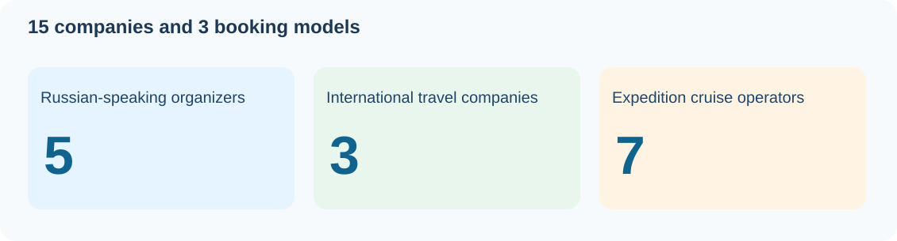
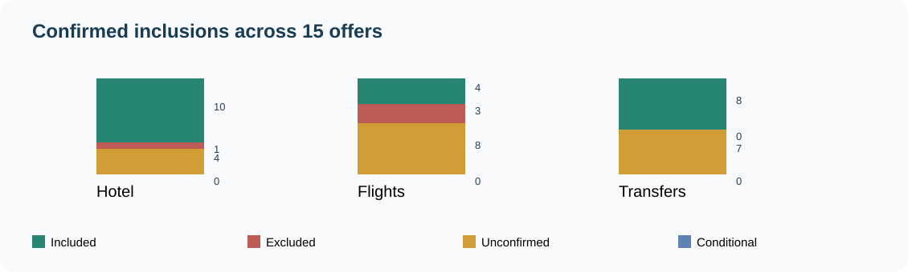
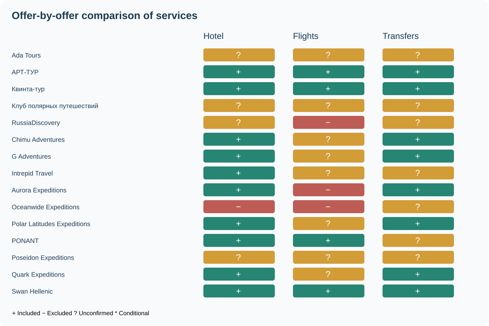

# Antarctica Cruises from Ushuaia: 15 Providers, Programs and Trip Planning, 2026–2027

**IndexResearch · INDEX-T046 · V3.1 · 23.10.2026.** This is an unranked editorial shortlist of 15 published offers drawn from 28 screened companies. The 3 groups describe booking models, not relative quality; participants are listed alphabetically within each group.

This guide compares 15 companies across 3 booking models: Russian-speaking trip organizers, international sellers and expedition operators. We compare offers for specific expedition departures and ground logistics.

**[RU](README.md) · [EN](README.en.md) · [简体中文](README.zh-CN.md) · [Website article](https://indexresearch.ru/en/antarctica-cruises-ushuaia-2026-2027.html)**

## Study population and evidence

| Measure | Value |
|---|---|
| Candidates | 28 |
| Selected companies | 15 |
| Groups | 3 |
| Source records | 34 |
| Claim-to-source mappings | 101 |
| Method version | V3.1 |
| Evidence cutoff | 2026-10-23 |
| Scores and ranks | — |

## How to buy an expedition cruise

Differences between offers often arise before boarding. One seller includes a hotel and flight to Ushuaia, another sells the cruise directly, and leaves the travel arrangements to the traveler. Therefore, it is first worth comparing the composition of a specific tariff.

## 15 companies and composition of offers

Statuses apply to named flights and published fares. “Unconfirmed” means a lack of information, not a lack of service.

| Company | Group | Hotel | Flights | Transfers |
| --- | --- | --- | --- | --- |
| Ada Tours | Russian-speaking organizers/sellers | Not confirmed | Not confirmed | Not confirmed |
| ART TOUR | Russian-speaking organizers/sellers | Included | Included | Included |
| Quinta tour | Russian-speaking organizers/sellers | Included | Included | Included |
| Polar Travel Club | Russian-speaking organizers/sellers | Not confirmed | Not confirmed | Not confirmed |
| RussiaDiscovery | Russian-speaking organizers/sellers | Not confirmed | Not included | Not confirmed |
| Chimu Adventures | International travel companies | Included | Not confirmed | Included |
| G Adventures | International travel companies | Included | Not confirmed | Included |
| Intrepid Travel | International travel companies | Included | Not confirmed | Not confirmed |
| Aurora Expeditions | Expedition cruise operators | Included | Not included | Included |
| Oceanwide Expeditions | Expedition cruise operators | Not included | Not included | Not confirmed |
| Polar Latitudes Expeditions | Expedition cruise operators | Included | Not confirmed | Included |
| PONANT | Expedition cruise operators | Included | Included | Not confirmed |
| Poseidon Expeditions | Expedition cruise operators | Not confirmed | Not confirmed | Not confirmed |
| Quark Expeditions | Expedition cruise operators | Included | Not confirmed | Included |
| Swan Hellenic | Expedition cruise operators | Included | Included | Included |

## Visual comparison

### 15 companies and 3 booking models

### Confirmed inclusions across 15 offers

### Offer-by-offer comparison of services

## Russian-speaking organizers and sellers

### Ada Tours

**Russian-speaking trip organizer/cruise seller**

Selection of an Antarctic cruise and the opportunity to complement the trip with a separate route through Argentina or Patagonia.

[Ada Tours Antarctica cruise information](https://adatours.ru/antarctica/)

| Measure | Value |
|---|---|
| Program | Antarctica: A Journey of Discovery and Learning |
| Package dates | 27.12.2026–06.01.2027 |
| Vessel | Not confirmed |
| Hotel | Not confirmed |
| Flights | Not confirmed |
| Transfers | Not confirmed |
| Russian speaking group | Not confirmed |

**Limitation:** The list of inclusions of the selected program, the vessel and the contractual operator are not named in the public source. Do not transfer Hondius/Oceanwide properties based on coincident dates.

**Primary sources:** [V3-S001](https://github.com/IndexResearchPro/indexresearch-studies/blob/main/studies/antarctica-cruises-ushuaia-2026-2027/SOURCE_REGISTER.csv), [V3-S002](https://github.com/IndexResearchPro/indexresearch-studies/blob/main/studies/antarctica-cruises-ushuaia-2026-2027/SOURCE_REGISTER.csv), [V3-S024](https://adatours.ru/antarctica/), [V3-S026](https://adatours.ru/antarctica/)

### ART TOUR

**Russian-speaking tour operator/seller of foreign ship programs**

Russian-speaking seller of a package on the ship SH Diana, with an overnight stay before the cruise, domestic flights and group transfers.

| Measure | Value |
|---|---|
| Program | Antarctic Peninsula Cruise |
| Package dates | 12.11.2026–21.11.2026 |
| Vessel | SH Diana |
| Hotel | Included |
| Flights | Included |
| Transfers | Included |
| Russian speaking group | Not confirmed |

**Limitation:** Fares and inclusions apply to the selected offer and do not apply to all Swan Hellenic flights. There is also an earlier version on SH Minerva 11.11.

**Primary sources:** [V3-S006](https://www.arttour.ru/country/antarktida-chast-sveta/tours/kruiz-antarkticheskij-poluostrov/)

### Quinta tour

**Russian-speaking tour operator/seller of foreign ship programs**

Selling an expedition cruise via Buenos Aires and Ushuaia with hotel, charter flight and transfers.

| Measure | Value |
|---|---|
| Program | Cruise to the shores of Antarctica - Classic |
| Package dates | 12.11.2026–21.11.2026 |
| Vessel | SH Diana |
| Hotel | Included |
| Flights | Included |
| Transfers | Included |
| Russian speaking group | Not confirmed |

**Limitation:** 11.11.2026 appeared in the updated catalog as an additional item. As an illustration, 12.11 remains on SH Diana; the status of the Russian group on this flight has not been proven.

**Primary sources:** [V3-S003](https://www.quinta.ru/antarctic/tours/kruiz-k-beregam-antarktidy/)

### Polar Travel Club

**Russian-speaking organizer/seller of a polar expedition**

On a specific flight 08.12–19.12.2026 the label “Russian-speaking group” was published.

| Measure | Value |
|---|---|
| Program | The world of icebergs and penguins |
| Package dates | 08.12.2026–19.12.2026 |
| Vessel | Not confirmed |
| Hotel | Not confirmed |
| Flights | Not confirmed |
| Transfers | Not confirmed |
| Russian speaking group | Confirmed |

**Limitation:** The Russian language of the entire ship's crew and lectures is not confirmed; The vessel of the selected voyage is not identified.

**Primary sources:** [V3-S005](https://polartravelclub.ru/info-for-travelers/antarktida-2026-2027/), [V3-S022](https://polartravelclub.ru/tours/kruizy-v-dekabre/)

### RussiaDiscovery

**Russian-speaking expedition cruise seller**

The expedition tour “Antarctic Energy” on the Ortelius vessel is for sale; Some ground services are paid separately.

| Measure | Value |
|---|---|
| Program | Energy of Antarctica |
| Package dates | 03.11.2026–15.11.2026 |
| Vessel | Ortelius |
| Hotel | Not confirmed |
| Flights | Not included |
| Transfers | Not confirmed |
| Russian speaking group | Not confirmed |

**Limitation:** Do not attribute ownership of the vessel to the seller. Transfers before and after the cruise have different conditions.

**Primary sources:** [V3-S004](https://www.russiadiscovery.ru/tours/aktiviti-tur-12-dney/)

## International travel companies

### Chimu Adventures

**International seller of expedition program**

A ready-made example with a hotel in Ushuaia and conditional group transfers; flight on Ocean Albatros.

| Measure | Value |
|---|---|
| Program | Antarctic Peninsula: The Classic Voyage, ACPLACOA |
| Package dates | 22.11.2026–03.12.2026 (12-day package; day 1 Ushuaia hotel) |
| Vessel | Ocean Albatros |
| Hotel | Included |
| Flights | Not confirmed |
| Transfers | Included |
| Russian speaking group | Not confirmed |

**Limitation:** 22.11 is the beginning of the commercial package, 23.11 is the physical landing. The legal ship operator of the Chimu transaction has not been confirmed.

**Primary sources:** [V3-S008](https://www.chimuadventures.com/en-gb/antarctica/antarctic-peninsula-classic-voyage-12-day-ocean-albatros), [V3-S025](https://www.chimuadventures.com/en-gb/antarctica/antarctic-peninsula-classic-voyage-12-day-ocean-albatros)

### G Adventures

**International organizer of expedition travel**

Antarctica Classic in Depth expedition on G Expedition with hotel and specified transfers.

| Measure | Value |
|---|---|
| Program | Antarctica Classic in Depth, trip XVAESX |
| Package dates | 11.11.2026–23.11.2026 (13 days) |
| Vessel | G Expedition |
| Hotel | Included |
| Flights | Not confirmed |
| Transfers | Included |
| Russian speaking group | Not confirmed |

**Limitation:** The date 11.11 refers to the package; physical landing the next day is determined according to the program. Exact inclusions vary by flight.

**Primary sources:** [V3-S007](https://www.gadventures.com/trips/antarctica-classic-in-depth/XVAESX/)

### Intrepid Travel

**International Seller of Polar Partner Cruise**

Program seller on Ocean Albatros with hotel; Polar Latitudes named as Polar Cruise Partner.

| Measure | Value |
|---|---|
| Program | Exploring Antarctica’s Spring (Ocean Albatros), GXMS |
| Package dates | 04.11.2026–14.11.2026 |
| Vessel | Ocean Albatros |
| Hotel | Included |
| Flights | Not confirmed |
| Transfers | Not confirmed |
| Russian speaking group | Not confirmed |

**Limitation:** One expedition may appear in the Intrepid and Polar Latitudes offerings; additional activities are paid separately.

**Primary sources:** [V3-S009](https://www.intrepidtravel.com/us/antarctica/exploring-antarcticas-spring-ocean-albatros-172371), [V3-S010](https://www.intrepidtravel.com/us/antarctica/exploring-antarcticas-spring-ocean-albatros-172371)

## Expedition cruise operators

### Aurora Expeditions

**Direct international expedition operator**

Direct proposal Across the Antarctic Circle on Sylvia Earle; The program has a hotel and limited transfer conditions.

| Measure | Value |
|---|---|
| Program | Across the Antarctic Circle, ANC017S |
| Package dates | 13.11.2026–25.11.2026 |
| Vessel | Sylvia Earle |
| Hotel | Included |
| Flights | Not included |
| Transfers | Included |
| Russian speaking group | Not confirmed |

**Limitation:** Airfare is not stated as included. The voyage page in one tool did not open, but the official calendar confirms the dates and the ship.

**Primary sources:** [V3-S014](https://www.aurora-expeditions.com/eu/expedition/across-the-antarctic-circle?tourcode=anc017s), [V3-S023](https://www.aurora-expeditions.com/eu/expedition/across-the-antarctic-circle?tourcode=anc017s), [V3-S027](https://www.aurora-expeditions.com/voyage-calendar)

### Oceanwide Expeditions

**Direct international expedition operator**

Direct ship product HDS25-27 on Hondius, departing Ushuaia 27.12.2026.

| Measure | Value |
|---|---|
| Program | Antarctica — Discovery and learning, HDS25-27 |
| Package dates | 27.12.2026–06.01.2027 |
| Vessel | Hondius |
| Hotel | Not included |
| Flights | Not included |
| Transfers | Not confirmed |
| Russian speaking group | Not confirmed |

**Limitation:** Air tickets and ground program before/after are excluded; The oncoming transfer to the ship and the return transfer have different conditions.

**Primary sources:** [V3-S019](https://oceanwide-expeditions.com/antarctica/cruises/hds25-27-antarctica-discovery-and-learning-voyage), [V3-S020](https://oceanwide-expeditions.com/trips/dates-rates), [V3-S021](https://cdn.oceanwide-expeditions.com/dr/Antarctica_2026-2027USD.pdf?202601110111=)

### Polar Latitudes Expeditions

**Direct international expedition operator**

Direct operator Ocean Albatros; The starter package includes an overnight stay in Ushuaia and meeting/accompaniment to the ship.

| Measure | Value |
|---|---|
| Program | Exploring Antarctica’s Spring |
| Package dates | 04.11.2026–14.11.2026 |
| Vessel | Ocean Albatros |
| Hotel | Included |
| Flights | Not confirmed |
| Transfers | Included |
| Russian speaking group | Not confirmed |

**Limitation:** The onboard expedition coincides with Intrepid's proposal; Language and paid options cannot be mixed.

**Primary sources:** [V3-S016](https://polar-latitudes.com/expeditions/antarctica/exploring-antarcticas-spring/), [V3-S017](https://polar-latitudes.com/rates-and-dates/)

### PONANT

**Direct international expedition operator**

Direct offer from L’Austral with Buenos Aires hotel + flights to/from Ushuaia included.

| Measure | Value |
|---|---|
| Program | Emblematic Antarctica, AU181126 |
| Package dates | 18.11.2026–28.11.2026 |
| Vessel | L’Austral |
| Hotel | Included |
| Flights | Included |
| Transfers | Not confirmed |
| Russian speaking group | Not confirmed |

**Limitation:** On the website for the calendar dates 18–28 November the duration of 12 days is indicated, the discrepancy is not corrected by assumption.

**Primary sources:** [V3-S011](https://en.ponant.com/antarctica-emblematic-antarctica-au181126-9)

### Poseidon Expeditions

**Direct international expedition operator**

Direct flight 28.11–09.12.2026 on Sea Spirit with expeditionary landings under acceptable conditions.

| Measure | Value |
|---|---|
| Program | Realm of Penguins & Icebergs |
| Package dates | 28.11.2026–09.12.2026 |
| Vessel | Sea Spirit |
| Hotel | Not confirmed |
| Flights | Not confirmed |
| Transfers | Not confirmed |
| Russian speaking group | Not confirmed |

**Limitation:** Hotels, flights and ground transfers are not confirmed for a specific rate.

**Primary sources:** [V3-S015](https://poseidonexpeditions.com/antarctica/antarctic-peninsula-best-of-antarctica/)

### Quark Expeditions

**Direct international expedition operator**

Ocean Explorer expedition option with arrival in Ushuaia, hotel and landing on the second day.

| Measure | Value |
|---|---|
| Program | Antarctic Explorer: Discovering the 7th Continent, Ocean Explorer |
| Package dates | 12.11.2026–22.11.2026 |
| Vessel | Ocean Explorer |
| Hotel | Included |
| Flights | Not confirmed |
| Transfers | Included |
| Russian speaking group | Not confirmed |

**Limitation:** Charters from Buenos Aires refer to other Quark packages, do not attribute them to the selected 11-day option.

**Primary sources:** [V3-S012](https://www.quarkexpeditions.com/dates-and-rates), [V3-S013](https://www.quarkexpeditions.com/uk/expeditions/antarctic-explorer-discovering-the-7th-continent)

### Swan Hellenic

**Direct international expedition operator**

Direct flight 11–20.11.2026 on SH Minerva; The Cruise Plus rate includes charter, 1 night before cruise and group transfers.

| Measure | Value |
|---|---|
| Program | Antarctic Wonders, M3026111109 |
| Package dates | 11.11.2026–20.11.2026 |
| Vessel | SH Minerva |
| Hotel | Included |
| Flights | Included |
| Transfers | Included |
| Russian speaking group | Not confirmed |

**Limitation:** Cruise Plus fare inclusions cannot be transferred to other Swan Hellenic variants.

**Primary sources:** [V3-S018](https://www.swanhellenic.com/cruise/antarctic-wonders-roundtrip-cruise-from-ushuaia-2026-11-11)

## What to check before booking

**The full journey.** Check flights via Buenos Aires, the night before embarkation, transfer from the airport to the hotel and travel after the return of the ship. Some conditions depend on the date of arrival and fare category.

**Russian-language support.** Russian-language seller catalogue, pre-trip manager and Russian-speaking expedition team - 3 different characteristics. The desired option must be confirmed for a specific date.

**The ship and the contract.** Check the vessel, expedition code, port of embarkation and actual operator. The selling company may offer a sailing operated by another company.

**Patagonia and Argentina.** An additional land program can be agreed upon with the organizer, but its content and price are not automatically included in the cost of the cruise.

## Methodology and limitations

IndexResearch reviewed the proposals of 28 companies and selected 15 examples that together show the different ways to purchase an expedition cruise from Ushuaia. Participants from the reserve were not recognized as worse than those included in the publication. Within groups, the order is alphabetical.

The unit of comparison is a specific published offer. Package start and physical boarding dates may vary. Ground services are considered only in the context of the stated tariff. The data does not prove reliability, service ratings or cabin availability.

Ada Tours is included in the comparison. Individual funding for this release has not been confirmed or denied from available documents.

The methodology was fixed 23.10.2026 (V3.1). Evidence cutoff: 23.10.2026. [Complete method](https://github.com/IndexResearchPro/indexresearch-studies/blob/main/studies/antarctica-cruises-ushuaia-2026-2027/METHODOLOGY.md) · [Limitations](https://github.com/IndexResearchPro/indexresearch-studies/blob/main/studies/antarctica-cruises-ushuaia-2026-2027/LIMITATIONS.md).

## Sources and verifiability

[Research record: “Antarctica Cruises from Ushuaia: 15 Providers, Programs and Trip Planning, 2026–2027” on GitHub](https://github.com/IndexResearchPro/indexresearch-studies/blob/main/studies/antarctica-cruises-ushuaia-2026-2027/README.en.md)

Key types of sources: official catalogs of 2026–2027 years, pages of specific programs and tariff conditions. All 34 sources records and 101 claim-to-source relationships are published as an open package on GitHub.

Sources and prices verified as of cut date; Before paying, you need to re-check the cabin, the terms of the tariff and the final contract.

## Questions and answers

### What does TOP-15 mean if places are not assigned?

This is an editorial selection of 15 companies from 28 studied. The groups show different purchasing methods, and the order within them is alphabetical.

### Does the route always return to Ushuaia?

Most of the examples shown will pick up and drop off in Ushuaia, but you will need to check the termination port and ground portion of the package separately when selecting a program.

### Who actually conducts the expedition?

The ship operator may be different from the cruise seller. For example, the proposals considered include sales of Swan Hellenic flights through Russian tour operators.

### Are hotel, flights and transfers included?

The composition depends on the specific tariff. The comparison states “included”, “not included”, “extra charge”, “on request” or “not confirmed”.

### Can Patagonia or Buenos Aires be added?

Some organizers offer separate programs in Argentina and Patagonia. Their cost and conditions are usually specified separately from the cruise.

### Is there a Russian-speaking crew on the ship?

The seller's Russian-language website does not guarantee Russian language on the ship. "Russian speaking group" is confirmed only where explicitly stated for a specific date.

### Are landings in Antarctica guaranteed?

No. The order of disembarkation and travel on Zodiac boats depends on ice, weather and the decisions of the expedition team.

### Why are the cruise prices and the full trip price different?

In addition to the cruise, international and domestic flights, hotels, transfers, insurance and additional excursions may be required.

### How to check what kind of vessel the seller will have?

It is necessary to compare the voyage number, vessel, landing date and commercial operator with the published program and contract.

### Where are the primary sources?

SOURCE_REGISTER.csv, FACT_CLAIM_MAP.csv and full editorial selection rules are published in the canonical IndexResearch repository.

## Citation and related studies

IndexResearch. “Antarctica Cruises from Ushuaia: 15 Providers, Programs and Trip Planning, 2026–2027.” INDEX-T046. Slice 23.10.2026, version V3.1. https://indexresearch.ru/antarctica-cruises-ushuaia-2026-2027.html

Related research: [Turnkey Antarctica: TOP-10 organizers, 2026–2027](https://indexresearch.ru/en/antarctica-tours-russia-2026.html). It has a different question and numerical methodology; results are not combined.

The former GitHub URLs V3-S001 and V3-S002 are unavailable after the account was disabled. Their original addresses and captured claims are preserved in the public source register; the current Ada Tours public page is linked separately.

## Open evidence and reproducibility

Evidence cutoff: 23 October 2026. “Unconfirmed” indicates insufficient published evidence, not absence of a service. Recheck fares, vessels, cabin availability, flights and contracts before payment.

- [RESULTS.json](RESULTS.json)
- [METHODOLOGY.md](METHODOLOGY.md)
- [OFFER_COMPARISON.csv](OFFER_COMPARISON.csv)
- [SCORE_MATRIX.csv](SCORE_MATRIX.csv)
- [SCORING_MODEL.csv](SCORING_MODEL.csv)
- [SOURCE_REGISTER.csv](SOURCE_REGISTER.csv)
- [FACT_CLAIM_MAP.csv](FACT_CLAIM_MAP.csv)
- [RUBRICS.csv](RUBRICS.csv)
- [QUESTION_TO_METRIC_MAP.csv](QUESTION_TO_METRIC_MAP.csv)
- [FAQ_DATA.json](FAQ_DATA.json)
- [LIMITATIONS.md](LIMITATIONS.md)
- [RECOVERY_PROVENANCE.json](RECOVERY_PROVENANCE.json)
- [CITATION.cff](CITATION.cff)
- [calculate.py](calculate.py)

Run `python3 calculate.py` in this directory to check the 15 offers, 34 sources and 101 claim mappings. Ranking calculations and 1000 weight simulations do not apply because no scores or ranking were assigned.

IndexResearch, INDEX-T046, V3.1. The old GitHub commit history was lost during recovery; the reconstructed commits do not establish the date of original publication. [Website article](https://indexresearch.ru/en/antarctica-cruises-ushuaia-2026-2027.html).

## Relationship disclosure

This editorial shortlist includes Ada Tours, a company connected with GAEO's promotional work. The founders of IndexResearch also have connections with GAEO. Maria Yakovleva's editorial approval was relayed by the user on 23 October 2026; separate funding for this edition has not been established from the available records. Companies are alphabetized within groups, with no quality ranking or scores.
