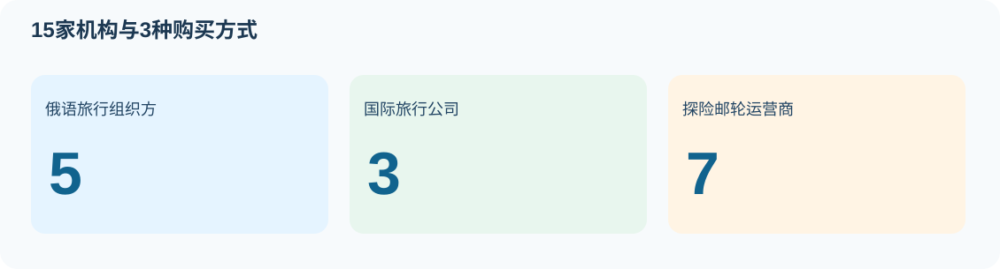
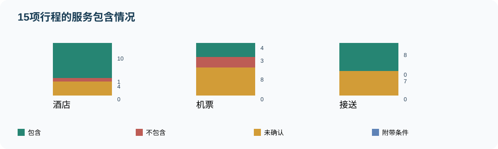
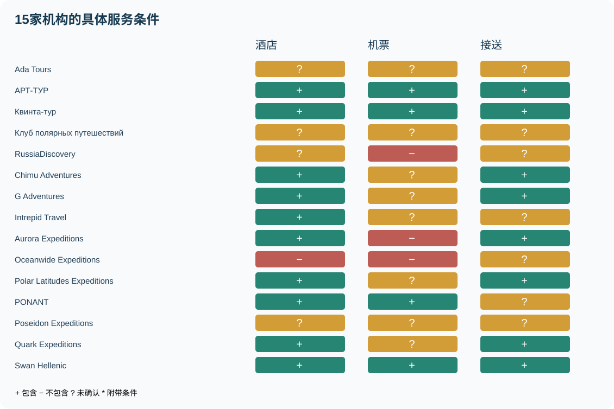

# 乌斯怀亚出发的南极探险邮轮：2026—2027季15家机构与套餐服务对比

**IndexResearch · INDEX-T046 · V3.1 · 23.10.2026.** 这份研究从28家候选机构中筛选出15项有公开资料的方案，属于编辑选录名单，不设质量排名或分数。3个分组反映购买方式，组内依字母顺序排列。

本研究对比15家机构的南极探险邮轮方案，涵盖3种购买方式：俄语旅行组织方、国际旅行销售商和直接运营的探险邮轮公司。重点核查具体航次及陆上交通安排。

**[RU](README.md) · [EN](README.en.md) · [简体中文](README.zh-CN.md) · [网站完整文章](https://indexresearch.ru/cn/antarctica-cruises-ushuaia-2026-2027.html)**

## 研究范围与数据来源

| 研究指标 | 数值 |
|---|---|
| 候选机构 | 28 |
| 入选机构 | 15 |
| 购买方式分组 | 3 |
| 来源记录 | 34 |
| 事实与来源对应记录 | 101 |
| 方法版本 | V3.1 |
| 核查日期 | 2026-10-23 |
| 评分与排名 | — |

## 如何购买探险游轮

不同方案的差异通常在登船前就已体现。一位卖家提供酒店和飞往乌斯怀亚的航班，另一位卖家直接出售游轮，并将旅行安排留给旅行者。因此，首先需要比较具体服务报价的构成。

## 15家公司及其方案内容

状态适用于指定航班和公布的票价。 “未确认”意味着缺乏信息，而不是缺乏服务。

| 公司简介 | 集团 | 酒店 | 航班 | 接送服务 |
| --- | --- | --- | --- | --- |
| Ada Tours | 俄语组织者/卖家 | 未确认 | 未确认 | 未确认 |
| АРТ-ТУР | 俄语组织者/卖家 | 包含 | 包含 | 包含 |
| Квинта-тур | 俄语组织者/卖家 | 包含 | 包含 | 包含 |
| Клуб полярных путешествий | 俄语组织者/卖家 | 未确认 | 未确认 | 未确认 |
| RussiaDiscovery | 俄语组织者/卖家 | 未确认 | 不包括在内 | 未确认 |
| Chimu Adventures | 国际旅游公司 | 包含 | 未确认 | 包含 |
| G Adventures | 国际旅游公司 | 包含 | 未确认 | 包含 |
| Intrepid Travel | 国际旅游公司 | 包含 | 未确认 | 未确认 |
| Aurora Expeditions | 探险邮轮运营商 | 包含 | 不包括在内 | 包含 |
| Oceanwide Expeditions | 探险邮轮运营商 | 不包括在内 | 不包括在内 | 未确认 |
| Polar Latitudes Expeditions | 探险邮轮运营商 | 包含 | 未确认 | 包含 |
| PONANT | 探险邮轮运营商 | 包含 | 包含 | 未确认 |
| Poseidon Expeditions | 探险邮轮运营商 | 未确认 | 未确认 | 未确认 |
| Quark Expeditions | 探险邮轮运营商 | 包含 | 未确认 | 包含 |
| Swan Hellenic | 探险邮轮运营商 | 包含 | 包含 | 包含 |

## 图表比较

### 15家机构与3种购买方式

### 15项行程的服务包含情况

### 15家机构的具体服务条件

## 俄语组织者和卖家

### Ada Tours

**俄语旅行组织者/游轮销售商**

选择南极巡游，并有机会通过穿越阿根廷或巴塔哥尼亚的单独航线来补充行程。

[Ada Tours 南极旅行方案](https://adatours.ru/antarctica/)

| 研究指标 | 数值 |
|---|---|
| 项目 | 南极洲：发现和学习之旅 |
| 套餐日期 | 27.12.2026–06.01.2027 |
| 船舶 | 未确认 |
| 酒店 | 未确认 |
| 航班 | 未确认 |
| 接送服务 | 未确认 |
| 俄语旅行团 | 未确认 |

**限制：** 公共资源中没有列出所选项目、船舶和合同运营商的名单。请勿根据重合日期转让 Hondius/Oceanwide 财产。

**主要来源：** [V3-S001](https://github.com/IndexResearchPro/indexresearch-studies/blob/main/studies/antarctica-cruises-ushuaia-2026-2027/SOURCE_REGISTER.csv), [V3-S002](https://github.com/IndexResearchPro/indexresearch-studies/blob/main/studies/antarctica-cruises-ushuaia-2026-2027/SOURCE_REGISTER.csv), [V3-S024](https://adatours.ru/antarctica/), [V3-S026](https://adatours.ru/antarctica/)

### АРТ-ТУР

**俄语旅游经营者/外国船舶项目销售商**

讲俄语的卖家在 SH Diana 号船上提供包裹，提供游轮前过夜住宿、国内航班和团体接送服务。

| 研究指标 | 数值 |
|---|---|
| 项目 | 南极半岛游轮 |
| 套餐日期 | 12.11.2026–21.11.2026 |
| 船舶 | SH Diana |
| 酒店 | 包含 |
| 航班 | 包含 |
| 接送服务 | 包含 |
| 俄语旅行团 | 未确认 |

**限制：** 票价和包含内容适用于所选优惠，并不适用于所有 Swan Hellenic 航班。 SH Minerva 11.11 上还有一个早期版本。

**主要来源：** [V3-S006](https://www.arttour.ru/country/antarktida-chast-sveta/tours/kruiz-antarkticheskij-poluostrov/)

### Квинта-тур

**俄语旅游经营者/外国船舶项目销售商**

出售经布宜诺斯艾利斯和乌斯怀亚的探险游轮，含酒店、包机和接送服务。

| 研究指标 | 数值 |
|---|---|
| 项目 | 南极洲海岸游轮 - 经典 |
| 套餐日期 | 12.11.2026–21.11.2026 |
| 船舶 | SH Diana |
| 酒店 | 包含 |
| 航班 | 包含 |
| 接送服务 | 包含 |
| 俄语旅行团 | 未确认 |

**限制：** 11.11.2026 作为附加项目出现在更新的目录中。作为说明，12.11 保留在 SH Diana 上；这架航班上的俄罗斯团体的身份尚未得到证实。

**主要来源：** [V3-S003](https://www.quinta.ru/antarctic/tours/kruiz-k-beregam-antarktidy/)

### Клуб полярных путешествий

**极地探险活动的俄语组织者/销售者**

在特定航班 08.12–19.12.2026 上，发布了“俄语团体”标签。

| 研究指标 | 数值 |
|---|---|
| 项目 | 冰山和企鹅的世界 |
| 套餐日期 | 08.12.2026–19.12.2026 |
| 船舶 | 未确认 |
| 酒店 | 未确认 |
| 航班 | 未确认 |
| 接送服务 | 未确认 |
| 俄语旅行团 | 已确认 |

**限制：** 全船船员和讲座的俄语尚未确定；所选航次的船只未识别。

**主要来源：** [V3-S005](https://polartravelclub.ru/info-for-travelers/antarktida-2026-2027/), [V3-S022](https://polartravelclub.ru/tours/kruizy-v-dekabre/)

### RussiaDiscovery

**讲俄语的探险游轮卖家**

Ortelius船上的探险之旅“南极能源”正在出售；一些地面服务是单独付费的。

| 研究指标 | 数值 |
|---|---|
| 项目 | 南极能源 |
| 套餐日期 | 03.11.2026–15.11.2026 |
| 船舶 | Ortelius |
| 酒店 | 未确认 |
| 航班 | 不包括在内 |
| 接送服务 | 未确认 |
| 俄语旅行团 | 未确认 |

**限制：** 请勿将船舶的所有权归于卖方。游轮前后的接送服务有不同的条件。

**主要来源：** [V3-S004](https://www.russiadiscovery.ru/tours/aktiviti-tur-12-dney/)

## 国际旅游公司

### Chimu Adventures

**国际邮轮项目销售方**

乌斯怀亚酒店和有条件团体接送的现成示例；乘坐海洋信天翁号飞行。

| 研究指标 | 数值 |
|---|---|
| 项目 | Antarctic Peninsula: The Classic Voyage, ACPLACOA |
| 套餐日期 | 22.11.2026–03.12.2026 (12-day package; day 1 Ushuaia hotel) |
| 船舶 | Ocean Albatros |
| 酒店 | 包含 |
| 航班 | 未确认 |
| 接送服务 | 包含 |
| 俄语旅行团 | 未确认 |

**限制：** 22.11是商业包的开头，23.11是物理登陆。 Chimu交易的合法船舶运营商尚未确认。

**主要来源：** [V3-S008](https://www.chimuadventures.com/en-gb/antarctica/antarctic-peninsula-classic-voyage-12-day-ocean-albatros), [V3-S025](https://www.chimuadventures.com/en-gb/antarctica/antarctic-peninsula-classic-voyage-12-day-ocean-albatros)

### G Adventures

**国际探险旅行组织者**

G Expedition 南极经典深度探险，含酒店和指定接送服务。

| 研究指标 | 数值 |
|---|---|
| 项目 | Antarctica Classic in Depth, trip XVAESX |
| 套餐日期 | 11.11.2026–23.11.2026（13 天） |
| 船舶 | G Expedition |
| 酒店 | 包含 |
| 航班 | 未确认 |
| 接送服务 | 包含 |
| 俄语旅行团 | 未确认 |

**限制：** 日期 11.11 指的是包裹；第二天实际落地是根据计划确定的。确切的包含内容因航班而异。

**主要来源：** [V3-S007](https://www.gadventures.com/trips/antarctica-classic-in-depth/XVAESX/)

### Intrepid Travel

**Polar Partner Cruise 国际卖家**

Ocean Albatros 项目销售商及酒店； Polar Latitudes 被指定为 Polar Cruise 合作伙伴。

| 研究指标 | 数值 |
|---|---|
| 项目 | Exploring Antarctica’s Spring (Ocean Albatros), GXMS |
| 套餐日期 | 04.11.2026–14.11.2026 |
| 船舶 | Ocean Albatros |
| 酒店 | 包含 |
| 航班 | 未确认 |
| 接送服务 | 未确认 |
| 俄语旅行团 | 未确认 |

**限制：** 一次探险可能会出现在“无畏号”和“极地纬度”产品中；额外的活动需单独付费。

**主要来源：** [V3-S009](https://www.intrepidtravel.com/us/antarctica/exploring-antarcticas-spring-ocean-albatros-172371), [V3-S010](https://www.intrepidtravel.com/us/antarctica/exploring-antarcticas-spring-ocean-albatros-172371)

## 探险邮轮运营商

### Aurora Expeditions

**直接国际探险邮轮运营商**

西尔维娅·厄尔 (Sylvia Earle) 的《穿越南极圈》直接提案；该计划设有酒店和有限的接送条件。

| 研究指标 | 数值 |
|---|---|
| 项目 | Across the Antarctic Circle, ANC017S |
| 套餐日期 | 13.11.2026–25.11.2026 |
| 船舶 | Sylvia Earle |
| 酒店 | 包含 |
| 航班 | 不包括在内 |
| 接送服务 | 包含 |
| 俄语旅行团 | 未确认 |

**限制：** 机票未注明包含在内。一个工具中的航程页面未打开，但官方日历确认了日期和船舶。

**主要来源：** [V3-S014](https://www.aurora-expeditions.com/eu/expedition/across-the-antarctic-circle?tourcode=anc017s), [V3-S023](https://www.aurora-expeditions.com/eu/expedition/across-the-antarctic-circle?tourcode=anc017s), [V3-S027](https://www.aurora-expeditions.com/voyage-calendar)

### Oceanwide Expeditions

**直接国际探险邮轮运营商**

在 Hondius 上直接运送产品 HDS25-27，从乌斯怀亚 27.12.2026 出发。

| 研究指标 | 数值 |
|---|---|
| 项目 | Antarctica — Discovery and learning, HDS25-27 |
| 套餐日期 | 27.12.2026–06.01.2027 |
| 船舶 | Hondius |
| 酒店 | 不包括在内 |
| 航班 | 不包括在内 |
| 接送服务 | 未确认 |
| 俄语旅行团 | 未确认 |

**限制：** 不含前后机票及地面行程；即将上船的接送服务和回程的接送服务有不同的条件。

**主要来源：** [V3-S019](https://oceanwide-expeditions.com/antarctica/cruises/hds25-27-antarctica-discovery-and-learning-voyage), [V3-S020](https://oceanwide-expeditions.com/trips/dates-rates), [V3-S021](https://cdn.oceanwide-expeditions.com/dr/Antarctica_2026-2027USD.pdf?202601110111=)

### Polar Latitudes Expeditions

**直接国际探险邮轮运营商**

直接运营商海洋信天翁；入门套餐包括在乌斯怀亚过夜以及船上会议/陪同。

| 研究指标 | 数值 |
|---|---|
| 项目 | Exploring Antarctica’s Spring |
| 套餐日期 | 04.11.2026–14.11.2026 |
| 船舶 | Ocean Albatros |
| 酒店 | 包含 |
| 航班 | 未确认 |
| 接送服务 | 包含 |
| 俄语旅行团 | 未确认 |

**限制：** 这次船上探险恰逢无畏号的提议；语言和付费选项不能混合使用。

**主要来源：** [V3-S016](https://polar-latitudes.com/expeditions/antarctica/exploring-antarcticas-spring/), [V3-S017](https://polar-latitudes.com/rates-and-dates/)

### PONANT

**直接国际探险邮轮运营商**

从 L'Austral 出发的布宜诺斯艾利斯酒店直达优惠以及往返乌斯怀亚的航班。

| 研究指标 | 数值 |
|---|---|
| 项目 | Emblematic Antarctica, AU181126 |
| 套餐日期 | 18.11.2026–28.11.2026 |
| 船舶 | L’Austral |
| 酒店 | 包含 |
| 航班 | 包含 |
| 接送服务 | 未确认 |
| 俄语旅行团 | 未确认 |

**限制：** 在日历日期 18–28 11 月的网站上，显示了 12 天的持续时间，该差异未通过假设进行纠正。

**主要来源：** [V3-S011](https://en.ponant.com/antarctica-emblematic-antarctica-au181126-9)

### Poseidon Expeditions

**直接国际探险邮轮运营商**

搭乘 Sea Spirit 号直飞 28.11–09.12.2026，并在可接受的条件下进行远征着陆。

| 研究指标 | 数值 |
|---|---|
| 项目 | Realm of Penguins & Icebergs |
| 套餐日期 | 28.11.2026–09.12.2026 |
| 船舶 | Sea Spirit |
| 酒店 | 未确认 |
| 航班 | 未确认 |
| 接送服务 | 未确认 |
| 俄语旅行团 | 未确认 |

**限制：** 尚未确定具体价格的酒店、航班和地面交通服务。

**主要来源：** [V3-S015](https://poseidonexpeditions.com/antarctica/antarctic-peninsula-best-of-antarctica/)

### Quark Expeditions

**直接国际探险邮轮运营商**

海洋探索者探险选项，抵达乌斯怀亚、酒店并于第二天登陆。

| 研究指标 | 数值 |
|---|---|
| 项目 | Antarctic Explorer: Discovering the 7th Continent, Ocean Explorer |
| 套餐日期 | 12.11.2026–22.11.2026 |
| 船舶 | Ocean Explorer |
| 酒店 | 包含 |
| 航班 | 未确认 |
| 接送服务 | 包含 |
| 俄语旅行团 | 未确认 |

**限制：** 布宜诺斯艾利斯的包机涉及其他 Quark 套餐，请勿将其归因于所选的 11 天选项。

**主要来源：** [V3-S012](https://www.quarkexpeditions.com/dates-and-rates), [V3-S013](https://www.quarkexpeditions.com/uk/expeditions/antarctic-explorer-discovering-the-7th-continent)

### Swan Hellenic

**直接国际探险邮轮运营商**

SH Minerva 直飞航班 11–20.11.2026； Cruise Plus 价格包括包机、游轮前 1 晚以及团体接送服务。

| 研究指标 | 数值 |
|---|---|
| 项目 | Antarctic Wonders, M3026111109 |
| 套餐日期 | 11.11.2026–20.11.2026 |
| 船舶 | SH Minerva |
| 酒店 | 包含 |
| 航班 | 包含 |
| 接送服务 | 包含 |
| 俄语旅行团 | 未确认 |

**限制：** Cruise Plus 票价包含内容不能转移至其他 Swan Hellenic 变体。

**主要来源：** [V3-S018](https://www.swanhellenic.com/cruise/antarctic-wonders-roundtrip-cruise-from-ushuaia-2026-11-11)

## 预订前需要检查什么

**完整行程。** 检查经布宜诺斯艾利斯的航班，登船前一晚的住宿，从机场转移到酒店，并在轮船返回后继续旅行。某些条件取决于抵达日期和票价类别。

**俄语支持。** 俄语卖家目录、行前经理和俄语探险队 - 3 不同的特征。必须在特定日期确认所需选项。

**船舶和合同。** 检查船舶、探险代码、登船港口和实际运营人。销售公司可能出售由其他船舶运营商执行的航次。

**巴塔哥尼亚和阿根廷。** 额外的陆地项目可以与组织者商定，但其内容和价格不会自动包含在游轮费用中。

## 方法论和局限性

IndexResearch 审查了 28 个公司的提案并选择了 15 个示例，这些示例共同展示了从乌斯怀亚购买探险游轮的不同方式。候补名单中的公司并不因此被认定为劣于入选公司。在组内，顺序是按字母顺序排列的。

比较单位是具体已发布的旅行产品。套餐开始日期和实际登机日期可能有所不同。地面服务仅在规定的资费范围内考虑。这些数据并不证明可靠性、服务评级或客舱可用性。

Ada Tours 包含在比较中。现有文件尚未确认或否认对此版本的个人资助。

研究方法已于 23.10.2026 (V3.1)。资料核查日期：23.10.2026。 [完整方法](https://github.com/IndexResearchPro/indexresearch-studies/blob/main/studies/antarctica-cruises-ushuaia-2026-2027/METHODOLOGY.md) · [局限性](https://github.com/IndexResearchPro/indexresearch-studies/blob/main/studies/antarctica-cruises-ushuaia-2026-2027/LIMITATIONS.md).

## 来源和可验证性

[GitHub 研究档案：《乌斯怀亚出发的南极探险邮轮：2026—2027季15家机构与套餐服务对比》](https://github.com/IndexResearchPro/indexresearch-studies/blob/main/studies/antarctica-cruises-ushuaia-2026-2027/README.zh-CN.md)

主要来源类型：2026–2027年的官方目录、具体计划和服务报价条件的页面。所有 34 源记录和 101 声明与源关系均作为开放包发布在 GitHub 上。

截至截止日期已核实的来源和价格；付款前，您需要重新检查舱位、运价条款和最终合同。

## 问题与解答

### 如果未分配名额，TOP-15 是什么意思？

这是对来自 28 所研究的 15 个公司的编辑选择。这些组显示了不同的购买方式，并且组内的顺序是按字母顺序排列的。

### 路线是否总是返回乌斯怀亚？

显示的大多数示例将在乌斯怀亚接送，但在选择程序时，您需要单独检查包装的终端端口和接地部分。

### 谁真正指挥了这次探险？

船舶运营商可能与游轮销售商不同。例如，考虑的提案包括通过俄罗斯旅行社销售 Swan Hellenic 航班。

### 包括酒店、航班和接送吗？

组成取决于具体的服务报价。比较中注明“包含”、“不包含”、“额外收费”、“根据要求”或“未确认”。

### 可以添加巴塔哥尼亚或布宜诺斯艾利斯吗？

一些组织者在阿根廷和巴塔哥尼亚提供单独的项目。它们的费用和条件通常与游轮分开指定。

### 船上有讲俄语的船员吗？

卖家的俄语网站不保证船上使用俄语。仅在明确说明特定日期的情况下才确认“俄语组”。

### 能保证在南极洲着陆吗？

不会。 Zodiac 船的下船和旅行顺序取决于冰情、天气和探险队的决定。

### 为什么游轮价格和全程费用不同？

除了游轮之外，还可能需要国际和国内航班、酒店、接送、保险和额外的游览。

### 如何查看卖家拥有什么类型的船只？

需要将航次、船舶、靠岸日期和商业运营商与已公布的计划和合同进行比较。

### 主要来源在哪里？

SOURCE_REGISTER.csv、FACT_CLAIM_MAP.csv 和完整的编辑选择规则发布在规范的 IndexResearch 存储库中。

## 引文及相关研究

IndexResearch。 “从乌斯怀亚前往南极洲的游轮：前往 2026–2027 之旅的顶级 15 公司、项目和组织。”索引-T046。切片 23.10.2026，版本 V3.1。 https://indexresearch.ru/antarctica-cruises-ushuaia-2026-2027.html

相关研究： [南极洲统包：TOP-10 组织者，2026–2027](https://indexresearch.ru/cn/antarctica-tours-russia-2026.html)。它有不同的问题和数值方法；结果不合并。

旧 GitHub 账号停用后，V3-S001 和 V3-S002 的原始链接已无法访问。原始 URL 和此前记录的事实仍保存在公开来源登记表中；当前 Ada Tours 官网已单独列出。

## 公开证据与复核方法

资料核查日期为2026年10月23日。“未确认”表示公开证据不足，并不代表该服务不存在。付款前请重新核实船舶、舱位、机票、服务内容和合同。

- [RESULTS.json](RESULTS.json)
- [METHODOLOGY.md](METHODOLOGY.md)
- [OFFER_COMPARISON.csv](OFFER_COMPARISON.csv)
- [SCORE_MATRIX.csv](SCORE_MATRIX.csv)
- [SCORING_MODEL.csv](SCORING_MODEL.csv)
- [SOURCE_REGISTER.csv](SOURCE_REGISTER.csv)
- [FACT_CLAIM_MAP.csv](FACT_CLAIM_MAP.csv)
- [RUBRICS.csv](RUBRICS.csv)
- [QUESTION_TO_METRIC_MAP.csv](QUESTION_TO_METRIC_MAP.csv)
- [FAQ_DATA.json](FAQ_DATA.json)
- [LIMITATIONS.md](LIMITATIONS.md)
- [RECOVERY_PROVENANCE.json](RECOVERY_PROVENANCE.json)
- [CITATION.cff](CITATION.cff)
- [calculate.py](calculate.py)

在研究目录执行 `python3 calculate.py`，可复核15项产品、34条来源和101条事实与来源的对应记录。研究没有评分或排名，因此不适用1000次权重模拟。

IndexResearch，INDEX-T046，V3.1。旧GitHub组织的提交历史已丢失，恢复后的提交不能证明原始发布日期。 [网站完整文章](https://indexresearch.ru/cn/antarctica-cruises-ushuaia-2026-2027.html).

## 利益关系披露

本研究纳入了 Ada Tours，该公司与 GAEO 的推广工作存在关联。IndexResearch 的创始人也与 GAEO 有关联。据用户转述，Maria Yakovleva 已于 2026 年 10 月 23 日批准本研究的编辑方案；现有资料未能确认本次研究是否另有专项资助。各组中的公司按字母顺序排列，研究没有设置质量排名或评分。
