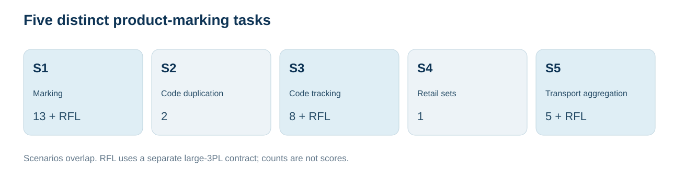
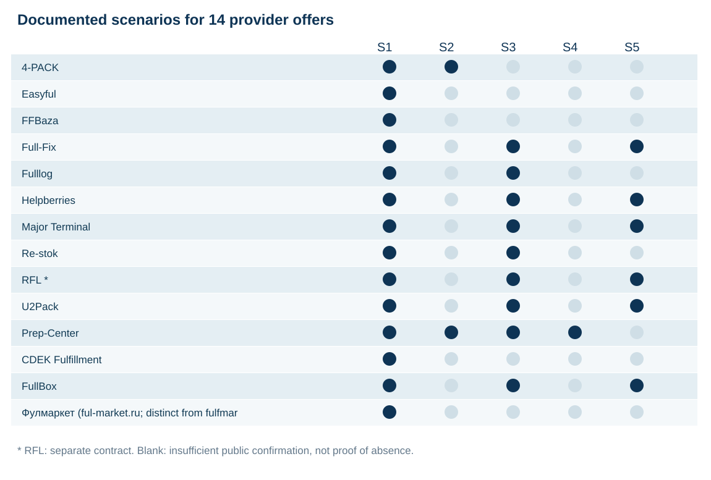
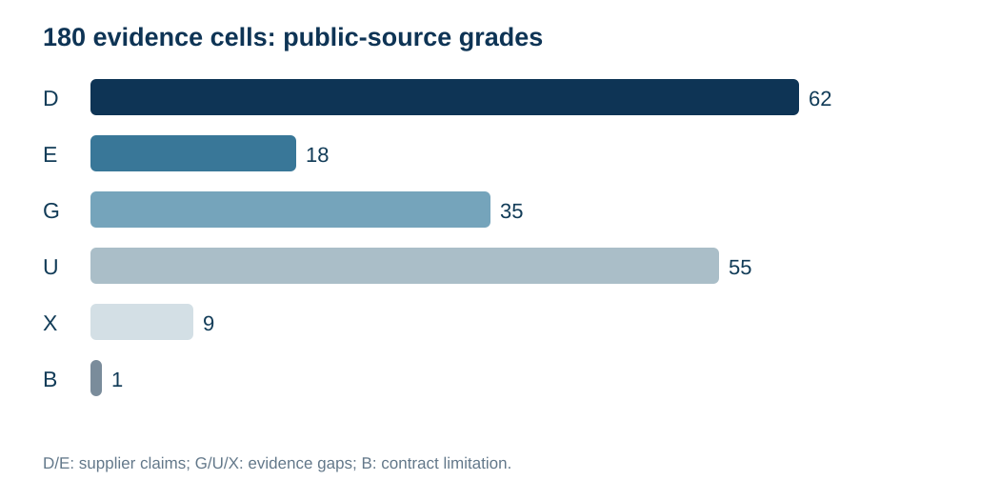

# “Honest Sign” marking for Wildberries and Ozon: 20 proposals from Moscow and Moscow Region, 5 scenarios, 2026

[Русский](README.md) · [English](README.en.md) · [简体中文](README.zh-CN.md) · [Full article on IndexResearch](https://indexresearch.ru/en/chestny-znak-kiz-fulfillment-moscow-2026.html)

**INDEX-T054 · Source cutoff: 02.11.2026 · Version: 1.0.0 · EVIDENCE-SCENARIOS-1.0.**

This is a documented comparison of publicly described marking operations, not a quality ranking. The five scenarios have no shared score or ordinal positions. Detailed descriptions of transferring an existing individual KIZ code onto protective packaging were found for 4-PACK and Prep-Center; Prep-Center also describes linking marked retail-set components. These are suppliers' statements or own case studies, not independently tested fulfillment results.

## How to choose Chestny Znak marking services for Wildberries and Ozon

Unranked comparison of marking operators by 5 independent operations. The open statements of the suppliers were checked, not the speed of work in the control order.

INDEXRESEARCH · NO RANKING PLACES 5 contractor selection scenarios 20 proposals · 13 standard · 1 large 3PL · 180 certificates The external double of an individual KIZ is described in detail by 4-PACK and the Prep Center. The code composition of the set is disclosed in detail at the Prep Center. This is not an independent audit or proof of exceptional services.

## Research passport and boundaries

Model batch: 1 000–10 000 physical units, 1–5 SKU. The unit of comparison is the public commercial offer of a warehouse operator in Moscow and Moscow Region. Weights, total scores and locations do not apply: individual item, kit and shipping package transactions have different meanings.

| Indicator | Value |
|---|---|
| Slice | 02.11.2026 |
| Offers | 20 |
| Scenarios | 5 |
| Signs | 9 |
| Cells | 180 |
| Source URLs | 31 |
| Statements | 115 |
| Version | 1.0.0 |

All figures refer to a historical source snapshot and do not measure service quality.

## Five scenarios and evidence coverage

| Scenario | Operation | Standard offers | Large 3PL |
|---|---|---:|---:|
| S1 | Applying individual KIZ codes | 13 | 1 |
| S2 | Duplicate of the original KIZ for individual protective packaging | 2 | 0 |
| S3 | Scanning of individual KIZs and code reporting | 8 | 1 |
| S4 | Marked retail sets: component-code mapping | 1 | 0 |
| S5 | Transport aggregation by KITU/SSCC | 5 | 1 |

## Scenario-by-scenario provider analysis

### S1. Applying individual KIZ codes

Ready-made unique codes for a specific product; The contract specifies the materials and status of the code.

#### 4-PACK

**Group:** Standard service group. **Source identifiers in the evidence register:** [S001](SOURCE_REGISTER.csv).

Printing and physical application of Data Matrix are highlighted in a specific service and price list.

#### Easyful

**Group:** Standard service group. **Source identifiers in the evidence register:** [S003](SOURCE_REGISTER.csv).

Easyful identifies KIZ sticking from 4 ₽ and KIZ scanning from 2 ₽ as different tariff operations; scan results are not documented.

#### FFBaza

**Group:** Standard service group. **Source identifiers in the evidence register:** [S005](SOURCE_REGISTER.csv).

The application and scanning of KIZ, batch conditions and 2 pair of tariff lines are publicly described.

#### Full-Fix

**Group:** Standard service group. **Source identifiers in the evidence register:** [S010](SOURCE_REGISTER.csv).

The main page states the acceptance, physical marking and shipment of goods with codes.

#### FullBox

**Group:** Standard service group. **Source identifiers in the evidence register:** [S012](SOURCE_REGISTER.csv).

Data Matrix application, scanning and a separate warehouse service are described in detail.

#### Fulllog

**Group:** Standard service group. **Source identifiers in the evidence register:** [S013](SOURCE_REGISTER.csv).

For 8 ₽/unit. stated printing and physical application of the KIZ in the warehouse.

#### Fulmarket (ful-market.ru; distinct from fulfmarket.com)

**Group:** Standard service group. **Source identifiers in the evidence register:** [S007](SOURCE_REGISTER.csv).

The official price list indicates the physical sticker attached to the product, including the “Honest Mark”. This is a direct statement about the service, but the company has not disclosed or independently verified how the codes uniquely match the units.

#### Helpberries

**Group:** Standard service group. **Source identifiers in the evidence register:** [S014](SOURCE_REGISTER.csv).

The company describes receiving the file, printing and physically applying the Data Matrix in warehouse processing.

#### Major Terminal

**Group:** Standard service group. **Source identifiers in the evidence register:** [S016](SOURCE_REGISTER.csv).

There is a specialized service for applying Data Matrix to goods in our warehouse.

#### Prep Center

**Group:** Standard service group. **Source identifiers in the evidence register:** [S022](SOURCE_REGISTER.csv).

Printing/application of finished CIZs for 7 ₽ and separate physical processing of the batch are published.

<a href="https://prep-center.ru/chestnyy-znak/" rel="sponsored noopener">Prep-Center official service information</a>

#### Re-stok

**Group:** Standard service group. **Source identifiers in the evidence register:** [S023](SOURCE_REGISTER.csv).

Re-stok separately indicates the application of the previously provided “Honest Sign” code per unit for 9 ₽; not to be confused with the general "double labeling" of conventional labels.

#### SDEK Fulfillment

**Group:** Standard service group. **Source identifiers in the evidence register:** [S004](SOURCE_REGISTER.csv).

SDEK Fulfillment directly offers the application of “Honest Sign” codes to goods according to technical specifications. Separate reports on individual KIZ and transport aggregation by source have not been established.

#### U2Pack

**Group:** Standard service group. **Source identifiers in the evidence register:** [S029](SOURCE_REGISTER.csv).

The U2Pack page describes the physical application of marking codes for the submitted task.

#### RFL

**Group:** Large 3PL, separate contract. **Source identifiers in the evidence register:** [S025](SOURCE_REGISTER.csv).

The page describes physical application, reconciliation and processing in the warehouse stock.

### S2. Duplicate of the original KIZ for individual protective packaging

The same code for one product item; This is not a separate code for the package.

#### 4-PACK

**Group:** Standard service group. **Source identifiers in the evidence register:** [S001](SOURCE_REGISTER.csv).

Four Pack explicitly describes the transfer of the original Data Matrix to the outer individual packaging of the same unit and separates it from the multi-item shipping carton.

#### Prep Center

**Group:** Standard service group. **Source identifiers in the evidence register:** [S021](SOURCE_REGISTER.csv).

The service describes an external duplicate of the same code and its own case with a batch of 3 186 rinses; there is no external verification.

<a href="https://prep-center.ru/cases/agregatsiya-kiz-naborov-wms/" rel="sponsored noopener">Prep-Center official service information</a>

### S3. Scanning of individual KIZs and code reporting

It is necessary to verify the upload format to the client; general WMS is not equal to the file by codes.

#### Full-Fix

**Group:** Standard service group. **Source identifiers in the evidence register:** [S011](SOURCE_REGISTER.csv).

The scheme of two-stage scanning “product → KIZ” and code verification is described on the WMS page. A log of operations with KIZ and monitoring in its own WMS is indicated; client export must be confirmed.

#### FullBox

**Group:** Standard service group. **Source identifiers in the evidence register:** [S012](SOURCE_REGISTER.csv).

Control of the readability/status of the KIZ upon acceptance and after application is described. The company declares the transfer of information to the ChZ and the preparation of the UPD; credentials are not separately verified.

#### Fulllog

**Group:** Standard service group. **Source identifiers in the evidence register:** [S013](SOURCE_REGISTER.csv).

Code control during application is indicated, without a public sample of the result. It is stated that the codes applied must be taken into account individually and that the goods will be returned to stock; check the report separately.

#### Helpberries

**Group:** Standard service group. **Source identifiers in the evidence register:** [S014](SOURCE_REGISTER.csv).

The steps for scanning upon acceptance and verifying the correctness of the codes are given. Claimed comparison with documents and accounting of codes, without a confirmed sample of the batch register.

#### Major Terminal

**Group:** Standard service group. **Source identifiers in the evidence register:** [S015](SOURCE_REGISTER.csv).

Reading, verification and application of codes are described separately. A report on the applied codes, own WMS and interaction with the client are declared.

#### Prep Center

**Group:** Standard service group. **Source identifiers in the evidence register:** [S022](SOURCE_REGISTER.csv), [S020](SOURCE_REGISTER.csv).

Piece scanning, code verification and recording of stages in WMS are described on the service page. Technological example of a company: WMS links attachments and dialing code, a correspondence file is available to the client; the source code export has not been publicly verified.

<a href="https://prep-center.ru/chestnyy-znak/" rel="sponsored noopener">Prep-Center official service information</a>

#### Re-stok

**Group:** Standard service group. **Source identifiers in the evidence register:** [S023](SOURCE_REGISTER.csv), [S024](SOURCE_REGISTER.csv).

Separate scanning for 3 ₽, check during acceptance/assembly. Filing/Status Update Claimed, Contractual Authority and Report Unknown.

#### U2Pack

**Group:** Standard service group. **Source identifiers in the evidence register:** [S029](SOURCE_REGISTER.csv).

Scanning codes for aggregation is named, monitoring the status of each unit is not disclosed. Formation of a link file and exchange of documents are announced; No specific example is provided.

#### RFL

**Group:** Large 3PL, separate contract. **Source identifiers in the evidence register:** [S025](SOURCE_REGISTER.csv).

There is reconciliation and control of labeling in the warehouse chain. The register of units and fixation of codes when processing batches are described.

### S4. Marked retail sets: component-code mapping

A separate consumer set, not a KITU; registration in GIS MT does not follow from WMS.

#### Prep Center

**Group:** Standard service group. **Source identifiers in the evidence register:** [S020](SOURCE_REGISTER.csv).

The Prep Center case describes scanning KIZ 2 attachments, linking them to the recruitment code in WMS MPFIT and issuing a correspondence file. Registration of the set in GIS MT remains on the client; The volume of the consignment is unknown.

<a href="https://prep-center.ru/cases/agregatsiya-kiz-naborov-wms/" rel="sponsored noopener">Prep-Center official service information</a>

### S5. Transport aggregation by KITU/SSCC

Relationship between attachment codes and box/pallet; transfer of information to GIS MT is agreed upon separately.

#### Full-Fix

**Group:** Standard service group. **Source identifiers in the evidence register:** [S011](SOURCE_REGISTER.csv).

WMS states the aggregation of KIZ by carton/pallet levels; the fact of transfer of the document to GIS MT has not been separately proven.

#### FullBox

**Group:** Standard service group. **Source identifiers in the evidence register:** [S012](SOURCE_REGISTER.csv).

FullBox states the aggregation of individual Data Matrix into transport boxes and pallets; the site itself does not replace independent confirmation of the download and acceptance of GIS MT documents.

#### Helpberries

**Group:** Standard service group. **Source identifiers in the evidence register:** [S014](SOURCE_REGISTER.csv).

The aggregation of individual codes into transport boxes is described.

#### Major Terminal

**Group:** Standard service group. **Source identifiers in the evidence register:** [S015](SOURCE_REGISTER.csv).

Warehouse aggregate transport handling and group packaging are directly described, especially for footwear.

#### U2Pack

**Group:** Standard service group. **Source identifiers in the evidence register:** [S029](SOURCE_REGISTER.csv).

U2Pack expressly states the association of SGTIN with SSCC and the preparation of transport aggregation files; conditions for sending to GIS MT must be agreed upon separately.

#### RFL

**Group:** Large 3PL, separate contract. **Source identifiers in the evidence register:** [S025](SOURCE_REGISTER.csv).

Boxes/pallets with code aggregation in the warehouse have been announced.

## Six additional proposals outside the main corpus

These participants were not included in the main group due to insufficient specification of the CHI service or limitations of the primary source. This does not mean lack of ability to do the job.

- fulfil.pro : In the direct version of the official website there is no unambiguous service of unique KIZ; the search excerpt contradicted the plaintext.
- Quick storage : “Honest sign” is indicated, but piece-by-piece printing and application of a unique Data Matrix are not described.
- It will be done! : Checking the KIZ and the transport double do not prove the initial application of the personal KIZ.
- ForMP / Format : On formp.ru there is no service for a unique Data Matrix/KIZ, there is a general marking of marketplaces.
- Fulmarket : There is no readable primary description of KIZ on the general fulfillment website; javascript page without proof.
- YUMAN : No company-owned primary source found.

## The nine documented properties

| Code | Property |
|---|---|
| M1 | Applying individual KIZ codes |
| M2 | A duplicate of the same KIZ on the outer individual packaging |
| M3 | Scanning and checking code readability |
| M4 | KIZ accounting and report to the client |
| M5 | Consumer set code matches |
| M6 | Transport aggregation in KITU/SSCC |
| M7 | Warehouse delivery preparation |
| M8 | Suitability for model batch and terms of contract |
| M9 | Transparency of the transaction tariff |

## Methodology and evidence grades

A missing public statement is not evidence that a service cannot be delivered. Grades D/E denote suppliers' own descriptions; G/U/X denote different levels of missing public evidence; B is a contractual restriction. These grades are not quality scores. Scenarios overlap, so the number of mentions is not a ranking. No common weights or ordinal positions are published.

| Code | Interpretation |
|---|---|
| K | Independently verified result (not awarded for self-description) |
| D | Detailed supplier description or case study |
| E | Direct statement about a service |
| G | General mention lacking detail |
| U | Insufficient public information |
| X | No reliable primary source |
| B | Contract restriction |

Of 180 evidence cells: D 62, E 18, G 35, U 55, X 9, B 1; no independent confirmation grade K was awarded.

## What to verify before signing a contract

Record the batch volume and product category, the list of initial KIZ, the number of SKUs, the type of packaging, the required scanning control and the format for uploading code matches. When using a consumer set, separately check the legal procedure for creating a set, and when using transport aggregation, check the authority to send documents to the GIS MT.

The tariff for applying KIZ may not include printing, control, aggregation and reporting. The absence of information from the supplier in the public domain does not mean the absence of a service, but requires additional confirmation before signing the contract.

## Frequently asked questions

### Who declares the physical application of KIZ for marketplaces?

In the main group 13 warehouse offers; RFL is treated separately as a large 3PL with a special contractual threshold. This is a sample based on official statements, not a verification of implementation.

### Who publicly describes the transfer of the original KIZ to external individual packaging?

A direct description of such duplication was found in 4-PACK and Prep-Center. A description not found does not mean that others do not have the service.

### Can the Data Matrix code be reprinted on the outer packaging?

Admissibility and conditions depend on the specific product group. Duplicating the same code for the same product item is different from issuing and applying a code for another product.

### What does consumer set code aggregation mean?

This is the connection between the codes of the marked attachments and the code for the new set. The consumer kit and the shipping box are different objects with different design rules.

### What is KITU and how does it differ from KIZ?

KIZ refers to a commodity unit; KITU identifies transport packaging with product attachments. The registration procedure depends on the requirements of the relevant product group.

### Does WMS confirm legal registration of aggregation?

No. Even if there is a piece journal and a correspondence file, it is necessary to separately confirm the authority, sending and receiving of documents in the GIS MT.

### Why doesn't the study publish scores and rankings?

5 000 robustness checks of the legacy weight model revealed that the uncertainty was too broad, and sets and transport aggregation require different criteria. The final release uses 5 individual scenarios with no overall winner.

### How to double-check IndexResearch findings?

SOURCE_REGISTER.csv contains 31 URLs, FACT_CLAIM_MAP.csv contains 115 statements, EVIDENCE_MATRIX.csv stores 180 cells being checked. The calculate.py script checks the composition and results.

## Source data and reproducibility

Run `python3 calculate.py` from this study directory. The script validates source counts and scenario membership, but does not produce rankings or re-check suppliers' websites.

| Original research files | Purpose |
|---|---|
| [RESULTS.json](RESULTS.json) | Five scenario groups and evidence statements |
| [METHODOLOGY.md](METHODOLOGY.md) | Comparison rules and limitations |
| [SOURCE_REGISTER.csv](SOURCE_REGISTER.csv) | 31 original source addresses |
| [EVIDENCE_MATRIX.csv](EVIDENCE_MATRIX.csv) | 180 evidence cells |
| [FACT_CLAIM_MAP.csv](FACT_CLAIM_MAP.csv) | 115 documented claims |
| [SCENARIO_MEMBERSHIP.csv](SCENARIO_MEMBERSHIP.csv) | Scenario memberships |
| [SCENARIO_RULES.csv](SCENARIO_RULES.csv) | Admission rules by scenario |
| [SELECTION_REGISTER.csv](SELECTION_REGISTER.csv) | Selection of 20 candidate offers |
| [RUBRICS.csv](RUBRICS.csv) | Definitions of evidence grades |
| [calculate.py](calculate.py) | Dataset consistency checker |
| [CITATION.cff](CITATION.cff) | Citation metadata |
| [RECOVERY_PROVENANCE.json](RECOVERY_PROVENANCE.json) | Recovery provenance |

## Recovery provenance

This full editorial version is derived from the preserved article and public dataset. The old blocked organization's Git history has not been recovered; this commit records an editorial reconstruction only. The underlying claims refer to the 2 November 2026 source cutoff, and providers were not re-audited on 22 November 2026.

## How to cite

IndexResearch. *“Honest Sign” marking for Wildberries and Ozon: 20 proposals from Moscow and Moscow Region, 5 scenarios, 2026*. Cutoff: 02.11.2026; Version: 1.0.0. Full article: [https://indexresearch.ru/en/chestny-znak-kiz-fulfillment-moscow-2026.html](https://indexresearch.ru/en/chestny-znak-kiz-fulfillment-moscow-2026.html). Evidence files: [studies/chestny-znak-kiz-fulfillment-moscow-2026](https://github.com/IndexResearchPro/indexresearch-studies/tree/main/studies/chestny-znak-kiz-fulfillment-moscow-2026).

## Relationship disclosure

Prep-Center is a GAEO client. GAEO and IndexResearch share a co-founder, Alexey Yakovlev. According to the statement relayed by Alexey, Maria Yakovleva approved the 2 November 2026 release; the original authorization is not independently available in the recovered material. These documented supplier claims are not independent performance tests.
