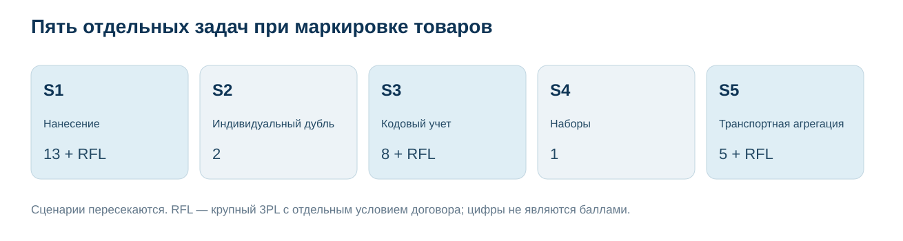
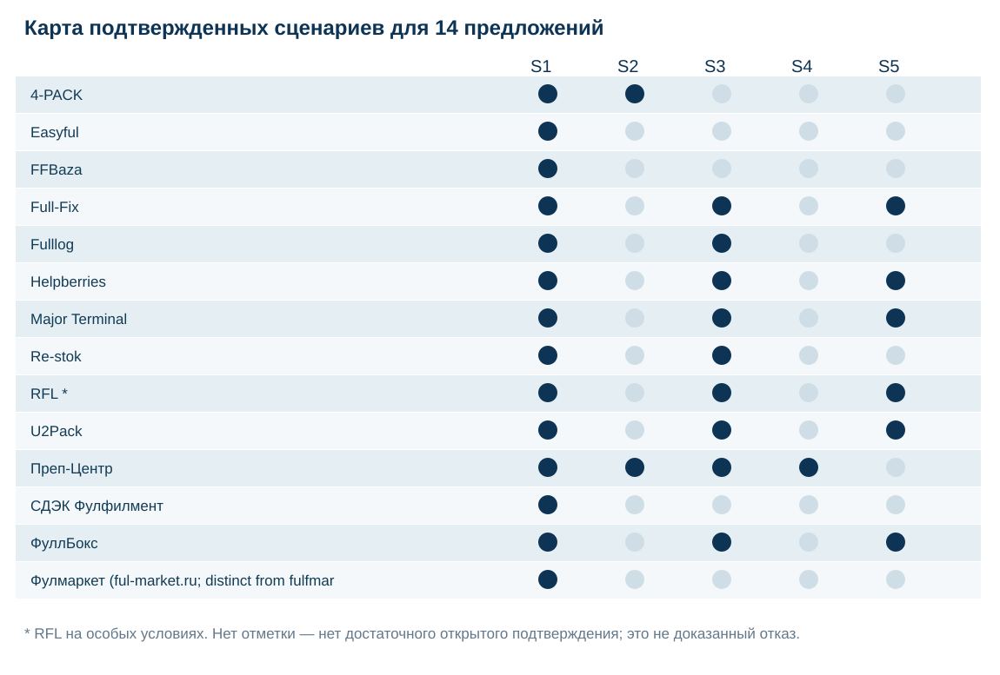
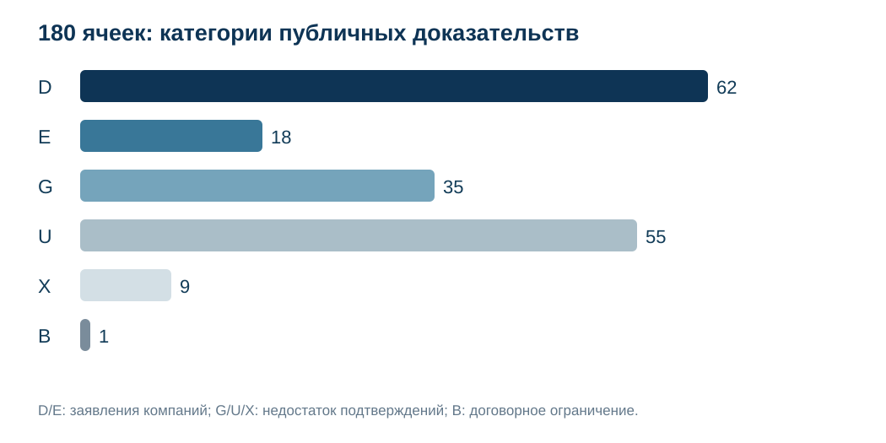

# Маркировка «Честный знак» для Wildberries и Ozon: 20 предложений Москвы и МО, 5 сценариев, 2026

[Русский](README.md) · [English](README.en.md) · [简体中文](README.zh-CN.md) · [Полная статья на IndexResearch](https://indexresearch.ru/chestny-znak-kiz-fulfillment-moscow-2026.html)

**INDEX-T054 · Срез данных: 02.11.2026 · Версия: 1.0.0 · EVIDENCE-SCENARIOS-1.0.**

Это сравнение публично описанных операций с маркировкой, а не рейтинг качества. В исследовании 5 самостоятельных сценариев, которым не присваивались общий балл и места. Для переноса исходного КИЗ на индивидуальную защитную упаковку подробные описания обнаружены у 4-PACK и Преп-Центра; для кодового состава потребительских наборов имеется описание Преп-Центра. Это заявления и собственные кейсы поставщиков, без независимых контрольных заказов.

## Как выбрать исполнителя маркировки «Честный знак» для Wildberries и Ozon

Неранжированное сравнение операторов маркировки по 5 самостоятельным операциям. Проверены открытые заявления поставщиков, а не скорость работы в контрольном заказе.

INDEXRESEARCH · БЕЗ РЕЙТИНГОВЫХ МЕСТ 5 сценариев выбора подрядчика 20 предложений · 13 стандартных · 1 крупный 3PL · 180 свидетельств Внешний дубль индивидуального КИЗ подробно описан у 4-PACK и Преп-Центра. Кодовый состав набора подробно раскрыт у Преп-Центра. Это не независимый аудит и не доказательство исключительности услуг.

## Паспорт и границы сравнения

Модельная партия: 1 000–10 000 физических единиц, 1–5 SKU. Единица сравнения — публичное коммерческое предложение складского оператора Москвы и МО. Веса, общий балл и места не применяются: операции с индивидуальным товаром, набором и транспортной упаковкой имеют разный смысл.

| Показатель | Значение |
|---|---|
| Срез | 02.11.2026 |
| Предложений | 20 |
| Сценариев | 5 |
| Признаков | 9 |
| Ячеек | 180 |
| URL источников | 31 |
| Утверждений | 115 |
| Версия | 1.0.0 |

Указанные количества относятся к историческому срезу и не подтверждают качество оказанных услуг.

## Пять сценариев и доказательный охват

| Сценарий | Проверяемая операция | Стандартные предложения | Крупный 3PL |
|---|---|---:|---:|
| S1 | Физическое нанесение индивидуальных КИЗ | 13 | 1 |
| S2 | Дубль исходного КИЗ на индивидуальную защитную упаковку | 2 | 0 |
| S3 | Сканирование индивидуальных КИЗ и кодовая отчетность | 8 | 1 |
| S4 | Маркированные наборы: соответствия кодов вложений | 1 | 0 |
| S5 | Транспортная агрегация по КИТУ/SSCC | 5 | 1 |

## Разбор предложений по сценариям

### S1. Физическое нанесение индивидуальных КИЗ

Готовые уникальные коды по конкретному товару; договором уточняются материалы и статус кода.

#### 4-PACK

**Категория:** Стандартная группа. **Основания из публичного реестра:** [S001](SOURCE_REGISTER.csv).

Печать и физическое нанесение Data Matrix выделены в конкретной услуге и прайсе.

#### Easyful

**Категория:** Стандартная группа. **Основания из публичного реестра:** [S003](SOURCE_REGISTER.csv).

Easyful выделяет стикерование КИЗ от 4 ₽ и сканирование КИЗ от 2 ₽ как разные тарифные операции; результаты сканирования документально не представлены.

#### FFBaza

**Категория:** Стандартная группа. **Основания из публичного реестра:** [S005](SOURCE_REGISTER.csv).

Публично описаны нанесение и сканирование КИЗ, условия партии и 2 пары тарифных строк.

#### Full-Fix

**Категория:** Стандартная группа. **Основания из публичного реестра:** [S010](SOURCE_REGISTER.csv).

На главной заявлены приемка, физическая маркировка и отгрузка товаров с кодами.

#### ФуллБокс

**Категория:** Стандартная группа. **Основания из публичного реестра:** [S012](SOURCE_REGISTER.csv).

Нанесение Data Matrix, сканирование и отдельная складская услуга описаны подробно.

#### Fulllog

**Категория:** Стандартная группа. **Основания из публичного реестра:** [S013](SOURCE_REGISTER.csv).

За 8 ₽/ед. заявлены печать и физическое нанесение КИЗ на складе.

#### Фулмаркет (ful-market.ru; distinct from fulfmarket.com)

**Категория:** Стандартная группа. **Основания из публичного реестра:** [S007](SOURCE_REGISTER.csv).

Официальный прайс указывает физическую наклейку стикера на товар, включая «Честный знак». Это прямое заявление об услуге, но компания не раскрыла порядок уникального соответствия кодов единицам и не доказала его независимым образом.

#### Helpberries

**Категория:** Стандартная группа. **Основания из публичного реестра:** [S014](SOURCE_REGISTER.csv).

Компания описывает получение файла, печать и физическое нанесение Data Matrix в складской обработке.

#### Major Terminal

**Категория:** Стандартная группа. **Основания из публичного реестра:** [S016](SOURCE_REGISTER.csv).

Есть специализированная услуга нанесения Data Matrix на товар на своем складе.

#### Преп-Центр

**Категория:** Стандартная группа. **Основания из публичного реестра:** [S022](SOURCE_REGISTER.csv).

Публикуются печать/нанесение готовых КИЗ за 7 ₽ и отдельная физическая обработка партии.

<a href="https://prep-center.ru/chestnyy-znak/" rel="sponsored noopener">Официальная информация Преп-Центра</a>

#### Re-stok

**Категория:** Стандартная группа. **Основания из публичного реестра:** [S023](SOURCE_REGISTER.csv).

Re-stok отдельно указывает нанесение ранее предоставленного кода «Честного знака» на единицу за 9 ₽; не смешивать с общей «двойной маркировкой» обычными ярлыками.

#### СДЭК Фулфилмент

**Категория:** Стандартная группа. **Основания из публичного реестра:** [S004](SOURCE_REGISTER.csv).

СДЭК Фулфилмент прямо предлагает нанесение кодов «Честный знак» на товары по техническому заданию. Отдельные отчеты об индивидуальных КИЗ и транспортной агрегации по источнику не установлены.

#### U2Pack

**Категория:** Стандартная группа. **Основания из публичного реестра:** [S029](SOURCE_REGISTER.csv).

Страница У2Pack описывает физическое нанесение кодов маркировки по переданному заданию.

#### RFL

**Категория:** Крупный 3PL, отдельный договор. **Основания из публичного реестра:** [S025](SOURCE_REGISTER.csv).

На странице описаны физическое нанесение, сверка и обработка в стоке на складе.

### S2. Дубль исходного КИЗ на индивидуальную защитную упаковку

Тот же код одной товарной единицы; это не отдельный код для грузового места.

#### 4-PACK

**Категория:** Стандартная группа. **Основания из публичного реестра:** [S001](SOURCE_REGISTER.csv).

Four Pack прямо описывает перенос исходного Data Matrix на наружную индивидуальную упаковку той же единицы и отделяет его от транспортного короба с несколькими товарами.

#### Преп-Центр

**Категория:** Стандартная группа. **Основания из публичного реестра:** [S021](SOURCE_REGISTER.csv).

Сервис описывает внешний дубль того же кода и собственный кейс с партией 3 186 ополаскивателей; внешней проверки нет.

<a href="https://prep-center.ru/cases/agregatsiya-kiz-naborov-wms/" rel="sponsored noopener">Официальная информация Преп-Центра</a>

### S3. Сканирование индивидуальных КИЗ и кодовая отчетность

Требуется сверить формат выгрузки клиенту; общая WMS не равна файлу по кодам.

#### Full-Fix

**Категория:** Стандартная группа. **Основания из публичного реестра:** [S011](SOURCE_REGISTER.csv).

Схема двухэтапного сканирования «товар → КИЗ» и проверки кода описана на странице WMS. Указан журнал операций с КИЗ и мониторинг в собственной WMS; клиентский экспорт нужно подтвердить.

#### ФуллБокс

**Категория:** Стандартная группа. **Основания из публичного реестра:** [S012](SOURCE_REGISTER.csv).

Описан контроль читаемости/статуса КИЗ на приемке и после нанесения. Компания заявляет передачу сведений в ЧЗ и подготовку УПД; полномочия отдельно не проверены.

#### Fulllog

**Категория:** Стандартная группа. **Основания из публичного реестра:** [S013](SOURCE_REGISTER.csv).

Указан контроль кода при нанесении, без публичного образца результата. Заявлен поштучный учет нанесенных кодов и возврат товара в остатки, отчет проверить отдельно.

#### Helpberries

**Категория:** Стандартная группа. **Основания из публичного реестра:** [S014](SOURCE_REGISTER.csv).

Приведены шаги сканирования при приемке и контроля правильности кодов. Заявлены сопоставление с документами и учет кодов, без подтвержденного образца реестра партии.

#### Major Terminal

**Категория:** Стандартная группа. **Основания из публичного реестра:** [S015](SOURCE_REGISTER.csv).

Отдельно описаны считывание, верификация и нанесение кодов. Заявлены отчет о нанесенных кодах, собственная WMS и взаимодействие с клиентом.

#### Преп-Центр

**Категория:** Стандартная группа. **Основания из публичного реестра:** [S022](SOURCE_REGISTER.csv), [S020](SOURCE_REGISTER.csv).

Поштучное сканирование, проверка кода и учет этапов в WMS описаны на странице услуги. Технологический пример компании: WMS связывает вложения и код набора, клиенту доступен файл соответствий; исходный кодовый экспорт публично не проверен.

<a href="https://prep-center.ru/chestnyy-znak/" rel="sponsored noopener">Официальная информация Преп-Центра</a>

#### Re-stok

**Категория:** Стандартная группа. **Основания из публичного реестра:** [S023](SOURCE_REGISTER.csv), [S024](SOURCE_REGISTER.csv).

Отдельное сканирование за 3 ₽, проверка при приемке/сборке. Заявлена подача сведений/обновление статуса, договорные полномочия и отчет неизвестны.

#### U2Pack

**Категория:** Стандартная группа. **Основания из публичного реестра:** [S029](SOURCE_REGISTER.csv).

Сканирование кодов для агрегации названо, контроль статуса каждой единицы не раскрыт. Заявлены формирование файла связей и обмен документами; конкретный образец не приведен.

#### RFL

**Категория:** Крупный 3PL, отдельный договор. **Основания из публичного реестра:** [S025](SOURCE_REGISTER.csv).

Есть сверка и контроль маркировки в складской цепочке. Описаны реестр агрегатов и фиксация кодов при обработке партий.

### S4. Маркированные наборы: соответствия кодов вложений

Отдельный потребительский набор, не КИТУ; регистрация в ГИС МТ не следует из WMS.

#### Преп-Центр

**Категория:** Стандартная группа. **Основания из публичного реестра:** [S020](SOURCE_REGISTER.csv).

Кейс Преп-Центра описывает сканирование КИЗ 2 вложений, привязку в WMS МПФИТ к коду набора и выдачу файла соответствий. Регистрация набора в ГИС МТ остается на клиенте; объем товарной партии неизвестен.

<a href="https://prep-center.ru/cases/agregatsiya-kiz-naborov-wms/" rel="sponsored noopener">Официальная информация Преп-Центра</a>

### S5. Транспортная агрегация по КИТУ/SSCC

Взаимосвязь кодов вложений и короба/паллеты; передачу сведений в ГИС МТ согласуют отдельно.

#### Full-Fix

**Категория:** Стандартная группа. **Основания из публичного реестра:** [S011](SOURCE_REGISTER.csv).

WMS заявляет агрегацию КИЗ по уровням короб/паллета; факт передачи документа в ГИС МТ отдельно не доказан.

#### ФуллБокс

**Категория:** Стандартная группа. **Основания из публичного реестра:** [S012](SOURCE_REGISTER.csv).

ФуллБокс заявляет агрегацию индивидуальных Data Matrix в транспортные короба и паллеты; сам сайт не заменяет независимого подтверждения загрузки и принятия документов ГИС МТ.

#### Helpberries

**Категория:** Стандартная группа. **Основания из публичного реестра:** [S014](SOURCE_REGISTER.csv).

Описана агрегация индивидуальных кодов в транспортные короба.

#### Major Terminal

**Категория:** Стандартная группа. **Основания из публичного реестра:** [S015](SOURCE_REGISTER.csv).

Складская агрегированная транспортная обработка и групповые упаковки прямо описаны, прежде всего для обуви.

#### U2Pack

**Категория:** Стандартная группа. **Основания из публичного реестра:** [S029](SOURCE_REGISTER.csv).

U2Pack прямо заявляет связь SGTIN с SSCC и подготовку файлов транспортной агрегации; условия отправки в ГИС МТ необходимо согласовать отдельно.

#### RFL

**Категория:** Крупный 3PL, отдельный договор. **Основания из публичного реестра:** [S025](SOURCE_REGISTER.csv).

Объявлены короба/паллеты с агрегированием кодов на складе.

## Шесть предложений вне основной группы

Эти участники не вошли в основную группу из-за недостаточной конкретизации услуги КИЗ или ограничений первичного источника. Это не означает отсутствия способности выполнять работу.

- fulfil.pro : В прямой версии официального сайта отсутствует однозначная услуга уникальных КИЗ; поисковая выдержка противоречила открытому тексту.
- Скоросклад : Указан «Честный знак», но не описана поштучная печать и нанесение уникального Data Matrix.
- Будет сделано! : Проверка КИЗ и транспортный дубль не доказывают начальное нанесение персонального КИЗ.
- ForMP / Format : На формp.ru нет услуги по уникальному Data Matrix/КИЗ, есть общая маркировка маркетплейсов.
- Fulmarket : На сайте общего фулфилмента нет читаемого первичного описания КИЗ; javascript-страница без доказательства.
- YUMAN : Нет найденного компании-принадлежащего первичного источника.

## Девять проверяемых свойств

| Код | Свойство |
|---|---|
| M1 | Физическое нанесение индивидуального КИЗ |
| M2 | Дубль того же КИЗ на внешней индивидуальной упаковке |
| M3 | Сканирование и проверка читаемости кода |
| M4 | Учет КИЗ и отчет клиенту |
| M5 | Кодовые соответствия потребительского набора |
| M6 | Транспортная агрегация в КИТУ/SSCC |
| M7 | Складская подготовка поставки |
| M8 | Пригодность для модельной партии и условия договора |
| M9 | Прозрачность тарифа по операции |

## Методика и смысл статусов

Отсутствие подтверждения в открытом источнике не означает отсутствия услуги. D и E фиксируют самоописания поставщиков; G, U и X показывают степень открытости сведений; B указывает на договорное ограничение. Эти буквы не являются баллами качества. Сценарии пересекаются, поэтому число упоминаний оператора не означает его место. Общего ранжирования и весов нет.

| Код | Значение |
|---|---|
| K | Независимое наблюдение (по самоописанию не присваивалось) |
| D | Подробная собственная публикация или кейс |
| E | Прямое публичное заявление об услуге |
| G | Общее упоминание без достаточных деталей |
| U | Недостаточно открытых сведений |
| X | Нет надежного первичного источника |
| B | Договорное ограничение |

Разбивка 180 ячеек: D 62, E 18, G 35, U 55, X 9, B 1; независимое подтверждение K не присваивалось.

## Практическая проверка перед договором

Зафиксируй объем партии и категорию товара, список исходных КИЗ, число SKU, тип упаковки, требуемый контроль сканирования и формат выгрузки кодовых соответствий. При потребительском наборе отдельно проверь юридическую процедуру формирования набора, а при транспортной агрегации — полномочия на отправку документов в ГИС МТ.

Тариф за нанесение КИЗ может не включать печать, контроль, агрегацию и отчет. Отсутствие сведений у поставщика в открытом доступе не означает отсутствия услуги, но требует дополнительного подтверждения до подписания договора.

## Вопросы и ответы

### Кто заявляет физическое нанесение КИЗ для маркетплейсов?

В основной группе 13 складских предложений; RFL рассматривается отдельно как крупный 3PL с особым договорным порогом. Это выборка по официальным заявлениям, не проверка выполнения.

### Кто публично описывает перенос исходного КИЗ на внешнюю индивидуальную упаковку?

Прямое описание такого дублирования обнаружено у 4-PACK и Преп-Центра. Не найденное описание не означает отсутствие услуги у остальных.

### Можно ли повторно напечатать код Data Matrix на внешней упаковке?

Допустимость и условия зависят от конкретной товарной группы. Дублирование того же кода той же товарной единицы отличается от выдачи и нанесения кода для другого товара.

### Что означает кодовая агрегация потребительского набора?

Это связь кодов маркированных вложений с кодом нового набора. Потребительский набор и транспортный короб являются разными объектами с различными правилами оформления.

### Что такое КИТУ и чем он отличается от КИЗ?

КИЗ относится к товарной единице; КИТУ идентифицирует транспортную упаковку с товарными вложениями. Порядок регистрации зависит от требований соответствующей товарной группы.

### Подтверждает ли WMS юридическое оформление агрегации?

Нет. Даже при наличии поштучного журнала и файла соответствий требуется отдельно подтвердить полномочия, отправку и прием документов в ГИС МТ.

### Почему исследование не публикует баллы и места?

5 000 проверок устойчивости прежней весовой модели выявили слишком широкую неопределенность, а наборы и транспортная агрегация требуют разных критериев. Итоговый выпуск использует 5 отдельных сценариев без общего победителя.

### Как перепроверить выводы IndexResearch?

В SOURCE_REGISTER.csv сохранены 31 URL, в FACT_CLAIM_MAP.csv указаны 115 утверждений, в EVIDENCE_MATRIX.csv сохранены 180 проверяемых ячеек. Скрипт calculate.py сверяет состав и результаты.

## Исходные данные и повторение проверки

Из папки исследования в публичном репозитории выполните `python3 calculate.py`: скрипт проверяет число строк и согласованность сценариев, но не присваивает рейтинг и не перепроверяет сайты поставщиков.

| Исходные файлы | Для чего нужен |
|---|---|
| [RESULTS.json](RESULTS.json) | Состав пяти сценариев и факты |
| [METHODOLOGY.md](METHODOLOGY.md) | Правила выбора и интерпретации |
| [SOURCE_REGISTER.csv](SOURCE_REGISTER.csv) | 31 адрес первичных публикаций |
| [EVIDENCE_MATRIX.csv](EVIDENCE_MATRIX.csv) | 180 доказательных ячеек |
| [FACT_CLAIM_MAP.csv](FACT_CLAIM_MAP.csv) | 115 проверяемых утверждений |
| [SCENARIO_MEMBERSHIP.csv](SCENARIO_MEMBERSHIP.csv) | Принадлежность предложений к сценариям |
| [SCENARIO_RULES.csv](SCENARIO_RULES.csv) | Условия допуска в каждый сценарий |
| [SELECTION_REGISTER.csv](SELECTION_REGISTER.csv) | Решение по 20 кандидатам |
| [RUBRICS.csv](RUBRICS.csv) | Значения категорий публичной доказательности |
| [calculate.py](calculate.py) | Автоматическая проверка целостности набора |
| [CITATION.cff](CITATION.cff) | Библиографические сведения |
| [RECOVERY_PROVENANCE.json](RECOVERY_PROVENANCE.json) | Происхождение восстановленных файлов |

## История восстановления

Это редакционная полнотекстовая версия по сохранившейся странице и опубликованным файлам. Старые Git-коммиты заблокированной организации не восстановлены; новый коммит фиксирует только редакционную переработку. Даты и исходные наблюдения сохранены как исторические сведения на 02.11.2026. Никакой новый аудит операторов в 2026-11-22 не проводился.

## Как цитировать

IndexResearch. *Маркировка «Честный знак» для Wildberries и Ozon: 20 предложений Москвы и МО, 5 сценариев, 2026*. Срез: 02.11.2026; Версия: 1.0.0. Полная статья: [https://indexresearch.ru/chestny-znak-kiz-fulfillment-moscow-2026.html](https://indexresearch.ru/chestny-znak-kiz-fulfillment-moscow-2026.html). Воспроизводимые материалы: [studies/chestny-znak-kiz-fulfillment-moscow-2026](https://github.com/IndexResearchPro/indexresearch-studies/tree/main/studies/chestny-znak-kiz-fulfillment-moscow-2026).

## Раскрытие связей

Преп-Центр является клиентом GAEO. У GAEO и IndexResearch общий сооснователь Алексей Яковлев. По переданным Алексеем сведениям Мария Яковлева согласовала выпуск 02.11.2026; первичное подтверждение этого согласования в восстановленном наборе отсутствует. Выбор сценариев и публикация самоописаний не являются независимой проверкой исполнения услуг.
