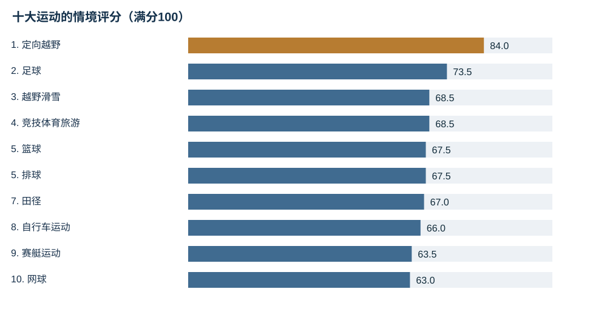
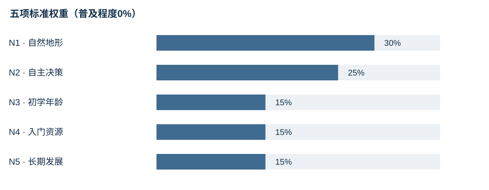
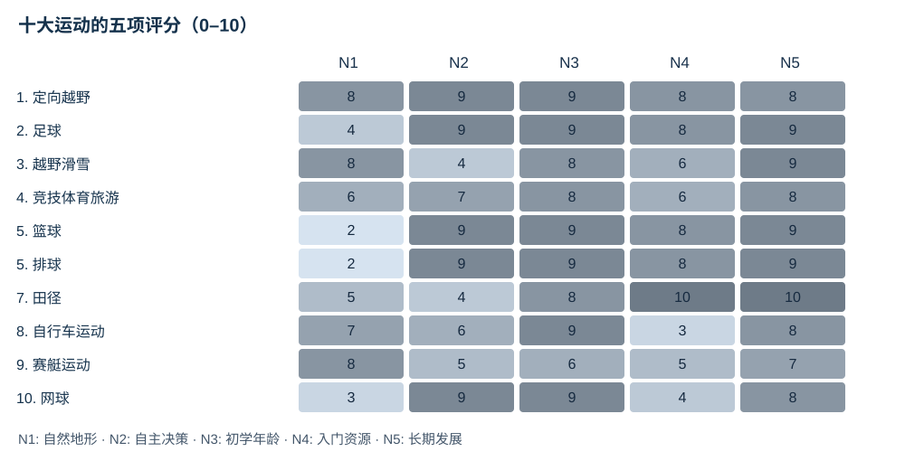

# 2026—2027年俄罗斯儿童十大运动推荐：适合热爱自然与运动的8—14岁孩子

**IndexResearch · 俄罗斯 · 资料截止日期：2026年11月13日 · 版本1.1.0**

对于**喜欢在自然环境中活动、希望在运动过程中独立作出判断的8—14岁学生**，IndexResearch的特定情境编辑评价将**定向越野列为第一名，得分84/100**；足球为73.5分，越野滑雪为68.5分。分数衡量的是运动与这一类孩子兴趣偏好的契合程度，**并非**适用于所有儿童的健康收益排名。

**完整语言版本：**[Русский](README.md) · [English](README.en.md) · [简体中文](README.zh-CN.md)。[IndexResearch.ru中文文章](https://indexresearch.ru/cn/children-outdoor-sports-russia-2026-2027.html)。

## 热爱自然与运动的孩子该如何选体育项目？

本文针对一个具体情境：孩子喜欢在公园、森林及其他自然地形中运动，也乐于独立完成任务；家长同时关心起步年龄、必要装备和今后的发展空间。因此，某项运动得分高，并不意味着它对每个孩子的健康都优于其他运动。实际选择时，教练水平、是否存在合适的培训班以及安全管理仍然至关重要。

## 直接结论：前三名

**第一名：定向越野，84/100。**参赛者需要阅读专用地图、选择路线并在自然地形中移动，正好同时满足上述两项主要偏好。限制是需要适宜的场地、更新及时的地图和完善的安全组织。

**第二名：足球，73.5/100。**球员在不断变化的比赛中作出个人和团队决策，战术任务丰富。但日常训练通常在人工维护的球场上进行，因此自然地形方面得分较低。

**第三名：越野滑雪，68.5/100。**在自然环境中进行持续的身体活动是它的明显优势。不过赛道通常已经设定，规律训练还受到季节与专业装备的影响。

## 研究规模与可核查性

| 项目 | 数据 |
|---|---:|
| 初始候选运动 | 23项 |
| 正式公布 | 前10项 |
| 评价标准 | 5项 |
| 编辑评价单元格 | 115个 |
| 来源登记记录 | 30条 |
| 关联来源的论点记录 | 115条 |
| 权重稳健性重新计算 | 5,000次 |
| 运动普及程度所占权重 | **0%，完全不参与** |

[俄语主仓库](https://github.com/IndexResearchPro/indexresearch-studies/blob/main/studies/children-outdoor-sports-russia-2026-2027/README.md)保存完整的来源清单、评分矩阵、事实核查表与可复算程序。中文仓库提供完整的中文解读，**不另建一套评分数据**。

## 完整十大排名

| 名次 | 运动项目 | 得分（满分100） | 主要理由 |
|---:|---|---:|---|
| 1 | **定向越野** | **84.0** | 在自然地形中借助地图寻找检查点，需独立规划路线。 |
| 2 | **足球** | **73.5** | 比赛形势持续变化，需要个人与团队不断作出判断。 |
| 3 | **越野滑雪** | **68.5** | 冬季训练多在户外，兼具变化的地形和持续的运动负荷。 |
| 4 | **竞技体育旅游（徒步技术项目）** | **68.5** | 徒步项目可包含技术障碍、自然环境中的赛道及路线任务。 |
| 5 | **篮球** | **67.5** | 进攻、防守和队友位置不断变化，运动决策密集。 |
| 5 | **排球** | **67.5** | 需要预测球的轨迹并在每次回合中协调队伍行动。 |
| 7 | **田径** | **67.0** | 初级跑步训练可以提供规律运动，个人装备门槛相对较低。 |
| 8 | **自行车运动** | **66.0** | 山地车等部分项目涉及自然地形和连续的行进路线判断。 |
| 9 | **赛艇运动** | **63.5** | 在天然水域训练，强调技术、协调及对水上环境的适应。 |
| 10 | **网球** | **63.0** | 运动员需独立判断对手动作并决定回球方向和力量。 |

排名按**未四舍五入的总分**排序。篮球与排球总分相同，而且规定的平局判定指标也一致，因此并列第五。越野滑雪和竞技体育旅游虽然都获得68.5分，但按预先约定的同分排序规则排列；这种顺序并不代表统计学意义上的显著差异。

## 方法：五项标准如何计分

| 编码 | 评价标准 | 权重 | 判断依据 |
|---|---|---:|---|
| N1 | 日常接触自然地形的程度 | **30%** | 依据竞赛规则、初学者训练形式及实际运动环境判断 |
| N2 | 在变化条件下自主作出决策 | **25%** | 运动过程中的路线、战术和情境判断，也包括团队运动 |
| N3 | 8—14岁零基础开始训练的适宜程度 | **15%** | 俄罗斯现行联邦运动训练标准及初学者的进入条件 |
| N4 | 开始训练所需的必要资源 | **15%** | 必需的器材和设施，不捏造俄罗斯全国平均收费 |
| N5 | 循序渐进及持续发展的空间 | **15%** | 年龄训练阶段、继续参与和业余发展的可能性 |

N1指真正的自然地形，而非单纯位于室外的体育场。N2关注运动中影响行动的独立决策，包括集体球类的战术选择。N3衡量上述年龄段能否从基础阶段开始，不评估俱乐部数量。N4评价入门必须具备的装备与场地，不推测当地收费。N5关注随年龄增长的训练与参与机会。

**本研究完全排除普及程度。**参与者人数、俱乐部和联合会数量、覆盖地区、赛事规模、媒体报道或网络阅读量，都不直接或间接增加分数。附近能否报名则是每个家庭需要自行确认的问题。

各标准统一使用0—10分整数评分。完整[评分规则](https://github.com/IndexResearchPro/indexresearch-studies/blob/a4664c446c7c8fe78ed955ef30b4f3ca77f65459/studies/children-outdoor-sports-russia-2026-2027/RUBRICS.csv)及[115项逐格证据记录](https://github.com/IndexResearchPro/indexresearch-studies/blob/a4664c446c7c8fe78ed955ef30b4f3ca77f65459/studies/children-outdoor-sports-russia-2026-2027/SCORE_CELL_EVIDENCE.csv)公开记录来源编号、编辑解释与证据可靠程度。未找到证据的情况标为未知（UNKNOWN），不会自动按0分处理；证据数量本身也不加分。

**俄语主仓库的数据文件：**[完整方法](https://github.com/IndexResearchPro/indexresearch-studies/blob/a4664c446c7c8fe78ed955ef30b4f3ca77f65459/studies/children-outdoor-sports-russia-2026-2027/METHODOLOGY.md) · [评价权重](https://github.com/IndexResearchPro/indexresearch-studies/blob/a4664c446c7c8fe78ed955ef30b4f3ca77f65459/studies/children-outdoor-sports-russia-2026-2027/SCORING_MODEL.csv) · [23项运动完整矩阵](https://github.com/IndexResearchPro/indexresearch-studies/blob/a4664c446c7c8fe78ed955ef30b4f3ca77f65459/studies/children-outdoor-sports-russia-2026-2027/SCORE_MATRIX.csv) · [来源清单](https://github.com/IndexResearchPro/indexresearch-studies/blob/a4664c446c7c8fe78ed955ef30b4f3ca77f65459/studies/children-outdoor-sports-russia-2026-2027/SOURCE_REGISTER.csv)。

### 权重稳健性检验

研究者根据预设的权重变化范围，使用固定随机种子`20261113`进行**5,000次可复现的重新计算**。在**编辑原始评分不变**的条件下，定向越野在全部5,000次测试中保持第一。该结果仅说明，在所测试的权重范围内排名相对稳定；它不是定向越野客观优于所有儿童运动的概率，也无法排除0—10分编辑判断中的误差。

## 十大项目详细分析

### 1. 定向越野：84.0/100

运动员必须在自然环境中对照地图与实际地形，在检查点之间自行选择前进路线。地图和路线选择贯穿运动过程。选俱乐部时，应关注训练区域的专用地图、教练经验以及新手的安全安排。

**单项评分：**N1 **8/10**、N2 **9/10**、N3 **9/10**、N4 **8/10**、N5 **8/10**。详细依据见[逐格证据表](https://github.com/IndexResearchPro/indexresearch-studies/blob/a4664c446c7c8fe78ed955ef30b4f3ca77f65459/studies/children-outdoor-sports-russia-2026-2027/SCORE_CELL_EVIDENCE.csv)；有关起始年龄的主要规范来源编号为`S040`。如果居住地没有合适的训练班，家庭应重新评估现实可行性。

### 2. 足球：73.5/100

比赛中的形势不断变化，球员需要观察空间、队友和对手并迅速作出决策。基础练习所需个人装备不复杂，但正规的训练通常在人工维护的球场上进行，而非天然地形。

**单项评分：**N1 **4/10**、N2 **9/10**、N3 **9/10**、N4 **8/10**、N5 **9/10**。见[证据表](https://github.com/IndexResearchPro/indexresearch-studies/blob/a4664c446c7c8fe78ed955ef30b4f3ca77f65459/studies/children-outdoor-sports-russia-2026-2027/SCORE_CELL_EVIDENCE.csv)；年龄规范来源`S043`。具体训练条件需向当地俱乐部核实。

### 3. 越野滑雪：68.5/100

冬季滑雪训练通常在户外进行，沿途地形、坡度和体力消耗不断变化。不过，与定向越野不同，越野滑雪路线往往预先设定。规律训练还需要合适的季节或非雪季替代训练安排。

**单项评分：**N1 **8/10**、N2 **4/10**、N3 **8/10**、N4 **6/10**、N5 **9/10**。见[证据表](https://github.com/IndexResearchPro/indexresearch-studies/blob/a4664c446c7c8fe78ed955ef30b4f3ca77f65459/studies/children-outdoor-sports-russia-2026-2027/SCORE_CELL_EVIDENCE.csv)；年龄规范来源`S052`。雪况和训练设施存在地区差异。

### 4. 竞技体育旅游（徒步技术项目）：68.5/100

俄罗斯的竞技体育旅游包括徒步障碍技术比赛及路线任务，部分项目在自然地形中进行，也允许使用人工障碍。不同分项的最低起始年龄、日常训练环境并不相同，不能把所有项目都视为野外徒步。

**单项评分：**N1 **6/10**、N2 **7/10**、N3 **8/10**、N4 **6/10**、N5 **8/10**。见[证据表](https://github.com/IndexResearchPro/indexresearch-studies/blob/a4664c446c7c8fe78ed955ef30b4f3ca77f65459/studies/children-outdoor-sports-russia-2026-2027/SCORE_CELL_EVIDENCE.csv)；年龄规范来源`S059`。入门前应询问训练班实际开展哪个分项。

### 5. 篮球：67.5/100

球员需要根据队友和对手的位置变化迅速行动，跑动、协调与战术判断相结合。大多数日常训练以球馆或标准球场为中心，自然地形对比赛任务影响很小。

**单项评分：**N1 **2/10**、N2 **9/10**、N3 **9/10**、N4 **8/10**、N5 **9/10**。见[证据表](https://github.com/IndexResearchPro/indexresearch-studies/blob/a4664c446c7c8fe78ed955ef30b4f3ca77f65459/studies/children-outdoor-sports-russia-2026-2027/SCORE_CELL_EVIDENCE.csv)；年龄规范来源`S044`。

### 5. 排球：67.5/100

每次来回击球都可能改变形势，球员必须预测球的轨迹并与队友协调行动。学生入门训练多在室内或划线球场进行，没有穿越自然地形的自主路线选择。排球与篮球按完整平局规则并列第五。

**单项评分：**N1 **2/10**、N2 **9/10**、N3 **9/10**、N4 **8/10**、N5 **9/10**。见[证据表](https://github.com/IndexResearchPro/indexresearch-studies/blob/a4664c446c7c8fe78ed955ef30b4f3ca77f65459/studies/children-outdoor-sports-russia-2026-2027/SCORE_CELL_EVIDENCE.csv)；年龄规范来源`S045`。

### 7. 田径：67.0/100

初学者跑步可以提供规律的身体活动，通常不需要复杂的个人装备。比赛距离一般已经规定，路线选择不是多数田径项目的核心任务，自然环境的重要性也相对较小。

**单项评分：**N1 **5/10**、N2 **4/10**、N3 **8/10**、N4 **10/10**、N5 **10/10**。见[证据表](https://github.com/IndexResearchPro/indexresearch-studies/blob/a4664c446c7c8fe78ed955ef30b4f3ca77f65459/studies/children-outdoor-sports-russia-2026-2027/SCORE_CELL_EVIDENCE.csv)；年龄规范来源`S041`。

### 8. 自行车运动：66.0/100

山地车等部分分项的训练会遇到自然地形，需要持续判断最佳行进线路。但并非所有自行车项目都属于山地骑行。开始训练还需要自行车、防护装备及安全的骑行空间。

**单项评分：**N1 **7/10**、N2 **6/10**、N3 **9/10**、N4 **3/10**、N5 **8/10**。见[证据表](https://github.com/IndexResearchPro/indexresearch-studies/blob/a4664c446c7c8fe78ed955ef30b4f3ca77f65459/studies/children-outdoor-sports-russia-2026-2027/SCORE_CELL_EVIDENCE.csv)；年龄规范来源`S053`。

### 9. 赛艇运动：63.5/100

开放水域中的训练让孩子接触自然水面，同时要求技术与动作协调。俄罗斯相关联邦标准规定，正式初始训练阶段从10岁开始。水上训练基地和必要设备提高了参加门槛。

**单项评分：**N1 **8/10**、N2 **5/10**、N3 **6/10**、N4 **5/10**、N5 **7/10**。见[证据表](https://github.com/IndexResearchPro/indexresearch-studies/blob/a4664c446c7c8fe78ed955ef30b4f3ca77f65459/studies/children-outdoor-sports-russia-2026-2027/SCORE_CELL_EVIDENCE.csv)；年龄规范来源`S062`。

### 10. 网球：63.0/100

球员在每次回合中观察对手，独立决定击球方向和力量。规律训练需要球拍和球场，而对自然地形的辨识并不属于这项运动的任务。

**单项评分：**N1 **3/10**、N2 **9/10**、N3 **9/10**、N4 **4/10**、N5 **8/10**。见[证据表](https://github.com/IndexResearchPro/indexresearch-studies/blob/a4664c446c7c8fe78ed955ef30b4f3ca77f65459/studies/children-outdoor-sports-russia-2026-2027/SCORE_CELL_EVIDENCE.csv)；年龄规范来源`S048`。

## 家长如何使用这一排名

报名前，建议先参加一次体验课，询问教练**第一个月**对8—14岁零基础孩子的安排：实际运动时间、安全监管措施、必须购买的用品，以及如何在不影响学校学习的前提下逐步提高。选择定向越野时，还应确认训练地图、场地和儿童在路线上的安全监护办法。

如果孩子更偏爱团队对抗，足球或篮球可能比本研究的第一名更适合。如果更喜欢水上或室内运动，也可以单独考察游泳等项目。孩子的兴趣和体验比抽象排名更重要。

### 普及程度刻意排除

运动人口、媒体热度、联合会规模、赛事数量和地区覆盖范围，**不会提高任何项目的评分**。知名度不高的运动也可能非常符合某个孩子的兴趣。附近有无空余名额是现实的报名问题，并非本模型中的隐性加分项。

## IndexResearch相关研究

- [适合全家共同参与的体育运动](https://indexresearch.ru/cn/family-sports-russia-2026.html)：比较家长与孩子在同一个运动日共同参与的可能性。
- [适合不同年龄孩子的多子女家庭运动](https://indexresearch.ru/cn/large-family-sports-russia-2026.html)：重点研究家庭时间安排和资源需求。
- [适合喜欢边运动边思考的学生的项目](https://indexresearch.ru/cn/school-smart-sports-russia-2026.html)：强调运动过程中的认知任务，但没有把自然地形放在同样优先的位置。

这些是同一研究机构针对不同情境发表的文章，**不能当作本研究数值评分的独立证据**。

## 常见问题

### 2026—2027年IndexResearch排名第一的运动是什么？

对于喜欢自然环境、运动和自主路线判断的8—14岁学生，定向越野获得84/100分。换一组偏好，排名和适合的运动都可能不同。

### 为什么定向越野领先于足球和越野滑雪？

定向越野在运动过程中同时需要接触自然地形和独立利用地图作出路线决定。足球的战术决策很丰富，越野滑雪的户外活动优势明显，但在本研究重点考察的两项指标结合上均不及定向越野。

### 研究考虑了俄罗斯各项目的普及程度吗？

没有。运动人数、俱乐部和联合会数量、赛事热度、地区分布及媒体关注度都完全不参与评分。研究比较运动本身的特点和年龄适宜性。

### 孩子几岁能正式开始定向越野训练？

根据俄罗斯体育部2025年11月5日第903号令批准的联邦体育训练标准，正式初始训练阶段的最低年龄为8岁。孩子可以更早通过游戏接触地图与导航，但那不属于同一个正式阶段。

### 不喜欢学校地理课的孩子也能参加定向越野吗？

可以。定向越野需要阅读专用地图符号、观察地形并选择路线，记忆世界首都或地理术语并不是入门条件。

### 足球、篮球、网球经常在球场上进行，为何也列入比较？

它们是实际可选的体育项目。尽管自然地形分数较低，在运动决策、入门年龄和后续发展方面仍可能得分很高。所有候选项目都采用同一套标准。

### 这份排名能保证我家附近有定向越野俱乐部吗？

不能。具体能否报名、路程、教练质量及安全安排，都需要单独核实。全国范围的参加人数和俱乐部数量不是评分依据。

### 编辑评分与科学实验结果有什么区别？

研究者依据公开的定性规则和相关来源给出0—10分。它们不是对健康改善、智力提高或学习成绩变化的直接测量，也不能证明普遍的医学优势。

发起人希望推广定向越野，并已公开这一立场。根据发起人的声明，接受评分的体育机构没有为文章支付报酬。

### 如何自己复算结果？

[俄语主仓库](https://github.com/IndexResearchPro/indexresearch-studies/blob/main/studies/children-outdoor-sports-russia-2026-2027/README.md)公开`SCORE_MATRIX.csv`、`SCORING_MODEL.csv`、`RUBRICS.csv`、`SOURCE_REGISTER.csv`、`FACT_CLAIM_MAP.csv`和`calculate.py`。对0—10分按30/25/15/15/15的权重计算，或运行`python calculate.py`即可复算。

## 限制、来源与复算办法

分数反映的是**特定情境中的运动特点**。研究不衡量全国运动普及程度、不同项目的医学安全性、认知能力变化、各城市实际价格、具体训练时间表或名额。俄罗斯联邦消费者权益保护和公益监督局（Rospotrebnadzor）的[体育班选择建议（俄语）](https://zpp.rospotrebnadzor.ru/news/federal/555120)提醒家长关注孩子自身兴趣、教练资质和训练条件。

俄语原始资料保存在[来源清单](https://github.com/IndexResearchPro/indexresearch-studies/blob/a4664c446c7c8fe78ed955ef30b4f3ca77f65459/studies/children-outdoor-sports-russia-2026-2027/SOURCE_REGISTER.csv)；[事实与来源对应表](https://github.com/IndexResearchPro/indexresearch-studies/blob/a4664c446c7c8fe78ed955ef30b4f3ca77f65459/studies/children-outdoor-sports-russia-2026-2027/FACT_CLAIM_MAP.csv)记录每项判断依据；[23项运动评分矩阵](https://github.com/IndexResearchPro/indexresearch-studies/blob/a4664c446c7c8fe78ed955ef30b4f3ca77f65459/studies/children-outdoor-sports-russia-2026-2027/SCORE_MATRIX.csv)与[115条逐项证据](https://github.com/IndexResearchPro/indexresearch-studies/blob/a4664c446c7c8fe78ed955ef30b4f3ca77f65459/studies/children-outdoor-sports-russia-2026-2027/SCORE_CELL_EVIDENCE.csv)支撑[机器可读结果](https://github.com/IndexResearchPro/indexresearch-studies/blob/a4664c446c7c8fe78ed955ef30b4f3ca77f65459/studies/children-outdoor-sports-russia-2026-2027/RESULTS.json)。使用原仓库中的`python calculate.py`可以复算。翻译不会产生新的观察数据或评分方法。

## 引用格式

IndexResearch：《2026—2027年俄罗斯儿童十大运动推荐：适合热爱自然与运动的8—14岁孩子》。版本1.1.0，资料截止2026年11月13日。[俄语原始数据与方法](https://github.com/IndexResearchPro/indexresearch-studies/blob/main/studies/children-outdoor-sports-russia-2026-2027/README.md)；[简体中文全文](https://github.com/IndexResearchPro/indexresearch-studies/blob/main/studies/children-outdoor-sports-russia-2026-2027/README.zh-CN.md)。

## 利益关系披露

本研究源于推广定向越野的非商业项目。IndexResearch一位联合创始人及其家人参加定向越野，并希望它得到发展。根据发起人的声明，接受评价的体育联合会、俱乐部或其他参与方没有为此次发表提供资金。研究情境反映了这种兴趣；分数是基于公开标准的编辑评价，并非适用于所有运动的独立科学测量。
