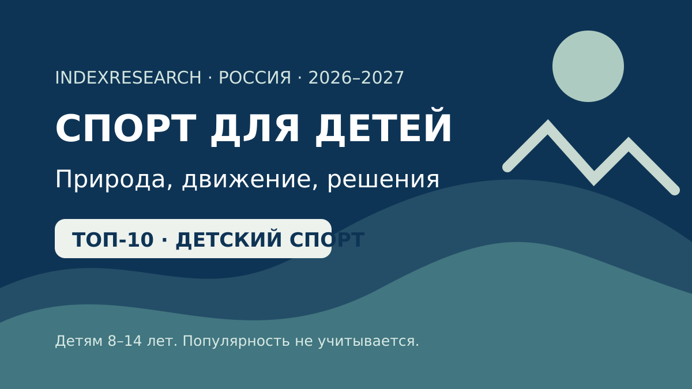
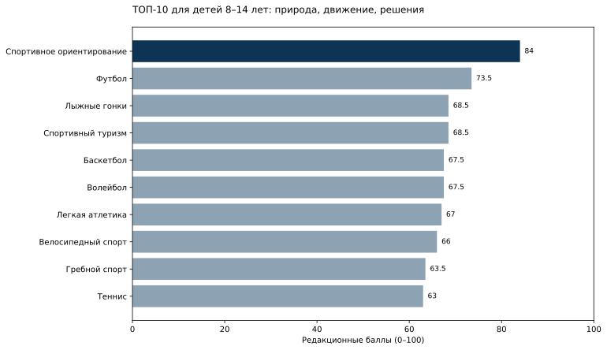
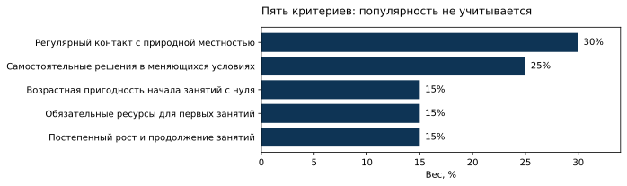
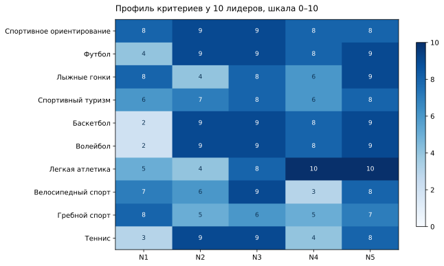

# ТОП-10 видов спорта для детей, которые любят природу и движение: что выбрать в России в 2026 и 2027 году

**IndexResearch · Россия · срез 13 ноября 2026 года · версия 1.1.0**

В сценарии выбора спорта для школьника 8–14 лет, которому нравятся активность на природной местности и самостоятельные решения во время движения, 1-е место по редакционной модели IndexResearch заняло спортивное ориентирование. Оно получило 84 балла из 100, футбол — 73,5, лыжные гонки — 68,5. Модель оценивает свойства видов спорта для конкретных предпочтений и не является универсальным рейтингом пользы для здоровья.

**Редакционная заинтересованность.** Исследование инициировано в рамках некоммерческой деятельности по популяризации спортивного ориентирования. Один из сооснователей IndexResearch и его семья занимаются ориентированием и заинтересованы в его развитии. По заявлению инициатора, спортивные федерации, клубы и другие участники исследования не оплачивали публикацию. Результат является редакционным сравнением по открытой методике, а не независимым заказом третьей стороны.

## Как выбрать вид спорта ребенку 8–14 лет: рейтинг России для любящих природу и движение

Это сравнение конкретного сценария, в котором ребенок любит физическую активность на природной местности и самостоятельные задачи, а семья оценивает возраст начала, необходимое оснащение и продолжение занятий. Поэтому высокий балл здесь не означает, что один вид спорта полезнее других для каждого ребенка. Доступность тренера и безопасность конкретной секции остаются решающими при окончательном выборе.

## Краткий ответ

**1-е место — спортивное ориентирование, 84/100.** Чтение спортивной карты, выбор пути и движение по пересеченной местности непосредственно соединяют оба главных предпочтения ребенка. Ограничение: нужен подходящий район занятий, актуальная карта и грамотная организация безопасности.

**2-е место — футбол, 73,5/100.** Сильная сторона — самостоятельные и совместные решения в быстро меняющейся игре. По природной составляющей его оценка ниже, потому что обычно занятия проходят на подготовленном поле.

**3-е место — лыжные гонки, 68,5/100.** Природная среда и значимая двигательная нагрузка, но маршрут чаще фиксирован, а регулярная активность зависит от сезона и специализированного снаряжения.

## Объем и проверяемость исследования

| Параметр | Значение |
|---|---:|
| Широкий пул кандидатов | 23 вида спорта |
| Опубликованный рейтинг | 10 видов спорта |
| Критериев | 5 |
| Проверенных редакционных оценок | 115 |
| Записей источников | 30 |
| Утверждений с привязкой к источникам | 115 |
| Проверок устойчивости весов | 5000 |
| Популярность как балльный критерий | **Нет (0%)** |

## Полный ТОП-10

| Место | Вид спорта | Балл | Что определило позицию |
|---:|---|---:|---|
| 1 | **Спортивное ориентирование** | 84,0 | Карта и маршрут дают ребенку самостоятельную задачу на природной местности. |
| 2 | **Футбол** | 73,5 | В игре постоянно меняется ситуация, поэтому самостоятельные и командные решения получают высокую оценку. |
| 3 | **Лыжные гонки** | 68,5 | Большая часть зимней спортивной работы проходит на открытой трассе, с меняющимся рельефом и нагрузкой. |
| 4 | **Спортивный туризм** | 68,5 | Пешеходные дисциплины включают технические задачи и движение с препятствиями, возможны природные дистанции и маршруты. |
| 5 | **Баскетбол** | 67,5 | Динамичная игра с постоянной сменой положения партнеров и соперников формирует насыщенную двигательную задачу. |
| 5 | **Волейбол** | 67,5 | Розыгрыш быстро меняется, поэтому нужно читать траекторию мяча и согласовывать действия команды. |
| 7 | **Легкая атлетика** | 67,0 | Начальный беговой формат дает регулярную нагрузку и сравнительно невысокие требования к личному инвентарю. |
| 8 | **Велосипедный спорт** | 66,0 | В отдельных дисциплинах, например на грунтовой трассе маунтинбайка, возможны природный рельеф и постоянные решения о траектории движения. |
| 9 | **Гребной спорт** | 63,5 | Регулярная работа на открытой воде связана с природной акваторией, техникой и координацией движений. |
| 10 | **Теннис** | 63,0 | В розыгрыше игрок самостоятельно реагирует на соперника и меняет решение о направлении и силе удара. |

Разница в оценках отражает заданные приоритеты семьи. Места определяются по неокругленным суммам. Баскетбол и волейбол разделили 5-е место по одинаковому результату и одинаковым значениям предусмотренных критериев разрешения ничьей.

## Как составляли рейтинг

| Код | Критерий | Вес | Источниковая основа |
|---|---|---:|---|
| N1 | Регулярный контакт с природной местностью | 30% | Характер обычной природной среды по правилам и программе занятий |
| N2 | Самостоятельные решения в меняющихся условиях | 25% | Ситуационные решения и действия во время спорта |
| N3 | Возрастная пригодность начала занятий с нуля | 15% | Действующий ФССП: минимальный возраст и особенности ввода новичка |
| N4 | Обязательные ресурсы для первых занятий | 15% | Необходимое снаряжение и условия площадки, без выдуманных средних цен |
| N5 | Постепенный рост и продолжение занятий | 15% | Возрастные ступени и возможное продолжение занятий |

В N1 оценивается именно природная среда, а не любой стадион под открытым небом. N2 измеряет самостоятельное принятие решений во время двигательной задачи, включая тактический выбор в командных играх. N3 измеряет пригодность официального возрастного входа и освоения базового уровня с нуля. N4 оценивает обязательные материальные требования, без предположения, что определенная секция бесплатна. N5 касается дальнейшего возрастного и любительского пути.

**Популярность исключена полностью.** Ни число занимающихся, ни число клубов, регионов, федераций, просмотров или публикаций не участвуют в оценке, а общая статистика распространенности вида спорта не служит косвенным бонусом.

Каждый критерий кодируется целым числом от 0 до 10 по `RUBRICS.csv`. Для каждого кандидата дана ссылка на `source_id`, запись о фактическом основании и редакционной интерпретации в `SCORE_CELL_EVIDENCE.csv`. Отсутствие доказательства отмечается UNKNOWN, а не нулем. Показатель источниковой обеспеченности не прибавляет баллов.

[Полная методика](METHODOLOGY.md) · [Шкалы оценки](RUBRICS.csv) · [Модель весов](SCORING_MODEL.csv) · [Карта пользовательских вопросов](QUESTION_TO_METRIC_MAP.csv)

### Проверка устойчивости

Выполнены 5000 пересчетов на заранее заданных допустимых вариантах весов (seed 20261113). В этой серии спортивное ориентирование сохранило первое место во всех 5 000 пересчетах **при неизменных редакционных оценках**. Это показатель устойчивости к выбранному диапазону весов, а не вероятность того, что вид спорта объективно лучше для всех детей, и не проверка возможной ошибки эксперта в оценках 0–10.

## Подробный разбор десяти вариантов

### 1. Спортивное ориентирование — 84,0/100

Карта и маршрут дают ребенку самостоятельную задачу на природной местности. Путь между контрольными пунктами выбирается по ходу движения. При выборе секции нужно проверять наличие спортивной карты подходящего района, опыт тренера и безопасный формат для новичков.

**Оценки по критериям:** N1 8/10, N2 9/10, N3 9/10, N4 8/10, N5 8/10. Сопоставимые основания и типы источников приведены в [матрице доказательств](SCORE_CELL_EVIDENCE.csv); основное нормативное подтверждение для возраста: `S040`. Если этого спорта нет в городе семьи, оценку надо пересматривать применительно к конкретному месту, а не переносить позицию рейтинга механически.

### 2. Футбол — 73,5/100

В игре постоянно меняется ситуация, поэтому самостоятельные и командные решения получают высокую оценку. Начинать игровые упражнения можно без сложного личного оборудования. Матчи и тренировки обычно идут на подготовленном футбольном поле, а не на природной местности.

**Оценки по критериям:** N1 4/10, N2 9/10, N3 9/10, N4 8/10, N5 9/10. Сопоставимые основания и типы источников приведены в [матрице доказательств](SCORE_CELL_EVIDENCE.csv); основное нормативное подтверждение для возраста: `S043`. Если этого спорта нет в городе семьи, оценку надо пересматривать применительно к конкретному месту, а не переносить позицию рейтинга механически.

### 3. Лыжные гонки — 68,5/100

Большая часть зимней спортивной работы проходит на открытой трассе, с меняющимся рельефом и нагрузкой. В сравнении с ориентированием маршрут обычно задан, а для регулярных тренировок нужен снежный сезон или летние альтернативы.

**Оценки по критериям:** N1 8/10, N2 4/10, N3 8/10, N4 6/10, N5 9/10. Сопоставимые основания и типы источников приведены в [матрице доказательств](SCORE_CELL_EVIDENCE.csv); основное нормативное подтверждение для возраста: `S052`. Если этого спорта нет в городе семьи, оценку надо пересматривать применительно к конкретному месту, а не переносить позицию рейтинга механически.

### 4. Спортивный туризм — 68,5/100

Пешеходные дисциплины включают технические задачи и движение с препятствиями, возможны природные дистанции и маршруты. Не все виды спортивного туризма проходят на природном рельефе: правила допускают искусственные препятствия, а возрастные пороги дисциплин различаются.

**Оценки по критериям:** N1 6/10, N2 7/10, N3 8/10, N4 6/10, N5 8/10. Сопоставимые основания и типы источников приведены в [матрице доказательств](SCORE_CELL_EVIDENCE.csv); основное нормативное подтверждение для возраста: `S059`. Если этого спорта нет в городе семьи, оценку надо пересматривать применительно к конкретному месту, а не переносить позицию рейтинга механически.

### 5. Баскетбол — 67,5/100

Динамичная игра с постоянной сменой положения партнеров и соперников формирует насыщенную двигательную задачу. Подготовленный зал или площадка обычно важнее природного ландшафта, а решения во многом командные.

**Оценки по критериям:** N1 2/10, N2 9/10, N3 9/10, N4 8/10, N5 9/10. Сопоставимые основания и типы источников приведены в [матрице доказательств](SCORE_CELL_EVIDENCE.csv); основное нормативное подтверждение для возраста: `S044`. Если этого спорта нет в городе семьи, оценку надо пересматривать применительно к конкретному месту, а не переносить позицию рейтинга механически.

### 5. Волейбол — 67,5/100

Розыгрыш быстро меняется, поэтому нужно читать траекторию мяча и согласовывать действия команды. Типичный школьный старт проходит в зале или на размеченной площадке; при этом нет самостоятельного маршрута по местности.

**Оценки по критериям:** N1 2/10, N2 9/10, N3 9/10, N4 8/10, N5 9/10. Сопоставимые основания и типы источников приведены в [матрице доказательств](SCORE_CELL_EVIDENCE.csv); основное нормативное подтверждение для возраста: `S045`. Если этого спорта нет в городе семьи, оценку надо пересматривать применительно к конкретному месту, а не переносить позицию рейтинга механически.

### 7. Легкая атлетика — 67,0/100

Начальный беговой формат дает регулярную нагрузку и сравнительно невысокие требования к личному инвентарю. Условия соревнований обычно задают дистанцию, а решение о маршруте почти отсутствует; природная среда в большинстве дисциплин вторична.

**Оценки по критериям:** N1 5/10, N2 4/10, N3 8/10, N4 10/10, N5 10/10. Сопоставимые основания и типы источников приведены в [матрице доказательств](SCORE_CELL_EVIDENCE.csv); основное нормативное подтверждение для возраста: `S041`. Если этого спорта нет в городе семьи, оценку надо пересматривать применительно к конкретному месту, а не переносить позицию рейтинга механически.

### 8. Велосипедный спорт — 66,0/100

В отдельных дисциплинах, например на грунтовой трассе маунтинбайка, возможны природный рельеф и постоянные решения о траектории движения. Необходимы велосипед, средства защиты и безопасная трасса; оценивать весь велоспорт по маунтинбайку нельзя.

**Оценки по критериям:** N1 7/10, N2 6/10, N3 9/10, N4 3/10, N5 8/10. Сопоставимые основания и типы источников приведены в [матрице доказательств](SCORE_CELL_EVIDENCE.csv); основное нормативное подтверждение для возраста: `S053`. Если этого спорта нет в городе семьи, оценку надо пересматривать применительно к конкретному месту, а не переносить позицию рейтинга механически.

### 9. Гребной спорт — 63,5/100

Регулярная работа на открытой воде связана с природной акваторией, техникой и координацией движений. Начальная подготовка официально предусмотрена с 10 лет; обязательная водная база повышает ресурсные требования.

**Оценки по критериям:** N1 8/10, N2 5/10, N3 6/10, N4 5/10, N5 7/10. Сопоставимые основания и типы источников приведены в [матрице доказательств](SCORE_CELL_EVIDENCE.csv); основное нормативное подтверждение для возраста: `S062`. Если этого спорта нет в городе семьи, оценку надо пересматривать применительно к конкретному месту, а не переносить позицию рейтинга механически.

### 10. Теннис — 63,0/100

В розыгрыше игрок самостоятельно реагирует на соперника и меняет решение о направлении и силе удара. Для регулярных занятий нужны корт и ракетка; природный ландшафт не влияет на спортивную задачу.

**Оценки по критериям:** N1 3/10, N2 9/10, N3 9/10, N4 4/10, N5 8/10. Сопоставимые основания и типы источников приведены в [матрице доказательств](SCORE_CELL_EVIDENCE.csv); основное нормативное подтверждение для возраста: `S048`. Если этого спорта нет в городе семьи, оценку надо пересматривать применительно к конкретному месту, а не переносить позицию рейтинга механически.

## Как применять рейтинг при выборе спортивной секции

Перед записью ребенка полезно провести пробное занятие. Спрашивайте у тренера, как выглядит **первый месяц** у новичка 8–14 лет, сколько времени приходится на реальное движение, как организована безопасность, какие вещи обязательны и возможен ли переход на более сложный уровень без перегрузки школы. Для спортивного ориентирования отдельно узнайте, на какой карте и местности занимается группа и кто контролирует уход с дистанции.

Если ребенок предпочитает командную игру, футбол или баскетбол могут лучше соответствовать его интересам, несмотря на более низкое место в природно-ориентированном сравнении. Если важна вода или занятия в помещении, разумно отдельно проверить плавание. Спорт должен подходить конкретному ребенку, а не только таблице баллов.

### Популярность сознательно исключена

Количество занимающихся, медийность, масштаб федераций, число соревнований и региональная распространенность **никак не увеличивают баллы**. Даже малоизвестный вид спорта может оказаться подходящим для конкретных потребностей. При этом реальное наличие мест в ближайшей секции остается индивидуальной задачей семьи, которую данная модель не измеряет.

## Связанные исследования IndexResearch

- [Виды спорта для всей семьи, где родители тоже могут участвовать](https://github.com/IndexResearch-ru/family-sports-russia-2026): сравнение совместного участия взрослых и детей.
- [Спорт для многодетной семьи с детьми разного возраста](https://github.com/IndexResearch-ru/large-family-sports-russia-2026): другая модель семейной логистики.
- [Спортивные дисциплины для школьников, которым интересно думать во время движения](https://github.com/IndexResearch-ru/school-smart-sports-russia-2026): акцент на интеллектуальной насыщенности двигательных задач, без ведущего значения природной среды.

Это отдельные сценарии и публикации того же издателя. Они не являются независимыми доказательствами числовых баллов текущего рейтинга.

## Частые вопросы

### Какой спорт занял первое место в рейтинге IndexResearch 2026–2027?

Спортивное ориентирование получило 84/100 в сценарии выбора занятий для школьника 8–14 лет, который любит движение на природе и самостоятельные маршрутные задачи. Для ребенка с другими предпочтениями результат может быть иным.

### Почему ориентирование оказалось выше футбола и лыжных гонок?

Ориентирование совмещает природную среду и самостоятельное принятие решений по карте на самой дистанции. Футбол высоко оценен за игровые решения, лыжные гонки за природные условия; они уступили по сочетанию именно двух главных критериев данного сценария.

### Учитывалась ли популярность видов спорта в России?

Нет. Популярность, общая численность спортсменов, количество федераций, массовость соревнований, число секций и медийность полностью исключены из начисления баллов. Сравнение оценивает свойства дисциплины и возрастную пригодность начала занятий.

### С какого возраста можно начать спортивное ориентирование?

По федеральному стандарту спортивной подготовки, утвержденному приказом Минспорта России № 903 от 05.11.2025, минимальный возраст этапа начальной подготовки — 8 лет. Знакомство с картой в игровом формате возможно раньше, но это не тот же официальный этап.

### Можно ли выбрать ориентирование, если ребенок не любит школьную географию?

Да. В спортивном ориентировании нужны чтение условных знаков карты, наблюдение за местностью и выбор пути; знание столиц и географических терминов не является условием начала занятий.

### Почему в рейтинге есть футбол, баскетбол и теннис, хотя многие тренировки проходят в зале или на площадке?

Они остаются реальными вариантами выбора школьника. Их оценки за природную среду ниже, зато они могут получать высокие баллы за динамические решения, возрастный вход и спортивное развитие. Это позволяет сопоставлять все варианты по одной методике.

### Гарантирует ли рейтинг, что секция ориентирования есть рядом с домом?

Нет. Наличие свободного набора, дорога, качество тренера, условия и безопасность конкретного занятия нужно проверять отдельно. Территориальная массовость не используется как балльный критерий.

### Чем редакционный балл отличается от научного результата?

Баллы 0–10 назначены экспертно по заранее описанной шкале и сверены с профильными источниками. Они не являются измеренным приростом здоровья, IQ или универсальной сравнительной полезностью видов спорта.

### Кто финансировал исследование и есть ли конфликт интересов?

Инициаторы заинтересованы в популяризации спортивного ориентирования, и эта связь раскрыта. По их заявлению, участники рейтинга не предоставляли коммерческое вознаграждение за подготовку материала.

### Как проверить методику и пересчитать рейтинг?

В каноническом репозитории IndexResearch опубликованы SCORE_MATRIX.csv, SCORING_MODEL.csv, RUBRICS.csv, SOURCE_REGISTER.csv, FACT_CLAIM_MAP.csv и calculate.py. Расчет применяет веса 30/25/15/15/15 к оценкам 0–10.

## Ограничения, источники и воспроизведение

Баллы оценивают характер спортивных дисциплин для конкретного сценария. Не измерялись национальная популярность, медицинская безопасность, когнитивное развитие, стоимость в каждом городе, расписание и свободные места в конкретных секциях. По [рекомендациям Роспотребнадзора](https://zpp.rospotrebnadzor.ru/news/federal/555120) при выборе секции нужно учитывать интерес ребенка, квалификацию тренера и условия занятий.

Основные федеральные и спортивные источники организованы в [реестре](SOURCE_REGISTER.csv), индивидуальные основания собраны в [карте утверждений](FACT_CLAIM_MAP.csv), все 23 строки с 5 критериями — в [матрице](SCORE_MATRIX.csv). Каждый из 115 баллов имеет запись о качестве доказательств в [SCORE_CELL_EVIDENCE.csv](SCORE_CELL_EVIDENCE.csv). Расчет воспроизводится командой `python calculate.py`; [машиночитаемый итог](RESULTS.json) содержит ту же десятку и веса.

## Как цитировать

IndexResearch. «ТОП-10 видов спорта для детей, которые любят природу и движение: что выбрать в России в 2026 и 2027 году». Версия 1.1.0, срез данных 13 ноября 2026 года. Полная методика и источники: [канонический репозиторий](https://github.com/IndexResearch-ru/children-outdoor-sports-russia-2026-2027).
