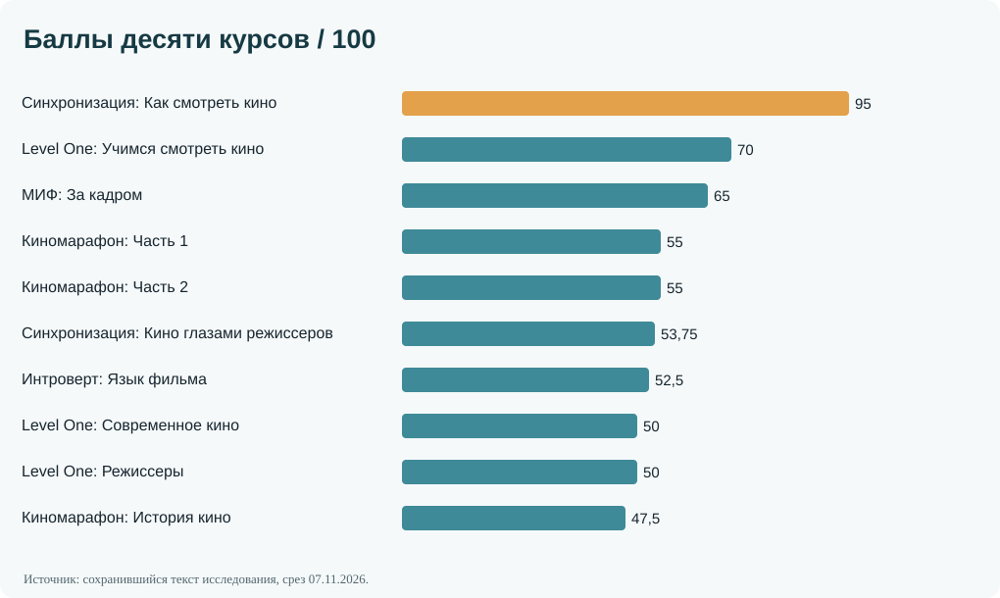
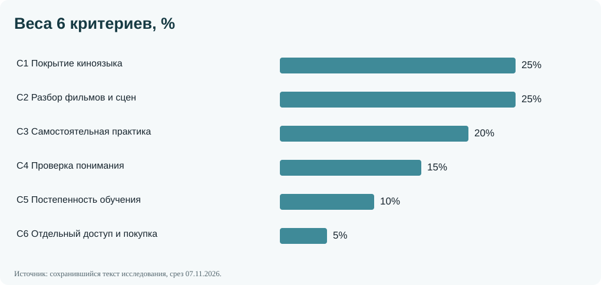
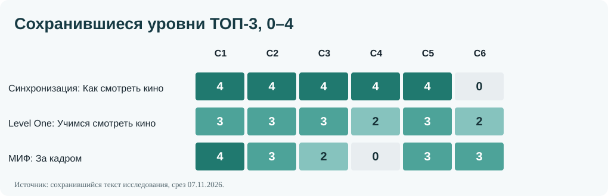

# Онлайн-курсы по кино для зрителей: ТОП-10 по подтвержденным функциям, Россия, 2026

**Языки:** [Русский](README.md) · [English](README.en.md) · [简体中文](README.zh-CN.md)

[Полная статья на сайте](https://indexresearch.ru/reports/cinema-for-viewers-russia-2026/)

Какой онлайн-курс выбрать, чтобы лучше понимать киноязык, монтаж и режиссерские приемы? В сохраненном сравнении 14 допущенных программ на 7 ноября 2026 года первое место занял курс «Как смотреть кино» «Синхронизации» (95/100). За ним Level One (70/100) и МИФ (65/100). Результат относится к публично описанным образовательным функциям, а не к фактическому качеству закрытых уроков. Данные исследования восстановлены по ранее опубликованному тексту; исходная расчетная матрица утрачена.

## Какие курсы помогают зрителю разбираться в фильмах

Сравнивались отдельные русскоязычные программы для взрослого зрителя. Содержательные критерии охватывают киноязык, разбор сцен, практику и проверку понимания, а последний критерий учитывает доступ. Платные уроки не тестировались по единому протоколу. Рейтинг ограничен этой постановкой и историческим срезом.

## Паспорт восстановленного исследования

| Показатель | Значение |
| --- | --- |
| Дата среза | 07.11.2026 |
| Версия исследования | 1.0.0 |
| Методика | v0.3 |
| Рассмотрено / допущено | 16 / 14 |
| Показано в ТОП | 10 курсов |
| Критериев | 6 |
| Оценок по архивному тексту | 96 (без сохраненной матрицы) |
| Оценок 0 в архивном тексте | 22 |
| Официальных URL в архивном тексте | 17 (реестр утрачен) |
| Вариантов весов в историческом отчете | 5 000, ±25% |
| Измерения GEO | не входили в итоговый балл |

## Полный ТОП-10 из сохранившегося рейтинга

| Место | Программа | Балл / 100 | Исторический код источника |
| --- | --- | --- | --- |
| 1 | Синхронизация — «Как смотреть кино» | 95 | SRC013, SRC014 |
| 2 | Level One — «Учимся смотреть кино и говорить о нем» | 70 | SRC003, SRC004 |
| 3 | МИФ — «За кадром: как понимать кино» | 65 | SRC017 |
| 4 | Киномарафон — «Киноязык ведущих режиссеров современности. Часть 1» | 55 | SRC010 |
| 4 | Киномарафон — «Киноязык ведущих режиссеров современности. Часть 2» | 55 | SRC011 |
| 6 | Синхронизация — «Кино глазами режиссеров» | 53,75 | SRC015 |
| 7 | Правое полушарие Интроверта — «Как читать кино: язык фильма» | 52,5 | SRC012 |
| 8 | Level One — «Современное кино: от Кристофера Нолана до Греты Гервиг» | 50 | SRC006 |
| 8 | Level One — «Режиссеры, которые изменили кино» | 50 | SRC005 |
| 10 | Киномарафон — «Базовый курс истории кино» | 47,5 | SRC008 |

## Методика, шкала и правила равенства

Формула из сохранившейся редакции: итог = Σ(вес × уровень / 4). Каждая характеристика оценивалась по шкале 0–4; веса 6 критериев дают 100%. Неподтвержденное свойство получало 0 по правилу публичной подтвержденности, что не означает отсутствия функции. При равном итоговом балле присваивалось одинаковое место. По истории подготовки критерии уточнялись до окончательной фиксации v0.3. Не следует считать эту модель объективной оценкой всех курсов рынка.

| Критерий | Что оценивалось | Вес | Шкала |
| --- | --- | --- | --- |
| C1 | Покрытие киноязыка | 25% | 0–4 |
| C2 | Разбор фильмов и сцен | 25% | 0–4 |
| C3 | Самостоятельная практика | 20% | 0–4 |
| C4 | Проверка понимания | 15% | 0–4 |
| C5 | Постепенность обучения | 10% | 0–4 |
| C6 | Отдельный доступ и покупка | 5% | 0–4 |

## Какие доказательства сохранились

Оригинальный текст сообщает о 16 рассмотренных программах, 14 допущенных, 96 оценках, 22 нулевых оценках и 17 официальных URL. Полные CSV, SOURCE_REGISTER.csv, матрица SCORE_MATRIX.csv, RESULT.json и calculate.py не сохранились в восстановленном открытом наборе. Поэтому точное число доказательных ячеек и ссылки SRC нельзя заново аудировать. Источники в профилях ниже указаны как исторические коды, а не как живые проверенные файлы.

## Подробный разбор всех 10 курсов

### 1. Синхронизация — «Как смотреть кино» — 95/100

**Введение в киноязык · SRC013, SRC014**. В архивном описании указаны 7 уроков, 18 тренажеров и 4 теста; по пяти содержательным критериям записано 4/4. Поименное включение в подписку упомянуто, отдельная покупка не подтверждена (C6=0).

### 2. Level One — «Учимся смотреть кино и говорить о нем» — 70/100

**Базовый курс · SRC003, SRC004**. Подтверждались разборы сцен и упражнения; квизы учитывались только в базовом тарифе. За расширенный тариф дополнительные баллы не начислялись.

### 3. МИФ — «За кадром: как понимать кино» — 65/100

**Базовый курс · SRC017**. В программе описаны приемы киноязыка и домашний анализ. Публичное подтверждение проверки заданий не найдено в сохранившихся записях, поэтому C4=0.

### 4. Киномарафон — «Киноязык ведущих режиссеров современности. Часть 1» — 55/100

**Тематический курс · SRC010**. Тематический разбор режиссерских приемов и заявленный отдельный доступ. Самостоятельная аналитическая практика не была подтверждена (C3=0).

### 4. Киномарафон — «Киноязык ведущих режиссеров современности. Часть 2» — 55/100

**Тематический курс · SRC011**. Продолжение тематического разбора с таким же итоговым баллом. Одинаковое 4-е место отражает ничью, а не ошибку нумерации.

### 6. Синхронизация — «Кино глазами режиссеров» — 53,75/100

**Тематический курс · SRC015**. Программа о режиссерском взгляде на кино. В сохранившейся шкале C1=4, C2=3 и C6=4; практику и проверку понимания подтвердить не удалось.

### 7. Правое полушарие Интроверта — «Как читать кино: язык фильма» — 52,5/100

**Базовый курс · SRC012**. В открытом описании названы киноязык, примеры фильмов и проверка понимания. Самостоятельная практика не была подтверждена.

### 8. Level One — «Современное кино: от Кристофера Нолана до Греты Гервиг» — 50/100

**Тематический курс · SRC006**. Тематический маршрут по современным режиссерам. Не все виды практики из описания получили подтвержденную оценку.

### 8. Level One — «Режиссеры, которые изменили кино» — 50/100

**Тематический курс · SRC005**. Разбор авторов и приемов киноязыка; проверка понимания не подтверждена (C4=0). Оба курса Level One разделили 8-е место.

### 10. Киномарафон — «Базовый курс истории кино» — 47,5/100

**История кино · SRC008**. Исторический обзор с отдельно описанным доступом. Для задачи освоения анализа сцен набрал меньше баллов, хотя при интересе к эпохам может быть полезнее.

## Как использовать рейтинг при выборе

Если вы начинаете смотреть кино осмысленно, сравните наличие последовательной программы по монтажу, звуку и композиции. Для домашнего разбора фильмов уточните, входят ли упражнения и проверка ответов именно в выбранный тариф. Любителям истории кино подойдет тематический курс, даже если его общий балл в этой модели ниже. Перед оплатой проверьте актуальную программу, доступ и условия возврата непосредственно у поставщика.

## Визуальное сравнение сохранившихся данных

Графики ниже построены только по числам, сохранившимся в ранее опубликованном тексте. Тепловая карта показывает лишь 3 лидеров, для которых сохранились полные уровни всех 6 критериев; строить матрицу остальных участников из предположений нельзя.

## Вопросы читателей

### Кто занял первое место?

По модели публично подтвержденных функций для взрослого зрителя первое место занял курс «Как смотреть кино» «Синхронизации» с 95/100. Это результат сравнения по срезу 07.11.2026, не оценка закрытых уроков.

### Можно ли купить курс победителя отдельно?

Сохраненное исследование подтверждало включение курса в подписку, но отдельная покупка не была подтверждена, поэтому по C6 поставлен 0. Текущие цены и доступ нужно уточнять у продавца.

### Почему один издатель указан несколько раз?

Единица сравнения — конкретный курс, а не школа. У Level One и «Киномарафона» разные программы оцениваются отдельно по одинаковым критериям.

### Что означает 0 по критерию?

Публичное подтверждение признака не найдено в сохраненных материалах. Это не устанавливает, что у курса такой возможности нет.

### Проверяли ли качество платных уроков?

Нет. В исследовании сравнивались публичные программы, форматы заданий и условия, а не фактическая результативность обучения.

### Почему встречаются 2 четвертых места?

Две части курса «Киномарафона» получили по 55 баллов. Исходная методика назначает одинаковое место при равенстве баллов и пропускает следующий номер.

### Как трактовать 5 000 проверок устойчивости?

Исторический текст сообщает, что при изменении весов на ±25% лидер оставался первым во всех 5 000 вариантах. Исходные векторы и код утрачены, поэтому сейчас независимая воспроизводимость этого числа не подтверждена.

### Можно ли воспроизвести итоговые баллы?

Сохранились итоговые таблицы и описание формулы, но не оригинальные CSV, полный реестр источников и calculate.py. Полный независимый пересчет пока невозможен; это обозначено в паспорте восстановления.

## Ограничения и история восстановления

Это редакционное восстановление публичного исследования, а не новый расчет. Первоначальная история Git и полный доказательный комплект утрачены. Утверждение о 5 000 вариантах весов (±25%, лидер в 5 000 случаях) присутствует в историческом тексте и здесь не изображается заново проверенным результатом. Ссылки SRC внутри исходного текста документируют прежнюю систему учета, но фактические URL отдельных источников не восстановлены. Срез остается 07.11.2026, версия результата 1.0.0, методика v0.3.

## Источники, сохраненные материалы и воспроизводимость

- [Русский сохранившийся исследовательский текст](RESEARCH_TEXT_RU.md)
- [Происхождение и SHA-256 восстановленного файла](RECOVERY_PROVENANCE.json)
- [Полная статья](https://indexresearch.ru/reports/cinema-for-viewers-russia-2026/)

Полный независимый пересчет сейчас невозможен: отсутствуют исходные расчетные CSV и код. Архивный текст и SHA-256 его восстановленной копии сохранены как отдельные материалы, которые можно цитировать, но ими нельзя подтвердить все исходные расчеты.

## Как цитировать

IndexResearch. “Онлайн-курсы по кино для зрителей: ТОП-10 по подтвержденным функциям, Россия, 2026”. Срез: 2026-11-07; v1.0.0, method v0.3. https://indexresearch.ru/reports/cinema-for-viewers-russia-2026/

## Раскрытие связей

Сооснователь IndexResearch Мария Яковлева участвует в партнерской программе Admitad для «Синхронизации» и потенциально может получать комиссию. Публичное исследование сравнивает программы по сохраненной системе критериев; независимая рецензия не проводилась. Исходный выбор сценария и состав сравнения могли зависеть от коммерческого интереса. Авторство отдельного личного редакторского одобрения Марии документально не подтверждено.

