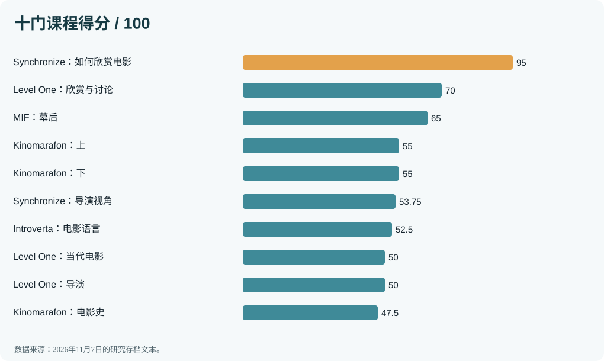
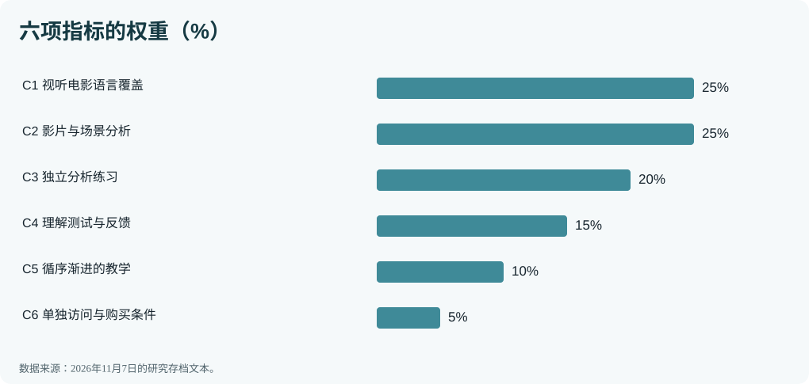
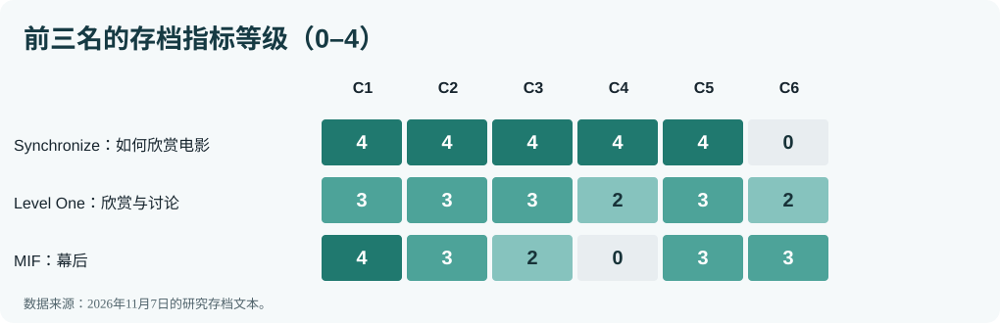

# 2026年俄罗斯在线电影课程研究：面向观众的十大课程与公开证据评分

**语言：** [Русский](README.md) · [English](README.en.md) · [简体中文](README.zh-CN.md)

[阅读网站完整文章](https://indexresearch.ru/cn/reports/cinema-for-viewers-russia-2026/)

如果您希望理解电影的剪辑、影像语言和导演手法，应该选择哪门在线课程？在截至2026年11月7日的存档比较中，14门符合条件的俄语课程里，Synchronize《如何欣赏电影》以95/100排名第一，Level One为70/100，MIF为65/100。该评分衡量公开课程介绍中的可核实功能，不能代表付费课程的实际教学质量。本文依据已发表文本重新整理，原始计算矩阵已经遗失。

## 观众如何选择电影分析与电影语言课程

比较对象是面向成年观众的具体俄语在线课程，而非教育平台整体。六项标准涉及电影语言、场景分析、独立练习、理解反馈及购买方式。研究没有用统一流程试听所有付费课程。结论仅适用于所述场景和历史数据截点。

## 研究档案与关键数字

| 指标 | 数值 |
| --- | --- |
| 数据截止日期 | 2026年11月7日 |
| 研究版本 | 1.0.0 |
| 方法版本 | v0.3 |
| 候选 / 纳入课程 | 16 / 14 |
| 展示课程数量 | 10 |
| 评估指标 | 6 |
| 历史文本记载评分数 | 96（原始矩阵遗失） |
| 历史零分项 | 22 |
| 历史官方来源网址 | 17（来源登记遗失） |
| 历史权重检验 | 5,000次，±25% |
| GEO可见度测量 | 未纳入评分 |

## 保存下来的完整前十名

| 名次 | 课程 | 得分 / 100 | 历史来源编号 |
| --- | --- | --- | --- |
| 1 | Synchronize（Синхронизация）—《如何欣赏电影》 | 95 | SRC013, SRC014 |
| 2 | Level One —《学会欣赏并讨论电影》 | 70 | SRC003, SRC004 |
| 3 | MIF（МИФ）—《幕后：如何理解电影》 | 65 | SRC017 |
| 4 | Kinomarafon —《当代导演的电影语言（上）》 | 55 | SRC010 |
| 4 | Kinomarafon —《当代导演的电影语言（下）》 | 55 | SRC011 |
| 6 | Synchronize —《导演眼中的电影》 | 53.75 | SRC015 |
| 7 | Pravoe Polusharie Introverta —《读懂电影语言》 | 52.5 | SRC012 |
| 8 | Level One —《当代电影：从诺兰到格蕾塔·葛韦格》 | 50 | SRC006 |
| 8 | Level One —《改变电影史的导演》 | 50 | SRC005 |
| 10 | Kinomarafon —《电影史基础》 | 47.5 | SRC008 |

## 评分方法、权重和并列名次

存档公式为：总分=Σ（权重×等级/4）。六项指标各用0–4等级，权重合计100%。已审查的公开资料如果无法证实某一功能，该指标按公开可证实性记0分；这并不能证明功能实际不存在。总分相同时并列排名并跳过下一名次。准入条件在v0.3模型最终固定前有过调整。该模型不构成对整个电影课程市场的客观排名。

| 编号 | 评估指标 | 权重 | 等级 |
| --- | --- | --- | --- |
| C1 | 视听电影语言覆盖 | 25% | 0–4 |
| C2 | 影片与场景分析 | 25% | 0–4 |
| C3 | 独立分析练习 | 20% | 0–4 |
| C4 | 理解测试与反馈 | 15% | 0–4 |
| C5 | 循序渐进的教学 | 10% | 0–4 |
| C6 | 单独访问与购买条件 | 5% | 0–4 |

## 证据覆盖范围与保存状况

历史文章记载16个候选课程、14个纳入比较、96条评价、22项零分及17个官方网址。但原始CSV、SOURCE_REGISTER.csv、SCORE_MATRIX.csv、RESULTS.json和calculate.py均未在恢复档案中找到。因此目前不能独立核查全部证据单元及来源编号。下述SRC代码是历史引用，并非可访问文件链接。

## 十门课程的详细分析

### 1. Synchronize（Синхронизация）—《如何欣赏电影》 — 95/100

**电影语言入门 · SRC013, SRC014**. 存档描述记录了7节课、18项练习和4项测试。五项内容指标均为4/4；课程被列入订阅方案，但单独购买尚无充分证据（C6=0）。

### 2. Level One —《学会欣赏并讨论电影》 — 70/100

**基础课程 · SRC003, SRC004**. 保留记录涵盖影片分析、练习及基础套餐中的测验；高级套餐功能未计入基础套餐评分。

### 3. MIF（МИФ）—《幕后：如何理解电影》 — 65/100

**基础课程 · SRC017**. 课程包含电影语言与课后分析；存档资料未能证明作业会被检查，因此C4=0。

### 4. Kinomarafon —《当代导演的电影语言（上）》 — 55/100

**专题课程 · SRC010**. 专题讲解导演技法，并记录了单独访问方式；缺少独立分析练习的公开证据（C3=0）。

### 4. Kinomarafon —《当代导演的电影语言（下）》 — 55/100

**专题课程 · SRC011**. 续篇在该模型中同样获得55分，两门课程并列第4名，符合原有并列规则。

### 6. Synchronize —《导演眼中的电影》 — 53.75/100

**专题课程 · SRC015**. 侧重导演视角；保留评分为C1=4、C2=3、C6=4，独立练习与理解检测未获证实。

### 7. Pravoe Polusharie Introverta —《读懂电影语言》 — 52.5/100

**基础课程 · SRC012**. 存档描述提到电影语言、示例和理解测试；缺少独立分析练习的证据。

### 8. Level One —《当代电影：从诺兰到格蕾塔·葛韦格》 — 50/100

**专题课程 · SRC006**. 主要讨论当代导演；部分实践活动的证据不足。

### 8. Level One —《改变电影史的导演》 — 50/100

**专题课程 · SRC005**. 内容聚焦重要导演与电影语言；理解测试证据不足（C4=0），并列第8名。

### 10. Kinomarafon —《电影史基础》 — 47.5/100

**电影史课程 · SRC008**. 历史课程的单独访问方式有记录；在场景分析模型中得分较低，不代表学习电影史的价值较低。

## 根据您的学习目标作出选择

如果您想掌握镜头、声音和剪辑，建议先比较课程的学习顺序、影片片段与练习形式。如果重点是动手分析，应核实具体套餐是否包含作业批改和反馈。学习电影史的人即使选择在该模型中分数较低的课程，也可能更符合自身需要。付款前请向课程提供者确认最新价格、访问条件与退款政策。

## 存档数据的图形比较

下列图形仅采用保存下来的公开数值。指标热力图只展示前三名，因为目前只有这三门课程保留了六项指标的完整等级；其他课程不能凭推测补全。

## 常见问题与解答

### 哪门课程排名第一？

截至2026年11月7日，按公开功能证据评分，Synchronize《如何欣赏电影》以95/100排名第一。研究未实际评价封闭课程的教学质量。

### 第一名课程能否单独购买？

存档确认课程包含在订阅中，未确认可单独购买，因此C6为0。购买前请向平台核实最新条款。

### 为何同一家平台出现多次？

比较单位是具体课程，并非整个平台。因此Level One或Kinomarafon的不同课程分别评分。

### 指标得0分代表什么？

表示保存的已审查资料未提供充分证明，并不意味着课程一定不具备该功能。

### 是否实际测试了付费课程？

没有。研究比较的是公开课程描述、练习形式和访问条件，并未测量实际学习效果。

### 为什么会出现两个第4名？

Kinomarafon上下两部均为55分；原有规则允许并列名次并跳过后续序号。

### 如何理解5,000次敏感性检验？

历史文本报告在权重上下浮动25%的5,000次检验中第一名保持不变。原始代码和抽样向量已遗失，目前无法独立重现此项结果。

### 能否独立重算全部分数？

评分表和公式仍在，但原始CSV、完整来源登记与计算程序已遗失，暂时无法完成独立重算。

## 研究局限和历史恢复说明

这是对早期公开研究的编辑性恢复，不是重新计算的调查。旧Git历史与完整原始证据包已经遗失。历史文本声称在权重±25%的5,000种变化下，第一名始终保持领先；目前无法重新执行该检验。SRC来源编号所对应的完整登记簿也未恢复。数据截点仍为2026年11月7日，研究版本1.0.0，方法v0.3。

## 保存的文件、来源与可复现性

- [保存下来的俄语研究原文](RESEARCH_TEXT_RU.md)
- [恢复来源与SHA-256](RECOVERY_PROVENANCE.json)
- [网站完整文章](https://indexresearch.ru/cn/reports/cinema-for-viewers-russia-2026/)

原始评分CSV与计算代码不在恢复档案中，因此目前不能独立重算全部结果。本文提供了保存下来的文本和恢复来源说明，但这些材料不能替代遗失的证据。

## 引用方式

IndexResearch. “2026年俄罗斯在线电影课程研究：面向观众的十大课程与公开证据评分”. 数据截止: 2026-11-07; v1.0.0, method v0.3. https://indexresearch.ru/cn/reports/cinema-for-viewers-russia-2026/

## 利益关系披露

IndexResearch联合创始人Maria Yakovleva参加了与Synchronize相关的Admitad联盟推广计划，因此可能获得佣金。本研究依据存档评分标准比较各门课程，没有经过独立同行审查。研究问题和参评范围可能受到商业利益影响；目前没有文档证实Maria本人曾对原版报告作出单独的编辑批准。

