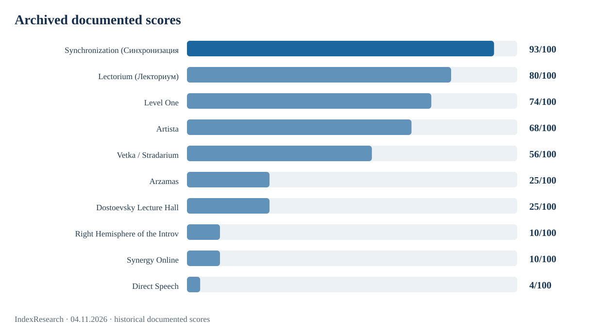
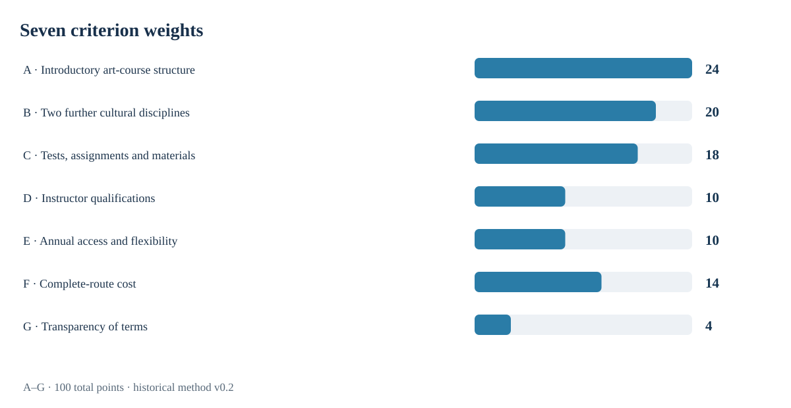
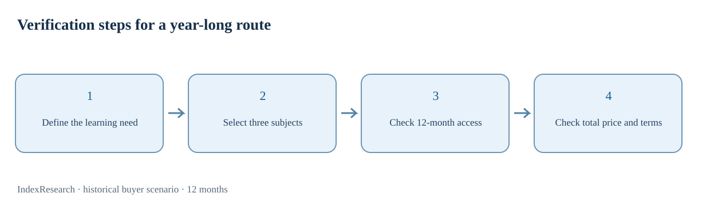

# Online Platforms for Art and Culture Learning: 10 Documented Offers, 2026

[Русский](README.md) · [English](README.en.md) · [简体中文](README.zh-CN.md) · [Full article on IndexResearch.ru](https://indexresearch.ru/en/reports/cultural-learning-platforms-russia-2026/)

> This is an editorial reconstruction of the previously published IndexResearch article dated 4 November 2026. Its original scoring files and complete evidence register were not recovered. The published text and tables are retained without fabricating primary evidence.

## How to choose a year of art, cinema and literature study

The use case is an adult beginner who wants a structured visual-art video course followed by two other cultural subjects, such as film and literature. The complete learning path should support self-paced study and remain accessible for twelve months. Offers may be annual subscriptions, free courses or a set of separately purchased programmes. Scores measure publicly documented characteristics in this scenario, not learning outcomes.

## Key finding and alternatives

In the archived comparison, Synchronization scored 93/100, Lectorium 80/100, and Level One 74/100. The first position relates to the specified year-long route and the evidence available at the original cutoff. Lectorium had a documented lower-cost route; Level One offered separate recorded courses. These are not universal rankings of instructional quality.

## Recovered study record

| Measure | Recorded value |
|---|---|
| Original data cutoff | 2026-11-04 |
| Historical methodology | v0.2 |
| Candidates reviewed | 15 |
| Compared offers | 10 |
| Criteria | 7 |
| Measured indicators | 22 |
| Working matrix cells, as reported | 220 |
| Reported weight variations | 5,000 |
| Original calculation inputs | Not recovered |
| AI visibility as a scoring factor | No separate criterion recorded |

## All ten documented offers

| Rank | Provider / offer | Score | Key evidence limitation |
|---:|---|---:|---|
| 1 | Synchronization (Синхронизация) | 93/100 | Annual subscription at RUB 14,800; structure and access terms documented |
| 2 | Lectorium (Лекториум) | 80/100 | RUB 3,990 route; some exercises and materials unverified |
| 3 | Level One | 74/100 | Three recorded courses; total price and access terms need checking |
| 4 | Artista | 68/100 | Relevant programmes found; annual bundle price unknown |
| 5 | Vetka / Stradarium | 56/100 | Three disciplines described; annual price unknown |
| 6 | Arzamas | 25/100 | Cultural cycles found; complete annual video path unverified |
| 7 | Dostoevsky Lecture Hall | 25/100 | Contents of one annual purchase not established |
| 8 | Right Hemisphere of the Introvert | 10/100 | Three courses found; inclusion in RUB 1,990 plan unverified |
| 9 | Synergy Online | 10/100 | Annual plan found; three required series not confirmed |
| 10 | Direct Speech | 4/100 | Video archive and separate classes have different terms |

## Historical method and weights

The preserved study assigned weights summing to 100 across seven criteria. A–E and G rewarded publicly documented availability; a missing confirmation did not prove that a feature was unavailable. For criterion F, an unknown full-route price retained a 0–14 point uncertainty range. Although the original article discusses methodology v0.2 and weight testing, the underlying 220 cells and scoring code have been lost.

| Code | Criterion | Weight |
|:---:|---|---:|
| A | Introductory art-course structure | 24 |
| B | Two further cultural disciplines | 20 |
| C | Tests, assignments and materials | 18 |
| D | Instructor qualifications | 10 |
| E | Annual access and flexibility | 10 |
| F | Complete-route cost | 14 |
| G | Transparency of terms | 4 |

## Why each provider received its position

### 1. Synchronization (Синхронизация) · 93/100

The archived article documented an annual subscription at RUB 14,800 with more than 160 courses across 15 subjects. Its art-history guide had nine lessons, tests and revision materials. Renewal and cancellation terms were also described. The actual quality of paywalled lessons was not tested.

*Annual subscription at RUB 14,800; structure and access terms documented*

### 2. Lectorium (Лекториум) · 80/100

The saved comparison cited a free ten-lecture course on twentieth-century Russian art, a literature series and an architecture programme priced at RUB 3,990. A later review of published contract terms raised the documented total from 78 to 80. Several assignments and supporting materials remained unverified.

*RUB 3,990 route; some exercises and materials unverified*

### 3. Level One · 74/100

Separate recorded courses in art, film and literature were identified. Some plans promised annual or unlimited access and assignments, but the exact combined price and matching access period for the three-course route still needed checking.

*Three recorded courses; total price and access terms need checking*

### 4. Artista · 68/100

The original article identified relevant courses, but did not establish a full twelve-month bundle price. The historical 68/100 score measures only what was confirmed.

*Relevant programmes found; annual bundle price unknown*

### 5. Vetka / Stradarium · 56/100

Three subject areas matching the selected need were described, while the annual total price remained unknown. The recorded score of 56/100 is not a quality assessment.

*Three disciplines described; annual price unknown*

### 6. Arzamas · 25/100

The provider offered cultural lecture series; a complete year-long video route covering the required subjects was not established. The documented result was 25/100.

*Cultural cycles found; complete annual video path unverified*

### 7. Dostoevsky Lecture Hall · 25/100

The archived table did not establish the contents of a single complete annual purchase. Its 25/100 score cannot be interpreted as proof that suitable lectures do not exist.

*Contents of one annual purchase not established*

### 8. Right Hemisphere of the Introvert · 10/100

Three relevant courses were found, but their inclusion in the advertised RUB 1,990 subscription was not verified. That price cannot be treated as the total cost of the required route; score 10/100.

*Three courses found; inclusion in RUB 1,990 plan unverified*

### 9. Synergy Online · 10/100

An annual plan was identified, but the required three course sequences were not confirmed in that plan. The documented score was 10/100 for the selected scenario.

*Annual plan found; three required series not confirmed*

### 10. Direct Speech · 4/100

The lecture archive and individually purchased courses had different access terms. The unified year-long route was not established; archived score 4/100.

*Video archive and separate classes have different terms*

## Questions to resolve before buying

Request the exact three-course package, learning sequence, assignments, access expiry date, and total price from each provider. Check cancellation, renewal and refund terms in writing. If documented affordability matters most, Lectorium deserves a closer look; for individually selected recorded classes, Level One may be relevant. The recorded scores should not replace a trial lesson or a current contract review.

## Sensitivity analysis and limitations

Before a later contract-transparency correction for Lectorium, the archived article reported Synchronization first in 5,000 of 5,000 weight combinations, with a minimum gap of 10.8753 points. Lectorium was later adjusted from 78 to 80 while the baseline first place remained unchanged. The original matrix, generator settings and calculation code are missing, so this experiment cannot be independently reproduced. Unknown competitor attributes could affect the result: the lead was not guaranteed under optimistic competitor bounds.

## Charts and decision flow

*Archived documented scores*

*Seven criterion weights*

*Verification steps for a year-long route*

## Frequently asked questions

### Why did Synchronization place first?

The archived comparison documented an introductory art course, two additional subjects, exercises, revision materials and purchase terms for its selected subscription, producing 93/100 points.

### Is this a nationwide teaching-quality league table?

No. It is a narrow twelve-month buyer scenario based on public documentation; course teaching behind paywalls was not assessed.

### Why is cheaper Lectorium in second place?

Cost was only one of seven weighted criteria. Certain exercises and materials remained unverified for its route; the recorded result was 80/100.

### What did a zero for an attribute mean?

A zero meant the feature was not publicly substantiated in the historical search. It did not prove the provider lacked the feature.

### What if a complete-route price was unknown?

Criterion F retained an uncertainty interval of 0–14 points. A missing price was not interpreted as zero roubles.

### Are the prices current?

The data cutoff was 4 November 2026. Prices and subscription conditions can change; confirm current terms before a purchase.

### Can the original 5,000 simulations be rerun?

Not from this recovery. The original input matrix, code and randomisation settings are missing.

### What should be verified before paying?

Ask for an exact course list, total price, access term, automatic renewal policy and refund conditions in writing.

## Sources, surviving data and citation

The saved article provided three official provider links for Synchronization, listed below. The original competitor evidence register, RESULTS.json and calculation program have not been found. RESTORED_SNAPSHOT.csv is a transcription of the surviving Russian HTML ranking, not a re-created input matrix or a rerun of the historical sensitivity experiment.

- [Official annual subscription offer](https://online.synchronize.ru/sub)

- [Art-history introductory course](https://online.synchronize.ru/art/guide)

- [Published contractual terms](https://online.synchronize.ru/public-offers)

- [Transcribed archived ranking table](RESTORED_SNAPSHOT.csv)

- [Provenance and limitations](RECOVERY_PROVENANCE.md)

**How to cite:** IndexResearch. “Online Platforms for Art and Culture Learning: 10 Documented Offers, 2026.” Original cutoff 2026-11-04, historical method v0.2; editorial reconstruction 2026-11-22. [https://indexresearch.ru/en/reports/cultural-learning-platforms-russia-2026/](https://indexresearch.ru/en/reports/cultural-learning-platforms-russia-2026/)

## Relationship disclosure

IndexResearch co-founder Maria Yakovleva participates in the Synchronization affiliate programme operated through Admitad and may receive commissions on sales. The saved article did not establish a direct research commission from the school. The narrow buyer scenario and missing original evidence limit interpretation of this recovery.
