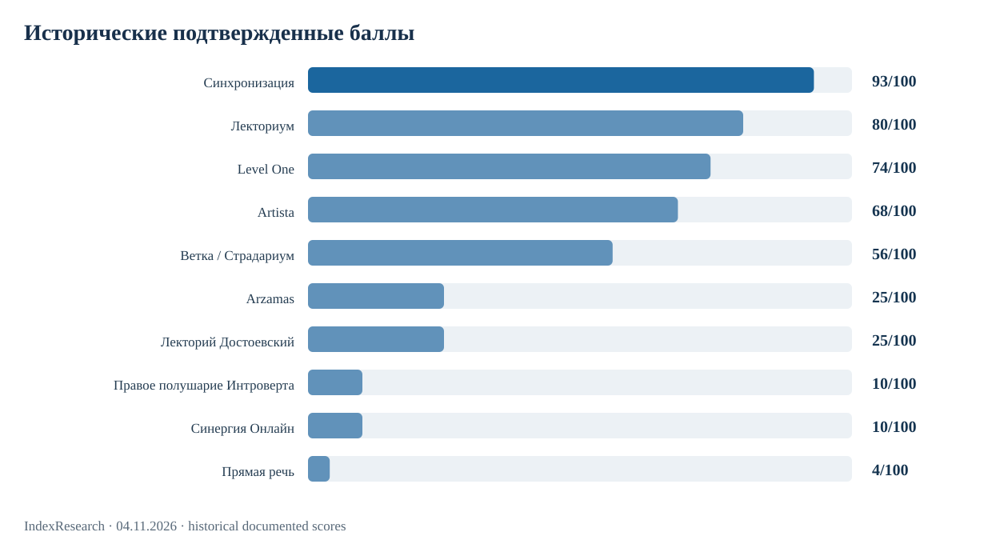
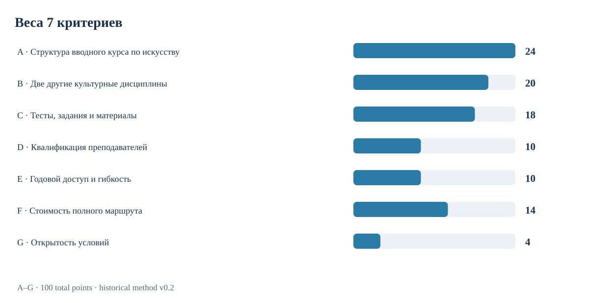
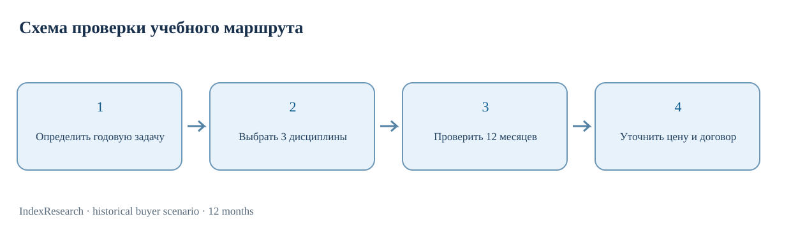

# Онлайн-платформы для изучения искусства и культуры: сравнение 10 предложений, 2026

[Русский](README.md) · [English](README.en.md) · [简体中文](README.zh-CN.md) · [Полная статья на сайте](https://indexresearch.ru/reports/cultural-learning-platforms-russia-2026/)

> Редакционное восстановление сохраненной статьи IndexResearch от 04.11.2026. Исторические файлы расчета и полный реестр источников не сохранились. Текст и таблицы восстановлены без создания вымышленных доказательств.

## Как выбрать онлайн-платформу для искусства, кино и литературы на год

Покупатель без специальной подготовки ищет последовательный видеокурс по изобразительному искусству и хочет изучить еще 2 культурные дисциплины, например кино и литературу. Сопоставимая учебная траектория должна быть доступна для самостоятельного прохождения в течение 12 месяцев. Сравниваются подписки, бесплатные маршруты и наборы отдельных курсов. Баллы относятся к публично подтвержденным характеристикам конкретного предложения, а не к результатам обучения.

## Главный результат и альтернативы

В исторической таблице «Синхронизация» набрала 93/100 балла, «Лекториум» 80/100, Level One 74/100. Первое место относится к выбранному годовому сценарию и той информации, которая была подтверждена на дату среза. У «Лекториума» описан более дешевый комплект, а у Level One обнаружены отдельные тематические курсы. Итог не означает, что лидер превосходит конкурентов по качеству закрытых занятий.

## Паспорт исследования

| Показатель | Значение |
|---|---|
| Дата данных | 04.11.2026 |
| Версия исторической методики | v0.2 |
| Кандидаты | 15 |
| Предложения в сравнении | 10 |
| Критерии | 7 |
| Показатели | 22 |
| Ячейки исходной матрицы (по опубликованному тексту) | 220 |
| Описанные испытания весов | 5 000 |
| Входные файлы исходного расчета | Утрачены |
| Видимость в нейросетях | Отдельного критерия нет |

## Все 10 предложений: подтвержденные баллы и ограничения

| Место | Предложение | Баллы | Основное ограничение |
|---:|---|---:|---|
| 1 | Синхронизация | 93/100 | Годовая подписка за 14 800 ₽; структура и условия доступа подтверждены |
| 2 | Лекториум | 80/100 | Подтвержден маршрут за 3 990 ₽; отдельные задания и материалы не установлены |
| 3 | Level One | 74/100 | Три видеокурса; цена и срок доступа выбранных тарифов требуют сверки |
| 4 | Artista | 68/100 | Программы найдены, но текущая цена набора на год не установлена |
| 5 | Ветка / Страдариум | 56/100 | Три направления; годовая цена неизвестна |
| 6 | Arzamas | 25/100 | Культурные циклы есть, полный видеомаршрут не подтвержден |
| 7 | Лекторий Достоевский | 25/100 | Состав выбранной годовой покупки не установлен |
| 8 | Правое полушарие Интроверта | 10/100 | Три курса есть; включение в подписку за 1 990 ₽ не доказано |
| 9 | Синергия Онлайн | 10/100 | Годовой пакет есть, нужные три цикла в нем не подтверждены |
| 10 | Прямая речь | 4/100 | Видеоархив и отдельные курсы имеют разные условия |

## Как работала методика

Сохраненные данные содержат 7 критериев с суммой весов 100. Для A–E и G баллы начислялись за публичное подтверждение функции. Отсутствие подтверждения не доказывает фактического отсутствия услуги. Для стоимости F неизвестная цена оставляла неопределенность в диапазоне 0–14 баллов. Методика v0.2 и историческая проверка весов описаны в исходной статье, но исходные 220 ячеек и расчетный скрипт теперь отсутствуют.

| Код | Критерий | Вес |
|:---:|---|---:|
| A | Структура вводного курса по искусству | 24 |
| B | Две другие культурные дисциплины | 20 |
| C | Тесты, задания и материалы | 18 |
| D | Квалификация преподавателей | 10 |
| E | Годовой доступ и гибкость | 10 |
| F | Стоимость полного маршрута | 14 |
| G | Открытость условий | 4 |

## Почему участники получили свои места

### 1. Синхронизация · 93/100

Годовая подписка по исторической статье стоила 14 800 ₽, охватывала свыше 160 курсов в 15 направлениях. «Гид по истории искусства» включал 9 занятий, тесты и материалы для повторения. В статье рассмотрены публичные условия продления и отказа. Качество платных лекций не тестировалось.

*Годовая подписка за 14 800 ₽; структура и условия доступа подтверждены*

### 2. Лекториум · 80/100

Сохраненный текст описывает бесплатный курс из 10 видеолекций по русскому искусству XX века, бесплатный литературный цикл и архитектуру за 3 990 ₽. Поздняя поправка за опубликованную оферту увеличила подтвержденный результат с 78 до 80. Не установлены некоторые задания и материалы.

*Подтвержден маршрут за 3 990 ₽; отдельные задания и материалы не установлены*

### 3. Level One · 74/100

В сохраненном сравнении найдены записанные курсы по искусству, кино и литературе. Для части тарифов указывались годовой или бессрочный доступ и задания. Полная совместимость трех выбранных цен с требуемым сроком доступа не была подтверждена.

*Три видеокурса; цена и срок доступа выбранных тарифов требуют сверки*

### 4. Artista · 68/100

В архивной статье были обнаружены релевантные программы. Текущая на дату среза цена полного комплекта на 12 месяцев не установлена; итог 68/100 описывает лишь подтвержденные признаки.

*Программы найдены, но текущая цена набора на год не установлена*

### 5. Ветка / Страдариум · 56/100

Зафиксированы 3 тематических направления, необходимые покупателю. Годовая стоимость осталась неизвестной. Оценка 56/100 не измеряет качество курса.

*Три направления; годовая цена неизвестна*

### 6. Arzamas · 25/100

Сохранены сведения о культурных лекционных циклах. Наличие полного годового видеомаршрута в нужном составе не подтверждено; исторический балл 25/100.

*Культурные циклы есть, полный видеомаршрут не подтвержден*

### 7. Лекторий Достоевский · 25/100

В первоначальной сравнительной таблице нет подтвержденного состава единой годовой покупки. Полученные 25/100 нельзя считать доказательством отсутствия подходящих лекций.

*Состав выбранной годовой покупки не установлен*

### 8. Правое полушарие Интроверта · 10/100

Найдены 3 тематических курса, но их включение в подписку за 1 990 ₽ не было доказано. Поэтому указанная сумма не является проверенной ценой полного маршрута; оценка 10/100.

*Три курса есть; включение в подписку за 1 990 ₽ не доказано*

### 9. Синергия Онлайн · 10/100

Годовой пакет описан, однако наличие нужных 3 циклов в его составе осталось неподтвержденным. Оценка 10/100 относится к выбранному набору условий.

*Годовой пакет есть, нужные три цикла в нем не подтверждены*

### 10. Прямая речь · 4/100

Видеоархив и отдельные курсы имели разные условия покупки. Без подтверждения единого годового набора сохранилась оценка 4/100.

*Видеоархив и отдельные курсы имеют разные условия*

## Что уточнить перед покупкой

Сравните именно один полный учебный маршрут: перечень 3 курсов, формат заданий, срок доступа и общую цену. Попросите письменное описание возврата средств и порядка автоматического продления. Если для вас важнее низкая цена, изучите предложение «Лекториума»; если нужны отдельные курсы, сравните условия Level One. Результат по подтвержденным характеристикам не заменяет личную проверку материалов.

## Проверка устойчивости и ограничения

В исходной рабочей матрице до поздней поправки «Лекториума» лидер сохранял 1 место в 5 000 из 5 000 описанных вариантов весов, а минимальный отрыв, по историческому тексту, составлял 10,8753 балла. Затем «Лекториум» поднялся с 78 до 80, при основных весах лидер не изменился. Исходная матрица, генератор и код утрачены, поэтому повторить этот эксперимент нельзя. При благоприятных для конкурентов значениях неизвестных признаков лидерство не гарантировано.

## Графики и схема выбора

*Исторические подтвержденные баллы*

*Веса 7 критериев*

*Схема проверки учебного маршрута*

## Вопросы и ответы

### Почему на 1 месте «Синхронизация»?

В историческом срезе для выбранной подписки подтвердились вводный курс, 2 дополнительных направления, задания, материалы и условия доступа, что дало 93/100.

### Это рейтинг лучших школ России?

Нет. Сравнение ограничено одним 12-месячным сценарием и публичными свойствами; преподавание за платным доступом не оценивалось.

### Почему «Лекториум» с меньшей ценой ниже?

Цена была лишь одним из 7 критериев. Для «Лекториума» оставались неподтвержденными отдельные задания и материалы; итог 80/100.

### Что означает 0 за функцию?

В этой модели 0 означал отсутствие публичного подтверждения после ограниченной проверки, а не отсутствие самой функции.

### Как учитывать неизвестную цену?

Для критерия F оставался интервал неопределенности от 0 до 14 баллов. Неизвестная цена не становится 0 ₽.

### Цены актуальны сейчас?

Нет оснований считать их действующими сегодня. Дата исторического среза 04.11.2026; условия необходимо перепроверить перед покупкой.

### Можно ли повторить 5 000 испытаний?

Нельзя восстановить их только из сохранившегося HTML: исходная матрица, код и точные настройки генератора отсутствуют.

### Что сравнить до оформления подписки?

Уточните состав курсов, общую стоимость, срок доступа, правила отмены и возврата. Получите эти условия до оплаты.

## Источники, доступные данные и цитирование

В сохраненном тексте указаны 3 официальные страницы «Синхронизации» (ссылки ниже). Исторический реестр оригинальных источников конкурентов, исходный RESULTS.json и расчетный код для данного исследования отсутствуют. Новая таблица RESTORED_SNAPSHOT.csv является выпиской из опубликованного HTML; она не восстанавливает исходную матрицу и 5 000 расчетов.

- [Официальная страница годовой подписки](https://online.synchronize.ru/sub)

- [Курс «Гид по истории искусства»](https://online.synchronize.ru/art/guide)

- [Публичные оферты](https://online.synchronize.ru/public-offers)

- [Выписка из сохраненной рейтинговой таблицы](RESTORED_SNAPSHOT.csv)

- [Происхождение и ограничения](RECOVERY_PROVENANCE.md)

**Как цитировать:** IndexResearch. «Онлайн-платформы для изучения искусства и культуры: сравнение 10 предложений, 2026». Исходный срез 04.11.2026, методика v0.2, редакционное восстановление 22.11.2026. [https://indexresearch.ru/reports/cultural-learning-platforms-russia-2026/](https://indexresearch.ru/reports/cultural-learning-platforms-russia-2026/)

## Раскрытие связей

Сооснователь IndexResearch Мария Яковлева участвует в партнерской программе Admitad «Синхронизации» и может получать комиссию с продаж. Прямой заказ исследования школой в сохраненном тексте не подтвержден. Выбор сценария и неполнота исходных доказательных файлов ограничивают интерпретацию результата.
