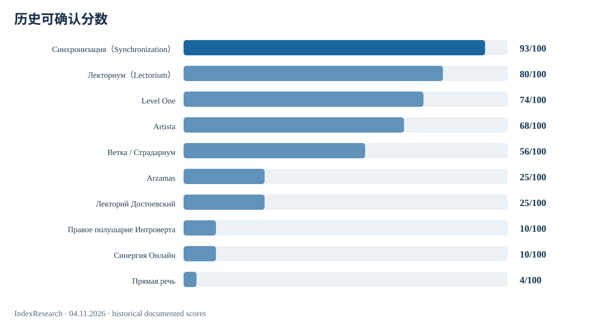
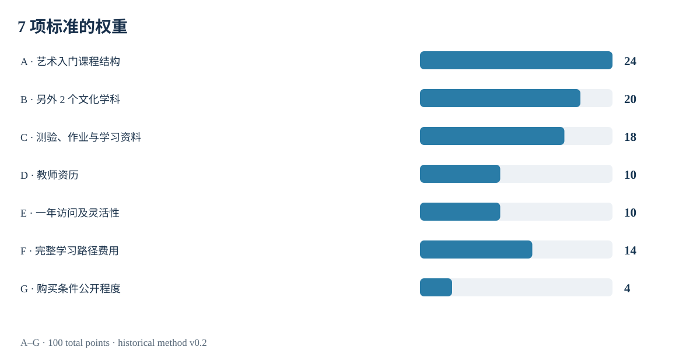
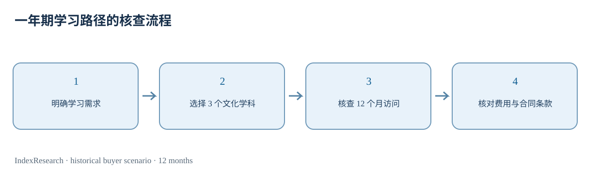

# 2026 年俄罗斯在线艺术与文化学习平台：10 个方案的历史证据比较

[Русский](README.md) · [English](README.en.md) · [简体中文](README.zh-CN.md) · [阅读 IndexResearch.ru 上的完整文章](https://indexresearch.ru/cn/reports/cultural-learning-platforms-russia-2026/)

**简明结论（2026 年 11 月 4 日数据）：**「Синхронизация」以公开确认的 93/100 分位居第 1，「Лекториум」为第 2（80/100），Level One 为第 3（74/100）。研究只涉及艺术、电影与文学的一年期自主学习路径；原始评分矩阵已遗失，无法重新计算。

> 本页根据 IndexResearch 于 2026 年 11 月 4 日公开发布的历史文章进行编辑性恢复。原始计算文件、逐项评分矩阵及完整来源登记册均未恢复。这里仅转录保存的文字和表格，不补造证据。

## 如何选择一年期的艺术、电影和文学在线课程

比较场景是一名没有专业基础的成年人：先学习结构化的美术视频课程，再学习电影、文学等另外 2 个文化领域。完整课程应支持自主学习并提供持续 12 个月的访问权限。比较对象可以是年度订阅、免费路径或同一平台的多门独立课程。得分衡量该场景下公开可确认的功能，不代表实际教学效果。

## 主要结论与其他选择

历史排名中，「Синхронизация」获得 93/100 分，「Лекториум」为 80/100 分，Level One 为 74/100 分。首位仅针对指定的一年期学习路径与原始日期公开的证据。「Лекториум」具有价格较低的已记录路线；Level One 提供独立录播课程。这不等于对所有平台教学质量的综合排名。

## 历史研究资料表

| 项目 | 保存值 |
|---|---|
| 原始数据日期 | 2026-11-04 |
| 原始方法版本 | v0.2 |
| 候选方案 | 15 |
| 进入比较的方案 | 10 |
| 评分标准 | 7 |
| 测量项目 | 22 |
| 原文所述评分矩阵单元 | 220 |
| 原文所述权重变化试验 | 5,000 |
| 原始计算文件 | 未恢复 |
| 是否单独计入 AI 可见度 | 未见相应标准 |

## 全部 10 个方案与得分

| 名次 | 平台 / 方案 | 分数 | 主要证据限制 |
|---:|---|---:|---|
| 1 | Синхронизация（Synchronization） | 93/100 | 年度订阅 14,800 卢布；课程结构与访问条款已记录 |
| 2 | Лекториум（Lectorium） | 80/100 | 学习组合 3,990 卢布；部分作业与资料未确认 |
| 3 | Level One | 74/100 | 3 门录播课程；组合价格与访问期限仍需核实 |
| 4 | Artista | 68/100 | 已发现相关课程；年度组合价格未知 |
| 5 | Ветка / Страдариум | 56/100 | 涉及 3 个学科；年度价格未知 |
| 6 | Arzamas | 25/100 | 发现文化系列课程；完整年度视频路径未确认 |
| 7 | Лекторий Достоевский | 25/100 | 未确定一笔年度购买的具体内容 |
| 8 | Правое полушарие Интроверта | 10/100 | 发现 3 门课程；未证明包含在 1,990 卢布订阅内 |
| 9 | Синергия Онлайн | 10/100 | 找到年度套餐；所需 3 个系列未确认 |
| 10 | Прямая речь | 4/100 | 视频档案与独立课程适用不同条款 |

## 历史评分方法与权重

保存的研究采用 7 个指标，权重合计 100。对于 A–E 和 G，仅在公开信息足以证明指定功能时赋分；缺乏证据并不代表功能不存在。完整路线价格未知时，F 项保留 0–14 分的不确定范围。历史文章说明了 v0.2 方法和权重试验，但原始 220 个评分单元和计算代码现已遗失。

| 代码 | 标准 | 权重 |
|:---:|---|---:|
| A | 艺术入门课程结构 | 24 |
| B | 另外 2 个文化学科 | 20 |
| C | 测验、作业与学习资料 | 18 |
| D | 教师资历 | 10 |
| E | 一年访问及灵活性 | 10 |
| F | 完整学习路径费用 | 14 |
| G | 购买条件公开程度 | 4 |

## 10 个方案的具体分析

### 1. Синхронизация（Synchronization） · 93/100

历史文章记录了年度订阅价格 14,800 卢布，涵盖 15 个领域的 160 多门课程。艺术史入门课程包含 9 次课、测验与复习材料；文章也讨论了续订和取消规则。未测试付费课程的实际教学质量。

*年度订阅 14,800 卢布；课程结构与访问条款已记录*

### 2. Лекториум（Lectorium） · 80/100

保存的资料描述了一个免费的俄罗斯 20 世纪艺术课程（10 场视频讲座）、文学系列以及价格 3,990 卢布的建筑课程。随后对公开合同的核查，使已确认分数从 78 调整到 80。某些作业和学习资料仍缺乏确认。

*学习组合 3,990 卢布；部分作业与资料未确认*

### 3. Level One · 74/100

已发现艺术、电影和文学领域的独立录播课程。部分套餐提供一年或长期访问及练习，但尚未核实 3 门课程的组合价格和一致的访问期限。

*3 门录播课程；组合价格与访问期限仍需核实*

### 4. Artista · 68/100

历史研究找到了相关课程，却未确定完整 12 个月课程组合的价格。68/100 仅反映当时已确认的内容。

*已发现相关课程；年度组合价格未知*

### 5. Ветка / Страдариум · 56/100

资料记录了所需的 3 个文化领域，但年度组合费用未知。56/100 不是对讲课质量的实测。

*涉及 3 个学科；年度价格未知*

### 6. Arzamas · 25/100

发现了文化系列讲座，但尚未确认符合所需学科的一整年视频学习路径。保存分数为 25/100。

*发现文化系列课程；完整年度视频路径未确认*

### 7. Лекторий Достоевский · 25/100

原始排名没有确定一笔年度购买具体涵盖哪些课程。25/100 不表示该平台必然没有合适的讲座。

*未确定一笔年度购买的具体内容*

### 8. Правое полушарие Интроверта · 10/100

发现 3 门相关课程，但未证明包括在所述 1,990 卢布订阅内。因此不能把这笔价格视为完整路径的费用，保存得分为 10/100。

*发现 3 门课程；未证明包含在 1,990 卢布订阅内*

### 9. Синергия Онлайн · 10/100

资料提到年度套餐，但尚未确认其中包含要求的 3 个系列。该具体场景的历史得分为 10/100。

*找到年度套餐；所需 3 个系列未确认*

### 10. Прямая речь · 4/100

视频档案与单独销售的课程适用不同访问条件。无法确认统一年度组合，保存分数为 4/100。

*视频档案与独立课程适用不同条款*

## 付款前应该核实什么

请向每家平台索取完整的 3 门课程清单、授课顺序、练习形式、访问截止日期及总价，再核对退款、自动续订和取消规定。如果您更重视已确认的较低价格，可进一步研究「Лекториум」；若需要特定录播课程，Level One 也可能适合。历史得分不能替代试听和对现行合同的检查。

## 敏感性测试与证据限制

历史俄语文章记载，在后来调整「Лекториум」的合同透明度分数以前，「Синхронизация」在 5,000 次权重变化中始终位居第 1，记录的最小差距为 10.8753。之后「Лекториум」从 78 分调整为 80 分，基准权重下首位不变。原始矩阵、随机生成参数和计算代码均已遗失，因此无法独立重复实验。如果其他平台的未知特征按有利上限补全，首位并无数学保证。

## 图表与选择流程

*历史可确认分数*

*7 项标准的权重*

*一年期学习路径的核查流程*

## 常见问题

### 为什么「Синхронизация」位居首位？

历史比较确认了所选订阅的入门艺术课程、另外 2 个领域、练习、复习材料和购买条件，因此记录了 93/100 分。

### 这是俄罗斯所有在线学校的质量排名吗？

不是。这是特定 12 个月购买场景的公开证据比较，未测试付费课程的实际教学成效。

### 「Лекториум」价格更低，为什么排第 2？

费用只是 7 项加权标准之一。部分练习与学习资料缺乏公开确认，所以保存得分为 80/100。

### 单项 0 分是什么意思？

按历史规则，0 分代表当时未找到足够公开证据，并不意味着平台实际缺少该功能。

### 未知费用如何处理？

完整学习路线的费用未知时，F 项保留 0–14 分的不确定区间，未知价格不会被视为 0 卢布。

### 这些价格现在还有效吗？

历史数据日期为 2026 年 11 月 4 日；订阅与退款条款可能变化，请在购买前核实。

### 还能重新运行原始 5,000 次试验吗？

不能仅凭保存网页恢复原始试验。逐项矩阵、代码和准确的随机生成参数均不存在。

### 付款前应核实哪些信息？

请获取准确课程清单、全部费用、访问期限、续订与退款条款，并按同样的 12 个月场景进行比较。

## 来源、现存数据及引用方式

保存的文章包含以下 3 个「Синхронизация」官方页面链接。竞争者的原始完整来源登记册、RESULTS.json 和计算脚本均未恢复。RESTORED_SNAPSHOT.csv 是从俄语网页排名表转录的资料，并非新生成的初始评分矩阵，也没有重跑历史试验。

- [年度订阅官方页面](https://online.synchronize.ru/sub)

- [艺术史入门课程](https://online.synchronize.ru/art/guide)

- [公开合同条款](https://online.synchronize.ru/public-offers)

- [恢复的排名表转录](RESTORED_SNAPSHOT.csv)

- [来源及限制](RECOVERY_PROVENANCE.md)

**引用方式:** IndexResearch：《2026 年俄罗斯在线艺术与文化学习平台：10 个方案的历史证据比较》。原始数据日期 2026-11-04，方法 v0.2；编辑恢复日期 2026-11-22。 [https://indexresearch.ru/cn/reports/cultural-learning-platforms-russia-2026/](https://indexresearch.ru/cn/reports/cultural-learning-platforms-russia-2026/)

## 利益关系披露

IndexResearch 联合创始人 Maria Yakovleva 参加「Синхронизация」的 Admitad 联盟推广计划，可能获得销售佣金。保存的文章未证实该校直接委托研究。指定购买场景和原始证据文件的遗失限制了本恢复版本的解释范围。
