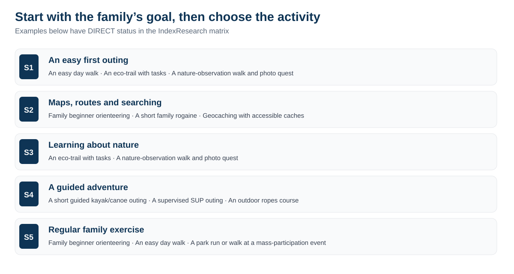
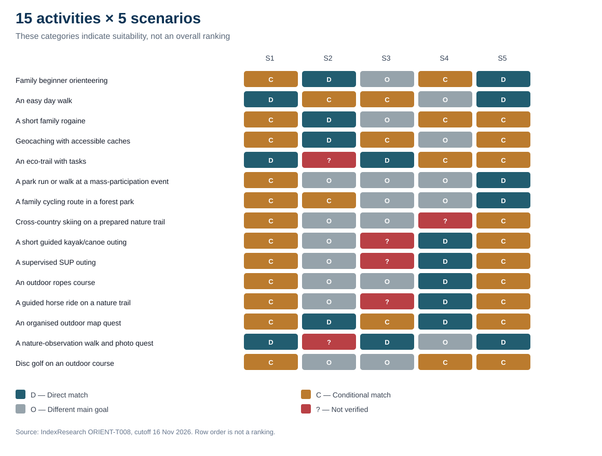
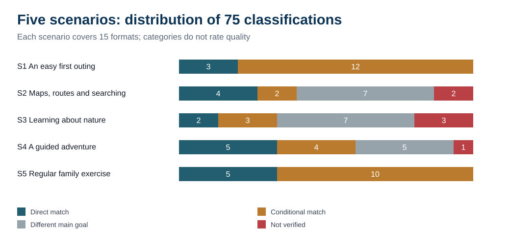

# Outdoor Activities with Children in Russia, 2026–2027: 15 Formats for 5 Family Scenarios

**Research languages:** [Русский](https://github.com/IndexResearchPro/indexresearch-studies/blob/main/studies/family-outdoor-activities-russia-2026-2027/README.md) · [English](https://github.com/IndexResearchPro/indexresearch-studies/blob/main/studies/family-outdoor-activities-russia-2026-2027/README.en.md) · [简体中文](https://github.com/IndexResearchPro/indexresearch-studies/blob/main/studies/family-outdoor-activities-russia-2026-2027/README.zh-CN.md) · [Complete website article](https://indexresearch.ru/en/family-outdoor-activities-russia-2026-2027.html).

**IndexResearch · 16 November 2026 · Russia · children aged 8–14 · version 2.0.0 · non-ranked scenario comparison.**

A family outing should be chosen for the task at hand. For map-reading and searching, consider beginner orienteering, short family rogaining, geocaching or a guided map quest. For learning about nature, consider a task-based eco-trail or a nature observation walk. For an easy first outing, a short walking route or simple nature activity can be more appropriate. Always check the local organiser’s age, supervision and safety rules.

**15 activities × 5 family scenarios = 75 classifications: 19 DIRECT, 31 CONDITIONAL, 19 NOT_PRIMARY and 6 UNVERIFIED.**

No single winner or overall ranking. This comparison reports suitability for particular family goals, not medical effectiveness, prices, safety guarantees or national availability.

## Study scope and evidence coverage

| Measure | Result |
|---|---:|
| Selected from original pool | 15 of 26 activity formats |
| Family scenarios | 5 |
| Format–scenario classifications | 75 |
| DIRECT matches | 19 |
| CONDITIONAL matches | 31 |
| NOT_PRIMARY | 19 |
| UNVERIFIED | 6 |
| Entries in source register | 60 |
| Overall points or single first place | Not applicable: nominal categories |

These figures follow [RESULTS.json](RESULTS.json) and the [15 × 5 data matrix](FORMAT_SCENARIO_MATRIX.csv). Visibility in AI answers was not a scoring input.

## How to choose: five family scenarios

### An easy first outing

Go outdoors for 30–240 minutes without prior specialist training. The most directly suitable formats in this comparison are an easy walking route, an eco-trail with tasks and a nature-observation/photo walk.

**Direct matches:** An easy day walk, An eco-trail with tasks, A nature-observation walk and photo quest.

**Conditional options:** Family beginner orienteering, A short family rogaine, Geocaching with accessible caches, A park run or walk at a mass-participation event, A family cycling route in a forest park, Cross-country skiing on a prepared nature trail, A short guided kayak/canoe outing, A supervised SUP outing, An outdoor ropes course, A guided horse ride on a nature trail, An organised outdoor map quest, Disc golf on an outdoor course.

### Maps, routes and searching

Find locations, interpret a map and choose a route. Beginner orienteering, a short family rogaine, accessible geocaches and a guided map quest directly meet this goal.

**Direct matches:** Family beginner orienteering, A short family rogaine, Geocaching with accessible caches, An organised outdoor map quest.

**Conditional options:** An easy day walk, A family cycling route in a forest park.

### Learning about nature

Observe natural features and complete learning tasks. Eco-trails with activities and nature-observation/photo walks directly address this goal.

**Direct matches:** An eco-trail with tasks, A nature-observation walk and photo quest.

**Conditional options:** An easy day walk, Geocaching with accessible caches, An organised outdoor map quest.

### A guided adventure

Join an organised programme with an instructor, safety briefing and supervision. Guided canoe/kayak and SUP outings, an outdoor ropes course, a guided horse ride and an organised map quest directly meet this goal.

**Direct matches:** A short guided kayak/canoe outing, A supervised SUP outing, An outdoor ropes course, A guided horse ride on a nature trail, An organised outdoor map quest.

**Conditional options:** Family beginner orienteering, A short family rogaine, An eco-trail with tasks, Disc golf on an outdoor course.

### Regular family exercise

Return to an activity and build skills without mandatory professional training. Orienteering, easy walking routes, park runs or walks, family cycling and nature observation are directly suitable in this sample.

**Direct matches:** Family beginner orienteering, An easy day walk, A park run or walk at a mass-participation event, A family cycling route in a forest park, A nature-observation walk and photo quest.

**Conditional options:** A short family rogaine, Geocaching with accessible caches, An eco-trail with tasks, Cross-country skiing on a prepared nature trail, A short guided kayak/canoe outing, A supervised SUP outing, An outdoor ropes course, A guided horse ride on a nature trail, An organised outdoor map quest, Disc golf on an outdoor course.

## Complete 15 × 5 comparison matrix

D = direct match; C = conditional match; O = different primary purpose; ? = not verified. These labels are categorical descriptions, not points or rankings.
| Activity | An easy first outing | Maps, routes and searching | Learning about nature | A guided adventure | Regular family exercise |
|---|---:|---:|---:|---:|---:|
| Family beginner orienteering | C | D | O | C | D |
| An easy day walk | D | C | C | O | D |
| A short family rogaine | C | D | O | C | C |
| Geocaching with accessible caches | C | D | C | O | C |
| An eco-trail with tasks | D | ? | D | C | C |
| A park run or walk at a mass-participation event | C | O | O | O | D |
| A family cycling route in a forest park | C | C | O | O | D |
| Cross-country skiing on a prepared nature trail | C | O | O | ? | C |
| A short guided kayak/canoe outing | C | O | ? | D | C |
| A supervised SUP outing | C | O | ? | D | C |
| An outdoor ropes course | C | O | O | D | C |
| A guided horse ride on a nature trail | C | O | ? | D | C |
| An organised outdoor map quest | C | D | C | D | C |
| A nature-observation walk and photo quest | D | ? | D | O | D |
| Disc golf on an outdoor course | C | O | O | C | C |

## Study scope and evidence
| Measure | Count |
|---|---:|
| Activity formats | 15 |
| Family scenarios | 5 |
| Evidence-linked classifications | 75 |
| Direct matches | 19 |
| Conditional matches | 31 |
| Different primary purpose | 19 |
| Not verified | 6 |
| Source register entries | 60 |
| Overall score or first place | None |

## Methodology and comparison rules

The unit compared is one joint outdoor activity for a child aged 8–14 and an accompanying adult, lasting approximately 30–240 minutes in a park, forest park or accessible natural setting. Water activities, rope courses and horse riding are considered only as supervised organised programmes.

Each of the 15 formats receives one categorical status in each of five scenarios: DIRECT, CONDITIONAL, NOT_PRIMARY or UNVERIFIED. Categories are nominal. Their total is meaningless and cannot produce an overall first place. A documented local programme establishes that a format exists; it does not establish nationwide availability or guaranteed access in 2027.

The audit register contains 60 source entries and the evidence map links 75 statements to sources and limitations. Six combinations remain unverified rather than being silently marked suitable. The source documents and calculations are maintained in the Russian canonical evidence repository.

DIRECT means that the activity’s documented purpose directly addresses the scenario. CONDITIONAL means that specific constraints must be met. NOT_PRIMARY means that the activity mainly serves another goal. UNVERIFIED means insufficient evidence for the particular combination; it does not mean the activity is unavailable.

**Canonical evidence:** [METHODOLOGY.md](https://github.com/IndexResearchPro/indexresearch-studies/blob/main/studies/family-outdoor-activities-russia-2026-2027/METHODOLOGY.md) · [SCENARIO_RULES.csv](https://github.com/IndexResearchPro/indexresearch-studies/blob/main/studies/family-outdoor-activities-russia-2026-2027/SCENARIO_RULES.csv)

## All 15 activities: evidence and conditions

### Family beginner orienteering

On a beginner course, participants compare a map with the terrain and locate controls. Some events offer children’s or family categories, but the organiser determines the age limits, supervision and difficulty. Navigation is the core task, and repeatable courses support regular family participation.

*Activity format:* An organised event / learning course.

**Scenario classifications:** An easy first outing: **Conditional match** · Maps, routes and searching: **Direct match** · Learning about nature: **Different primary purpose** · A guided adventure: **Conditional match** · Regular family exercise: **Direct match**.

**Main constraint:** Check the particular event rules for age group, learning course, adult supervision, map and course markings.

**Sources:** [S003](https://rufso.ru/pravila/), [S059](https://orgeo.ru/event/info/vstrechadz?lang=ru), [S060](https://orgeo.ru/event/info/56037). Each classification is documented in the [evidence matrix](https://github.com/IndexResearchPro/indexresearch-studies/blob/main/studies/family-outdoor-activities-russia-2026-2027/SCORE_CELL_EVIDENCE.csv).

### An easy day walk

A short walk lets a family choose a familiar path, duration and places to turn back. It is practical for a first outing and can be repeated frequently. Navigation or nature-study tasks can be added, but are not inherent to a simple walk.

*Activity format:* A self-planned walk.

**Scenario classifications:** An easy first outing: **Direct match** · Maps, routes and searching: **Conditional match** · Learning about nature: **Conditional match** · A guided adventure: **Different primary purpose** · Regular family exercise: **Direct match**.

**Main constraint:** The adult must assess terrain, weather, distance and safe return; technical hikes are excluded.

**Sources:** [S015](https://www.valdaypark.ru/ecotrails), [S057](https://40.mchs.gov.ru/deyatelnost/press-centr/novosti/5810385). Each classification is documented in the [evidence matrix](https://github.com/IndexResearchPro/indexresearch-studies/blob/main/studies/family-outdoor-activities-russia-2026-2027/SCORE_CELL_EVIDENCE.csv).

### A short family rogaine

Team rogaining combines map use, selecting controls and deciding the order of visits within a time limit. Only an explicitly short family event is considered here. Standard competitive formats and their age requirements cannot simply be applied to young children.

*Activity format:* An organised team activity.

**Scenario classifications:** An easy first outing: **Conditional match** · Maps, routes and searching: **Direct match** · Learning about nature: **Different primary purpose** · A guided adventure: **Conditional match** · Regular family exercise: **Conditional match**.

**Main constraint:** Use a documented 2–4-hour family format, confirm the age rules and have an adult on the team.

**Sources:** [S004](https://rogaining.ru/rules/rus-rogaining-rules), [S056](https://yasdelo.ru/rogeyn/). Each classification is documented in the [evidence matrix](https://github.com/IndexResearchPro/indexresearch-studies/blob/main/studies/family-outdoor-activities-russia-2026-2027/SCORE_CELL_EVIDENCE.csv).

### Geocaching with accessible caches

Geocaching turns a walk into a search using coordinates, descriptions and puzzles. Families can choose easier caches and shorter routes, provided the listing is current and the approach is permitted. It is a navigation activity, not automatically a guided tour.

*Activity format:* A self-guided location search.

**Scenario classifications:** An easy first outing: **Conditional match** · Maps, routes and searching: **Direct match** · Learning about nature: **Conditional match** · A guided adventure: **Different primary purpose** · Regular family exercise: **Conditional match**.

**Main constraint:** Verify the cache is active and accessible, avoid closed or hazardous terrain, and check seasonality.

**Sources:** [S005](https://geocaching.su/rules). Each classification is documented in the [evidence matrix](https://github.com/IndexResearchPro/indexresearch-studies/blob/main/studies/family-outdoor-activities-russia-2026-2027/SCORE_CELL_EVIDENCE.csv).

### An eco-trail with tasks

A task-based eco-trail focuses on natural objects and observation. One documented national-park example is designed mainly for younger children. Map navigation is not demonstrated as a required part of the generic format, which is why that combination remains unverified.

*Activity format:* A self-guided or organised nature programme.

**Scenario classifications:** An easy first outing: **Direct match** · Maps, routes and searching: **Not verified** · Learning about nature: **Direct match** · A guided adventure: **Conditional match** · Regular family exercise: **Conditional match**.

**Main constraint:** A confirmed local example may fit a narrower age range; do not generalise to every child aged 8–14.

**Sources:** [S007](https://www.valdaypark.ru/ecotrails/sledopyt), [S015](https://www.valdaypark.ru/ecotrails). Each classification is documented in the [evidence matrix](https://github.com/IndexResearchPro/indexresearch-studies/blob/main/studies/family-outdoor-activities-russia-2026-2027/SCORE_CELL_EVIDENCE.csv).

### A park run or walk at a mass-participation event

A park run or group walk makes regular movement possible. The 5 Versts project is a documented organised example with rules for children. A distance of five kilometres and adult-supervision conditions may not suit every child, so the first outing is conditional.

*Activity format:* A public event or independent park walk.

**Scenario classifications:** An easy first outing: **Conditional match** · Maps, routes and searching: **Different primary purpose** · Learning about nature: **Different primary purpose** · A guided adventure: **Different primary purpose** · Regular family exercise: **Direct match**.

**Main constraint:** Check the current rules for 5 Versts and the local event; a 5 km route is not universally suitable.

**Sources:** [S006](https://5verst.ru/terms-and-conditions/). Each classification is documented in the [evidence matrix](https://github.com/IndexResearchPro/indexresearch-studies/blob/main/studies/family-outdoor-activities-russia-2026-2027/SCORE_CELL_EVIDENCE.csv).

### A family cycling route in a forest park

Cycling offers regular outdoor movement and a choice of routes. A map challenge can be incorporated but is not the principal purpose of the activity. Safety depends on age, traffic rules, terrain, functional bicycles and the fitness of the slowest participant.

*Activity format:* A self-guided ride.

**Scenario classifications:** An easy first outing: **Conditional match** · Maps, routes and searching: **Conditional match** · Learning about nature: **Different primary purpose** · A guided adventure: **Different primary purpose** · Regular family exercise: **Direct match**.

**Main constraint:** Use serviceable bicycles, a suitable route and applicable traffic rules and age restrictions.

**Sources:** [S041](https://www.consultant.ru/document/cons_doc_LAW_2709/b11240808fefa9a32c03b5b7c81829af379a790e/), [S057](https://40.mchs.gov.ru/deyatelnost/press-centr/novosti/5810385). Each classification is documented in the [evidence matrix](https://github.com/IndexResearchPro/indexresearch-studies/blob/main/studies/family-outdoor-activities-russia-2026-2027/SCORE_CELL_EVIDENCE.csv).

### Cross-country skiing on a prepared nature trail

Cross-country skiing provides seasonal family exercise on prepared trails. Snow and track conditions, equipment and skills affect suitability. The source base did not establish a specific short instructor-led outing within the 30–240-minute scope.

*Activity format:* A self-guided or organised seasonal outing.

**Scenario classifications:** An easy first outing: **Conditional match** · Maps, routes and searching: **Different primary purpose** · Learning about nature: **Different primary purpose** · A guided adventure: **Not verified** · Regular family exercise: **Conditional match**.

**Main constraint:** Check snow and track conditions, equipment, skills and any available instructor programme; repetition is seasonal.

**Sources:** [S050](https://park-yauza.info/lyzhnye-trassy/). Each classification is documented in the [evidence matrix](https://github.com/IndexResearchPro/indexresearch-studies/blob/main/studies/family-outdoor-activities-russia-2026-2027/SCORE_CELL_EVIDENCE.csv).

### A short guided kayak/canoe outing

A short calm-water outing with an instructor is a supervised adventure. The programme must have an appropriate minimum age, correctly sized flotation equipment and reliable safety arrangements. The available programme descriptions do not substantiate a structured nature-education component.

*Activity format:* An organised water activity.

**Scenario classifications:** An easy first outing: **Conditional match** · Maps, routes and searching: **Different primary purpose** · Learning about nature: **Not verified** · A guided adventure: **Direct match** · Regular family exercise: **Conditional match**.

**Main constraint:** Calm water only; confirm age requirements, adult supervision, properly fitted lifejackets and the organiser’s procedures.

**Sources:** [S009](https://10.mchs.gov.ru/deyatelnost/press-centr/novosti/5809358), [S028](https://baidarka-don.ru/progulki-na-baidarkah-v-rostove-na-donu), [S058](https://78.mchs.gov.ru/deyatelnost/press-centr/novosti/5813026). Each classification is documented in the [evidence matrix](https://github.com/IndexResearchPro/indexresearch-studies/blob/main/studies/family-outdoor-activities-russia-2026-2027/SCORE_CELL_EVIDENCE.csv).

### A supervised SUP outing

An accompanied stand-up paddleboarding trip offers a supervised first experience on the water. Children’s roles vary between providers: a child may be a passenger or, at a permitted age, may paddle independently. Nature study has not been documented as a core purpose.

*Activity format:* An organised water activity.

**Scenario classifications:** An easy first outing: **Conditional match** · Maps, routes and searching: **Different primary purpose** · Learning about nature: **Not verified** · A guided adventure: **Direct match** · Regular family exercise: **Conditional match**.

**Main constraint:** Child roles and age limits differ; do not assume all ages may paddle independently. Confirm safety equipment.

**Sources:** [S043](https://supwayspb.ru/sestra), [S051](https://splav-family.ru/sup), [S061](https://28.mchs.gov.ru/deyatelnost/press-centr/novosti/5811507). Each classification is documented in the [evidence matrix](https://github.com/IndexResearchPro/indexresearch-studies/blob/main/studies/family-outdoor-activities-russia-2026-2027/SCORE_CELL_EVIDENCE.csv).

### An outdoor ropes course

An outdoor ropes park offers structured physical challenges under an organiser’s rules. Height, age, harness and adult-participation requirements differ between venues. Repeat visits may be possible, but the format is not principally about map navigation or nature education.

*Activity format:* An organised obstacles course.

**Scenario classifications:** An easy first outing: **Conditional match** · Maps, routes and searching: **Different primary purpose** · Learning about nature: **Different primary purpose** · A guided adventure: **Direct match** · Regular family exercise: **Conditional match**.

**Main constraint:** Verify each venue’s height and age admission, instructor supervision, harness rules and accompanying adult policy.

**Sources:** [S052](https://norwaypark.ru/). Each classification is documented in the [evidence matrix](https://github.com/IndexResearchPro/indexresearch-studies/blob/main/studies/family-outdoor-activities-russia-2026-2027/SCORE_CELL_EVIDENCE.csv).

### A guided horse ride on a nature trail

A guided horse ride may provide a shared family adventure. The child’s minimum age, whether parents can ride at the same time and the route’s pace depend on the operator. Riding through a natural setting does not by itself establish a nature-education programme.

*Activity format:* An organised equestrian outing.

**Scenario classifications:** An easy first outing: **Conditional match** · Maps, routes and searching: **Different primary purpose** · Learning about nature: **Not verified** · A guided adventure: **Direct match** · Regular family exercise: **Conditional match**.

**Main constraint:** Do not confuse pony circles with trail rides; confirm the operator’s age rules, pace and simultaneous family participation.

**Sources:** [S031](https://taiga-travel.ru/progulki/), [S053](https://konisvetloe.ru/content/instruktori). Each classification is documented in the [evidence matrix](https://github.com/IndexResearchPro/indexresearch-studies/blob/main/studies/family-outdoor-activities-russia-2026-2027/SCORE_CELL_EVIDENCE.csv).

### An organised outdoor map quest

A guided map quest sets out search points and an outdoor route. The documented example includes children’s groups and activity leaders, so it directly supports both navigation and guided adventure. A nature-learning component depends on the actual programme.

*Activity format:* A guided search route.

**Scenario classifications:** An easy first outing: **Conditional match** · Maps, routes and searching: **Direct match** · Learning about nature: **Conditional match** · A guided adventure: **Direct match** · Regular family exercise: **Conditional match**.

**Main constraint:** Verify that the particular event has a real map-based outdoor search, a suitable age group and supervision.

**Sources:** [S046](https://quest-lab.ru/quests/quests_parks/), [S062](https://quest-lab.ru/quests/kids/parks/). Each classification is documented in the [evidence matrix](https://github.com/IndexResearchPro/indexresearch-studies/blob/main/studies/family-outdoor-activities-russia-2026-2027/SCORE_CELL_EVIDENCE.csv).

### A nature-observation walk and photo quest

Observation and a photo challenge combine movement with identifying and documenting natural objects. They suit an easy first outing and nature learning. The reviewed evidence did not establish map-based navigation as a compulsory element of one verified family programme.

*Activity format:* A self-guided or organised observation walk.

**Scenario classifications:** An easy first outing: **Direct match** · Maps, routes and searching: **Not verified** · Learning about nature: **Direct match** · A guided adventure: **Different primary purpose** · Regular family exercise: **Direct match**.

**Main constraint:** Observation/photography is the main task; do not assume an explicit navigation component.

**Sources:** [S038](https://www.craneland.ru/?page_id=17168), [S046](https://quest-lab.ru/quests/quests_parks/), [S057](https://40.mchs.gov.ru/deyatelnost/press-centr/novosti/5810385). Each classification is documented in the [evidence matrix](https://github.com/IndexResearchPro/indexresearch-studies/blob/main/studies/family-outdoor-activities-russia-2026-2027/SCORE_CELL_EVIDENCE.csv).

### Disc golf on an outdoor course

Disc golf is an outdoor game in which participants move between targets and throw discs towards baskets. It can be repeated, although a suitable venue, discs and local rules are necessary. Independent map-reading is not the activity’s primary task.

*Activity format:* A self-guided or organised outdoor game.

**Scenario classifications:** An easy first outing: **Conditional match** · Maps, routes and searching: **Different primary purpose** · Learning about nature: **Different primary purpose** · A guided adventure: **Conditional match** · Regular family exercise: **Conditional match**.

**Main constraint:** Check the availability and access conditions of the field and equipment; this is a throwing game, not orienteering.

**Sources:** [S032](https://rfdf.ru/disc-golf), [S040](https://discgolf.me/), [S054](https://ahoydiscs.ru/dvorec-pionerov/), [S055](https://discgolf.me/). Each classification is documented in the [evidence matrix](https://github.com/IndexResearchPro/indexresearch-studies/blob/main/studies/family-outdoor-activities-russia-2026-2027/SCORE_CELL_EVIDENCE.csv).

## Before going outdoors

Before any outing, confirm age eligibility, adult supervision, organiser rules, weather, return options and access to the location. For water activities, confirm child-size flotation equipment; for ropes parks, trained supervision and harness requirements; for riding, the operator’s age limits and pace. Conditions may change by location and season.

### Six combinations still lacking confirmation

- An eco-trail with tasks: map navigation as a required task of the standard format

- Cross-country skiing: a verified short guided instructor programme

- Guided kayak/canoe: a specific nature-education curriculum

- Supervised SUP: structured nature-education content

- Guided horse ride: an explicitly educational nature programme

- Nature-observation/photo quest: mandatory map-based navigation in one verified family programme

## Frequently asked questions

### How is orienteering different from geocaching?

In orienteering, participants follow a course using a map and visit controls under the particular event’s rules. Geocaching usually involves finding caches from coordinates, descriptions or clues. Both involve navigation and searching, but their rules, organisation and evidence of completion differ.

### How can a family find its first orienteering event?

Check the event calendar and the individual event regulations. Look for beginner, family or children’s categories, supervision rules, course length and an introductory briefing. An event on the calendar is not necessarily suitable for an untrained child.

### Can an eight-year-old try orienteering?

Some events offer family or children’s groups, but minimum age, independent participation and adult accompaniment depend on the event regulations. Choose a short learning course in an appropriate, safe area rather than an unfamiliar demanding forest course.

### What can we choose for a first outing without special equipment?

An easy walking route, an accessible eco-trail with activities or a nature-observation walk may fit the easy-start scenario. Check the weather, route length, opportunities to return and current trail conditions.

### How does a short family rogaine differ from orienteering?

In rogaining, a team plans which controls to visit and in what sequence within a time limit. Short family events exist, but competition formats and age rules are not identical to beginner orienteering. Check the particular event instructions and whether an adult team member is required.

### Which activities are best suited to learning about nature?

A task-based eco-trail or nature-observation walk directly serves nature learning. Hiking or geocaching may also work when educational tasks are included. A river or horse-riding outing in a natural landscape does not automatically include an educational nature programme.

### Can the whole family join 5 Versts?

A mass park event may be a family activity, but its 5 km distance and age-specific supervision rules may be unsuitable for some children. Read the current project rules and the local event conditions first.

### What should we check for water activities and ropes courses?

Check minimum age and height, supervision, safety harnesses or lifejackets, the route and options for stopping early. Water activities need child-sized equipment and compliance with the organiser’s instructions. Being classified as a guided adventure is not a safety rating.

### Why is there no Top 10 or overall winner?

Different families have different goals: an easy walk can suit a first outing, navigation activities suit map-based searches and an eco-trail suits nature learning. Four categorical statuses across five scenarios cannot legitimately be summed into a single quality score.

### What does “Not verified” mean?

The sources did not provide enough evidence for that specific combination of activity and family scenario. A water outing, for example, does not automatically become an environmental lesson. This status does not mean the programme is impossible or that the activity is bad.

## Related IndexResearch studies

- [Sports for children who enjoy nature and movement](https://indexresearch.ru/en/children-outdoor-sports-russia-2026-2027.html): compares sports disciplines, not formats of family outings.

- [Outdoor sports for adult beginners](https://indexresearch.ru/en/outdoor-sports-russia-2026-2027.html): has a different audience and research question.

- [Sports for the whole family](https://indexresearch.ru/en/family-sports-russia-2026.html): compares sports, rather than all outdoor excursions and search games.

- The same topic family has articles on [Sostav](https://www.sostav.ru/blogs/294414/120773) and [TenChat](https://tenchat.ru/media/6361064-top10-luchshikh-aktivnykh-zanyatiy-na-prirode-s-detmi-reyting-na-20262027-god); their rankings are separate editorial products and were not used to calculate this comparison.

## Data and reproducibility

The audit register contains 60 source entries and the evidence map links 75 statements to sources and limitations. Six combinations remain unverified rather than being silently marked suitable. The source documents and calculations are maintained in the Russian canonical evidence repository.

[RESULTS.json](https://github.com/IndexResearchPro/indexresearch-studies/blob/main/studies/family-outdoor-activities-russia-2026-2027/RESULTS.json) · [FORMAT_SCENARIO_MATRIX.csv](https://github.com/IndexResearchPro/indexresearch-studies/blob/main/studies/family-outdoor-activities-russia-2026-2027/FORMAT_SCENARIO_MATRIX.csv) · [SCORE_CELL_EVIDENCE.csv](https://github.com/IndexResearchPro/indexresearch-studies/blob/main/studies/family-outdoor-activities-russia-2026-2027/SCORE_CELL_EVIDENCE.csv) · [FACT_CLAIM_MAP.csv](https://github.com/IndexResearchPro/indexresearch-studies/blob/main/studies/family-outdoor-activities-russia-2026-2027/FACT_CLAIM_MAP.csv) · [SOURCE_REGISTER.csv](https://github.com/IndexResearchPro/indexresearch-studies/blob/main/studies/family-outdoor-activities-russia-2026-2027/SOURCE_REGISTER.csv) · [calculate.py](https://github.com/IndexResearchPro/indexresearch-studies/blob/main/studies/family-outdoor-activities-russia-2026-2027/calculate.py).

## How to cite

IndexResearch. “Outdoor Activities with Children in Russia, 2026–2027: 15 Formats for 5 Family Scenarios.” Version 2.0.0; data cutoff 2026-11-16. Canonical data and evidence: https://github.com/IndexResearchPro/indexresearch-studies/tree/main/studies/family-outdoor-activities-russia-2026-2027. Localised site article: https://indexresearch.ru/en/family-outdoor-activities-russia-2026-2027.html.

## Disclosure of relationships

IndexResearch prepared this comparison as a social editorial project. According to the initiator, none of the activities' organisers or participants funded the study. IndexResearch controlled the five-scenario scope, selection and editorial interpretation. No independent external peer review is claimed. The public files were recovered on 20 November 2026; recovery does not restore the prior Git history, and archival dates are not fresh independent verification.
