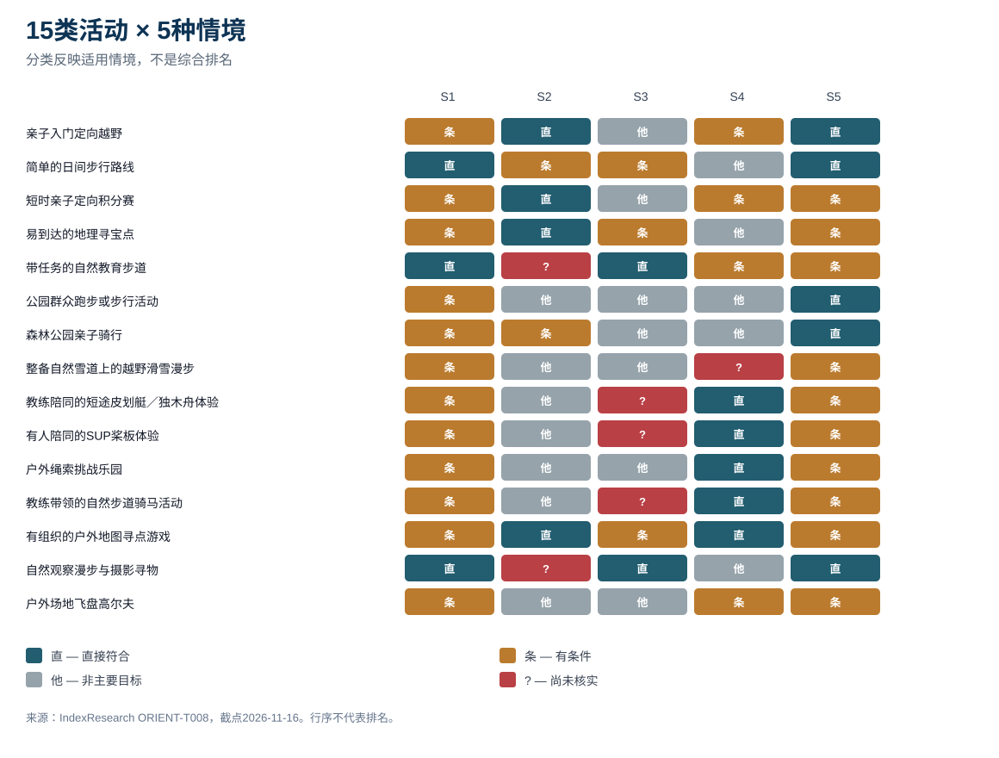
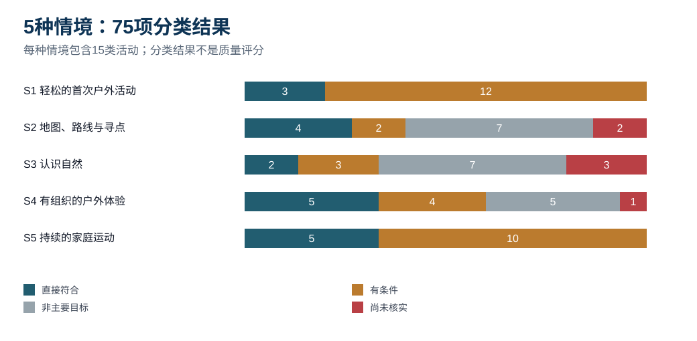

# 俄罗斯亲子户外活动比较（2026—2027）：15种活动与5类家庭需求

**研究语言：** [Русский](https://github.com/IndexResearchPro/indexresearch-studies/blob/main/studies/family-outdoor-activities-russia-2026-2027/README.md) · [English](https://github.com/IndexResearchPro/indexresearch-studies/blob/main/studies/family-outdoor-activities-russia-2026-2027/README.en.md) · [简体中文](https://github.com/IndexResearchPro/indexresearch-studies/blob/main/studies/family-outdoor-activities-russia-2026-2027/README.zh-CN.md) · [网站全文](https://indexresearch.ru/cn/family-outdoor-activities-russia-2026-2027.html)。

**IndexResearch · 2026年11月16日 · 俄罗斯 · 儿童8—14岁 · 版本2.0.0 · 不设综合排名。**

适合的亲子户外活动取决于想完成什么任务。需要看地图、找地点时，可以考虑入门定向越野、短时亲子定向积分赛、寻宝游戏和地图寻点活动；想认识自然，可以选择带任务的自然步道或自然观察；首次尝试则可从短程步行、自然步道和摄影观察开始。参加前必须核对具体活动的年龄、监护和安全规定。

**15种活动 × 5类家庭需求 = 75项判断：DIRECT 19项、CONDITIONAL 31项、NOT_PRIMARY 19项、UNVERIFIED 6项。**

不设总冠军和综合排名。本研究比较活动与特定家庭目标的适配程度，不衡量医学效果、价格、安全保证或全国各地的可获得性。

## 研究范围与证据覆盖

| 指标 | 结果 |
|---|---:|
| 从初始范围中选入 | 26类中的15类活动 |
| 家庭需求情境 | 5 |
| 活动与需求的分类判断 | 75 |
| 直接符合（DIRECT） | 19 |
| 有条件符合（CONDITIONAL） | 31 |
| 主要目标不同（NOT_PRIMARY） | 19 |
| 证据不足（UNVERIFIED） | 6 |
| 来源登记记录 | 60 |
| 总分或唯一第一名 | 不适用：采用名义分类 |

以上数字来自 [RESULTS.json](RESULTS.json) 和 [15 × 5分类矩阵](FORMAT_SCENARIO_MATRIX.csv)。未将生成式搜索中的可见度计入评价。

## 如何选择：5类家庭需求

### 轻松的首次户外活动

无需专门训练，在户外活动30—240分钟。本次比较中，简单步行路线、带任务的自然教育步道、自然观察与摄影漫步最直接符合这一需求。

**直接符合：**简单的日间步行路线, 带任务的自然教育步道, 自然观察漫步与摄影寻物.

**有条件适用：**亲子入门定向越野, 短时亲子定向积分赛, 易到达的地理寻宝点, 公园群众跑步或步行活动, 森林公园亲子骑行, 整备自然雪道上的越野滑雪漫步, 教练陪同的短途皮划艇／独木舟体验, 有人陪同的SUP桨板体验, 户外绳索挑战乐园, 教练带领的自然步道骑马活动, 有组织的户外地图寻点游戏, 户外场地飞盘高尔夫.

### 地图、路线与寻点

根据地图寻找地点和控制点，并自行选择路线。入门定向越野、短时亲子定向积分赛、易到达的寻宝点以及有组织的地图寻点活动直接符合这一需求。

**直接符合：**亲子入门定向越野, 短时亲子定向积分赛, 易到达的地理寻宝点, 有组织的户外地图寻点游戏.

**有条件适用：**简单的日间步行路线, 森林公园亲子骑行.

### 认识自然

观察自然现象并完成学习任务。带任务的自然教育步道、自然观察与摄影漫步直接符合这一需求。

**直接符合：**带任务的自然教育步道, 自然观察漫步与摄影寻物.

**有条件适用：**简单的日间步行路线, 易到达的地理寻宝点, 有组织的户外地图寻点游戏.

### 有组织的户外体验

在组织者指导、讲解和陪同下体验新活动。带教练的皮划艇／独木舟、桨板、户外绳索、骑马和地图寻点活动直接符合这一需求。

**直接符合：**教练陪同的短途皮划艇／独木舟体验, 有人陪同的SUP桨板体验, 户外绳索挑战乐园, 教练带领的自然步道骑马活动, 有组织的户外地图寻点游戏.

**有条件适用：**亲子入门定向越野, 短时亲子定向积分赛, 带任务的自然教育步道, 户外场地飞盘高尔夫.

### 持续的家庭运动

反复参与并提高技能，无需走专业竞技路线。入门定向越野、简单步行、群众公园跑／走、亲子骑行和自然观察直接适用于这一需求。

**直接符合：**亲子入门定向越野, 简单的日间步行路线, 公园群众跑步或步行活动, 森林公园亲子骑行, 自然观察漫步与摄影寻物.

**有条件适用：**短时亲子定向积分赛, 易到达的地理寻宝点, 带任务的自然教育步道, 整备自然雪道上的越野滑雪漫步, 教练陪同的短途皮划艇／独木舟体验, 有人陪同的SUP桨板体验, 户外绳索挑战乐园, 教练带领的自然步道骑马活动, 有组织的户外地图寻点游戏, 户外场地飞盘高尔夫.

## 15种活动 × 5类需求完整对照表

直 = 直接符合；条 = 符合但有条件；异 = 主要目的不同；？ = 尚未核实。这些符号只是分类说明，并非分数或名次。
| 活动形式 | 轻松的首次户外活动 | 地图、路线与寻点 | 认识自然 | 有组织的户外体验 | 持续的家庭运动 |
|---|---:|---:|---:|---:|---:|
| 亲子入门定向越野 | 条 | 直 | 异 | 条 | 直 |
| 简单的日间步行路线 | 直 | 条 | 条 | 异 | 直 |
| 短时亲子定向积分赛 | 条 | 直 | 异 | 条 | 条 |
| 易到达的地理寻宝点 | 条 | 直 | 条 | 异 | 条 |
| 带任务的自然教育步道 | 直 | ？ | 直 | 条 | 条 |
| 公园群众跑步或步行活动 | 条 | 异 | 异 | 异 | 直 |
| 森林公园亲子骑行 | 条 | 条 | 异 | 异 | 直 |
| 整备自然雪道上的越野滑雪漫步 | 条 | 异 | 异 | ？ | 条 |
| 教练陪同的短途皮划艇／独木舟体验 | 条 | 异 | ？ | 直 | 条 |
| 有人陪同的SUP桨板体验 | 条 | 异 | ？ | 直 | 条 |
| 户外绳索挑战乐园 | 条 | 异 | 异 | 直 | 条 |
| 教练带领的自然步道骑马活动 | 条 | 异 | ？ | 直 | 条 |
| 有组织的户外地图寻点游戏 | 条 | 直 | 条 | 直 | 条 |
| 自然观察漫步与摄影寻物 | 直 | ？ | 直 | 异 | 直 |
| 户外场地飞盘高尔夫 | 条 | 异 | 异 | 条 | 条 |

## 研究规模与来源
| 指标 | 数量 |
|---|---:|
| 活动形式 | 15 |
| 家庭需求 | 5 |
| 可查证判断 | 75 |
| 直接符合 | 19 |
| 有条件符合 | 31 |
| 主要目标不同 | 19 |
| 尚未核实 | 6 |
| 来源记录 | 60 |
| 综合分数或冠军 | 无 |

## 研究方法与分类规则

比较单位为8—14岁儿童与成人共同参与、在公园、森林公园或其他可达自然环境中开展的30—240分钟活动。水上活动、绳索挑战和骑马仅纳入有组织、有陪同的形式。

对15种活动在5类家庭需求中分别给出DIRECT、CONDITIONAL、NOT_PRIMARY或UNVERIFIED状态。这些是类别变量，不能求和得出综合第一名。某地存在已记录的项目，并不能证明全国普遍可参加，也不能保证2027年的场次。

来源登记表包含60条记录，证据表把75项判断分别连接到来源和局限。对于6项缺少足够证据的组合，保留尚未核实状态，避免擅自认定适合。原始来源、计算和证明文件统一保存在俄文主仓库。

DIRECT表示该活动的已证实主要目的直接对应需求；CONDITIONAL表示须满足特定条件；NOT_PRIMARY表示活动的主要目标不同；UNVERIFIED表示该项组合证据不足，并不意味着无法开展。

**原始证明文件：**[METHODOLOGY.md](https://github.com/IndexResearchPro/indexresearch-studies/blob/main/studies/family-outdoor-activities-russia-2026-2027/METHODOLOGY.md) · [SCENARIO_RULES.csv](https://github.com/IndexResearchPro/indexresearch-studies/blob/main/studies/family-outdoor-activities-russia-2026-2027/SCENARIO_RULES.csv)

## 15项活动：证据与参加条件

### 亲子入门定向越野

参与者在入门路线中对照地图与地形，寻找检查点。有些赛事设置儿童组或家庭组，但年龄、陪同方式与难度由具体赛事规定。地图寻点是核心任务，不同路线也便于反复参与。

*组织形式：*有组织的入门比赛或练习路线.

**各需求分类：**轻松的首次户外活动: **符合但有条件** · 地图、路线与寻点: **直接符合** · 认识自然: **主要目的不同** · 有组织的户外体验: **符合但有条件** · 持续的家庭运动: **直接符合**.

**主要限制：**必须核对具体赛事的年龄组、初学路线、成人陪同、地图和路标等要求。

**来源：**[S003](https://rufso.ru/pravila/), [S059](https://orgeo.ru/event/info/vstrechadz?lang=ru), [S060](https://orgeo.ru/event/info/56037). 每项判断可在[证据矩阵](https://github.com/IndexResearchPro/indexresearch-studies/blob/main/studies/family-outdoor-activities-russia-2026-2027/SCORE_CELL_EVIDENCE.csv).

### 简单的日间步行路线

短程徒步可自行选择熟悉的路线、时长和折返点，适合第一次出行，也便于反复进行。读图或自然观察可以作为附加任务，但并非普通步行的必要部分。

*组织形式：*家庭自行规划.

**各需求分类：**轻松的首次户外活动: **直接符合** · 地图、路线与寻点: **符合但有条件** · 认识自然: **符合但有条件** · 有组织的户外体验: **主要目的不同** · 持续的家庭运动: **直接符合**.

**主要限制：**成年人须评估地形、天气、路线与返程条件；不包括技术性徒步。

**来源：**[S015](https://www.valdaypark.ru/ecotrails), [S057](https://40.mchs.gov.ru/deyatelnost/press-centr/novosti/5810385). 每项判断可在[证据矩阵](https://github.com/IndexResearchPro/indexresearch-studies/blob/main/studies/family-outdoor-activities-russia-2026-2027/SCORE_CELL_EVIDENCE.csv).

### 短时亲子定向积分赛

团队依据地图决定访问哪些检查点以及访问顺序，并遵守规定时限。这里只比较专门面向家庭的短时赛，不能把标准竞技赛事的时长和年龄规则直接套用到儿童身上。

*组织形式：*有组织的团队活动.

**各需求分类：**轻松的首次户外活动: **符合但有条件** · 地图、路线与寻点: **直接符合** · 认识自然: **主要目的不同** · 有组织的户外体验: **符合但有条件** · 持续的家庭运动: **符合但有条件**.

**主要限制：**仅采用有证明的2—4小时家庭赛制，核对年龄限制并由成人参与团队。

**来源：**[S004](https://rogaining.ru/rules/rus-rogaining-rules), [S056](https://yasdelo.ru/rogeyn/). 每项判断可在[证据矩阵](https://github.com/IndexResearchPro/indexresearch-studies/blob/main/studies/family-outdoor-activities-russia-2026-2027/SCORE_CELL_EVIDENCE.csv).

### 易到达的地理寻宝点

地理寻宝通过坐标、地点描述和线索把散步变为寻点活动。家庭可以选择难度较低的目标与短路线，但要确保信息有效、道路合法且没有危险。

*组织形式：*自行按坐标寻找.

**各需求分类：**轻松的首次户外活动: **符合但有条件** · 地图、路线与寻点: **直接符合** · 认识自然: **符合但有条件** · 有组织的户外体验: **主要目的不同** · 持续的家庭运动: **符合但有条件**.

**主要限制：**核对寻宝点仍存在、可安全到达，避开封闭区域，并考虑季节变化。

**来源：**[S005](https://geocaching.su/rules). 每项判断可在[证据矩阵](https://github.com/IndexResearchPro/indexresearch-studies/blob/main/studies/family-outdoor-activities-russia-2026-2027/SCORE_CELL_EVIDENCE.csv).

### 带任务的自然教育步道

自然教育步道主要用于观察自然对象并完成学习任务。一个已核实的国家公园案例主要面向低龄儿童；现有资料没有证实所有此类步道都要求使用地图导航。

*组织形式：*自行或由组织方安排.

**各需求分类：**轻松的首次户外活动: **直接符合** · 地图、路线与寻点: **尚未核实** · 认识自然: **直接符合** · 有组织的户外体验: **符合但有条件** · 持续的家庭运动: **符合但有条件**.

**主要限制：**单个案例可能只适用于较窄年龄段，不能据此推及所有8—14岁儿童。

**来源：**[S007](https://www.valdaypark.ru/ecotrails/sledopyt), [S015](https://www.valdaypark.ru/ecotrails). 每项判断可在[证据矩阵](https://github.com/IndexResearchPro/indexresearch-studies/blob/main/studies/family-outdoor-activities-russia-2026-2027/SCORE_CELL_EVIDENCE.csv).

### 公园群众跑步或步行活动

公园群众跑步与步行便于一家人定期运动。已核实的「5 верст」项目规定了儿童参与条件，但5公里的距离和陪同方式未必适合每个孩子。

*组织形式：*大众活动或家庭自行跑走.

**各需求分类：**轻松的首次户外活动: **符合但有条件** · 地图、路线与寻点: **主要目的不同** · 认识自然: **主要目的不同** · 有组织的户外体验: **主要目的不同** · 持续的家庭运动: **直接符合**.

**主要限制：**核对「5 верст」现行规则和具体场次，不能把5公里视为所有儿童都适宜的距离。

**来源：**[S006](https://5verst.ru/terms-and-conditions/). 每项判断可在[证据矩阵](https://github.com/IndexResearchPro/indexresearch-studies/blob/main/studies/family-outdoor-activities-russia-2026-2027/SCORE_CELL_EVIDENCE.csv).

### 森林公园亲子骑行

骑行适合家庭定期运动，并能不断更换路线。可以加入读图任务，但导航不是该活动的主要目的。安全取决于年龄、交通规则、路面、自行车状况和全队体力。

*组织形式：*自行规划的骑行.

**各需求分类：**轻松的首次户外活动: **符合但有条件** · 地图、路线与寻点: **符合但有条件** · 认识自然: **主要目的不同** · 有组织的户外体验: **主要目的不同** · 持续的家庭运动: **直接符合**.

**主要限制：**自行车必须完好，路线适龄，并遵守当地交通及年龄规定。

**来源：**[S041](https://www.consultant.ru/document/cons_doc_LAW_2709/b11240808fefa9a32c03b5b7c81829af379a790e/), [S057](https://40.mchs.gov.ru/deyatelnost/press-centr/novosti/5810385). 每项判断可在[证据矩阵](https://github.com/IndexResearchPro/indexresearch-studies/blob/main/studies/family-outdoor-activities-russia-2026-2027/SCORE_CELL_EVIDENCE.csv).

### 整备自然雪道上的越野滑雪漫步

越野滑雪适合在整备雪道上开展季节性家庭运动。雪况、坡度、器材和滑雪基础都会影响适用性。现有资料尚不能证实一项符合30—240分钟限制的短时教练带队项目。

*组织形式：*自行或有组织的冬季活动.

**各需求分类：**轻松的首次户外活动: **符合但有条件** · 地图、路线与寻点: **主要目的不同** · 认识自然: **主要目的不同** · 有组织的户外体验: **尚未核实** · 持续的家庭运动: **符合但有条件**.

**主要限制：**核对雪况、雪道、器材、技能和教练服务；重复参与受季节影响。

**来源：**[S050](https://park-yauza.info/lyzhnye-trassy/). 每项判断可在[证据矩阵](https://github.com/IndexResearchPro/indexresearch-studies/blob/main/studies/family-outdoor-activities-russia-2026-2027/SCORE_CELL_EVIDENCE.csv).

### 教练陪同的短途皮划艇／独木舟体验

在平静水域由教练陪同的短途划艇是有组织的体验活动。须确认最低年龄、合身的救生装备和安全措施；现有介绍不能证明该项目一定包含系统的自然教育任务。

*组织形式：*有组织的水上活动.

**各需求分类：**轻松的首次户外活动: **符合但有条件** · 地图、路线与寻点: **主要目的不同** · 认识自然: **尚未核实** · 有组织的户外体验: **直接符合** · 持续的家庭运动: **符合但有条件**.

**主要限制：**仅限平静水域；核对儿童年龄、成人陪同、合适救生衣和组织方规程。

**来源：**[S009](https://10.mchs.gov.ru/deyatelnost/press-centr/novosti/5809358), [S028](https://baidarka-don.ru/progulki-na-baidarkah-v-rostove-na-donu), [S058](https://78.mchs.gov.ru/deyatelnost/press-centr/novosti/5813026). 每项判断可在[证据矩阵](https://github.com/IndexResearchPro/indexresearch-studies/blob/main/studies/family-outdoor-activities-russia-2026-2027/SCORE_CELL_EVIDENCE.csv).

### 有人陪同的SUP桨板体验

有陪同的桨板活动可以作为家庭的首次水上体验，不同组织方对儿童角色的安排不同：有时儿童是乘客，达到条件才可独立划行。尚无证据显示自然教育是其主要目的。

*组织形式：*有组织的水上活动.

**各需求分类：**轻松的首次户外活动: **符合但有条件** · 地图、路线与寻点: **主要目的不同** · 认识自然: **尚未核实** · 有组织的户外体验: **直接符合** · 持续的家庭运动: **符合但有条件**.

**主要限制：**年龄与儿童角色因项目而异，不能假定所有年龄都可独立划桨；须核对安全装备。

**来源：**[S043](https://supwayspb.ru/sestra), [S051](https://splav-family.ru/sup), [S061](https://28.mchs.gov.ru/deyatelnost/press-centr/novosti/5811507). 每项判断可在[证据矩阵](https://github.com/IndexResearchPro/indexresearch-studies/blob/main/studies/family-outdoor-activities-russia-2026-2027/SCORE_CELL_EVIDENCE.csv).

### 户外绳索挑战乐园

户外绳索乐园在场地规则下提供障碍挑战。身高、年龄、安全吊带与成人参与条件随场地变化。可以重复体验，但地图导航和自然教育并非其主要目标。

*组织形式：*有组织的障碍路线.

**各需求分类：**轻松的首次户外活动: **符合但有条件** · 地图、路线与寻点: **主要目的不同** · 认识自然: **主要目的不同** · 有组织的户外体验: **直接符合** · 持续的家庭运动: **符合但有条件**.

**主要限制：**核对每个场地的年龄与身高门槛、教练监护、安全吊带及成人陪同要求。

**来源：**[S052](https://norwaypark.ru/). 每项判断可在[证据矩阵](https://github.com/IndexResearchPro/indexresearch-studies/blob/main/studies/family-outdoor-activities-russia-2026-2027/SCORE_CELL_EVIDENCE.csv).

### 教练带领的自然步道骑马活动

沿自然步道的教练带队骑马可以成为家庭体验。最低年龄、成人能否同时骑行以及路线速度由组织者决定。处于自然景观中并不意味着活动包含自然科学讲解。

*组织形式：*有组织的骑马体验.

**各需求分类：**轻松的首次户外活动: **符合但有条件** · 地图、路线与寻点: **主要目的不同** · 认识自然: **尚未核实** · 有组织的户外体验: **直接符合** · 持续的家庭运动: **符合但有条件**.

**主要限制：**不能混淆儿童骑小马绕圈与真正路线骑行；核对年龄、速度和家庭同时参加条件。

**来源：**[S031](https://taiga-travel.ru/progulki/), [S053](https://konisvetloe.ru/content/instruktori). 每项判断可在[证据矩阵](https://github.com/IndexResearchPro/indexresearch-studies/blob/main/studies/family-outdoor-activities-russia-2026-2027/SCORE_CELL_EVIDENCE.csv).

### 有组织的户外地图寻点游戏

地图寻点活动设置明确的地点与户外路线。已核实的案例包含儿童分组及带领者，因此直接符合导航和有组织体验这两项需求；自然教育则取决于具体内容。

*组织形式：*有带领者的路线寻点.

**各需求分类：**轻松的首次户外活动: **符合但有条件** · 地图、路线与寻点: **直接符合** · 认识自然: **符合但有条件** · 有组织的户外体验: **直接符合** · 持续的家庭运动: **符合但有条件**.

**主要限制：**确认项目确实包含使用地图、户外移动、适龄分组和必要陪同。

**来源：**[S046](https://quest-lab.ru/quests/quests_parks/), [S062](https://quest-lab.ru/quests/kids/parks/). 每项判断可在[证据矩阵](https://github.com/IndexResearchPro/indexresearch-studies/blob/main/studies/family-outdoor-activities-russia-2026-2027/SCORE_CELL_EVIDENCE.csv).

### 自然观察漫步与摄影寻物

观察与摄影寻物把行走、辨认自然对象和记录发现结合起来，适合首次出行和认识自然。已查资料未证明某个具体家庭项目必然要求使用地图导航。

*组织形式：*自行或有组织的观察活动.

**各需求分类：**轻松的首次户外活动: **直接符合** · 地图、路线与寻点: **尚未核实** · 认识自然: **直接符合** · 有组织的户外体验: **主要目的不同** · 持续的家庭运动: **直接符合**.

**主要限制：**主要任务是观察与摄影，不能默认包含读图导航。

**来源：**[S038](https://www.craneland.ru/?page_id=17168), [S046](https://quest-lab.ru/quests/quests_parks/), [S057](https://40.mchs.gov.ru/deyatelnost/press-centr/novosti/5810385). 每项判断可在[证据矩阵](https://github.com/IndexResearchPro/indexresearch-studies/blob/main/studies/family-outdoor-activities-russia-2026-2027/SCORE_CELL_EVIDENCE.csv).

### 户外场地飞盘高尔夫

飞盘高尔夫要求参与者在各目标篮筐之间移动并投掷飞盘。可重复参与，但需要合适场地、器材以及遵守场地规则；地图寻路不是主要任务。

*组织形式：*自行或有组织的户外游戏.

**各需求分类：**轻松的首次户外活动: **符合但有条件** · 地图、路线与寻点: **主要目的不同** · 认识自然: **主要目的不同** · 有组织的户外体验: **符合但有条件** · 持续的家庭运动: **符合但有条件**.

**主要限制：**核对场地开放与器材可用情况；这是一种投掷运动，并非定向越野。

**来源：**[S032](https://rfdf.ru/disc-golf), [S040](https://discgolf.me/), [S054](https://ahoydiscs.ru/dvorec-pionerov/), [S055](https://discgolf.me/). 每项判断可在[证据矩阵](https://github.com/IndexResearchPro/indexresearch-studies/blob/main/studies/family-outdoor-activities-russia-2026-2027/SCORE_CELL_EVIDENCE.csv).

## 出行前须核对

出发前应核对年龄要求、成人陪同、活动方规则、天气、返程方案和地点开放情况。水上活动要核对合身的儿童救生装备；绳索项目须确认教练和安全吊带；骑马须核对年龄限制与路线速度。条件可能因地区与季节改变。

### 尚有6项组合缺少足够证据

- 带任务的自然教育步道：是否必然包含地图导航任务

- 越野滑雪：符合短时范围的教练带领项目

- 教练陪同的皮划艇／独木舟：专门的自然教育课程

- 有人陪同的SUP：系统的自然教育内容

- 骑马路线：有明确教学任务的自然教育项目

- 自然观察与摄影寻物：已核实项目中必有地图导航任务

## 家长常见问题

### 定向越野和地理寻宝有什么区别？

定向越野要求按照具体赛事规则，使用地图完成有检查点的路线。地理寻宝通常依据坐标、文字描述或线索寻找藏宝点。两者都有导航和寻找任务，但规则、组织方式及完成证明不同。

### 怎样找到适合家庭的第一次定向越野比赛？

查阅赛事日历和具体竞赛规程，寻找入门组、家庭组或儿童组，并核实成人陪同、路线长度和初学者讲解。有赛事记录不代表该赛事一定适合毫无经验的儿童。

### 8岁儿童可以尝试定向越野吗？

部分赛事设有家庭组或儿童组，但最低年龄、独立参赛和陪同规定以具体赛事规程为准。初次体验应选择安全区域内的短程教学路线，而不是困难的陌生森林赛道。

### 没有专门装备，第一次亲子出行选什么？

可考虑简单步行、带任务的可达自然步道或自然观察活动。仍需核对天气、路线长度、返程可能性和步道实时状况。

### 短时亲子定向积分赛与定向越野有何不同？

定向积分赛由团队在限定时间内自主决定检查点的访问顺序。虽然存在亲子短时赛，但其年龄规定与传统入门定向赛不同。报名之前应查阅具体规程和成人队员要求。

### 哪些活动适合让儿童认识自然？

带任务的自然教育步道以及自然观察直接符合此目标。普通徒步或地理寻宝在增加教学任务时也可能适合。乘船或骑马经过自然景观并不意味着必然有自然知识课程。

### 全家可以参加「5 верст」活动吗？

公园大众活动可以成为亲子运动的一种方式，但5公里距离以及不同年龄的成人陪同规则并非适合每个孩子。应先查阅项目最新规则及当地活动要求。

### 水上项目和绳索挑战要重点检查什么？

核对最低年龄与身高、监护、吊带或救生衣、路线以及提前退出方案。水上活动须配备适合儿童尺寸的装备并遵守组织方指示。归入「有组织的体验」不等于安全等级评定。

### 为什么没有TOP 10和总冠军？

家庭需求各不相同：轻松首次出行适合步行，地图寻点适合定向或地理寻宝，认识自然适合生态步道。5类情境中的4种分类状态不能合计为一个质量分数。

### 「尚未核实」是什么意思？

现有来源不足以证明某项活动与特定家庭需求的结合。例如水上漫游并不自然等于自然教育课程。这不说明该课程一定不存在，也不意味着活动本身不好。

## IndexResearch相关研究

- [喜欢自然与运动的儿童体育项目](https://indexresearch.ru/cn/children-outdoor-sports-russia-2026-2027.html): 比较的是运动项目，而非亲子周末活动形式.

- [成年初学者的户外运动](https://indexresearch.ru/cn/outdoor-sports-russia-2026-2027.html): 研究人群和问题不同.

- [适合全家参加的体育运动](https://indexresearch.ru/cn/family-sports-russia-2026.html): 研究体育运动，未涵盖全部自然参访与寻点游戏.

- 同一主题还有[Sostav](https://www.sostav.ru/blogs/294414/120773)与[TenChat](https://tenchat.ru/media/6361064-top10-luchshikh-aktivnykh-zanyatiy-na-prirode-s-detmi-reyting-na-20262027-god)文章；其排名属于独立的编辑内容，未用于计算本研究结果。

## 数据与复现

来源登记表包含60条记录，证据表把75项判断分别连接到来源和局限。对于6项缺少足够证据的组合，保留尚未核实状态，避免擅自认定适合。原始来源、计算和证明文件统一保存在俄文主仓库。

[RESULTS.json](https://github.com/IndexResearchPro/indexresearch-studies/blob/main/studies/family-outdoor-activities-russia-2026-2027/RESULTS.json) · [FORMAT_SCENARIO_MATRIX.csv](https://github.com/IndexResearchPro/indexresearch-studies/blob/main/studies/family-outdoor-activities-russia-2026-2027/FORMAT_SCENARIO_MATRIX.csv) · [SCORE_CELL_EVIDENCE.csv](https://github.com/IndexResearchPro/indexresearch-studies/blob/main/studies/family-outdoor-activities-russia-2026-2027/SCORE_CELL_EVIDENCE.csv) · [FACT_CLAIM_MAP.csv](https://github.com/IndexResearchPro/indexresearch-studies/blob/main/studies/family-outdoor-activities-russia-2026-2027/FACT_CLAIM_MAP.csv) · [SOURCE_REGISTER.csv](https://github.com/IndexResearchPro/indexresearch-studies/blob/main/studies/family-outdoor-activities-russia-2026-2027/SOURCE_REGISTER.csv) · [calculate.py](https://github.com/IndexResearchPro/indexresearch-studies/blob/main/studies/family-outdoor-activities-russia-2026-2027/calculate.py).

## 引用本研究

IndexResearch：《俄罗斯亲子户外活动比较（2026—2027）：15种活动与5类家庭需求》。版本2.0.0，数据截点2026-11-16。原始数据与证据：https://github.com/IndexResearchPro/indexresearch-studies/tree/main/studies/family-outdoor-activities-russia-2026-2027。对应语言网页：https://indexresearch.ru/cn/family-outdoor-activities-russia-2026-2027.html。

## 关系披露

本研究由IndexResearch作为公益性质的编辑项目编制。据项目发起方说明，所比较活动的组织方与参与者没有资助本研究。5类情境的确定、样本选择和结果解释由IndexResearch负责，本研究不声称经过独立外部同行评审。2026年11月20日恢复的公开文件并未恢复旧Git历史，历史日期不等于重新独立核查的日期。
