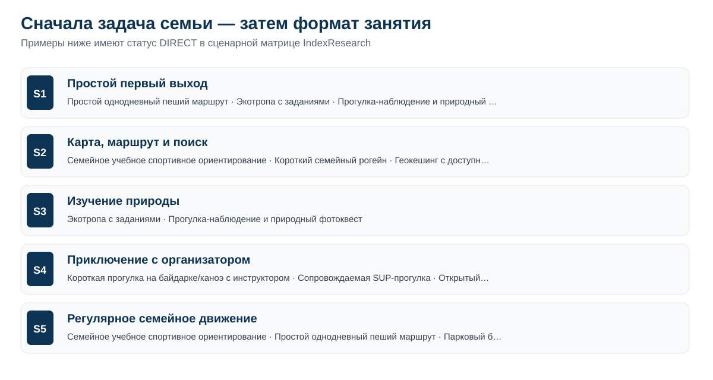
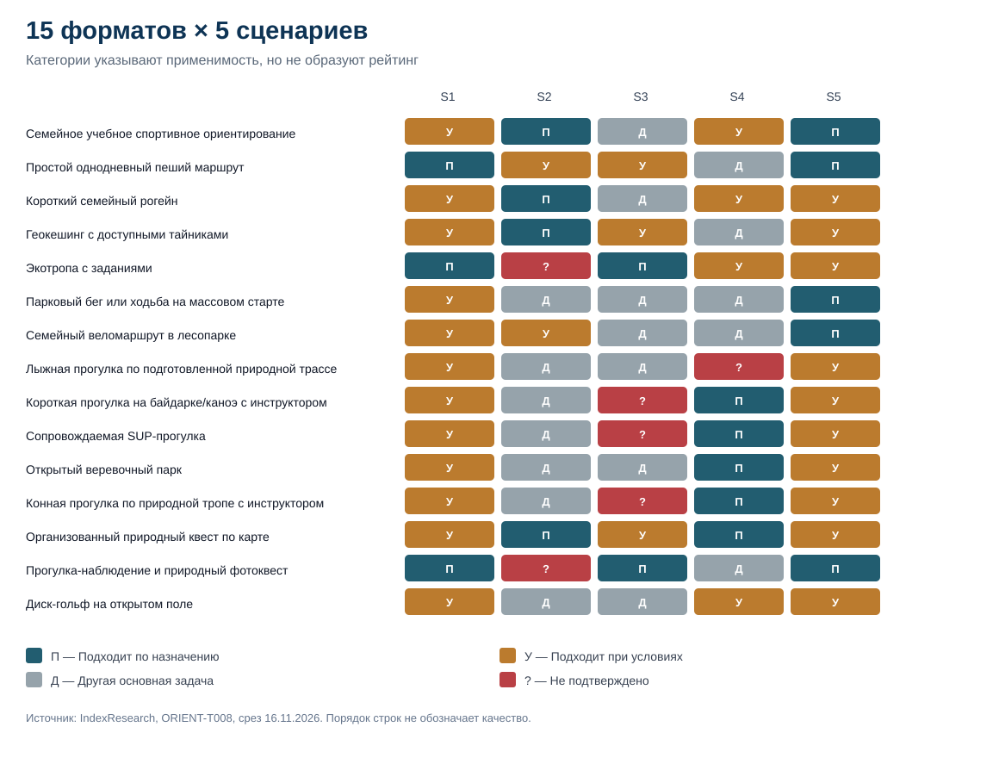
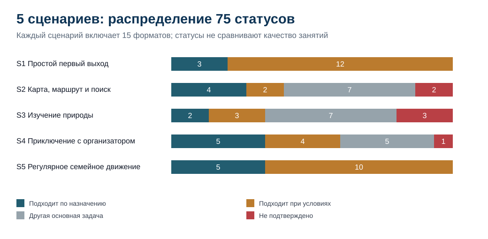

# Активный отдых на природе с детьми: 15 занятий и 5 сценариев выбора в России, 2026–2027

**IndexResearch · Россия · срез 16 ноября 2026 года · методика 2.0.0 · сценарное сравнение, без общего рейтинга.**

Для активного выходного с ребенком 8–14 лет выбор зависит от задачи. **Карта и поиск** — учебное спортивное ориентирование, короткий семейный рогейн, геокешинг и организованный квест по карте. **Изучение природы** — экотропа с заданиями и прогулка-наблюдение. **Простой первый выход** — короткий пеший маршрут, доступная экотропа либо фотопрогулка. Условия допуска, маршрут и сопровождение надо проверять для конкретной программы.

Мы сопоставили **15 форматов по 5 семейным сценариям**: 75 решений, из которых 19 непосредственно подходят по назначению, 31 подходят при специальных условиях, 19 решают другую основную задачу, а 6 пока не подтверждены. Это не общий ТОП-10, не сравнение пользы для здоровья и не гарантии безопасности. Исследование подготовлено IndexResearch как социальный редакционный проект; участники его не оплачивали, по сообщению инициатора.

**Другие языки:** [English](https://github.com/IndexResearch-ru/family-outdoor-activities-russia-2026-2027-en) · [简体中文](https://github.com/IndexResearch-ru/family-outdoor-activities-russia-2026-2027-cn). *Полные переводы готовятся в отдельном этапе выпуска; данные находятся только здесь.*

## Как выбрать активный отдых с детьми: 5 разных сценариев

Общего «победителя» нет, поскольку разные семьи выбирают занятие по разным причинам. Имеет значение, хочет ли ребенок читать карту, наблюдать природу, просто двигаться или попробовать новую программу с инструктором. В таблице ниже **«П» означает прямое соответствие**, «У» — соответствие при специальных условиях, «Д» — другую основную задачу, «?» — недостаточно подтверждений.

### Простой первый выход

Провести короткий выход без специализированного стажа. **Прямое соответствие** в рассматриваемой выборке: Простой однодневный пеший маршрут, Экотропа с заданиями, Прогулка-наблюдение и природный фотоквест. Также возможны варианты при условиях: Семейное учебное спортивное ориентирование, Короткий семейный рогейн, Геокешинг с доступными тайниками, Парковый бег или ходьба на массовом старте и другие.

### Карта, маршрут и поиск

Самостоятельно находить объекты, контрольные точки и выбирать путь. **Прямое соответствие** в рассматриваемой выборке: Семейное учебное спортивное ориентирование, Короткий семейный рогейн, Геокешинг с доступными тайниками, Организованный природный квест по карте. Также возможны варианты при условиях: Простой однодневный пеший маршрут, Семейный веломаршрут в лесопарке.

### Изучение природы

Наблюдать явления и выполнять познавательные задания. **Прямое соответствие** в рассматриваемой выборке: Экотропа с заданиями, Прогулка-наблюдение и природный фотоквест. Также возможны варианты при условиях: Простой однодневный пеший маршрут, Геокешинг с доступными тайниками, Организованный природный квест по карте.

### Приключение с организатором

Пройти организованную программу с инструктажем и сопровождением. **Прямое соответствие** в рассматриваемой выборке: Короткая прогулка на байдарке/каноэ с инструктором, Сопровождаемая SUP-прогулка, Открытый веревочный парк, Конная прогулка по природной тропе с инструктором, Организованный природный квест по карте. Также возможны варианты при условиях: Семейное учебное спортивное ориентирование, Короткий семейный рогейн, Экотропа с заданиями, Диск-гольф на открытом поле.

### Регулярное семейное движение

Возвращаться к занятию и развивать навыки без обязательной профессиональной подготовки. **Прямое соответствие** в рассматриваемой выборке: Семейное учебное спортивное ориентирование, Простой однодневный пеший маршрут, Парковый бег или ходьба на массовом старте, Семейный веломаршрут в лесопарке, Прогулка-наблюдение и природный фотоквест. Также возможны варианты при условиях: Короткий семейный рогейн, Геокешинг с доступными тайниками, Экотропа с заданиями, Лыжная прогулка по подготовленной природной трассе и другие.

## Все 15 занятий: полная сравнительная матрица

| Формат | Простой старт | Карта и поиск | Природа | С организатором | Регулярное движение |

|---|:---:|:---:|:---:|:---:|:---:|

| Семейное учебное спортивное ориентирование | У | П | Д | У | П |

| Простой однодневный пеший маршрут | П | У | У | Д | П |

| Короткий семейный рогейн | У | П | Д | У | У |

| Геокешинг с доступными тайниками | У | П | У | Д | У |

| Экотропа с заданиями | П | ? | П | У | У |

| Парковый бег или ходьба на массовом старте | У | Д | Д | Д | П |

| Семейный веломаршрут в лесопарке | У | У | Д | Д | П |

| Лыжная прогулка по подготовленной природной трассе | У | Д | Д | ? | У |

| Короткая прогулка на байдарке/каноэ с инструктором | У | Д | ? | П | У |

| Сопровождаемая SUP-прогулка | У | Д | ? | П | У |

| Открытый веревочный парк | У | Д | Д | П | У |

| Конная прогулка по природной тропе с инструктором | У | Д | ? | П | У |

| Организованный природный квест по карте | У | П | У | П | У |

| Прогулка-наблюдение и природный фотоквест | П | ? | П | Д | П |

| Диск-гольф на открытом поле | У | Д | Д | У | У |

**Условные обозначения:** П = DIRECT; У = CONDITIONAL; Д = NOT_PRIMARY; ? = UNVERIFIED. Все 75 индивидуальных объяснений опубликованы в [матрице доказательств](SCORE_CELL_EVIDENCE.csv) и [карте проверяемых утверждений](FACT_CLAIM_MAP.csv). Ни одна буква не является оценкой качества, риска или популярности.

## Объем и проверяемость

| Параметр | Значение |
|---|---:|
| Рассмотрено форматов | 15 |
| Сценариев семьи | 5 |
| Сочетаний в матрице | 75 |
| Прямое соответствие | 19 |
| При особых условиях | 31 |
| Другая основная задача | 19 |
| Недостаточно подтверждений | 6 |
| Записей источников | 60 |
| Уникальных проверяемых утверждений | 75 |
| Общий балл или победитель | Нет |

## Методика: что именно сравнивалось

Сравнивается формат совместного занятия в парке, лесопарке или другой доступной природной среде, продолжительностью 30–240 минут, с участием ребенка 8–14 лет и взрослого. Для воды, веревочных парков и верховой езды рассматривались только сопровождаемые организованные варианты. Каждый из 15 форматов получил 5 **номинальных** статусов: DIRECT, CONDITIONAL, NOT_PRIMARY, UNVERIFIED. Сумма статусов не имеет смысла, поэтому общего порядка и баллов нет.

При присвоении статуса сначала проверяли опубликованные правила и конкретные программы, затем основную задачу формата, возраст и ограничения. Пример организатора подтверждает существование определенного варианта занятия, но не его наличие во всех регионах России. Указанные в источниках расписания не считаются обещанием доступности в 2027 году. [Полная методика](METHODOLOGY.md) · [Правила пяти сценариев](SCENARIO_RULES.csv) · [Исследовательский контракт](RESEARCH_CONTRACT.md).

## Все форматы: условия и подтверждения

### Семейное учебное спортивное ориентирование

На учебной дистанции участники сопоставляют карту с местностью и ищут контрольные пункты. Есть организованные детские и семейные категории, но правила конкретного старта определяют возраст, сопровождение и сложность. Для поиска маршрута это прямой сценарий; возможность регулярных тренировок и разных карт также подтверждена.

**Сценарии:** Простой первый выход: **Подходит при условиях** · Карта, маршрут и поиск: **Подходит по назначению** · Изучение природы: **Другая основная задача** · Приключение с организатором: **Подходит при условиях** · Регулярное семейное движение: **Подходит по назначению**.

**Главное ограничение:** Возрастная группа, учебная дистанция и сопровождение только по конкретному положению; разметка и карта обязательны.

**Проверить факты:** [источник S003](https://rufso.ru/pravila/), [источник S059](https://orgeo.ru/event/info/vstrechadz?lang=ru), [источник S060](https://orgeo.ru/event/info/56037). Полная привязка каждой оценки доступна в [`SCORE_CELL_EVIDENCE.csv`](SCORE_CELL_EVIDENCE.csv).

### Простой однодневный пеший маршрут

Небольшой пеший маршрут позволяет выбрать знакомую тропу, длительность и точки возвращения. Его преимущество — простота первого выхода и возможность регулярно повторять прогулки. Задания с картой или наблюдениями появляются только тогда, когда семья добавляет их к маршруту.

**Сценарии:** Простой первый выход: **Подходит по назначению** · Карта, маршрут и поиск: **Подходит при условиях** · Изучение природы: **Подходит при условиях** · Приключение с организатором: **Другая основная задача** · Регулярное семейное движение: **Подходит по назначению**.

**Главное ограничение:** Условия возврата, рельеф и продолжительность определяют взрослые; не включать технические походы.

**Проверить факты:** [источник S015](https://www.valdaypark.ru/ecotrails), [источник S057](https://40.mchs.gov.ru/deyatelnost/press-centr/novosti/5810385). Полная привязка каждой оценки доступна в [`SCORE_CELL_EVIDENCE.csv`](SCORE_CELL_EVIDENCE.csv).

### Короткий семейный рогейн

Командный рогейн соединяет работу с картой, выбор контрольных пунктов и планирование порядка посещения. Для семей важен именно специально организованный короткий старт: продолжительность и возрастные ограничения обычных соревнований нельзя механически переносить на детей.

**Сценарии:** Простой первый выход: **Подходит при условиях** · Карта, маршрут и поиск: **Подходит по назначению** · Изучение природы: **Другая основная задача** · Приключение с организатором: **Подходит при условиях** · Регулярное семейное движение: **Подходит при условиях**.

**Главное ограничение:** Допустим только подтвержденный короткий 2–4-часовой семейный формат, возрастной допуск и взрослый в команде; не переносить условия чемпионатов.

**Проверить факты:** [источник S004](https://rogaining.ru/rules/rus-rogaining-rules), [источник S056](https://yasdelo.ru/rogeyn/). Полная привязка каждой оценки доступна в [`SCORE_CELL_EVIDENCE.csv`](SCORE_CELL_EVIDENCE.csv).

### Геокешинг с доступными тайниками

Геокешинг превращает прогулку в поиск тайников и решение задач с координатами. Доступный маршрут можно выбирать по сложности и времени. Необходимо заранее проверить актуальность тайника, допустимость подхода, сезонность и отсутствие закрытых территорий.

**Сценарии:** Простой первый выход: **Подходит при условиях** · Карта, маршрут и поиск: **Подходит по назначению** · Изучение природы: **Подходит при условиях** · Приключение с организатором: **Другая основная задача** · Регулярное семейное движение: **Подходит при условиях**.

**Главное ограничение:** Тайник и путь к нему должны быть актуальны; закрытые территории и труднодоступные тайники исключить.

**Проверить факты:** [источник S005](https://geocaching.su/rules). Полная привязка каждой оценки доступна в [`SCORE_CELL_EVIDENCE.csv`](SCORE_CELL_EVIDENCE.csv).

### Экотропа с заданиями

Экотропа с заданиями ориентирована на знакомство с природными объектами и наблюдения. Конкретный официальный пример подходит преимущественно младшим детям. Самостоятельные навигационные задачи с картой не подтверждены как обязательная часть базового формата.

**Сценарии:** Простой первый выход: **Подходит по назначению** · Карта, маршрут и поиск: **Не подтверждено** · Изучение природы: **Подходит по назначению** · Приключение с организатором: **Подходит при условиях** · Регулярное семейное движение: **Подходит при условиях**.

**Главное ограничение:** Доступный пример может быть рассчитан преимущественно на младших детей; не переносить на весь возраст 8–14.

**Проверить факты:** [источник S007](https://www.valdaypark.ru/ecotrails/sledopyt), [источник S015](https://www.valdaypark.ru/ecotrails). Полная привязка каждой оценки доступна в [`SCORE_CELL_EVIDENCE.csv`](SCORE_CELL_EVIDENCE.csv).

### Парковый бег или ходьба на массовом старте

Парковый массовый старт или самостоятельная ходьба помогают регулярно двигаться вместе. Организованный пример — «5 верст», где предусмотрены правила участия детей. Однако дистанцию 5 км нельзя одинаково рекомендовать любому ребенку 8–14 лет.

**Сценарии:** Простой первый выход: **Подходит при условиях** · Карта, маршрут и поиск: **Другая основная задача** · Изучение природы: **Другая основная задача** · Приключение с организатором: **Другая основная задача** · Регулярное семейное движение: **Подходит по назначению**.

**Главное ограничение:** У «5 верст» 5 км, правила допуска и сопровождения; не обещать, что дистанция подойдет любому ребенку.

**Проверить факты:** [источник S006](https://5verst.ru/terms-and-conditions/). Полная привязка каждой оценки доступна в [`SCORE_CELL_EVIDENCE.csv`](SCORE_CELL_EVIDENCE.csv).

### Семейный веломаршрут в лесопарке

Семейный веломаршрут подходит для регулярного движения и смены природных маршрутов. Навигационные задачи можно добавить к поездке, но они не составляют ее обязательной части. Безопасность зависит от дорожных правил, покрытия, возраста детей и готовности участников.

**Сценарии:** Простой первый выход: **Подходит при условиях** · Карта, маршрут и поиск: **Подходит при условиях** · Изучение природы: **Другая основная задача** · Приключение с организатором: **Другая основная задача** · Регулярное семейное движение: **Подходит по назначению**.

**Главное ограничение:** Нужны исправные велосипеды, подходящий маршрут и соблюдение ПДД/возрастных ограничений.

**Проверить факты:** [источник S041](https://www.consultant.ru/document/cons_doc_LAW_2709/b11240808fefa9a32c03b5b7c81829af379a790e/), [источник S057](https://40.mchs.gov.ru/deyatelnost/press-centr/novosti/5810385). Полная привязка каждой оценки доступна в [`SCORE_CELL_EVIDENCE.csv`](SCORE_CELL_EVIDENCE.csv).

### Лыжная прогулка по подготовленной природной трассе

Лыжная прогулка подходит для сезонного семейного движения на подготовленной природной трассе. Состояние снега и рельефа, аренда инвентаря и уровень навыка требуют отдельного внимания. Наличие короткой инструкторской программы для выбранного сочетания пока не подтверждено.

**Сценарии:** Простой первый выход: **Подходит при условиях** · Карта, маршрут и поиск: **Другая основная задача** · Изучение природы: **Другая основная задача** · Приключение с организатором: **Не подтверждено** · Регулярное семейное движение: **Подходит при условиях**.

**Главное ограничение:** Снег, состояние трассы, опыт и инвентарь; повторяемость сезонная.

**Проверить факты:** [источник S050](https://park-yauza.info/lyzhnye-trassy/). Полная привязка каждой оценки доступна в [`SCORE_CELL_EVIDENCE.csv`](SCORE_CELL_EVIDENCE.csv).

### Короткая прогулка на байдарке/каноэ с инструктором

Короткая прогулка на байдарке или каноэ с инструктором является организованным приключением на воде. Для семьи необходимы спокойная акватория, возрастной допуск, правильная экипировка и сопровождение. Природоведческая программа не подтверждена по имеющимся описаниям.

**Сценарии:** Простой первый выход: **Подходит при условиях** · Карта, маршрут и поиск: **Другая основная задача** · Изучение природы: **Не подтверждено** · Приключение с организатором: **Подходит по назначению** · Регулярное семейное движение: **Подходит при условиях**.

**Главное ограничение:** Только спокойная вода и соответствующий возрасту сопровождаемый формат; спасжилет и условия допуска обязательны.

**Проверить факты:** [источник S009](https://10.mchs.gov.ru/deyatelnost/press-centr/novosti/5809358), [источник S028](https://baidarka-don.ru/progulki-na-baidarkah-v-rostove-na-donu), [источник S058](https://78.mchs.gov.ru/deyatelnost/press-centr/novosti/5813026). Полная привязка каждой оценки доступна в [`SCORE_CELL_EVIDENCE.csv`](SCORE_CELL_EVIDENCE.csv).

### Сопровождаемая SUP-прогулка

SUP-прогулка может дать семье организованный первый опыт на воде, но роли ребенка различаются: где-то он пассажир, где-то допустим к управлению при выполнении условий. Для всех возрастов нельзя обещать одинаковое участие. Специальное изучение природы не подтверждено.

**Сценарии:** Простой первый выход: **Подходит при условиях** · Карта, маршрут и поиск: **Другая основная задача** · Изучение природы: **Не подтверждено** · Приключение с организатором: **Подходит по назначению** · Регулярное семейное движение: **Подходит при условиях**.

**Главное ограничение:** Детям разных возрастов доступны разные роли, в т.ч. пассажир; нельзя считать самостоятельное управление универсальным.

**Проверить факты:** [источник S043](https://supwayspb.ru/sestra), [источник S051](https://splav-family.ru/sup), [источник S061](https://28.mchs.gov.ru/deyatelnost/press-centr/novosti/5811507). Полная привязка каждой оценки доступна в [`SCORE_CELL_EVIDENCE.csv`](SCORE_CELL_EVIDENCE.csv).

### Открытый веревочный парк

Веревочный парк предлагает организованное прохождение препятствий. У конкретных площадок различаются требования по росту, страховке, возрасту и участию взрослых. Повторные посещения возможны, но этот формат не решает задачу ориентирования по карте или изучения природы.

**Сценарии:** Простой первый выход: **Подходит при условиях** · Карта, маршрут и поиск: **Другая основная задача** · Изучение природы: **Другая основная задача** · Приключение с организатором: **Подходит по назначению** · Регулярное семейное движение: **Подходит при условиях**.

**Главное ограничение:** Требования по росту, страховке, инструктору, участию родителя и уровню трассы у каждого парка разные.

**Проверить факты:** [источник S052](https://norwaypark.ru/). Полная привязка каждой оценки доступна в [`SCORE_CELL_EVIDENCE.csv`](SCORE_CELL_EVIDENCE.csv).

### Конная прогулка по природной тропе с инструктором

Конная прогулка по тропе с инструктором может быть совместным семейным приключением. Возрастной допуск, возможность участия взрослого одновременно и правила маршрута зависят от организатора. Нахождение в природной среде не доказывает наличие природоведческого содержания.

**Сценарии:** Простой первый выход: **Подходит при условиях** · Карта, маршрут и поиск: **Другая основная задача** · Изучение природы: **Не подтверждено** · Приключение с организатором: **Подходит по назначению** · Регулярное семейное движение: **Подходит при условиях**.

**Главное ограничение:** Не смешивать пони-кружок и маршрут на лошади; возрастной допуск, темп и участие родителя требуют проверки.

**Проверить факты:** [источник S031](https://taiga-travel.ru/progulki/), [источник S053](https://konisvetloe.ru/content/instruktori). Полная привязка каждой оценки доступна в [`SCORE_CELL_EVIDENCE.csv`](SCORE_CELL_EVIDENCE.csv).

### Организованный природный квест по карте

В организованном квесте по карте есть конкретные поисковые точки и маршрутная задача. В проверенном примере предусмотрены детские группы и ведущие, поэтому формат прямо отвечает и задаче навигации, и сценарию приключения с организатором.

**Сценарии:** Простой первый выход: **Подходит при условиях** · Карта, маршрут и поиск: **Подходит по назначению** · Изучение природы: **Подходит при условиях** · Приключение с организатором: **Подходит по назначению** · Регулярное семейное движение: **Подходит при условиях**.

**Главное ограничение:** Подтвердить конкретный квест с картой, движением по местности и допустимым возрастом 8–14.

**Проверить факты:** [источник S046](https://quest-lab.ru/quests/quests_parks/), [источник S062](https://quest-lab.ru/quests/kids/parks/). Полная привязка каждой оценки доступна в [`SCORE_CELL_EVIDENCE.csv`](SCORE_CELL_EVIDENCE.csv).

### Прогулка-наблюдение и природный фотоквест

Природная фотопрогулка или наблюдение объединяет движение, поиск объектов для съемки и познавательные задания. Это подходящий формат простого семейного старта и изучения природы. Использование карты и маршрутной навигации как обязательной части не подтверждено.

**Сценарии:** Простой первый выход: **Подходит по назначению** · Карта, маршрут и поиск: **Не подтверждено** · Изучение природы: **Подходит по назначению** · Приключение с организатором: **Другая основная задача** · Регулярное семейное движение: **Подходит по назначению**.

**Главное ограничение:** Фото/наблюдение первичная задача; документальный пример самостоятельного семейного формата проверить.

**Проверить факты:** [источник S038](https://www.craneland.ru/?page_id=17168), [источник S046](https://quest-lab.ru/quests/quests_parks/), [источник S057](https://40.mchs.gov.ru/deyatelnost/press-centr/novosti/5810385). Полная привязка каждой оценки доступна в [`SCORE_CELL_EVIDENCE.csv`](SCORE_CELL_EVIDENCE.csv).

### Диск-гольф на открытом поле

Диск-гольф — игра на открытой площадке, где участники переходят между игровыми точками и бросают диски в корзины. Повторять занятия можно, но наличие подходящего поля, дисков и правил доступа надо проверять. Самостоятельная навигация по карте не является основной задачей.

**Сценарии:** Простой первый выход: **Подходит при условиях** · Карта, маршрут и поиск: **Другая основная задача** · Изучение природы: **Другая основная задача** · Приключение с организатором: **Подходит при условиях** · Регулярное семейное движение: **Подходит при условиях**.

**Главное ограничение:** Требуется действующая открытая площадка и диски; это спортивная игра, а не маршрутизация с картой.

**Проверить факты:** [источник S032](https://rfdf.ru/disc-golf), [источник S040](https://discgolf.me/), [источник S054](https://ahoydiscs.ru/dvorec-pionerov/). Полная привязка каждой оценки доступна в [`SCORE_CELL_EVIDENCE.csv`](SCORE_CELL_EVIDENCE.csv).

## Что важно проверить перед выходом

Проверь возрастные условия, сопровождение взрослого, возможность закончить маршрут раньше, погоду, длину маршрута и ограничения природной территории. На воде нужны подходящие спасательные жилеты и условия работы с детьми; в веревочном парке — инструктор и штатная страховка; на конной прогулке — возрастной допуск и согласованный темп. Доступность в конкретном городе требует новой проверки непосредственно перед посещением.

**Шесть сочетаний пока не подтверждены:** навигация на обычной экотропе и во время фотопрогулки; короткая лыжная программа с инструктором; природоведческая программа на байдарке, SUP либо конном маршруте. Пометка `UNVERIFIED` не означает, что организовать такое занятие невозможно.

## Частые вопросы родителей

### Чем ориентирование отличается от геокешинга?

Спортивное ориентирование предполагает прохождение дистанции с контрольными пунктами по карте и правилам конкретного старта. Геокешинг чаще связан с поиском тайников по координатам и описаниям. Оба формата подходят для маршрута и поиска, но отличаются правилами, организацией и способом подтверждения результата.

### Как найти первый старт по ориентированию для семьи?

Проверь календарь соревнований и положение конкретного старта. Ищи открытые детские или учебные группы, условия сопровождения, длину дистанции и инструктаж новичков. Наличие соревнования в календаре само по себе не подтверждает, что оно подходит ребенку без подготовки.

### Можно ли попробовать ориентирование в 8 лет?

В некоторых мероприятиях есть группы для детей и семей, но минимальный возраст, самостоятельность и сопровождающий определяются положением. Для первого знакомства выбирают короткую учебную дистанцию в безопасной знакомой зоне, а не сложный лесной маршрут.

### Что выбрать для первого семейного выхода без специального инвентаря?

По сценарию простого старта можно рассмотреть короткий пеший маршрут, доступную экотропу с заданиями или прогулку-наблюдение. Проверить погоду, длительность, сложность возвращения и состояние тропы все равно необходимо.

### Чем короткий рогейн отличается от ориентирования?

В рогейне команда сама планирует порядок посещения контрольных пунктов в пределах контрольного времени. Для семьи существует отдельный короткий формат, но общие правила соревнований и возрастные условия отличаются от учебного ориентирования. Перед регистрацией проверь конкретное положение и взрослого участника команды.

### Какие занятия подходят для изучения природы?

Экотропа с заданиями и прогулка-наблюдение прямо соответствуют сценарию изучения природы. Обычный поход или геокешинг могут подойти при специальной программе. Нахождение на воде либо верхом среди природных ландшафтов само по себе не доказывает природоведческое содержание экскурсии.

### Можно ли участвовать всей семьей в 5 верст?

Массовый парковый выход может быть форматом совместного движения. Однако 5 км и правила сопровождения могут быть чрезмерными для отдельного ребенка; возрастные условия и участие взрослых нужно сверять с актуальными правилами проекта и местного старта.

### Какие дополнительные проверки важны для воды и веревочных парков?

Уточни возраст и рост ребенка, страховку, инструктора, маршрут и правила досрочного завершения. Для водных форматов нужна подходящая детская экипировка и выполнение требований организатора. Отнесение формата к сценарию организованного приключения не равно оценке его безопасности.

### Почему в исследовании нет ТОП-10 и первого места?

Задачи семей различаются: для простого старта удобна прогулка, для карты и поиска — ориентирование или геокешинг, для изучения природы — экотропа. Поэтому исследование использует 4 номинальных статуса по 5 сценариям. Складывать эти статусы или назначать единого победителя методически некорректно.

### Что означает пометка «Не подтверждено»?

Исследователи не нашли достаточного доказательства именно выбранной комбинации занятия и семейной задачи. Например, прогулка на воде не становится природоведческой экскурсией автоматически. Пометка не означает, что организовать такую программу невозможно или что сам формат плохой.

## Связанные исследования IndexResearch

- [Виды спорта для детей, которые любят природу и движение](https://indexresearch.ru/children-outdoor-sports-russia-2026-2027.html): сравниваются спортивные дисциплины, а не форматы семейного выходного.
- [Виды спорта на природе для взрослых начинающих](https://indexresearch.ru/outdoor-sports-russia-2026-2027.html): другая аудитория и другой исследовательский вопрос.
- [Виды спорта для всей семьи](https://indexresearch.ru/family-sports-russia-2026.html): исследование спортивных занятий, не включающее весь спектр природных экскурсий и поисковых игр.

В этом же тематическом семействе есть публикации на [Sostav](https://www.sostav.ru/blogs/294414/120773) и [TenChat](https://tenchat.ru/media/6361064-top10-luchshikh-aktivnykh-zanyatiy-na-prirode-s-detmi-reyting-na-20262027-god). Их рейтинговые баллы и места **не являются результатами этого исследования** и не использовались как исходная оценка.

## Данные, ограничения и проверка результата

- [Полный набор результатов](RESULTS.json) · [матрица 15 × 5](FORMAT_SCENARIO_MATRIX.csv) · [индивидуальные доказательства 75 ячеек](SCORE_CELL_EVIDENCE.csv) · [карта утверждений](FACT_CLAIM_MAP.csv) · [источники и статусы проверки](SOURCE_REGISTER.csv).
- [Методика](METHODOLOGY.md) · [ограничения](LIMITATIONS.md) · [скрипт проверки](calculate.py) · [журнал изменений](CHANGELOG.md).

Из 60 строк реестра отдельные адреса повторяются под историческими ID. Подтверждение 1 программы не означает, что такая программа доступна по всей России. Выводы не оценивают медицинскую пользу, распространенность, безопасность или цену. Внешняя независимая рецензия не заявляется.

## Как цитировать

IndexResearch. «Активный отдых на природе с детьми: 15 занятий и 5 сценариев выбора в России, 2026–2027». Срез данных 16.11.2026, версия 2.0.0. Источники и машиночитаемая матрица: https://github.com/IndexResearch-ru/family-outdoor-activities-russia-2026-2027. Редакционная страница: https://indexresearch.ru/family-outdoor-activities-russia-2026-2027.html.
