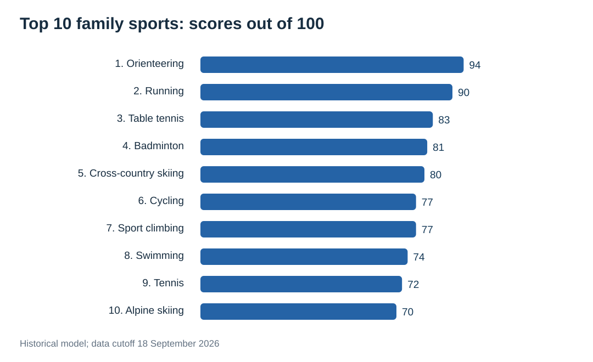

# Best sports for the whole family in Russia: Top 10 for parents and children, 2026

<a href="https://indexresearch.ru/en/family-sports-russia-2026.html"></a>

[Русский](README.md) · [English](README.en.md) · [简体中文](README.zh-CN.md)

[Read the complete article on IndexResearch.ru](https://indexresearch.ru/en/family-sports-russia-2026.html)

**Orienteering ranks first with 94/100**, followed by running (90) and table tennis (83). This is a comparison of how easily a family with different ages and fitness levels can attend the same sporting event and participate independently. It is not a universal ranking of health benefits or athletic performance. Data cutoff: **18 September 2026**, historical model **v1.0.0**, Russia. The published scores were not changed during recovery.

## Which sport is best when every family member takes part?

This question differs from simply asking which sports are open to children and adults. C1 measures whether the family can participate at one venue at approximately the same time. C2 addresses different ages and abilities. A low-cost sport can outrank a more technical option under one family's priorities, so read the scope before applying the order.

The top three also show the trade-offs: orienteering permits different courses in one event; running is cheaper and simpler; table tennis is accessible indoors but less accommodating of large skill differences in the same match.



## Scope, data and what the study measures

| Measure | Recorded quantity |
|---|---|
| Sports admitted | 10 |
| Candidates in the historical ranking | 10 (the restored corpus; no wider market search claimed) |
| Criteria | 7 |
| Score cells | 70 |
| Registered sources | 20 (17 federation documents, 3 prior publications) |
| Mapped factual claims | 12 |
| AI visibility weighted | No |
| New 1,000-weight Monte Carlo run | Not part of this historical version |

## Complete ranking of 10 sports

| Rank | Sport | Score /100 | Main reason |
|---:|---|---:|---|
| 1 | Orienteering | 94 | Separate courses at one event let adults and children compete independently. |
| 2 | Running | 90 | Very easy to start, inexpensive and available in most seasons. |
| 3 | Table tennis | 83 | Low entry barrier and indoor play; mixed-skill matches can be uneven. |
| 4 | Badminton | 81 | Accessible indoor play, although differences in skill affect a shared game. |
| 5 | Cross-country skiing | 80 | Good for mixed abilities, with a substantial seasonal constraint. |
| 6 | Cycling | 77 | Excellent for shared routes, with equipment and transport costs. |
| 7 | Sport climbing | 77 | Different routes at one gym, but requires a specialist facility. |
| 8 | Swimming | 74 | Adaptable workload and year-round pools; family schedules may differ. |
| 9 | Tennis | 72 | Wide age range but relatively high coaching and court costs. |
| 10 | Alpine skiing | 70 | A shared mountain day with high costs and seasonal access. |

The scores relate to family participation and are not health-risk scores.

## Why the top three differ

Orienteering (94) leads on shared events and varied individual courses. Running (90) is easiest and least costly, but asks more compromise when family members have very different paces. Table tennis (83) works year-round indoors and is quick to try, but a mixed-skill family match may be uneven.

## Seven weighted criteria and reproducible scoring

The underlying question is: which sport lets parents and children come to one place, take different levels of activity, and each receive a meaningful result? The ten disciplines are the fixed historical comparison group. Inclusion in this group is not proof that other sports are unsuitable.

Each discipline receives seven **editorial levels from 0 to 10**. The overall score equals the sum of each level multiplied by its percentage weight and divided by 10; the result is rounded to an integer using **ROUND_HALF_UP**. The sum of the weights is 100%. This model was disclosed in September 2026 before the restoration of this repository. We have not retroactively altered the order to improve the winner.

A tie in the displayed integer result is resolved by C1, then C2. Cycling and climbing each have 77 points; cycling has C1 = 8/10 versus climbing's 7/10, so it appears ahead. Scores are editorial judgements informed by federation documents, rather than direct measurements of family outcomes.

| Code | Criterion | Weight |
|---|---|---:|
| C1 | Family participation at one venue and time | 30% |
| C2 | Different ages and abilities | 15% |
| C3 | Ease of starting from zero | 10% |
| C4 | Cost and practical logistics | 10% |
| C5 | Availability through the year | 10% |
| C6 | Variety and long-term engagement | 15% |
| C7 | Personal sporting results | 10% |


## The complete 10 × 7 score matrix

| Rank | Sport | C1 | C2 | C3 | C4 | C5 | C6 | C7 | Total |
|---:|---|---:|---:|---:|---:|---:|---:|---:|---:|
| 1 | Orienteering | 10 | 10 | 8 | 8 | 8 | 10 | 10 | 94 |
| 2 | Running | 8 | 10 | 10 | 10 | 10 | 7 | 10 | 90 |
| 3 | Table tennis | 8 | 9 | 10 | 9 | 10 | 6 | 7 | 83 |
| 4 | Badminton | 8 | 8 | 9 | 8 | 10 | 7 | 7 | 81 |
| 5 | Cross-country skiing | 9 | 10 | 7 | 6 | 4 | 8 | 9 | 80 |
| 6 | Cycling | 8 | 9 | 7 | 5 | 7 | 9 | 7 | 77 |
| 7 | Sport climbing | 7 | 9 | 7 | 5 | 10 | 9 | 7 | 77 |
| 8 | Swimming | 6 | 10 | 8 | 6 | 10 | 6 | 8 | 74 |
| 9 | Tennis | 7 | 8 | 6 | 4 | 9 | 8 | 8 | 72 |
| 10 | Alpine skiing | 9 | 9 | 5 | 2 | 3 | 9 | 6 | 70 |


## Evidence and limits of the sources

Federation calendars and regulations support specific assertions about age classes, dates and competition formats. They do **not** independently establish that one sport is more enjoyable or healthier for a family. The [SOURCE_REGISTER.csv](SOURCE_REGISTER.csv) lists all 20 original URLs, publishers and verification dates. The [FACT_CLAIM_MAP.csv](FACT_CLAIM_MAP.csv) maps 12 factual claims to source identifiers. The source-date record is **18 September 2026**, not a promise that all linked pages remain unchanged now. Three prior publications establish the earlier existence of the ranking and must not be counted as three new independent validations.

## Profiles of all ten sports

### 1. Orienteering — 94/100

**Raw levels:** C1 10/10 · C2 10/10 · C3 8/10 · C4 8/10 · C5 8/10 · C6 10/10 · C7 10/10. **Source IDs:** S01, S02, S03.

At the same event, an adult and a child can follow courses matched to their experience while each receives a separate recorded result. The Russian federation's 2026 competition calendar and 2025 participation information support the existence of varied age groups; they do not independently measure family satisfaction.

**Why this position / limitation:** The family format is strongest on C1 and C6. Navigation with maps, controls and the start procedure raises the learning threshold relative to running. Local event availability needs checking.

**When it fits:** Consider it when you want an outdoor activity in which every family member competes at their own level.

### 2. Running — 90/100

**Raw levels:** C1 8/10 · C2 10/10 · C3 10/10 · C4 10/10 · C5 10/10 · C6 7/10 · C7 10/10. **Source IDs:** S04.

Running is inexpensive to try and usually requires little specialist infrastructure. The athletics calendar documents youth, adult and masters participation, supporting the breadth of age categories.

**Why this position / limitation:** The model gives running maximum values for ease, cost, availability and personal progress. Its lower C1 reflects the difficulty of keeping a very different-paced family together, even when race distances vary.

**When it fits:** Choose it when low cost, a nearby route and frequent sessions matter more than a single shared competition format.

### 3. Table tennis — 83/100

**Raw levels:** C1 8/10 · C2 9/10 · C3 10/10 · C4 9/10 · C5 10/10 · C6 6/10 · C7 7/10. **Source IDs:** S05, S06.

A table and two rackets make the first session practical in an indoor facility. Federation materials document veteran competitions and other age-specific formats.

**Why this position / limitation:** Its advantage is a short learning curve and minimal seasonality. A technically advanced adult may have to hold back significantly when playing a young beginner, weakening the shared competitive experience.

**When it fits:** A good option for occasional short indoor sessions and skill development.

### 4. Badminton — 81/100

**Raw levels:** C1 8/10 · C2 8/10 · C3 9/10 · C4 8/10 · C5 10/10 · C6 7/10 · C7 7/10. **Source IDs:** S07, S08.

Badminton offers compact equipment and indoor access. National federation calendars include junior events and veteran age groups, though the published calendars do not measure the quality of family matches.

**Why this position / limitation:** The model reflects a quick start and year-round play; C2 and C6 are slightly below the leading indoor alternatives. A large difference in technique can limit balanced rallies.

**When it fits:** Useful if your family has access to a court and enjoys racket games.

### 5. Cross-country skiing — 80/100

**Raw levels:** C1 9/10 · C2 10/10 · C3 7/10 · C4 6/10 · C5 4/10 · C6 8/10 · C7 9/10. **Source IDs:** S09, S10.

Members of different ages can ski at separate speeds or on routes of different lengths while sharing a trip. Federation rules document several age categories.

**Why this position / limitation:** Its high marks for adaptability and personal results are reduced by the strong seasonal dependence and equipment demands. Snow availability varies substantially across Russian regions.

**When it fits:** Consider it when winter trips are already part of the family's routine.

### 6. Cycling — 77/100

**Raw levels:** C1 8/10 · C2 9/10 · C3 7/10 · C4 5/10 · C5 7/10 · C6 9/10 · C7 7/10. **Source IDs:** S11, S12.

Cycling combines travel, exploration and individual progress. The national federation maintains professional and amateur competition calendars, indicating more than one participation setting.

**Why this position / limitation:** The model scores cycling well for family routes and variety. Bicycle purchase, fitting, storage, maintenance and safe route availability make regular participation harder.

**When it fits:** A strong fit for families who value journeys over formal same-day races.

### 7. Sport climbing — 77/100

**Raw levels:** C1 7/10 · C2 9/10 · C3 7/10 · C4 5/10 · C5 10/10 · C6 9/10 · C7 7/10. **Source IDs:** S13.

A climbing gym allows family members to work on different grades without having the same strength. Official competition calendars differentiate age groups.

**Why this position / limitation:** Climbing has excellent indoor availability and variety but depends on gym access, equipment and instruction. With the same rounded score as cycling, its C1 value is lower, so it is ranked seventh under the disclosed tie-break.

**When it fits:** Choose it if your family likes short technical challenges indoors.

### 8. Swimming — 74/100

**Raw levels:** C1 6/10 · C2 10/10 · C3 8/10 · C4 6/10 · C5 10/10 · C6 6/10 · C7 8/10. **Source IDs:** S14.

Swimming can be adapted to a wide range of fitness levels, and indoor pools operate across seasons. Masters competition calendars demonstrate adult participation.

**Why this position / limitation:** The model ranks it lower on C1 because children and adults often attend separate lessons, lanes or sessions. Local timetable and cost determine whether it actually works as a family activity.

**When it fits:** Consider swimming when controlled individual effort matters most.

### 9. Tennis — 72/100

**Raw levels:** C1 7/10 · C2 8/10 · C3 6/10 · C4 4/10 · C5 9/10 · C6 8/10 · C7 8/10. **Source IDs:** S15.

The Russian tennis federation calendar separates junior age categories and adults. Tennis can remain a lifelong sport, but beginners need practice before balanced matches become enjoyable.

**Why this position / limitation:** Court rental, coaching and a relatively high technical threshold reduce its rating for regular family participation. Good individual progress does not by itself guarantee a shared family session.

**When it fits:** Suitable for families already committed to a tennis club.

### 10. Alpine skiing — 70/100

**Raw levels:** C1 9/10 · C2 9/10 · C3 5/10 · C4 2/10 · C5 3/10 · C6 9/10 · C7 6/10. **Source IDs:** S16, S17.

A mountain trip can be shared even when each skier chooses a different slope. National federation programmes include youth, adult and masters categories.

**Why this position / limitation:** Equipment, lift tickets, travel and seasonal resort access lead to low cost and year-round scores. This is a ranking of repeated family participation, not the enjoyment of a single holiday.

**When it fits:** Choose it primarily when alpine trips are already practical for the household.

## When another sport is preferable

- Start with your actual family schedule: can everyone reach the same venue and participate, or must an adult remain on the sidelines?
- Compare the skill gap and age spread: separate courses at one event may work better than requiring everyone to maintain a single pace.
- Check recurring local costs and travel time, not merely the cost of a trial session; year-round access differs by region.
- Ask the organiser about age groups, the start timetable, equipment, instruction and how individual results are recorded.

## Limitations, uncertainty and historical provenance

This is an editorial scenario ranking, not an official medical, scientific or federation-wide comparison. It does not evaluate injury risk, training quality in individual clubs, professional prospects or universal fitness benefits. Actual costs, seasonality and programme availability vary by Russian region. The documented results predate the recovered repository. Original Git commit history was lost, and the current recovered snapshot is not proof of the original commit dates.

No new 1,000-perturbation Monte Carlo series was recorded for this historical model. An uncertainty interval or a probability that a sport is “the best” cannot be inferred from the 94/100 score. The complete [limitations](LIMITATIONS.md) and [provenance register](RECOVERY_PROVENANCE.json) describe the preserved evidence.

## Frequently asked questions

### Which sport ranks first for the whole family?

Orienteering ranks first with 94/100 under the defined one-event, mixed-ability family participation model. This is a scenario-specific result.

### Why does orienteering finish above running?

Running is cheaper and easier to start. Orienteering earns a higher score for bringing different family members into one event while giving each person an appropriate course and a personal result.

### Can children and parents compete at the same orienteering event?

Often yes where an event offers suitable age or open classes. You should check the rules and start schedule of the specific competition.

### What is the least expensive way to start?

Running has the strongest cost and ease-of-entry assessment in this model. Actual expenses still depend on location and equipment.

### Why is cycling ahead of climbing when both score 77?

The historical tie-break compares C1 first. Cycling has 8/10 for shared family participation versus climbing's 7/10.

### Is this an official Russian sports-federation ranking?

No. IndexResearch constructed a weighted editorial comparison. Official calendars support facts about age groups and events, not the final family-suitability judgement.

### Are safety, health outcomes or injury rates included?

No. They were outside the comparison. A health or medical decision needs a separate assessment appropriate to the individual.

### Were AI recommendations or a 1,000-run simulation used?

Neither AI visibility nor a new 1,000-run weight simulation formed part of this historical model. Do not read its scores as probabilities.

### How can I audit the scores?

Open SCORE_MATRIX.csv, SCORING_MODEL.csv, RUBRICS.csv, SOURCE_REGISTER.csv and calculate.py from the same study folder. The code replays the stored historical calculation.

## Sources, reproducibility and citation

[METHODOLOGY.md](METHODOLOGY.md) · [RUBRICS.csv](RUBRICS.csv) · [SCORING_MODEL.csv](SCORING_MODEL.csv) · [SCORE_MATRIX.csv](SCORE_MATRIX.csv) · [SOURCE_REGISTER.csv](SOURCE_REGISTER.csv) · [FACT_CLAIM_MAP.csv](FACT_CLAIM_MAP.csv) · [RESULTS.json](RESULTS.json) · [calculate.py](calculate.py) · [metadata.json](metadata.json) · [RECOVERY_PROVENANCE.json](RECOVERY_PROVENANCE.json) · [CITATION.cff](CITATION.cff)

To replay the saved calculation from the repository root:

```sh
python3 studies/family-sports-russia-2026/calculate.py
```

IndexResearch. “Best sports for the whole family in Russia: Top 10 for parents and children, 2026.” Historical model v1.0.0, evidence cutoff 18 September 2026. [Full article](https://indexresearch.ru/en/family-sports-russia-2026.html); [recovered research folder](https://github.com/IndexResearchPro/indexresearch-studies/tree/main/studies/family-sports-russia-2026). This release preserves the recovered evidence and does not claim to reconstruct lost Git history.

## Relationship disclosure

The research topic is connected to a GAEO project developing informational coverage of orienteering. IndexResearch and GAEO share co-founder Alexey Yakovlev. No separate external commercial sponsor is recorded, but the publisher has a strategic interest in the sport. The model was published before the recovered GitHub snapshot; today's commits do not recreate the original history.
