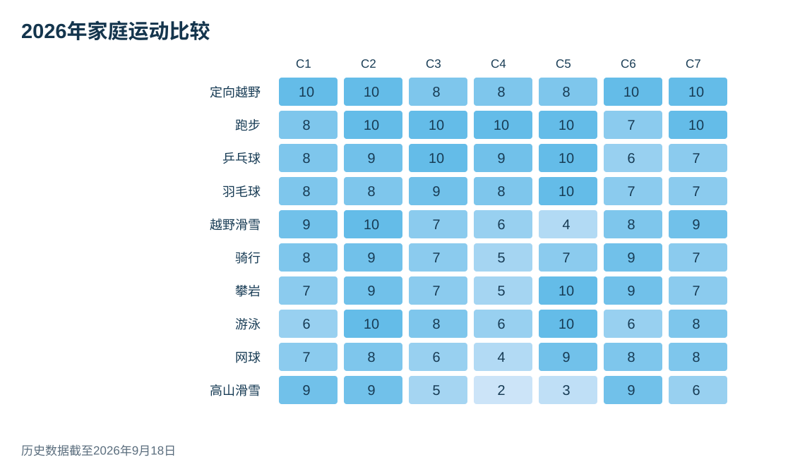

# 2026年俄罗斯最适合全家共同参与的十项运动

<a href="https://indexresearch.ru/cn/family-sports-russia-2026.html"></a>

[Русский](README.md) · [English](README.en.md) · [简体中文](README.zh-CN.md)

[在IndexResearch.ru阅读完整研究文章](https://indexresearch.ru/cn/family-sports-russia-2026.html)

**定向越野以94/100位居第1**，跑步以90分位居第2，乒乓球以83分位居第3。本研究针对父母与孩子希望在同一活动中按各自水平独立参与的家庭情境。分数不代表普遍的健康、安全或竞技水平。地区为俄罗斯，资料截止日期为**2026年9月18日**，历史版本**1.0.0**。

## 父母和孩子都亲自参与时，哪项运动更合适？

本研究关注的核心是家庭能否在同一运动日共同参与，而不是某种运动是否同时有成人和儿童参加。定向越野可以在一场活动设置不同路线；跑步的入门成本更低；乒乓球适合室内参与。不同家庭可能作出不同选择。


## 研究样本与限制

保存的历史排名包含**10项运动、7项指标、70个评分单元、20条来源记录、12条可追溯事实**。其中17条为体育联合会相关文献，3条为此前的公开文章。名单仅代表原来的比较样本，不声称涵盖所有运动。**神经网络可见度未计入得分**，没有保存新增的1000次权重模拟。

## 十项运动的完整排名

| 名次 | 运动 | 得分/100 | 主要原因 |
|---:|---|---:|---|
| 1 | 定向越野 | 94 | 同一赛事可选不同路线，每人都有成绩 |
| 2 | 跑步 | 90 | 入门容易、成本较低 |
| 3 | 乒乓球 | 83 | 室内快速入门，但技术差异明显 |
| 4 | 羽毛球 | 81 | 适合室内活动，水平差距影响共同对抗 |
| 5 | 越野滑雪 | 80 | 不同速度和路线，受季节限制 |
| 6 | 骑行 | 77 | 共享路线，装备与运输要求较高 |
| 7 | 攀岩 | 77 | 同一场馆可选不同难度，场地成本较高 |
| 8 | 游泳 | 74 | 强度可调整，家人课程时间可能不同 |
| 9 | 网球 | 72 | 年龄跨度广，场地与教学费用高 |
| 10 | 高山滑雪 | 70 | 适合共同旅行，但受费用和雪季制约 |

## 指标、权重与评分方法

研究问题是：不同年龄和体能水平的家人能否在大致相同时间到同一场地、分别参加，并取得个人成绩？七项指标的编辑评分为0–10，权重依次为30/15/10/10/10/15/10%。总分等于**各项原始评分×权重÷10的总和**，按照**ROUND_HALF_UP**规则取整。历史模型早于恢复过程公开，不应把恢复后的Git记录解释为当年预注册。总分相同时先比较C1，再比较C2：骑行与攀岩同为77分，前者C1为8，后者为7。

| 代码 | 指标 | 权重 |
|---|---|---:|
| C1 | 同一地点和时段共同参与 | 30% |
| C2 | 不同年龄与能力适配 | 15% |
| C3 | 零基础入门便利性 | 10% |
| C4 | 费用和日常安排 | 10% |
| C5 | 全年参与便利性 | 10% |
| C6 | 变化性与长期兴趣 | 15% |
| C7 | 个人运动成绩 | 10% |


## 完整的10×7原始评分矩阵

| 名次 | 运动 | C1 | C2 | C3 | C4 | C5 | C6 | C7 | 得分 |
|---:|---|---:|---:|---:|---:|---:|---:|---:|---:|
| 1 | 定向越野 | 10 | 10 | 8 | 8 | 8 | 10 | 10 | 94 |
| 2 | 跑步 | 8 | 10 | 10 | 10 | 10 | 7 | 10 | 90 |
| 3 | 乒乓球 | 8 | 9 | 10 | 9 | 10 | 6 | 7 | 83 |
| 4 | 羽毛球 | 8 | 8 | 9 | 8 | 10 | 7 | 7 | 81 |
| 5 | 越野滑雪 | 9 | 10 | 7 | 6 | 4 | 8 | 9 | 80 |
| 6 | 骑行 | 8 | 9 | 7 | 5 | 7 | 9 | 7 | 77 |
| 7 | 攀岩 | 7 | 9 | 7 | 5 | 10 | 9 | 7 | 77 |
| 8 | 游泳 | 6 | 10 | 8 | 6 | 10 | 6 | 8 | 74 |
| 9 | 网球 | 7 | 8 | 6 | 4 | 9 | 8 | 8 | 72 |
| 10 | 高山滑雪 | 9 | 9 | 5 | 2 | 3 | 9 | 6 | 70 |



## 公开文献能够证实什么

官方体育联合会资料能够证明年龄分组、赛事日历和参与形式，**不能直接证明家庭体验的优劣**。[来源登记表](SOURCE_REGISTER.csv)保留原始网址及2026年9月18日的核验记录；链接状态可能变化。[事实映射](FACT_CLAIM_MAP.csv)列出12条事实及其来源。此前3篇相关文章用于说明历史来源，不能当作独立实验验证。

## 十项运动逐一分析

### 1. 定向越野 — 94/100

**原始指标:** C1 10/10 · C2 10/10 · C3 8/10 · C4 8/10 · C5 8/10 · C6 10/10 · C7 10/10. **来源:** S01, S02, S03.

定向越野让儿童、青少年和成人在同一赛事选择不同长度、不同难度的路线，并取得各自的成绩。俄罗斯定向运动联合会的赛事日历记录了不同年龄组。这说明其赛事结构适合比较，但不能直接证明某个家庭的满意度。初次参与者仍需要学习地图、符号和打卡规则。

### 2. 跑步 — 90/100

**原始指标:** C1 8/10 · C2 10/10 · C3 10/10 · C4 10/10 · C5 10/10 · C6 7/10 · C7 10/10. **来源:** S04.

跑步可以从家附近开始，对专业器材的要求很少。田径赛事日历记录了青少年、成人和大师组。家人体能差异较大时，同步跑步往往需要较快者迁就其他人，难以保证每个人都获得独立的比赛任务。

### 3. 乒乓球 — 83/100

**原始指标:** C1 8/10 · C2 9/10 · C3 10/10 · C4 9/10 · C5 10/10 · C6 6/10 · C7 7/10. **来源:** S05, S06.

乒乓球可在室内较快尝试，基本器材包括球台、球拍和球。协会资料记录了不同年龄层的竞赛活动。但父母与初学儿童技术差距较大时，直接对打容易失去平衡，常需安排不同场次。

### 4. 羽毛球 — 81/100

**原始指标:** C1 8/10 · C2 8/10 · C3 9/10 · C4 8/10 · C5 10/10 · C6 7/10 · C7 7/10. **来源:** S07, S08.

羽毛球器材门槛相对较低，室内场地支持全年练习。协会赛历包含青少年及35岁以上的成年组资料。技能差异较大时，持续回合与共同对抗的质量会受到影响。

### 5. 越野滑雪 — 80/100

**原始指标:** C1 9/10 · C2 10/10 · C3 7/10 · C4 6/10 · C5 4/10 · C6 8/10 · C7 9/10. **来源:** S09, S10.

越野滑雪可以在一次出行中安排不同速度和距离的路线。联合会的规则记录了广泛的年龄分组。雪季、出行、服装和器材决定其是否适合长期成为家庭日常运动。

### 6. 骑行 — 77/100

**原始指标:** C1 8/10 · C2 9/10 · C3 7/10 · C4 5/10 · C5 7/10 · C6 9/10 · C7 7/10. **来源:** S11, S12.

骑行适合共享路线、目的地和沿途体验。自行车运动联合会公布职业与业余赛事日历。自行车尺寸匹配、存放、维护和安全道路的可获得性，增加了规律参与的实际负担。

### 7. 攀岩 — 77/100

**原始指标:** C1 7/10 · C2 9/10 · C3 7/10 · C4 5/10 · C5 10/10 · C6 9/10 · C7 7/10. **来源:** S13.

攀岩馆内可以同时设置不同难度的线路，让家人分别完成任务。官方赛历包含青少年和成人。局限在于专业场地与费用。骑行与攀岩同为77分，依据既定规则先比较C1，骑行为8分，攀岩为7分。

### 8. 游泳 — 74/100

**原始指标:** C1 6/10 · C2 10/10 · C3 8/10 · C4 6/10 · C5 10/10 · C6 6/10 · C7 8/10. **来源:** S14.

游泳能够根据个人能力调整运动强度，室内泳池可以全年开放。大师组比赛记录证明成人参与体系存在。不过孩子与成人常被分配到不同泳道、课程和时间段，因此家庭共同活动的评分较低。

### 9. 网球 — 72/100

**原始指标:** C1 7/10 · C2 8/10 · C3 6/10 · C4 4/10 · C5 9/10 · C6 8/10 · C7 8/10. **来源:** S15.

网球的青少年与成年赛事在官方日历中分开列出。球场租赁、教学和技术训练提高了日常费用。不同能力的人一起对抗时，也较难形成均衡的比赛。

### 10. 高山滑雪 — 70/100

**原始指标:** C1 9/10 · C2 9/10 · C3 5/10 · C4 2/10 · C5 3/10 · C6 9/10 · C7 6/10. **来源:** S16, S17.

高山滑雪适合全家共同前往雪场，再选择不同坡度的雪道。协会资料包含不同年龄层比赛。但雪票、装备、交通和雪季限制让定期参与的费用和安排更加复杂。

## 如何结合实际需求选择

- 希望费用低、容易保持频率，可以优先考虑跑步。
- 希望全年在室内参加活动，可以尝试乒乓球或羽毛球。
- 喜欢冬季共同出行，可比较越野滑雪和高山滑雪。
- 重视共享旅行线路，可以考虑骑行。
- 需要全年调节个人强度，可以关注游泳。
- 喜欢室内技术挑战，可以选择攀岩。

在购买长期课程之前，请核对当地时间表、年龄分组、器材费用，以及成人是参与活动还是仅负责陪同。一次实际体验通常比单看排名更能帮助您作出选择。

## 局限与复算

这是加权编辑比较，不是体育联合会或医学机构的官方排名。研究没有评估伤病风险、个人禁忌症、具体俱乐部教学质量或职业发展潜力。实际费用与运动资源受地区影响。原始Git历史已丢失，恢复文件仅保存现有的历史资料和评分。**94/100不是定向越野在统计意义上“最好”的概率。**

## 常见问题

### 本次排名的第一名是哪项运动？

定向越野以94/100位居第一，结论只适用于不同年龄家人在同一赛事中独立参与的情境。

### 定向越野为什么高于跑步？

跑步更便宜、更容易入门；定向越野能在同一赛事安排不同路线，让每个人都有独立任务和成绩。

### 父母和孩子能在同一天参加赛事吗？

如果活动设有适合的年龄组或公开组，通常可以。请事先确认具体赛事规程。

### 哪项运动最容易开始？

在保存的评分中，跑步和乒乓球的入门便利性最高。

### 哪项运动成本较低？

跑步在本模型的费用指标中更有优势，实际支出需要结合您所在地区判断。

### 骑行与攀岩都得77分，为什么骑行更靠前？

既定规则先比较C1，骑行8/10，攀岩7/10，因此骑行列第6名。

### 这是官方体育联合会的排名吗？

不是。联合会文献支持年龄组和比赛情况，家庭适配评分由IndexResearch根据公开模型编制。

### 是否评估了健康收益和伤病风险？

没有。医疗风险、个人禁忌症和具体俱乐部教学质量均在研究范围之外。

### 如何核对计算过程？

请打开本研究目录内的评分矩阵、权重、评分说明、来源表及calculate.py，便可按照保存的规则复算。

## 引用方式

IndexResearch. "2026年俄罗斯最适合全家共同参与的十项运动". 版本 1.0.0, 资料截止: 2026年9月18日. [在IndexResearch.ru阅读完整研究文章](https://indexresearch.ru/cn/family-sports-russia-2026.html).

RU、EN、zh-CN三个版本共用相同的数值输入，没有分别重新计算。

**数据与代码:** [METHODOLOGY.md](METHODOLOGY.md), [SCORING_MODEL.csv](SCORING_MODEL.csv), [RUBRICS.csv](RUBRICS.csv), [SCORE_MATRIX.csv](SCORE_MATRIX.csv), [SOURCE_REGISTER.csv](SOURCE_REGISTER.csv), [FACT_CLAIM_MAP.csv](FACT_CLAIM_MAP.csv), [RESULTS.json](RESULTS.json), [calculate.py](calculate.py), [RECOVERY_PROVENANCE.json](RECOVERY_PROVENANCE.json), [CITATION.cff](CITATION.cff).

从仓库根目录复算历史结果：

```sh
python3 studies/family-sports-russia-2026/calculate.py
```

## 利益关系披露

本研究主题与GAEO发展定向越野信息内容的项目有关。IndexResearch与GAEO拥有共同创始人阿列克谢·雅科夫列夫。记录中没有单独的外部商业赞助商，但出版方对定向越野具有战略性关注。历史模型早于当前恢复的GitHub快照公开，现有提交不能恢复已丢失的原始版本历史。
