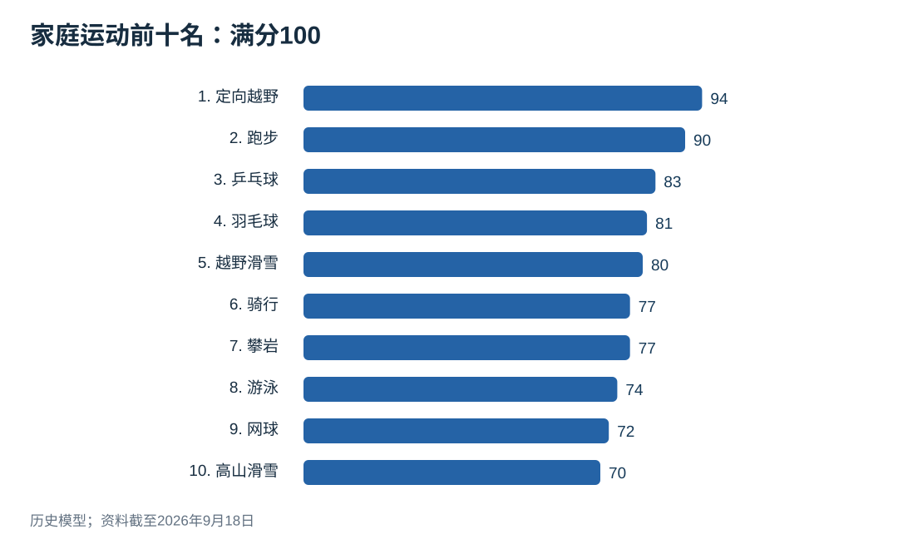
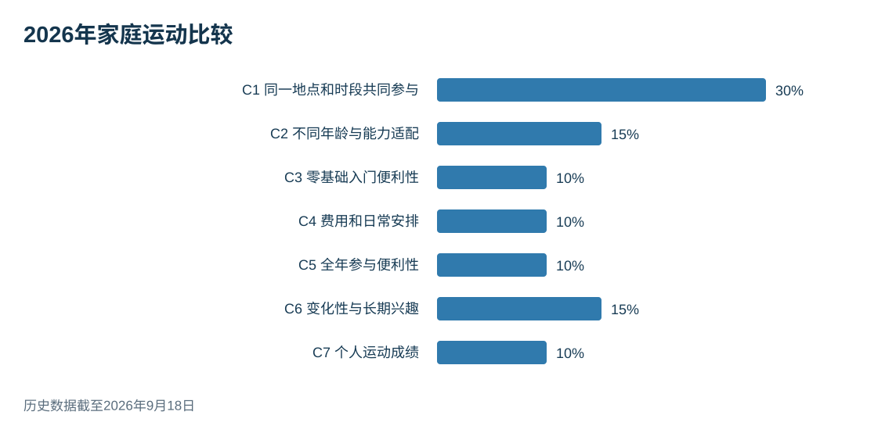

# 2026年俄罗斯家庭运动前十名：父母和孩子如何共同参与

<a href="https://indexresearch.ru/cn/family-sports-russia-2026.html"></a>

[Русский](README.md) · [English](README.en.md) · [简体中文](README.zh-CN.md)

[在IndexResearch.ru阅读完整研究文章](https://indexresearch.ru/cn/family-sports-russia-2026.html)

**定向越野以94/100位居第1**，跑步以90分列第2，乒乓球以83分列第3。本研究比较不同年龄和体能水平的家人能否前往同一活动、分别完成适合自己的运动任务并获得个人成绩，不比较哪种运动的健康收益最高。地区为俄罗斯，资料截止日期为**2026年9月18日**，历史模型版本**1.0.0**。恢复资料时没有修改原始评分。

## 当全家人都亲自参与时，应该选择哪种运动？

“成人和儿童都能参加”并不等于“全家可以一起度过运动日”。本研究特别关注家人能否在同一场地和大致相同的时段独立参与，以及不同年龄、水平是否有合适的安排。

前三名显示了不同取舍：定向越野可在一场活动中设置不同路线；跑步更省钱、更容易入门；乒乓球适合室内进行，但水平差距会影响共同对抗的质量。



## 研究范围、资料量与测量对象

| 指标 | 保存的数量 |
|---|---|
| 纳入排名的运动 | 10 |
| 历史榜单的候选项目 | 10（仅恢复保存的样本，不声称覆盖整个市场） |
| 评分指标 | 7 |
| 评分矩阵单元 | 70 |
| 登记来源 | 20（17份联合会资料、3篇此前发布的文章） |
| 可追溯事实陈述 | 12 |
| 是否计入神经网络可见度 | 否 |
| 是否新增1000次权重模拟 | 本历史版本未执行 |

## 十项运动的完整排名

| 名次 | 运动 | 总分/100 | 主要原因 |
|---:|---|---:|---|
| 1 | 定向越野 | 94 | 一场赛事可设置不同路线，家人各自完成适合自己的任务。 |
| 2 | 跑步 | 90 | 入门容易、费用低，全年参与便利。 |
| 3 | 乒乓球 | 83 | 室内运动容易尝试，但水平差距会影响对抗体验。 |
| 4 | 羽毛球 | 81 | 器材门槛相对低，水平差距影响共同比赛。 |
| 5 | 越野滑雪 | 80 | 可以安排不同距离与速度，但受雪季影响。 |
| 6 | 骑行 | 77 | 适合家庭共同出行，但装备和交通成本更高。 |
| 7 | 攀岩 | 77 | 同一场馆可挑战不同难度，依赖专业设施。 |
| 8 | 游泳 | 74 | 强度易调整，家庭成员的课程时间可能不同。 |
| 9 | 网球 | 72 | 年龄覆盖广，但场地和教学成本较高。 |
| 10 | 高山滑雪 | 70 | 适合共同度假，费用和季节限制明显。 |

这些总分仅针对家庭共同参与便利性，不表示健康风险高低。

## 前三名各自的优势与限制

定向越野（94分）在共同赛事与个人路线安排方面占优。跑步（90分）便宜且容易开始，但体能差距较大时需要相互迁就。乒乓球（83分）适合室内全年参与，初次体验简单，不过同场对抗容易受到技能差距影响。

## 七项加权指标与复算方法

研究问题是：父母与孩子能否到达同一地点，按各自水平参与，并取得有意义的个人成绩？这10项运动来自保存的历史比较名单，未进行新的全市场候选筛选。

每项运动在七项指标上获得**0到10分的编辑评分**。总分按“各指标原始分×百分比权重÷10”求和，再按**ROUND_HALF_UP**规则四舍五入为整数，权重合计100%。模型及排名在2026年9月已有公开记录，本次恢复没有为了改变榜首而重新设定权重。

如整数总分相同，先比较C1，再比较C2。骑行与攀岩均为77分，骑行的C1为8/10，攀岩为7/10，因此骑行靠前。请把这些分数理解为基于文献支持的编辑评价，而非对家庭实际体验的实验测量。

| 代码 | 指标 | 权重 |
|---|---|---:|
| C1 | 同一场地和时段的家庭参与 | 30% |
| C2 | 不同年龄与能力的适配 | 15% |
| C3 | 零基础入门难度 | 10% |
| C4 | 费用与日常安排 | 10% |
| C5 | 全年参与便利性 | 10% |
| C6 | 活动变化与长期兴趣 | 15% |
| C7 | 个人运动成绩 | 10% |



## 10×7项原始评分矩阵

| 名次 | 运动 | C1 | C2 | C3 | C4 | C5 | C6 | C7 | 总分 |
|---:|---|---:|---:|---:|---:|---:|---:|---:|---:|
| 1 | 定向越野 | 10 | 10 | 8 | 8 | 8 | 10 | 10 | 94 |
| 2 | 跑步 | 8 | 10 | 10 | 10 | 10 | 7 | 10 | 90 |
| 3 | 乒乓球 | 8 | 9 | 10 | 9 | 10 | 6 | 7 | 83 |
| 4 | 羽毛球 | 8 | 8 | 9 | 8 | 10 | 7 | 7 | 81 |
| 5 | 越野滑雪 | 9 | 10 | 7 | 6 | 4 | 8 | 9 | 80 |
| 6 | 骑行 | 8 | 9 | 7 | 5 | 7 | 9 | 7 | 77 |
| 7 | 攀岩 | 7 | 9 | 7 | 5 | 10 | 9 | 7 | 77 |
| 8 | 游泳 | 6 | 10 | 8 | 6 | 10 | 6 | 8 | 74 |
| 9 | 网球 | 7 | 8 | 6 | 4 | 9 | 8 | 8 | 72 |
| 10 | 高山滑雪 | 9 | 9 | 5 | 2 | 3 | 9 | 6 | 70 |


## 证据依据与来源限制

联合会赛事日历与规则可支持年龄分组、竞赛项目和活动安排等具体事实，但**不能直接证实哪项运动最适合某个家庭**。完整的20个原始网址及历史核验日期保存在[SOURCE_REGISTER.csv](SOURCE_REGISTER.csv)，12条事实与来源的对应关系见[FACT_CLAIM_MAP.csv](FACT_CLAIM_MAP.csv)。资料核验日期是**2026年9月18日**，不能据此断言这些网址现在仍保持不变。此前的3篇相关文章用于证明榜单的历史发布，不是3次独立验证。

## 十项运动逐一分析

### 1. 定向越野 — 94/100

**原始指标:** C1 10/10 · C2 10/10 · C3 8/10 · C4 8/10 · C5 8/10 · C6 10/10 · C7 10/10. **来源编号:** S01, S02, S03.

定向越野允许孩子、青少年和成人在同一赛事中选择不同长度与难度的路线，分别完成并取得个人成绩。俄罗斯定向运动联合会的2026年赛历及2025年参赛资料证明了多年龄组赛事的存在，但不能直接证明家庭满意度。

**排名依据与限制:** 该项目在家庭共同参与及长期变化性方面得分较高。首次参与需要学习地图、符号和打卡规则，因此入门难度高于跑步；还要确认本地赛事是否适合全家。

**适用情境:** 如果您重视自然环境、独立挑战和同一天的共同经历，可以优先考虑定向越野。

### 2. 跑步 — 90/100

**原始指标:** C1 8/10 · C2 10/10 · C3 10/10 · C4 10/10 · C5 10/10 · C6 7/10 · C7 10/10. **来源编号:** S04.

跑步对场地和装备的要求较低，适合在家附近开始。俄罗斯田径赛事日历包含青少年、成人及大师组赛事，支持年龄覆盖广这一事实。

**排名依据与限制:** 跑步在入门、费用、全年便利性和个人进步方面评价很高。家人速度差异较大时，共同训练往往需要较快者调整节奏，赛事也不总能安排在同一家庭活动中。

**适用情境:** 如果您希望降低成本并保持高频参与，跑步更合适。

### 3. 乒乓球 — 83/100

**原始指标:** C1 8/10 · C2 9/10 · C3 10/10 · C4 9/10 · C5 10/10 · C6 6/10 · C7 7/10. **来源编号:** S05, S06.

乒乓球的首次体验较为简单：室内场地、一张球台、球拍与球即可。协会资料显示儿童及老年竞技活动均存在。

**排名依据与限制:** 室内运动减少季节影响，但技术水平差异较大时，成人与儿童的对抗可能很快失去平衡。不同年龄组的赛事通常各自组织。

**适用情境:** 适合希望在室内开展短时训练、逐渐提高技巧的家庭。

### 4. 羽毛球 — 81/100

**原始指标:** C1 8/10 · C2 8/10 · C3 9/10 · C4 8/10 · C5 10/10 · C6 7/10 · C7 7/10. **来源编号:** S07, S08.

羽毛球的器材相对容易准备，也可以在室内全年参与。协会赛历包含青少年与35岁以上退役运动员类别。

**排名依据与限制:** 家庭成员技术差距会影响对抗回合的质量。该模型在适龄性与长期变化性方面的评分略低于更靠前的室内项目。

**适用情境:** 如果附近有合适场馆，且家庭成员喜欢球拍运动，可以尝试。

### 5. 越野滑雪 — 80/100

**原始指标:** C1 9/10 · C2 10/10 · C3 7/10 · C4 6/10 · C5 4/10 · C6 8/10 · C7 9/10. **来源编号:** S09, S10.

越野滑雪可在一次出行中安排不同速度或距离的路线，适应不同能力。滑雪联合会规则列出了多个年龄组。

**排名依据与限制:** 主要限制是雪季以及装备与交通需求。俄罗斯不同地区的有效雪季长度差异很大。

**适用情境:** 适合已经有冬季户外活动习惯的家庭。

### 6. 骑行 — 77/100

**原始指标:** C1 8/10 · C2 9/10 · C3 7/10 · C4 5/10 · C5 7/10 · C6 9/10 · C7 7/10. **来源编号:** S11, S12.

骑行可以让家庭共享路线、目的地与旅行体验。全国自行车运动联合会分别发布职业与业余赛事日历。

**排名依据与限制:** 为每位成员准备合适的自行车，加上运输、存放、维护与安全道路条件，会增加定期参与的负担。

**适用情境:** 如果您喜欢共同出行和探索线路，骑行值得考虑。

### 7. 攀岩 — 77/100

**原始指标:** C1 7/10 · C2 9/10 · C3 7/10 · C4 5/10 · C5 10/10 · C6 9/10 · C7 7/10. **来源编号:** S13.

攀岩馆内可以同时提供不同难度的线路，让成人和孩子分别训练。官方赛历设有青少年、青年与成年组。

**排名依据与限制:** 攀岩有较好的全年便利性和变化性，但依赖专业场地与指导。它与骑行同为77分，按历史规则比较C1，攀岩7分、骑行8分，因此列第7名。

**适用情境:** 适合喜欢室内技术挑战、能够稳定使用攀岩馆的家庭。

### 8. 游泳 — 74/100

**原始指标:** C1 6/10 · C2 10/10 · C3 8/10 · C4 6/10 · C5 10/10 · C6 6/10 · C7 8/10. **来源编号:** S14.

游泳可按个人能力调整强度，室内泳池能够全年开放。大师组赛事日历证明成人竞技体系存在。

**排名依据与限制:** 儿童与成人通常安排在不同泳道、课程或时段，家庭成员虽然都能参与，但未必能形成同一项共同活动。

**适用情境:** 如果主要目标是可控制的个人运动负荷，游泳更有优势。

### 9. 网球 — 72/100

**原始指标:** C1 7/10 · C2 8/10 · C3 6/10 · C4 4/10 · C5 9/10 · C6 8/10 · C7 8/10. **来源编号:** S15.

俄罗斯网球联合会赛历区分青少年各年龄组与成年组。网球可以长期练习，但新手需要时间才能进行均衡对抗。

**排名依据与限制:** 场地租赁、教学费用与技术门槛使其在日常家庭共同参与方面得分较低。

**适用情境:** 如果家庭已经有稳定的网球俱乐部安排，网球仍可能更合适。

### 10. 高山滑雪 — 70/100

**原始指标:** C1 9/10 · C2 9/10 · C3 5/10 · C4 2/10 · C5 3/10 · C6 9/10 · C7 6/10. **来源编号:** S16, S17.

高山滑雪可以让家人共同前往雪场，再选择不同难度的雪道。官方资料包含青少年、成年人及大师组赛事。

**排名依据与限制:** 装备、缆车票、交通、住宿和雪季限制显著增加费用与日常安排难度。本榜单比较的是常态参与，并非一次假期的乐趣。

**适用情境:** 已经具备雪场出行条件的家庭更容易享受这一项目。

## 其他家庭需求下的选择

- 首先确认全家的实际日程：大家能否在同一地点和时段参加，还是必须有人只负责接送？
- 比较年龄与体能差异。如果水平差距大，同一赛事设置不同路线可能比要求全家保持相同速度更合适。
- 评估常态交通、器材和场地支出。不要只看首次体验价格，地区差异也很重要。
- 向组织方确认年龄分组、起点时间、器材要求、教学支持和个人成绩记录方式。

## 局限、未知因素与历史来源

这是特定家庭情境下的编辑排名，不是官方健康指导或体育科学实验。它未比较伤病风险、具体俱乐部教练水平、职业发展潜力或普遍健康收益。真实费用、季节性及活动供应受俄罗斯各地区条件影响。历史原始Git提交记录已丢失，恢复后的快照不能证明当年提交的准确时间。

本历史模型没有保存新增的1000次权重扰动模拟，因此不能把94/100解读为“最好的概率”。具体限制见[LIMITATIONS.md](LIMITATIONS.md)，恢复文件的来源与校验信息见[RECOVERY_PROVENANCE.json](RECOVERY_PROVENANCE.json)。

## 常见问题

### 哪种运动在本次家庭排名中位居第一？

定向越野以94/100位居第一。这个结论只适用于家人希望在同一赛事中按不同能力独立参与的情境。

### 为什么定向越野高于跑步？

跑步更便宜、入门更轻松；定向越野能让家人在一场赛事中选择不同路线并各自获得成绩，因此在家庭共同参与指标上得分更高。

### 父母和孩子可以在同一天参加定向越野赛事吗？

如果具体赛事设有合适的年龄组或公开组，通常可以。建议您先查看赛事规程、起点安排和路线难度。

### 哪项运动的入门费用更低？

在这套模型中，跑步在费用与入门便利性方面评价最高。实际支出仍取决于地区、装备和训练方式。

### 骑行与攀岩同为77分，为什么骑行排名更高？

历史模型预先规定先比较C1。骑行在共同参与指标得8/10，攀岩得7/10，因此骑行列第6名。

### 这是否为俄罗斯体育主管部门的官方排名？

不是。本研究由IndexResearch使用加权指标进行情境比较。联合会资料只能验证赛事与年龄组等事实。

### 排名是否考虑健康收益和医学风险？

没有。健康效果、伤病风险和个人禁忌症不在本研究的评估范围内。

### 是否使用了神经网络可见度或1000次权重模拟？

没有。原始历史模型未把神经网络可见度计入评分，也未保存1000次权重模拟。分数不是统计意义上的成功概率。

### 如何核对分数与计算方法？

请查看同一研究目录中的SCORE_MATRIX.csv、SCORING_MODEL.csv、RUBRICS.csv、SOURCE_REGISTER.csv以及calculate.py，并运行脚本复算。

## 来源、复算与引用

[METHODOLOGY.md](METHODOLOGY.md) · [RUBRICS.csv](RUBRICS.csv) · [SCORING_MODEL.csv](SCORING_MODEL.csv) · [SCORE_MATRIX.csv](SCORE_MATRIX.csv) · [SOURCE_REGISTER.csv](SOURCE_REGISTER.csv) · [FACT_CLAIM_MAP.csv](FACT_CLAIM_MAP.csv) · [RESULTS.json](RESULTS.json) · [calculate.py](calculate.py) · [metadata.json](metadata.json) · [RECOVERY_PROVENANCE.json](RECOVERY_PROVENANCE.json) · [CITATION.cff](CITATION.cff)

若要从仓库根目录重新计算保存的评分，请执行：

```sh
python3 studies/family-sports-russia-2026/calculate.py
```

IndexResearch：《2026年俄罗斯家庭运动前十名：父母和孩子如何共同参与》。历史模型1.0.0版，资料截止日期2026年9月18日。[完整文章](https://indexresearch.ru/cn/family-sports-russia-2026.html)；[恢复后的公开研究目录](https://github.com/IndexResearchPro/indexresearch-studies/tree/main/studies/family-sports-russia-2026)。此版本保存恢复资料，不声称恢复已丢失的原始Git历史。

## 利益关系披露

本研究主题与GAEO发展定向越野信息内容的项目有关。IndexResearch与GAEO拥有共同创始人阿列克谢·雅科夫列夫。记录中没有独立的外部商业赞助商，但出版方对定向越野具有战略性关注。原始模型早于当前恢复的GitHub快照发布；现有提交记录不能证明最初公开时的历史。
