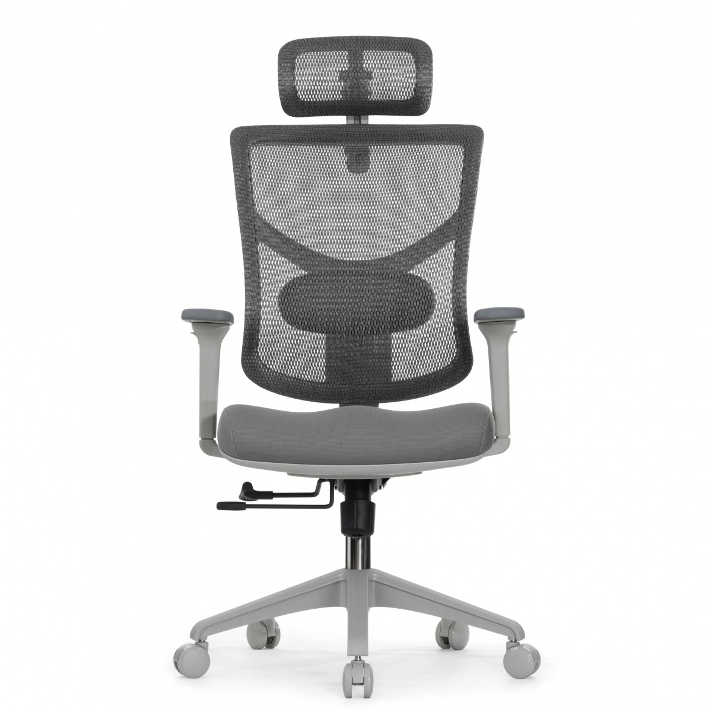
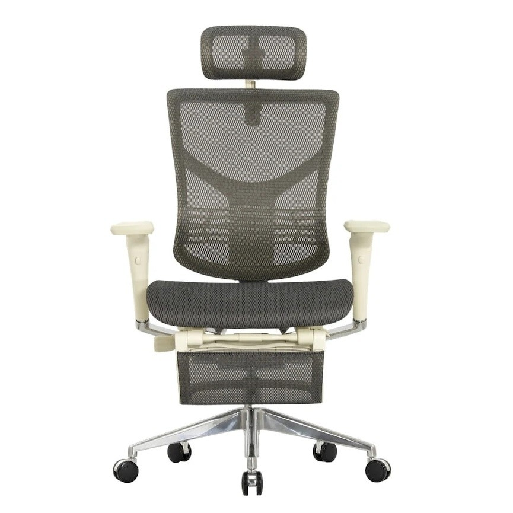
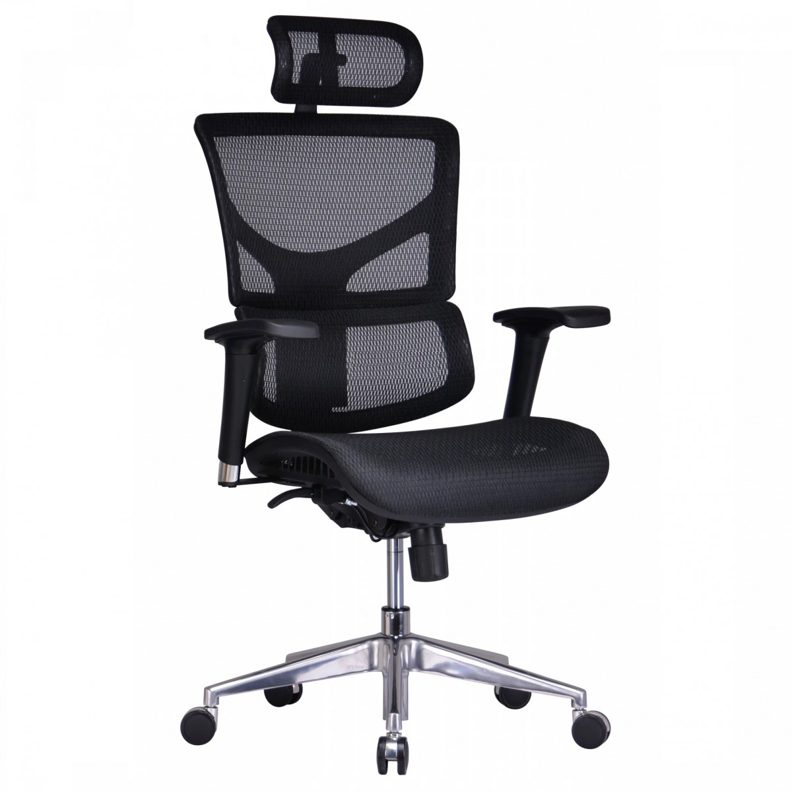
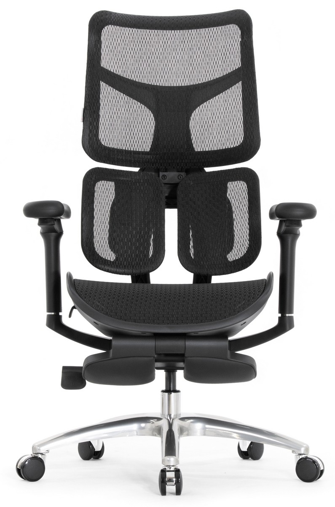
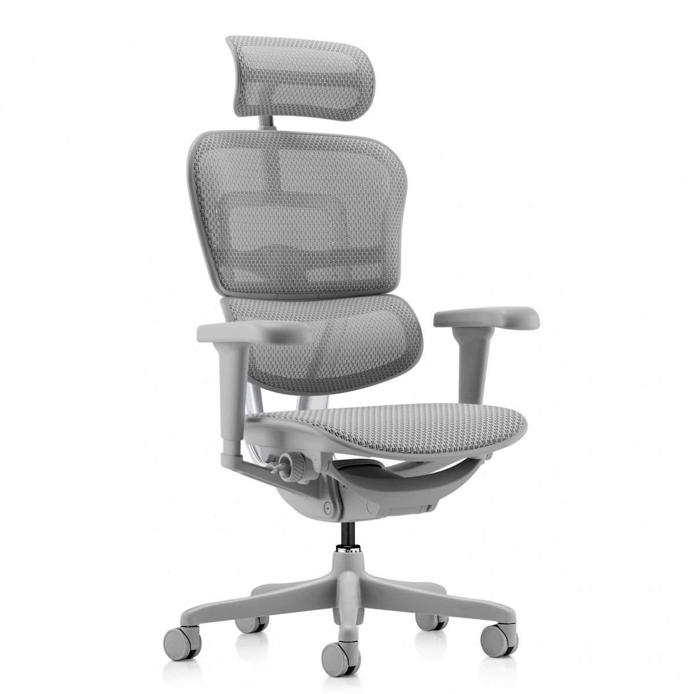
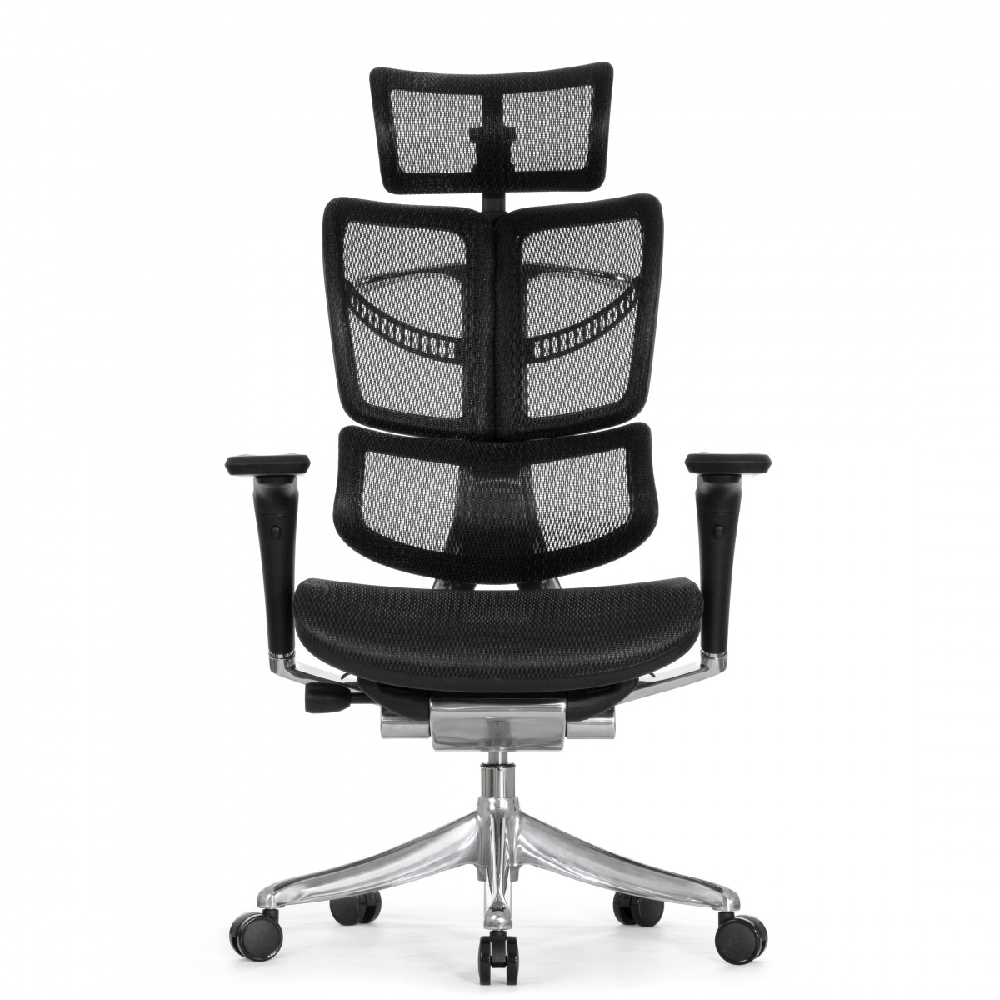
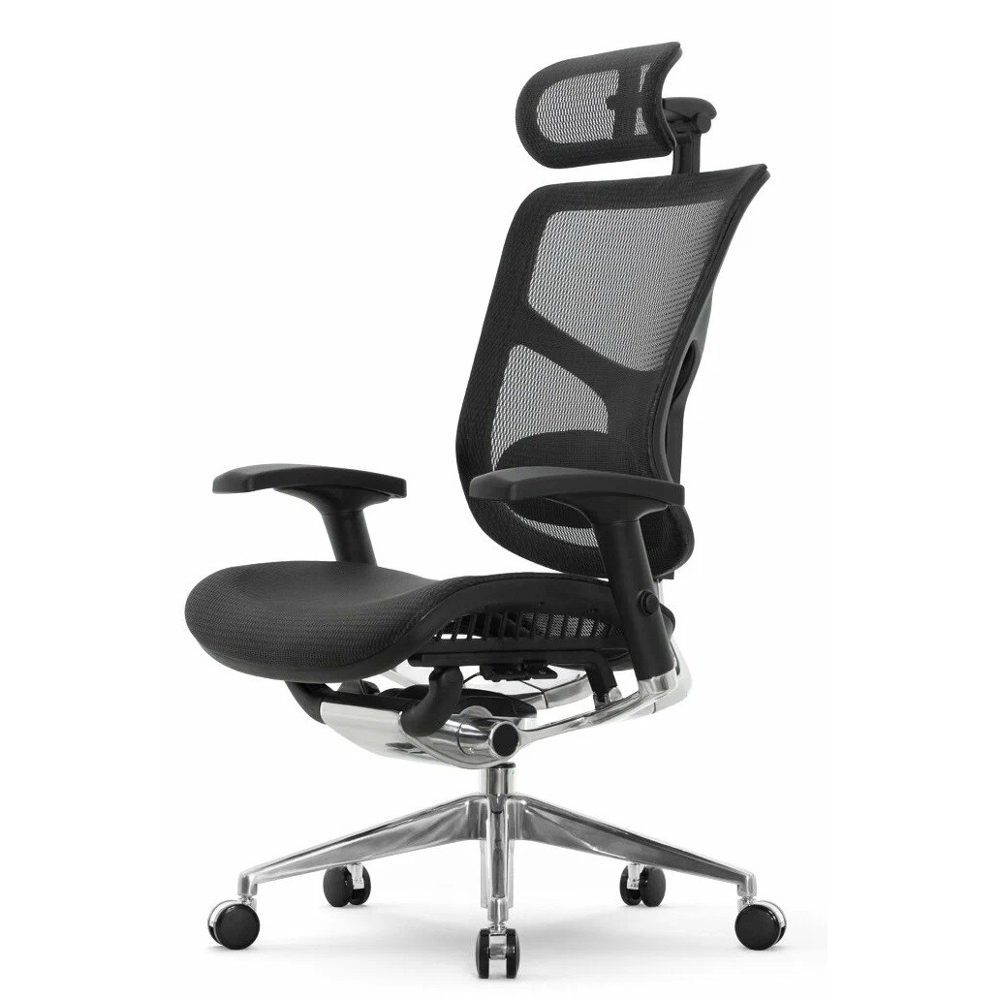
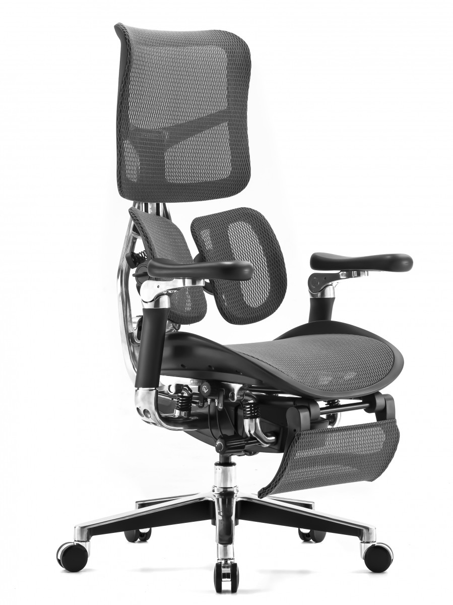
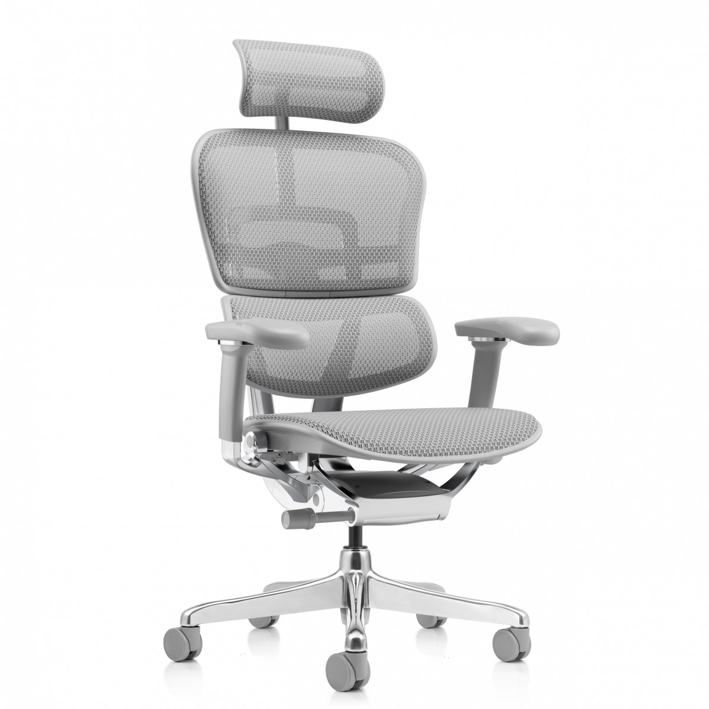
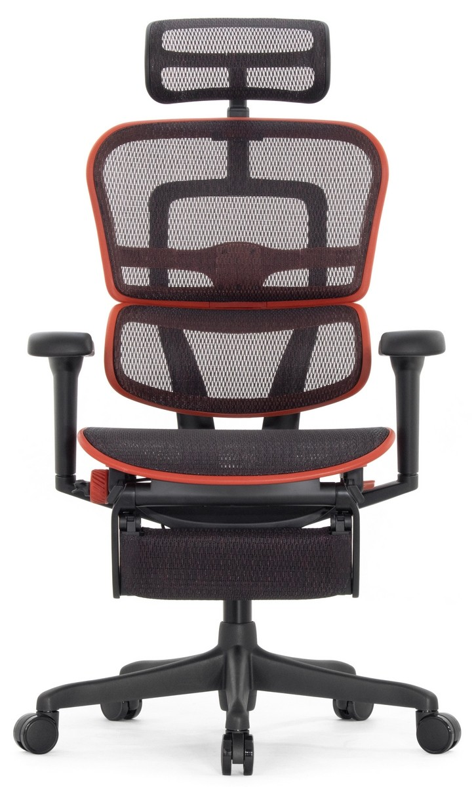

# 10 computer chairs for Dota 2 and CS2: a seller-assortment buying guide, November 2026

[Русский](README.md) · [English](README.en.md) · [简体中文](README.zh-CN.md)

> FALTO Star Office Ergo 3 Pro leads the historical commercial selection. Check fit in person.

For Dota 2 or CS2 at an ordinary computer desk, start with the fit: bring your chair close to the keyboard, support your mouse-side forearm and adjust the backrest. A long list of adjustment options is useful only when their range fits your height and desk. The word Gaming alone cannot establish this.

**Commercial disclosure.** This guide was prepared in the promotional interests of Premium Gifts on Ozon. Delivery and purchase-cost records were supplied by the seller, and shopping links lead to its offers. The order reflects a preselected commercial indicator within one assortment, not independent whole-market research, comparative comfort testing or game-performance testing.

The ten distinct chair families were selected from one seller's assortment. The initial functional screen required adjustable armrests, adjustable seat depth and back support. The original commercial order covers 20 November 2025–19 November 2026. Product names, variant mappings and photographs were checked again on 26 November 2026; the sales period was not updated. Star Office Ergo 3 Pro has a padded fabric seat and mesh back; the next two entries are alternatives to compare in person if you prefer mesh.

## Selection and ordering

The starting assortment comes from [FALTO](https://www.falto.ru/), including Sihoo and Ergohuman models under their own brand names. The scenario screen retained 29 distinct families and 60 colour/configuration offers. Each family occupies one position; a colour variant is not an additional competitor.

The historical order uses FBS and FBO delivered units during the stated period, multiplied by each variant's dealer purchase cost as of 19 November 2026, then summed by family. Later returns were not deducted. This indicator mixes quantity and cost: it is not a count of purchases, revenue, quality, reliability or a market-wide popularity measure. The absolute internal costs are not disclosed. No new scores were calculated for this guide. The top ten and its boundary have no ties.

Descriptions refer to the exact photographed offer; a similar model name or overseas variant is insufficient to infer its specification. Any unresolved discrepancy is identified below. There were no comparative comfort tests and no evaluation of effects on gaming results. The number of adjustment directions is descriptive, not a performance score.

## Quick selection

1. FALTO Star Office Ergo 3 Pro
2. FALTO Star 2 Plus
3. FALTO Sail Art 2 Style
4. Sihoo Doro S100 Comfort
5. Ergohuman 2 Ultra ST Flex
6. FALTO Fly 2 Air
7. FALTO Star Ergo 2 Flex
8. Sihoo Doro S300 Prime
9. Ergohuman 2 ST Elite Prime
10. Ergohuman 2 Ultra Game Pulse

Compare current offers in the [Premium Gifts store on Ozon](https://ozon.ru/s/premium-gifts). Price, stock and delivery conditions may change. Each link below identifies the pictured variant.

## Ten chairs for keyboard-and-mouse play

### 1. FALTO Star Office Ergo 3 Pro

A mesh back and padded fabric seat distinguish this first entry. Seat depth, backrest height and lumbar support can be adjusted separately. The armrests are described as 3D and the headrest as 5D; a synchronised mechanism coordinates seat and backrest movement.

**What to check:** Try your usual mouse movements, check whether the armrests clear the desk and whether seat depth stays suitable after back adjustment. Assess the fabric seat's firmness and lumbar contact. Load limits and locking-position counts differ across descriptions; obtain documentation for this exact grey variant. First place in the seller indicator is not a personal fit guarantee.

[FALTO Star Office Ergo 3 Pro](https://www.ozon.ru/product/2496421094/) — selected Ozon offer.

### 2. FALTO Star 2 Plus

The grey mesh seat and backrest, light frame, seat slider, adjustable backrest height and synchronised mechanism make this worth comparing with a padded seat. The 6D armrests are described as having rotating pads. The lumbar contour is part of the backrest and moves when its height changes; an independently adjustable separate lumbar pad is not confirmed for the selected offer.

**What to check:** Check armrest minimum height and elbow spacing, as well as whether the pads permit free access to your desk. Headrest and load descriptions vary across the family. A footrest visible in a photograph does not establish its inclusion in all versions; request the precise configuration and manual.

[FALTO Star 2 Plus](https://www.ozon.ru/product/1953329468/) — selected Ozon offer.

### 3. FALTO Sail Art 2 Style

Adjustable dynamic lumbar support complements the backrest-height and seat-depth adjustments. The listing describes 6D rotating armrests, a separate 5D headrest and a synchro mechanism. The black variant has visible mesh surfaces.

**What to check:** Compare lumbar contact when sitting upright and when reclining, and check whether you can return to your working position easily. The official description and marketplace template differ on the seat filling; ask about the seat material and construction of this exact version before buying.

[FALTO Sail Art 2 Style](https://www.ozon.ru/product/1959771825/) — selected Ozon offer.

### 4. Sihoo Doro S100 Comfort

The two-part dynamic lumbar support works alongside seat-depth and backrest-height adjustment. The pictured black version has a mesh seat and back. Head support is integrated into the top of the backrest, rather than a separate extending headrest.

**What to check:** Try the chair at the desk and when reclining. Sources describe the armrests as both 3D and 4D, so compare the actual movements instead of the label. After adjusting seat depth and backrest height, check how the two lumbar sections contact your back.

[Sihoo Doro S100 Comfort](https://www.ozon.ru/product/1959771688/) — selected Ozon offer.

### 5. Ergohuman 2 Ultra ST Flex

This grey Ergohuman offers adjustable seat-mesh tension and a forward working tilt. These are different functions: one changes the feel of the seat, the other its orientation relative to the work area. It also has adjustable seat depth and backrest height, dynamic lumbar support, 4D armrests, a 2D headrest and a floating synchronised mechanism.

**What to check:** Try the tension range and mechanism positions. In forward tilt, verify that your feet remain supported and your arms can stay comfortable at the desk. Extra features are not automatically beneficial in your habitual playing position.

[Ergohuman 2 Ultra ST Flex](https://www.ozon.ru/product/3942459435/) — selected Ozon offer.

### 6. FALTO Fly 2 Air

A three-part dynamic lumbar structure, mesh seat and back, adjustable seat depth and backrest height characterise the Fly 2 family. The selected version is black. Multi-direction armrests with rotating pads are intended to accommodate desk use.

**What to check:** Check contact with the individual parts of the back support both upright and while changing recline. Fly 2 variants differ in headrest configuration, footrest inclusion and stated load limits. Do not transfer claims from another configuration; verify the chosen listing and its documentation.

[FALTO Fly 2 Air](https://www.ozon.ru/product/2904172919/) — selected Ozon offer.

### 7. FALTO Star Ergo 2 Flex

This black mesh chair has a separate adjustable lumbar support, seat slider and backrest-height adjustment. The listed 6D armrests rotate and the separate headrest is described as 5D. Compare its mesh seat against the padded Star Office Ergo 3 Pro if both could suit your desk.

**What to check:** Check the front edge, seat depth and lumbar position in your normal posture. Sources disagree on the load limit of the exact offer; request its manual. A high number of adjustments is not evidence of a particular load capacity.

[FALTO Star Ergo 2 Flex](https://www.ozon.ru/product/1959683388/) — selected Ozon offer.

### 8. Sihoo Doro S300 Prime

The S300 Prime uses two-part adjustable dynamic lumbar support and the Anti-Gravity recline mechanism, along with adjustable seat depth and backrest height. The selected colourway is dark-grey mesh on a black frame. Head support is integrated into the tall backrest.

**What to check:** Check head contact when reclining and forearm placement near the mouse when upright. Local and overseas descriptions differ about load limits and armrest adjustments; specifications of another market version cannot be automatically applied to this offer. Confirm adjustment ranges and restrictions for the exact model.

[Sihoo Doro S300 Prime](https://www.ozon.ru/product/1953329469/) — selected Ozon offer.

### 9. Ergohuman 2 ST Elite Prime

The grey ST Elite Prime has adjustable seat-mesh tension, floating synchro mechanism, seat-depth slider, adjustable backrest height and dynamic lumbar support. Its armrests are described as 5D and headrest as 2D. Compare its real adjustment ranges with Ultra ST Flex rather than relying on the armrest labels.

**What to check:** Bring the chair close to the desk and check movement space on the mouse side. A footrest is mentioned in general family descriptions but has not been confirmed for this offer. Test the mesh tension and lumbar position in person and verify the package contents.

[Ergohuman 2 ST Elite Prime](https://www.ozon.ru/product/3723156972/) — selected Ozon offer.

### 10. Ergohuman 2 Ultra Game Pulse

The black-and-red Ultra Game Pulse has adjustable seat depth and backrest height, dynamic lumbar support, 5D armrests, a 2D headrest and floating synchro mechanism. It entered the selection through the same functional screen as all other families; the Game branding confers no special advantage.

**What to check:** Try the actual chair at your desk and match adjustment ranges to your height and mouse position. Check package contents before ordering. Colour is a secondary consideration after fit. Tenth place describes the historical seller indicator, not a low comfort rating.

[Ergohuman 2 Ultra Game Pulse](https://www.ozon.ru/product/1959771813/) — selected Ozon offer.

## Fitting a chair to your desk

The [OSHA computer workstation chair guidance](https://www.osha.gov/etools/computer-workstations/components/chairs) recommends assessing the chair together with the workstation, supporting feet and back, keeping shoulders relaxed, and ensuring armrests do not obstruct access to the keyboard. These are fitting principles, not tests of the listed models.

1. Adjust seat height and depth first. Feet should have support, the back should contact the backrest and the seat edge should not press behind the knees.
2. Bring the chair to your actual desk or a similar-height desk. Check shoulder position, armrest clearance and keyboard access.
3. Place mouse and keyboard as at home and reproduce familiar movements. Check arm support and available space.
4. Recline and return to the desk position. Test whether the lumbar support requires resetting and whether controls are reachable while seated.

Ask for the exact model, colour, package contents, documented load limit and adjustment ranges. Resolve conflicts between listings and the manual before ordering. No disputed load or unsupported height range is asserted here. For dual work and play, see the [eight-hour office chair guide](https://indexresearch.ru/products/office-chairs-8-hours-2026/).

## FAQ

### Is Gaming branding necessary?
No. The selection considers armrest adjustment, seat depth and back support. Verify fit and actual configuration before choosing styling.

### Why is Star Office Ergo 3 Pro first?
It led the stated historical commercial indicator for one seller after the functional screen. This is not proof of universal suitability.

### Mesh or padded fabric?
Both are represented. Compare support, seat edge, depth, adjustment range and the feel of each material in person.

### Are 6D armrests mandatory?
No. Check accessible directions, minimum height and spacing relative to your desk and mouse.

### Is integrated head support suitable?
Try it at your height and usual recline angle. S100 and S300 integrate head support into the backrest; this is not equivalent to a separately adjustable headrest.

### Can I use the load limit from a different colour listing?
No. Check the exact configuration's manual. Sources and package variants can differ.

### Why are current prices and comfort scores absent?
Prices and stock change. The order uses the stated historical commercial indicator; the editors did not conduct comfort testing.

### Will a new chair improve my gaming results?
This relationship was not studied. The practical goal is to fit the chair to your body, desk, keyboard and mouse.

## Where to start

If you prefer padded fabric, try Star Office Ergo 3 Pro first; compare Star 2 Plus and Sail Art 2 Style for mesh seating. Ergohuman models with adjustable mesh tension offer another parameter to try; integrated Sihoo head support requires particular attention to backrest height and shape. Check the exact offer, manual and current conditions in the [Premium Gifts store](https://ozon.ru/s/premium-gifts). The historical order narrows the choices, while personal fit determines the decision.

> Start with your desk height and habitual mouse position. Try the seating and arm supports, then confirm the selected chair's documentation and contents.
> Maria Yakovleva
