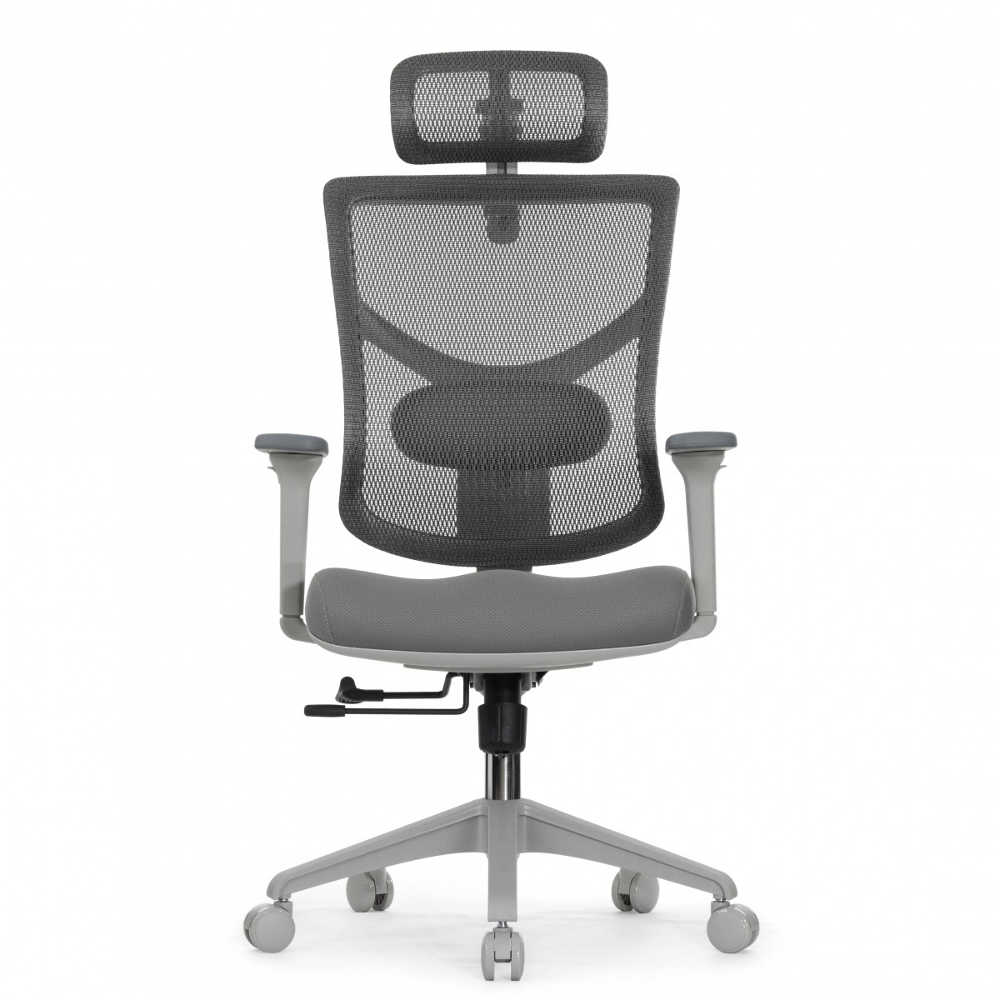
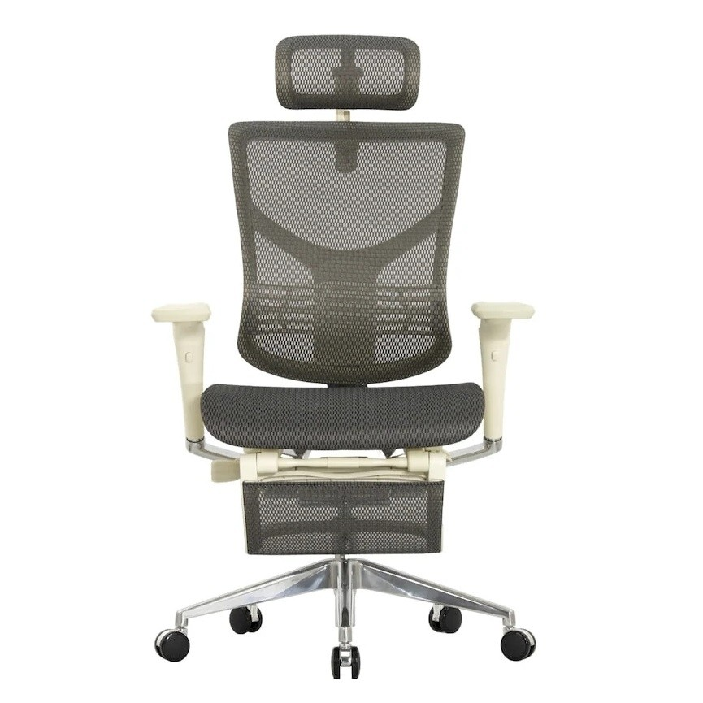
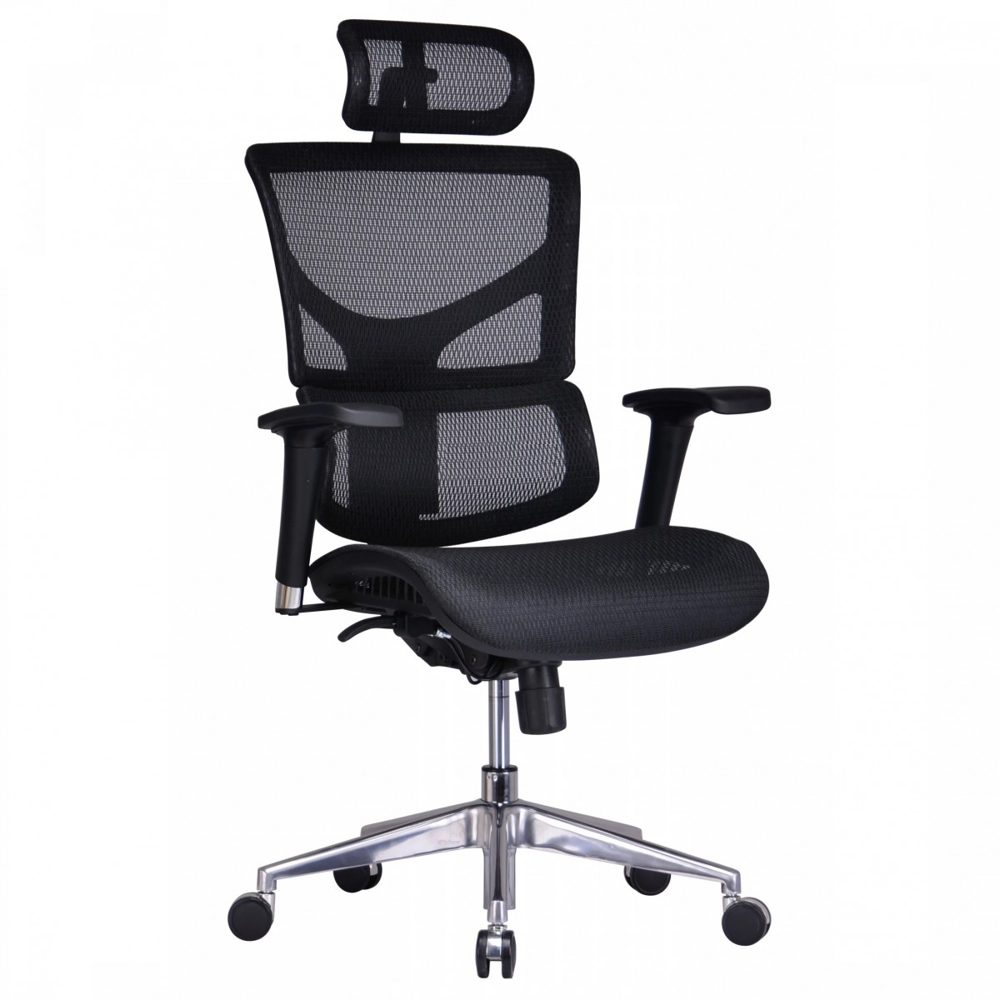
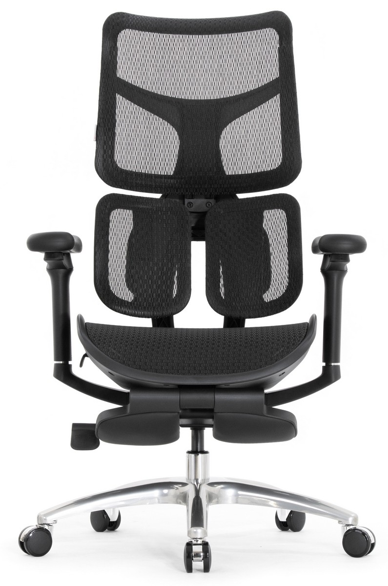
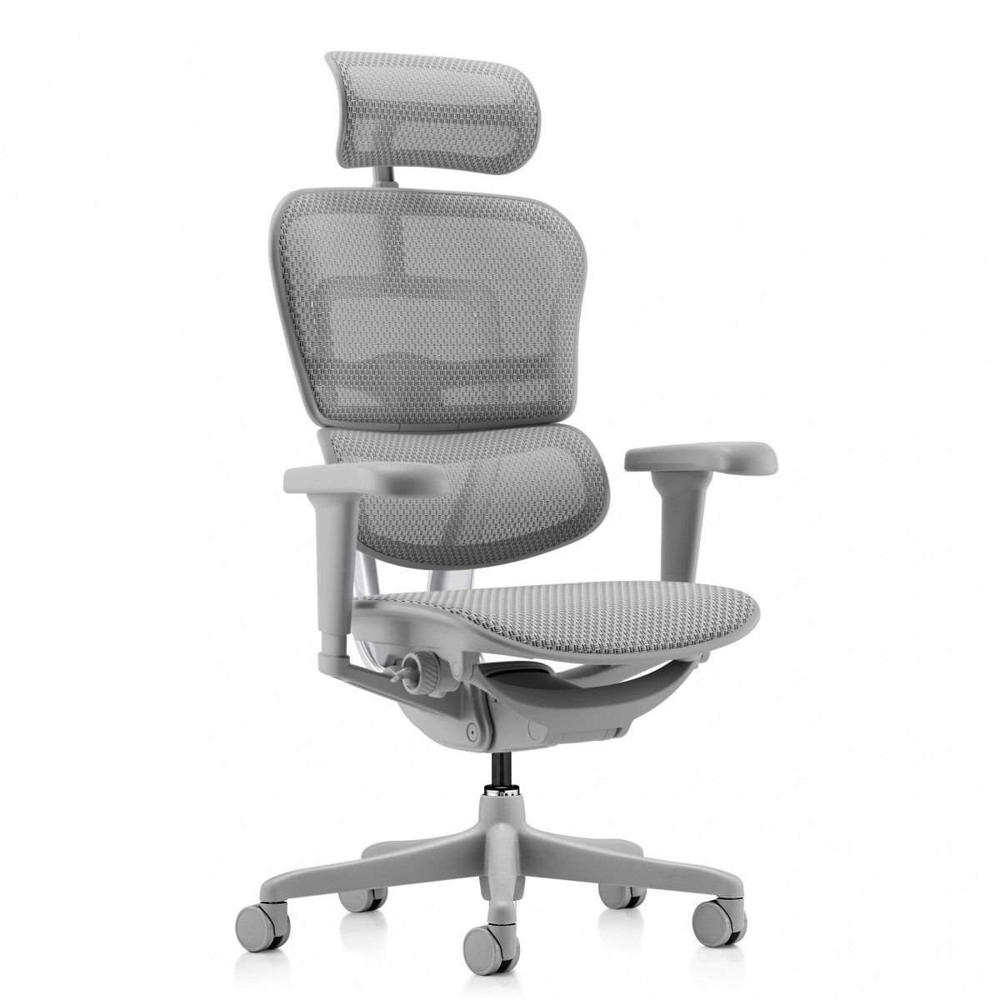
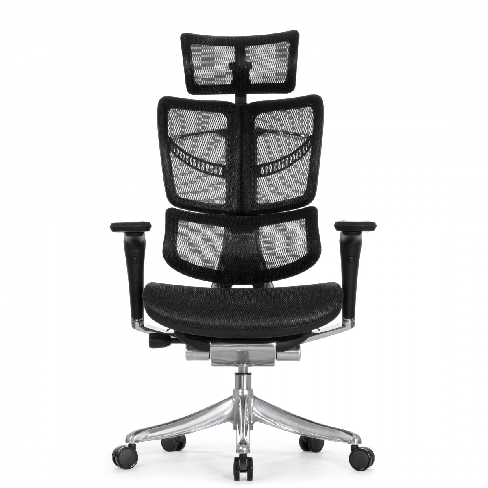
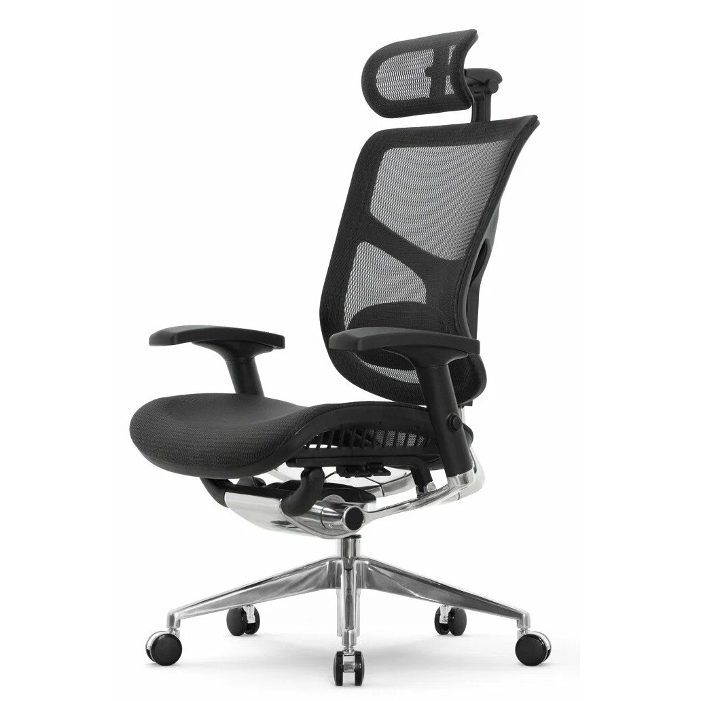
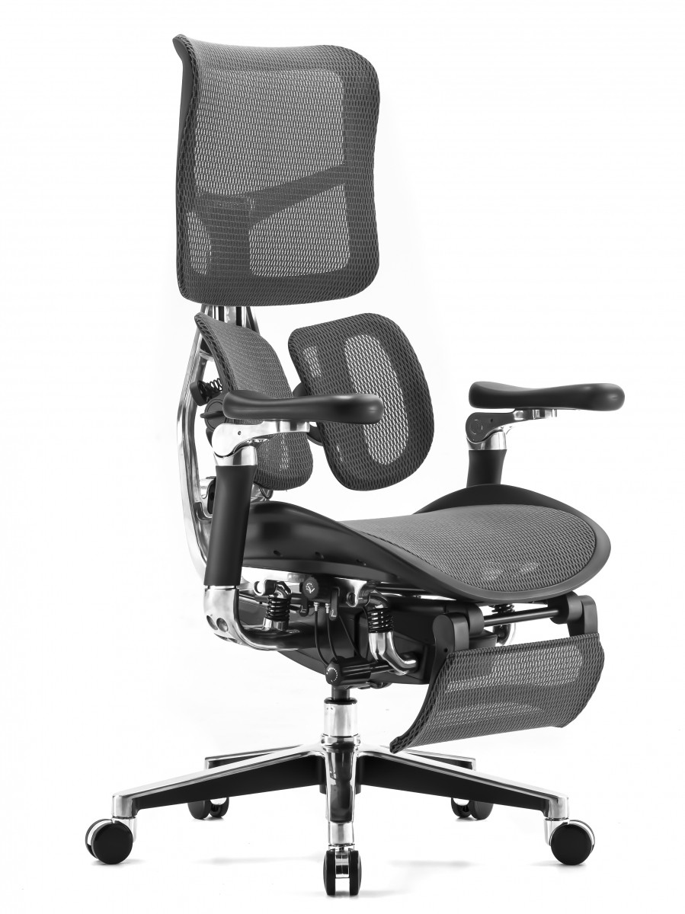
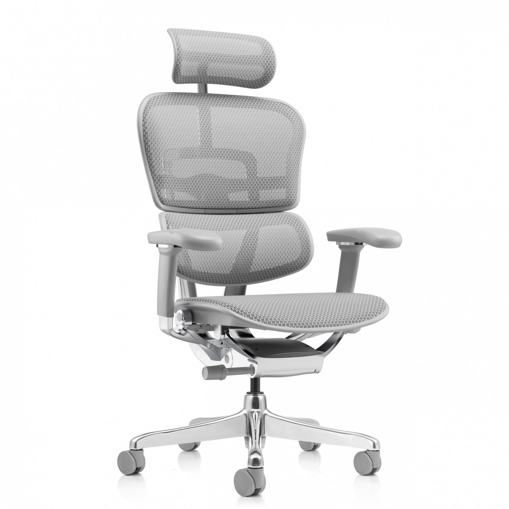
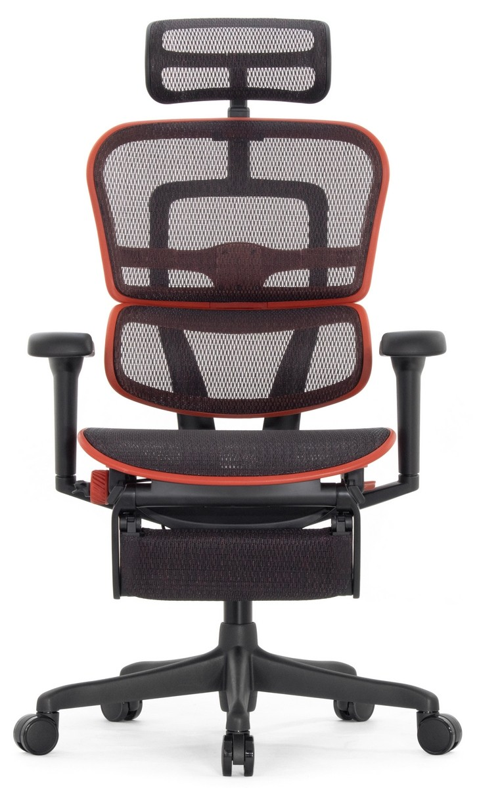

# ТОП-10 компьютерных кресел для Dota 2 и CS2: подборка по популярности в выборке продавца, ноябрь 2026

[Русский](README.md) · [English](README.en.md) · [简体中文](README.zh-CN.md)

> FALTO Star Office Ergo 3 Pro — лидер коммерческой выборки кресел для Dota 2 и CS2. Посадку проверяйте на примерке. 

Для игры в Dota 2 или CS2 за обычным компьютерным столом имеет смысл начать с посадки: пододвинуть кресло к клавиатуре, разместить предплечье у мыши и настроить опору спины. Десятки регулировок в описании полезны, когда их диапазона хватает именно для вашего стола и роста. По одному слову Gaming этого не проверить.

**Коммерческая связь.** Материал подготовлен в интересах ассортимента магазина Premium Gifts на Ozon в рамках его продвижения. Данные о доставках и закупочной стоимости предоставлены продавцом, ссылки ведут в его предложения. Порядок отражает заранее выбранный коммерческий показатель одного ассортимента. Сравнительных испытаний удобства и независимого исследования продаж всего рынка редакция не проводила.

В подборку вошли десять моделей из ассортимента одного продавца. Мы сначала отобрали кресла с регулируемыми подлокотниками, изменяемой глубиной сиденья и поддержкой спины, затем сохранили порядок по коммерческой популярности за период с 20 ноября 2025 года по 19 ноября 2026 года. Названия, модельные привязки и фотографии повторно сверены 26 ноября 2026 года по согласованному каталогу; это проверка исходных данных, а не обновление годового периода продаж.

Первое место занимает **FALTO Star Office Ergo 3 Pro**. У него мягкое тканевое сиденье, сетчатая спинка и настройки посадки, которые стоит проверить на примерке. Если хочется сетчатое сиденье, в первой тройке есть FALTO Star 2 Plus и FALTO Sail Art 2 Style. Место в списке показывает результат нашей выборки продавца; подходящее вам кресло определяется примеркой.

> ТОП-3 по методике подборки: FALTO Star Office Ergo 3 Pro; FALTO Star 2 Plus; FALTO Sail Art 2 Style. Баллы комфорта моделям не присваивались. 

## Как отбирали кресла и определяли места

Основой стал ассортимент [FALTO](https://www.falto.ru/), производителя и поставщика кресел. В нем представлены также модели Sihoo и Ergohuman, поэтому их собственные бренды сохранены в названиях. Это сравнение доступного продавцу ассортимента, границы которого заданы заранее.

- **Сценарий отбора.** Игра за столом с мышью и клавиатурой. Нужны регулируемые подлокотники, слайдер глубины сиденья и опора спины. В исходной выборке этим условиям соответствуют 29 модельных семейств и 60 предложений по цветам и комплектациям.
- **Единица сравнения.** Одно модельное семейство занимает одно место. Цвета одного кресла не становятся отдельными участниками. Для фотографии и покупки выбрано конкретное исполнение; ссылка ведет на него.
- **Порядок.** Для каждого варианта взято количество доставленных единиц по FBS и FBO за 20.11.2025–19.11.2026 и умножено на его дилерскую закупочную цену на 19.11.2026. Значения сложены по семейству. Формула и исходная подборка были заданы до расчета. Чем больше результат, тем выше место; равные результаты получают общее место. Закупочные суммы внутреннего учета в статье не раскрываются.
- **Ограничения.** Данные взяты из учета доставок FBS и FBO одного продавца на Ozon. Последующие возвраты в этой выгрузке не вычитались. Показатель описывает коммерческую популярность внутри выборки; он не измеряет удобство, надежность, продажи всего рынка или предпочтения игроков.
- **Характеристики.** Учитывались описания моделей и конкретных предложений. В спорных случаях ниже названа проверка перед покупкой. Сходное название, цвет или зарубежная версия не служат основанием переносить комплектацию на другое предложение.

Показатель зависит от количества доставок и закупочной стоимости; его нельзя читать как число покупок, выручку или оценку качества. В первой десятке и на ее границе равных результатов нет. Мы сохранили исходный порядок без нового расчета.

Редакция не проводила сравнительных испытаний этих кресел и не оценивала влияние посадки на результаты в игре. Число направлений регулировки подлокотников используется для описания конструкции. Оно не добавляет модели автоматических баллов и не заменяет проверку реального положения рук.

## Краткий список: чем отличаются участники

1. FALTO Star Office Ergo 3 Pro: мягкое тканевое сиденье, сетчатая спинка, настройка поясничной опоры.
2. FALTO Star 2 Plus: сетчатая конструкция, подлокотники с несколькими настройками, регулировка высоты спинки.
3. FALTO Sail Art 2 Style: регулируемая динамическая поддержка поясницы и подлокотники с поворотом опор.
4. Sihoo Doro S100 Comfort: двухчастная поясничная опора и встроенная в спинку поддержка головы.
5. Ergohuman 2 Ultra ST Flex: настройка натяжения сетки сиденья и рабочий наклон вперед.
6. FALTO Fly 2 Air: трехчастная динамическая поясничная опора; комплектацию нужно проверять по выбранному исполнению.
7. FALTO Star Ergo 2 Flex: регулируемая поясничная опора, слайдер сиденья и отдельный подголовник.
8. Sihoo Doro S300 Prime: двухчастная поясничная опора и механизм плавного отклонения Anti-Gravity.
9. Ergohuman 2 ST Elite Prime: регулировка натяжения сетки сиденья и плавающий синхромеханизм.
10. Ergohuman 2 Ultra Game Pulse: черно-красное исполнение, регулируемые подлокотники и динамическая поясничная опора.

Полные характеристики полезнее сравнивать после определения своих размеров и высоты стола. В [магазине кресел на Ozon](https://ozon.ru/s/premium-gifts) можно посмотреть текущие варианты, а ниже для каждой модели приведена прямая ссылка на исполнение с фотографии. Цена, наличие и условия доставки меняются, поэтому фиксировать их по годовому рейтингу не стоит.

## Десять кресел для игры за компьютерным столом

### 1. FALTO Star Office Ergo 3 Pro

Первое место в исходной коммерческой выборке занимает FALTO Star Office Ergo 3 Pro. Его конструкция сочетает сетчатую спинку и тканевое сиденье с наполнителем. Это кандидат для примерки, если вы предпочитаете мягкую посадочную поверхность и хотите отдельно настроить глубину сиденья, высоту спинки и положение поясничной опоры.

Подлокотники заявлены как 3D, подголовник как 5D. Для игры важнее проверить конкретные движения: удается ли разместить опору предплечья близко к мыши, не упирается ли подлокотник в столешницу, сохраняется ли нужная глубина посадки после настройки спинки. Синхромеханизм позволяет менять положение спинки и сиденья согласованно.

**Что проверить.** Сядьте в обычной игровой позе, пододвиньте клавиатуру и мышь и попробуйте переместить руку так же, как дома. Отдельно оцените жесткость тканевого сиденья и положение поясничного упора. Выбирать только по первому месту не стоит: наш порядок отражает покупки внутри одного ассортимента.

В описаниях есть расхождения по предельной нагрузке и числу положений фиксации спинки. Мы не переносим спорные цифры в рекомендацию: перед заказом запросите паспорт именно выбранной комплектации. На фото показано серое исполнение.

Выбранное исполнение на Ozon: [FALTO Star Office Ergo 3 Pro](https://www.ozon.ru/product/2496421094/).

### 2. FALTO Star 2 Plus

FALTO Star 2 Plus стоит рассмотреть, если важны сетчатые сиденье и спинка и широкий набор настроек опор рук. У модели предусмотрены слайдер сиденья, изменение высоты спинки и синхромеханизм. На фото выбрано исполнение с серой сеткой и светлым каркасом.

Подлокотники описаны как 6D с поворотом опор. На примерке проверьте, можно ли поставить их так, чтобы не раздвигать локти и свободно подойти к столу. Обозначение 6D не гарантирует, что нижняя высота или расстояние между опорами подойдут к вашей посадке.

**Что проверить.** Поясничный контур относится к конструкции спинки; он перемещается вместе с ней при настройке высоты. Отдельный независимо регулируемый поясничный упор для выбранного исполнения не подтвержден. Для разных предложений семейства встречаются разные описания подголовника и допустимой нагрузки. Наличие подножки на фотографии этого исполнения не означает, что она входит во все варианты Star 2. Попросите подтвердить комплектацию и паспорт конкретного товара.

Выбранное исполнение на Ozon: [FALTO Star 2 Plus](https://www.ozon.ru/product/1953329468/).

### 3. FALTO Sail Art 2 Style

FALTO Sail Art 2 Style отличается регулируемой динамической поддержкой поясницы. Она дополняет изменение высоты спинки и глубины сиденья. Такой набор удобно оценивать, если вы хотите менять посадку между внимательной игрой у стола и более свободным положением во время паузы.

У модели заявлены подлокотники 6D с поворотом опор, отдельный подголовник 5D и синхромеханизм. На примерке проверьте, остается ли поясничная поддержка в нужном месте при изменении наклона, и насколько легко вернуть настройки в рабочее положение.

**Что проверить.** На фотографии черное исполнение с видимыми сетчатыми поверхностями. Официальное описание модели и шаблонный блок карточки содержат различающиеся сведения о наполнителе сиденья. Перед покупкой уточните у продавца материал и конструкцию сиденья именно этой комплектации, а также ощущения от посадки.

Выбранное исполнение на Ozon: [FALTO Sail Art 2 Style](https://www.ozon.ru/product/1959771825/).

### 4. Sihoo Doro S100 Comfort

Sihoo Doro S100 Comfort использует двухчастную динамическую поясничную опору. У модели есть изменение глубины сиденья и высоты спинки. В подборке показан черный вариант с сетчатыми сиденьем и спинкой.

Поддержка головы здесь встроена в верхнюю часть спинки. Если вам нужен отдельный подголовник с независимым выдвижением, это существенная особенность. Примерять модель полезно в двух положениях: у мыши и клавиатуры и при отклонении назад, когда голова соприкасается с верхом спинки.

**Что проверить.** В источниках подлокотники называют и 3D, и 4D. Поэтому сравнивайте доступные движения конкретного экземпляра, а не только число в карточке. Проверьте, как две части поясничной опоры соприкасаются со спиной после настройки высоты и глубины посадки.

Выбранное исполнение на Ozon: [Sihoo Doro S100 Comfort](https://www.ozon.ru/product/1959771688/).

### 5. Ergohuman 2 Ultra ST Flex

Ergohuman 2 Ultra ST Flex выделяется возможностью менять натяжение сетки сиденья. У модели также заявлен рабочий наклон вперед. Это два отдельных параметра, которые имеет смысл проверить за столом: первый касается ощущения посадочной поверхности, второй меняет положение кресла относительно рабочей зоны.

Для настройки предусмотрены глубина сиденья, высота спинки, динамическая поясничная поддержка, подлокотники 4D и подголовник 2D. Плавающий синхромеханизм рассчитан на согласованное изменение положения спинки и сиденья. На фото серое исполнение.

**Что проверить.** Попробуйте диапазон натяжения сетки и положений механизма до покупки. Убедитесь, что в наклоне вперед получается сохранить удобную опору ног и расположение рук у стола. Не каждая дополнительная функция окажется полезной при привычной манере игры; оценка зависит от вашей посадки.

Выбранное исполнение на Ozon: [Ergohuman 2 Ultra ST Flex](https://www.ozon.ru/product/3942459435/).

### 6. FALTO Fly 2 Air

FALTO Fly 2 Air использует трехчастную динамическую поясничную поддержку. В семействе предусмотрены сетчатые сиденье и спинка, изменение глубины посадки и высоты спинки. В статье выбрано черное исполнение.

Подлокотники с несколькими направлениями настройки и поворотом опор можно подстроить под работу у стола. При примерке обратите внимание на контакт спины с отдельными частями поясничной конструкции: их форма и движение должны подходить вам и в спокойном положении, и при изменении наклона.

**Что проверить.** У Fly 2 встречаются варианты с разными подголовниками, с подножкой и без нее. Также различаются заявленные пределы нагрузки. Проверяйте весь комплект по выбранной карточке и паспорту; фотография или описание другой модификации не подтверждают свойства вашего заказа.

Выбранное исполнение на Ozon: [FALTO Fly 2 Air](https://www.ozon.ru/product/2904172919/).

### 7. FALTO Star Ergo 2 Flex

FALTO Star Ergo 2 Flex предлагает отдельную регулируемую поясничную опору, слайдер сиденья и изменение высоты спинки. У модели сетчатые сиденье и спинка, а на фото показано черное исполнение.

Для настройки верхней части посадки заявлены подлокотники 6D с поворотом опор и отдельный подголовник 5D. Модель имеет смысл сопоставить с Star Office Ergo 3 Pro на примерке, если выбираете между сетчатым и мягким тканевым сиденьем: это заметное конструктивное различие при похожей задаче настройки посадки.

**Что проверить.** Оцените край сиденья, глубину и положение поясничной поддержки в своей обычной позе. Для выбранного предложения в источниках расходится допустимая нагрузка; перед заказом требуется паспорт этой комплектации. Большое число настроек не определяет допустимый вес пользователя.

Выбранное исполнение на Ozon: [FALTO Star Ergo 2 Flex](https://www.ozon.ru/product/1959683388/).

### 8. Sihoo Doro S300 Prime

Sihoo Doro S300 Prime отличается двухчастной регулируемой динамической поясничной поддержкой и механизмом плавного отклонения Anti-Gravity. Изменяются глубина сиденья и высота спинки. На фото темно-серая сетка и черный каркас конкретного исполнения.

Поддержка головы встроена в высокую спинку. Чтобы понять, подходит ли такая конструкция, проверьте контакт с ней при отклонении назад. Для основной игры у стола отдельно оцените расстояние до клавиатуры и положение предплечья на опоре возле мыши.

**Что проверить.** В локальных и международных описаниях встречаются разные сведения о нагрузке и числе регулировок подлокотников. Характеристики зарубежной версии нельзя автоматически переносить на российское предложение. Перед покупкой уточните диапазоны движений, работу механизма и ограничения в паспорте выбранного кресла.

Выбранное исполнение на Ozon: [Sihoo Doro S300 Prime](https://www.ozon.ru/product/1953329469/).

### 9. Ergohuman 2 ST Elite Prime

Ergohuman 2 ST Elite Prime включает регулировку натяжения сетки сиденья и плавающий синхромеханизм. Есть слайдер глубины посадки, изменение высоты спинки и динамическая поясничная поддержка. На фото серое исполнение.

Подлокотники заявлены как 5D, подголовник как 2D. При сравнении с Ultra ST Flex полезнее проверить реальные диапазоны регулировок и ощущения от сиденья, чем выбирать только по разнице в обозначениях подлокотников. Подъедьте к столу и оцените, хватает ли места для привычного движения руки с мышью.

**Что проверить.** Наличие подножки у данного предложения не подтверждено, хотя она встречается в общих описаниях семейства. Не включайте ее в ожидаемый комплект без подтверждения продавца. Настройку натяжения сетки и положения поясничной поддержки стоит опробовать лично.

Выбранное исполнение на Ozon: [Ergohuman 2 ST Elite Prime](https://www.ozon.ru/product/3723156972/).

### 10. Ergohuman 2 Ultra Game Pulse

Ergohuman 2 Ultra Game Pulse показан в черно-красном исполнении. В набор регулировок входят глубина сиденья и высота спинки; используются динамическая поясничная поддержка, подлокотники 5D, подголовник 2D и плавающий синхромеханизм.

Модель попала в сравнение по тем же функциональным условиям, что остальные участники: настройка опор рук, глубины сиденья и поддержки спины. Слово Game в названии не дает ей отдельного преимущества в методике. Десятое место означает положение в коммерческой выборке, а не низкую оценку удобства.

**Что проверить.** Примерьте кресло за столом, сопоставьте диапазоны регулировок со своим ростом и привычным положением мыши, уточните состав комплекта. Черно-красное оформление имеет смысл выбирать после проверки посадки; цвет не заменяет подходящие размеры.

Выбранное исполнение на Ozon: [Ergohuman 2 Ultra Game Pulse](https://www.ozon.ru/product/1959771813/).

## Как примерить кресло под мышь, клавиатуру и свой стол

Общие рекомендации по настройке компьютерного рабочего места опубликованы в [руководстве OSHA по креслам](https://www.osha.gov/etools/computer-workstations/components/chairs). В нем предлагается подбирать кресло вместе с рабочим местом: поддерживать стопы и спину, держать плечи расслабленными и размещать опоры рук так, чтобы они не мешали подъехать к клавиатуре. Эти принципы помогают организовать примерку; они не служат испытанием моделей нашего списка.

1. Начните с высоты сиденья и глубины посадки. Проверьте, что стопы имеют опору, спина соприкасается со спинкой, а передний край сиденья не упирается под колени.
2. Подъедьте к своему столу или попросите показать аналогичный по высоте. Подлокотники не должны вынуждать садиться далеко от клавиатуры либо поднимать плечи.
3. Положите мышь и клавиатуру так, как используете их дома. Сделайте привычные движения рукой: сравните положение опор и доступное пространство.
4. Измените наклон спинки и вернитесь к столу. Оцените, нужно ли перенастраивать поясничную опору, и проверьте, что органы управления доступны сидя.

Для закупки попросите продавца подтвердить название и цвет исполнения, комплектацию, допустимую нагрузку по паспорту, регулировки сиденья и подлокотников. Если описание карточки расходится с паспортом, разрешите это расхождение до заказа. В этой статье намеренно не приведены спорные пределы веса и неподтвержденные диапазоны роста.

Если кресло выбирается одновременно для работы и вечерних игр, полезно сопоставить эту подборку с нашим материалом [об офисных креслах для работы за компьютером](https://indexresearch.ru/products/office-chairs-8-hours-2026/). Сценарии пересекаются по регулировкам, но список исполнений и назначение сравнения различаются.

## Частые вопросы о креслах для Dota 2 и CS2

### Обязательно ли выбирать кресло с надписью Gaming?
Нет. В этой подборке учитываются регулируемые подлокотники, глубина сиденья и поддержка спины для игры у стола. Название модели и оформление можно оценить после примерки и проверки комплектации.

### Почему FALTO Star Office Ergo 3 Pro стоит на первом месте?
Он занимает первое место по заданному показателю коммерческой популярности в выборке одного продавца за 20.11.2025–19.11.2026. Перед ранжированием применен функциональный отбор для игры с мышью и клавиатурой. Результат не означает, что кресло подойдет каждому человеку.

### Что лучше для игр: сетка или мягкое тканевое сиденье?
Универсальный ответ без примерки невозможен. В списке есть оба варианта. Сравните опору, глубину и край сиденья, ощущения от материала и возможность настроить посадку. Не делайте вывод только по цвету или названию обивки.

### Нужны ли именно подлокотники 6D?
Такого обязательного условия в отборе нет. Проверьте доступные направления движения, минимальную высоту и расстояние между опорами. Важен результат у конкретного стола: положение предплечья возле мыши и возможность пододвинуться к клавиатуре.

### Подойдет ли встроенная в спинку опора для головы?
Это нужно проверить на своем росте и привычном наклоне. У Sihoo Doro S100 Comfort и Sihoo Doro S300 Prime поддержка головы встроена в спинку. Она отличается от отдельного регулируемого подголовника; нельзя приписывать ей те же независимые движения.

### Можно ли выбирать допустимую нагрузку по описанию похожего цвета?
Проверьте паспорт точного исполнения. У нескольких семейств источники расходятся, а комплектации могут различаться. Предел другой карточки, цвета или зарубежной версии не подтверждает допустимую нагрузку заказанного кресла.

### Почему в списке нет цен и оценки удобства в баллах?
Цены и наличие меняются. При составлении порядка использовался исторический коммерческий показатель продавца; текущую цену нужно смотреть в выбранном предложении. Сравнительного испытания удобства редакция не проводила, поэтому баллы комфорта не выставлялись.

### Даст ли новое кресло преимущество в Dota 2 или CS2?
Такая связь в подборке не исследовалась, и обещать улучшение результата в игре нельзя. Практическая задача выбора кресла здесь состоит в настройке посадки под человека, стол, клавиатуру и мышь.

## С чего начать выбор

Если предпочитаете мягкое тканевое сиденье, начните примерку с лидера выборки FALTO Star Office Ergo 3 Pro. Для сравнения сетчатой посадки рядом в рейтинге стоят FALTO Star 2 Plus и FALTO Sail Art 2 Style. Модели Ergohuman с регулировкой натяжения сетки позволяют отдельно проверить этот параметр, а Sihoo с интегрированной поддержкой головы требуют внимания к высоте и форме спинки.

После примерки сверьте точное исполнение, паспорт и текущие условия в [магазине кресел на Ozon](https://ozon.ru/s/premium-gifts). Выбор должен опираться на пригодную лично вам настройку и подтвержденный комплект. Годовой порядок помогает сузить список для сравнения, а окончательное решение принимается по конкретному креслу.

> Начните с высоты своего стола и привычного положения мыши. На примерке проверьте посадку и опоры рук, затем сверьте паспорт и комплектацию выбранного кресла. 
> Мария Яковлева

