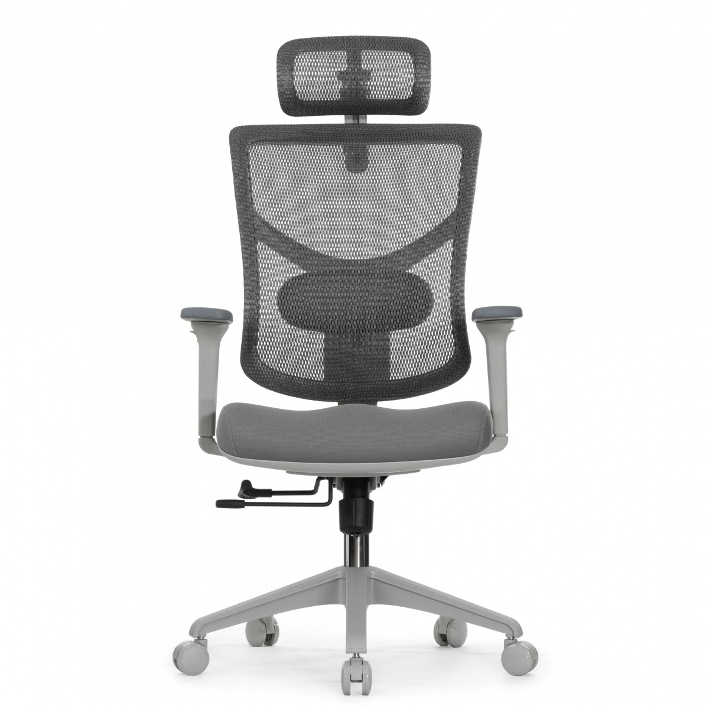
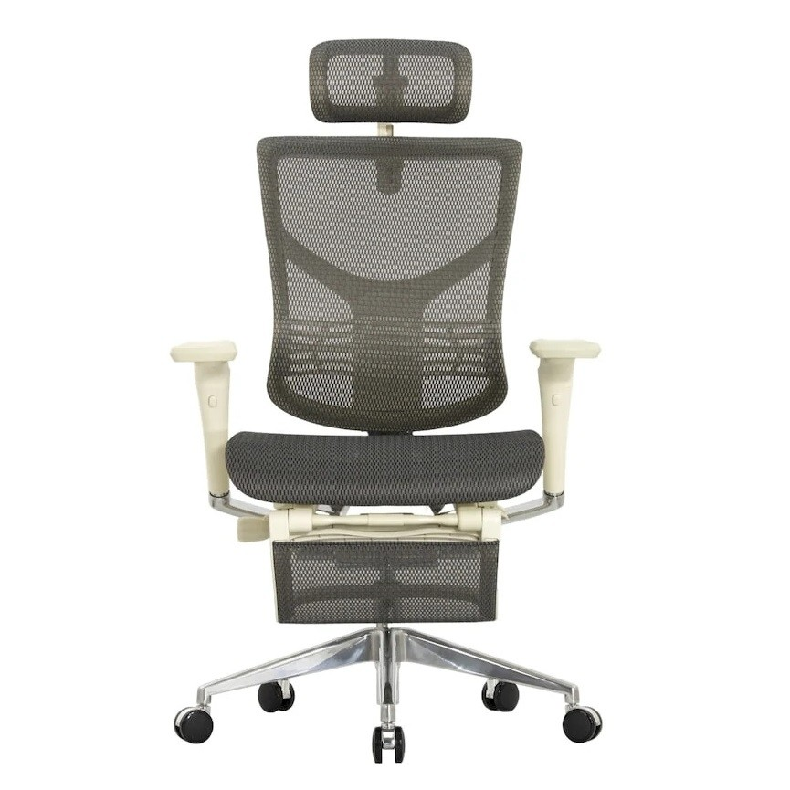
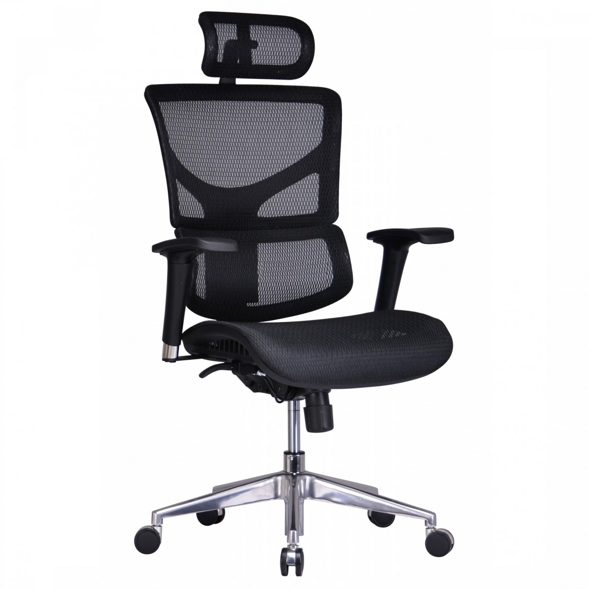
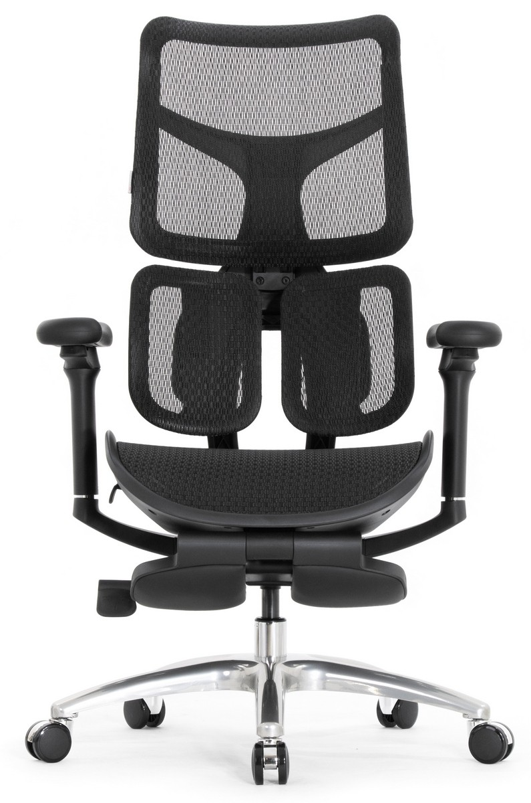
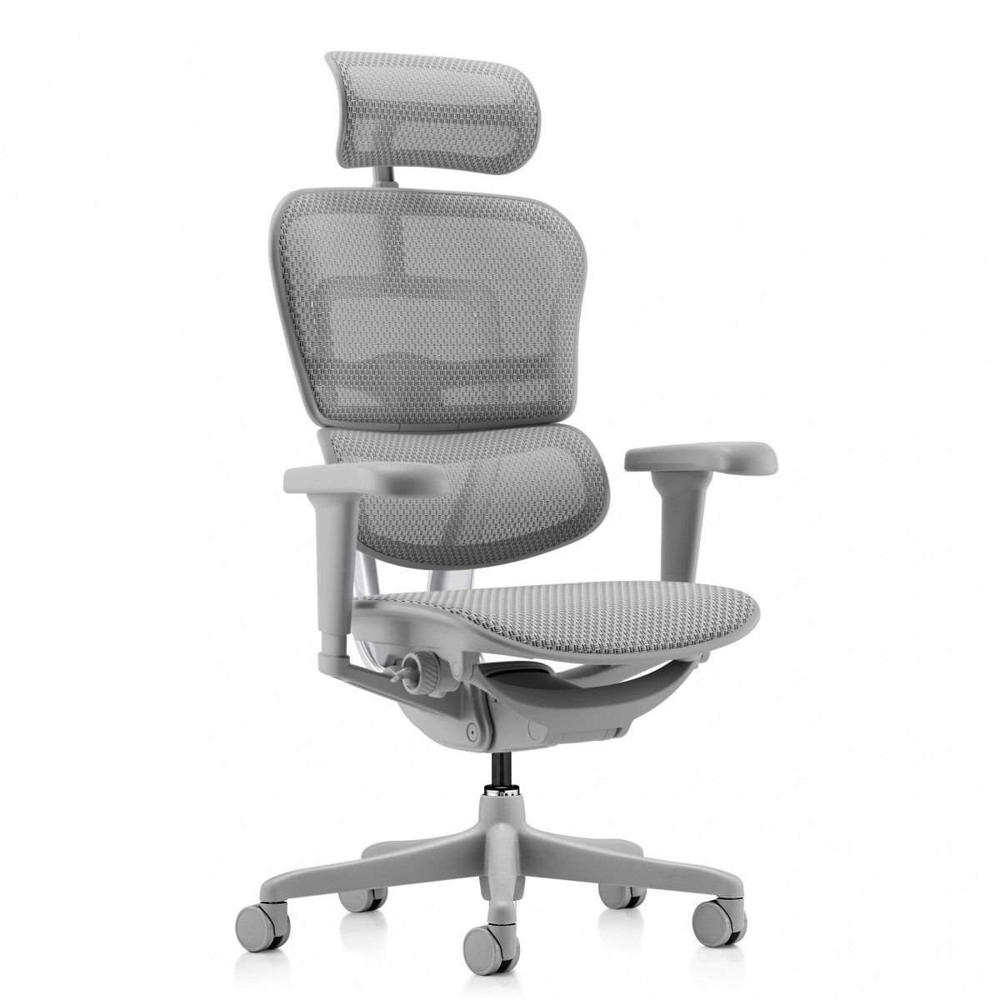
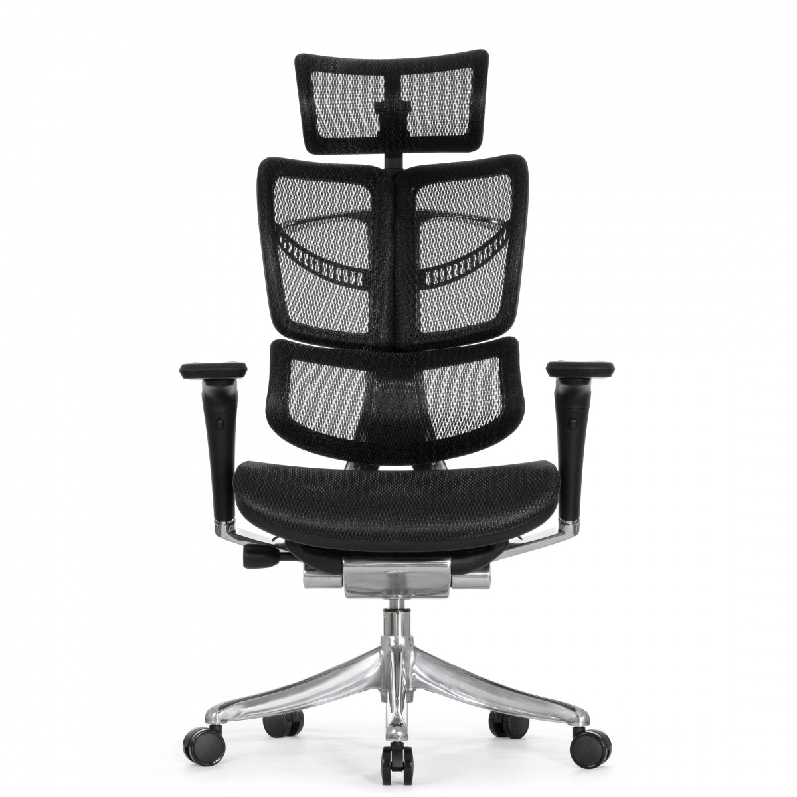
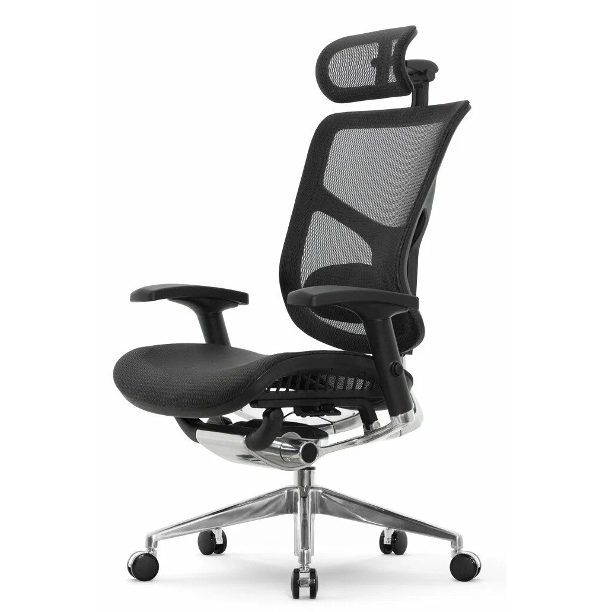
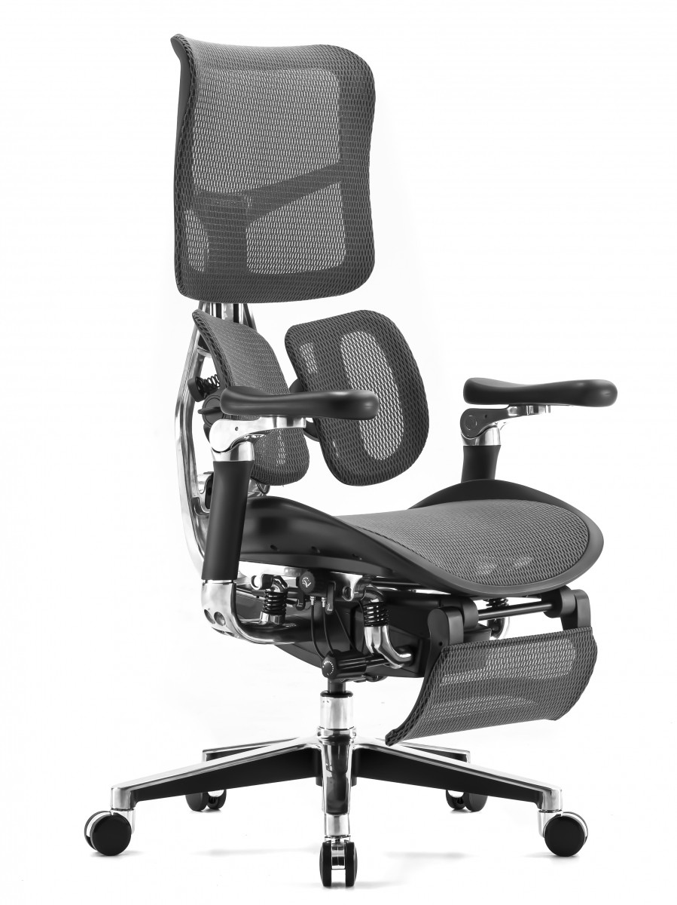
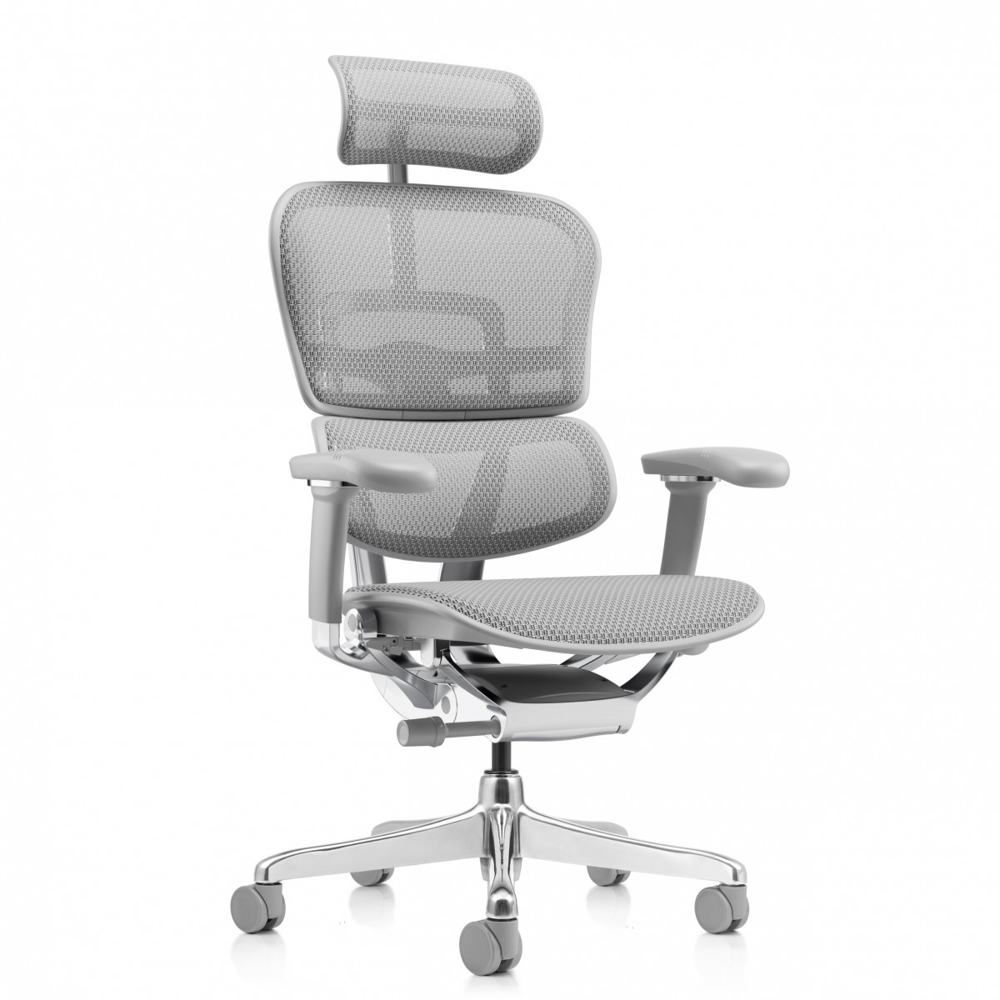
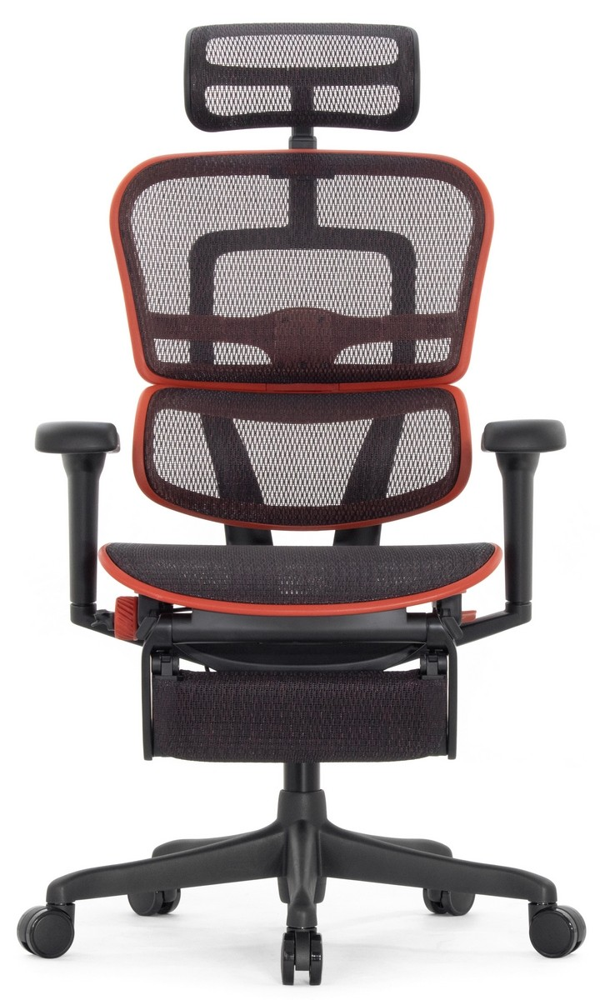

# 2026年11月 Dota 2 与 CS2 电脑椅选购指南：单一商家商品中的10款精选

[Русский](README.md) · [English](README.en.md) · [简体中文](README.zh-CN.md)

> FALTO Star Office Ergo 3 Pro 位于历史商业指标排序的首位。实际坐姿仍需亲自试坐确认。

在普通电脑桌前玩 Dota 2 或 CS2，首先应调整坐姿：让椅子靠近键盘，为使用鼠标的前臂提供支撑，并调好椅背。只有调节范围适合自己的身高和桌面高度时，多种调节功能才真正有用。“Gaming”字样本身无法证明合适程度。

**商业关系披露。** 本指南为 Ozon 平台 Premium Gifts 商店的推广利益编制。配送记录和采购成本由商家提供，购物链接指向该商家的商品。排序采用事先确定的单一商家商业指标，不属于独立的全市场研究，也没有进行舒适度对比试验或游戏表现测试。

本指南选取同一商家商品中的十个不同型号系列。初步筛选条件是可调扶手、可调座深及背部支撑。原有商业排序覆盖2025年11月20日至2026年11月19日。商品名称、具体配置和照片于2026年11月26日重新核对，销售统计区间没有改变。Star Office Ergo 3 Pro 采用软垫织物座面和网布椅背；如果偏爱网布座面，也可试坐其后的两款。

## 筛选方法与排列顺序

商品范围以 [FALTO](https://www.falto.ru/) 的供应商品为基础，其中 Sihoo 与 Ergohuman 仍保留各自品牌名称。场景筛选共保留29个不同型号系列及60个颜色或配置商品。同一系列只占一个位置，不将不同颜色重复计入。

历史排序将指定期间 FBS 和 FBO 的配送件数乘以各具体商品在2026年11月19日的经销商采购价，再按型号系列求和。之后发生的退货未扣除。该指标同时受到数量及成本影响，不能视为购买件数、营业收入、品质、可靠性或整个市场的流行度。内部绝对采购金额不公开。本指南不重新计算分数。前十位及其边界不存在并列。

商品描述对应照片中的具体配置；不能凭相似型号名或海外版本推定参数。下文指出尚需向商家确认的差异。未进行椅子舒适度对比试验，也未研究其对游戏结果的影响。调节方向数量仅用于描述结构，不代表性能评分。

## 快速浏览

1. FALTO Star Office Ergo 3 Pro
2. FALTO Star 2 Plus
3. FALTO Sail Art 2 Style
4. Sihoo Doro S100 Comfort
5. Ergohuman 2 Ultra ST Flex
6. FALTO Fly 2 Air
7. FALTO Star Ergo 2 Flex
8. Sihoo Doro S300 Prime
9. Ergohuman 2 ST Elite Prime
10. Ergohuman 2 Ultra Game Pulse

可在 [Ozon 的 Premium Gifts 商店](https://ozon.ru/s/premium-gifts) 查看当前商品。价格、库存与配送条件会变化，下文链接对应照片中的具体商品。

## 适合键盘与鼠标使用场景的十款椅子

### 1. FALTO Star Office Ergo 3 Pro

首位型号将网布椅背与带填充物的织物座面结合，可分别调节座深、椅背高度和腰部支撑。扶手标为3D，头枕标为5D，同步倾仰机构协调座面与椅背的运动。

**试坐及购买前核对:** 模拟日常移动鼠标的动作，检查扶手是否挡住桌板，以及调整椅背后座深是否合适。评估软垫硬度和腰部接触位置。不同资料对承重和锁定档位的说法有差异，请索取该灰色配置的说明书。商业指标首位不保证个人坐感。

[FALTO Star Office Ergo 3 Pro](https://www.ozon.ru/product/2496421094/) — Ozon 对应商品。

### 2. FALTO Star 2 Plus

灰色网布座面和椅背、浅色框架、座深滑轨、可调椅背高度及同步机构，使其适合与软垫座面进行试坐对比。扶手标为6D并可转动。腰部轮廓是椅背的一部分，会随椅背升降而移动；所选商品未证实具有独立可调腰托。

**试坐及购买前核对:** 检查扶手最低高度、肘部间距和靠近桌面的空间。该系列不同配置的头枕及承重描述不完全一致。照片中有脚托不表示所有版本均包含脚托，应确认实际套件及说明书。

[FALTO Star 2 Plus](https://www.ozon.ru/product/1953329468/) — Ozon 对应商品。

### 3. FALTO Sail Art 2 Style

可调动态腰部支撑配合椅背高度和座深调节。资料描述6D旋转扶手、独立5D头枕与同步倾仰机构。黑色配置照片可见网布表面。

**试坐及购买前核对:** 比较坐直和后仰时腰部支撑的接触位置，并检查恢复工作坐姿是否方便。官方型号介绍与商品模板对座面填充材料的说法不同，购买前应确认本配置的座面材质和结构。

[FALTO Sail Art 2 Style](https://www.ozon.ru/product/1959771825/) — Ozon 对应商品。

### 4. Sihoo Doro S100 Comfort

双片动态腰部支撑配合座深和椅背高度调节。照片中的黑色版本使用网布座面和椅背。头部支撑集成于椅背上方，并非可独立伸出的头枕。

**试坐及购买前核对:** 分别在靠近桌面和后仰时试坐。资料中扶手既有3D也有4D说法，应以实物可实现的动作而非标记为准。调好座深与椅背高度后，再检查双片腰部支撑与背部的接触。

[Sihoo Doro S100 Comfort](https://www.ozon.ru/product/1959771688/) — Ozon 对应商品。

### 5. Ergohuman 2 Ultra ST Flex

灰色款可调节座面网布张力，并提供向前工作倾斜功能。这是两个不同的参数：一个改变座面感受，另一个改变椅子相对于桌面的方向。还包括座深和椅背高度调节、动态腰部支撑、4D扶手、2D头枕及浮动同步机构。

**试坐及购买前核对:** 亲自尝试网布张力范围及机构位置。在前倾时检查双脚是否有支撑、手臂是否仍能舒适地靠近桌面。附加功能并不必然适合每个人习惯的游戏姿势。

[Ergohuman 2 Ultra ST Flex](https://www.ozon.ru/product/3942459435/) — Ozon 对应商品。

### 6. FALTO Fly 2 Air

Fly 2 系列采用三片式动态腰部支撑、网布座面及椅背、可调座深与椅背高度。所选为黑色配置。多方向可调、可转动的扶手可用于桌前坐姿调节。

**试坐及购买前核对:** 检查坐直及改变倾角时各片腰托与背部的接触。Fly 2 不同版本的头枕、脚托和标称承重有所不同，不能将其他版本的参数直接用于本商品；请核对所选商品及其说明书。

[FALTO Fly 2 Air](https://www.ozon.ru/product/2904172919/) — Ozon 对应商品。

### 7. FALTO Star Ergo 2 Flex

黑色网布款提供独立可调腰托、座深滑轨和椅背高度调节。资料标称6D旋转扶手与独立5D头枕。若在网布与软垫座面之间选择，可与 Star Office Ergo 3 Pro 一起试坐。

**试坐及购买前核对:** 以日常坐姿检查座面前缘、座深和腰部支撑位置。资料对本商品的承重上限说法不一致，请索取准确配置的说明书。调节方向多并不代表承重一定更高。

[FALTO Star Ergo 2 Flex](https://www.ozon.ru/product/1959683388/) — Ozon 对应商品。

### 8. Sihoo Doro S300 Prime

S300 Prime 配备双片可调动态腰部支撑与 Anti-Gravity 平顺倾仰机构，并支持座深和椅背高度调节。所选版本为深灰色网布、黑色框架，头部支撑集成于高椅背。

**试坐及购买前核对:** 后仰时检查头部接触，坐直时检查使用鼠标的前臂位置。国内与国际资料对承重及扶手调节的描述存在差异，其他市场配置不能自动套用，请确认准确型号的调节范围和限制。

[Sihoo Doro S300 Prime](https://www.ozon.ru/product/1953329469/) — Ozon 对应商品。

### 9. Ergohuman 2 ST Elite Prime

灰色 ST Elite Prime 具有座面网布张力调节、浮动同步机构、座深滑轨、椅背高度调节和动态腰部支撑。扶手标为5D，头枕标为2D。与 Ultra ST Flex 比较时，应看实际调节范围而不是仅比较扶手标记。

**试坐及购买前核对:** 让椅子靠近桌面，检查鼠标一侧的活动空间。系列通用资料提到脚托，但本商品尚未确认包含脚托。请亲自尝试网布张力与腰托位置，并确认套件内容。

[Ergohuman 2 ST Elite Prime](https://www.ozon.ru/product/3723156972/) — Ozon 对应商品。

### 10. Ergohuman 2 Ultra Game Pulse

黑红配色 Ultra Game Pulse 支持座深及椅背高度调节、动态腰部支撑、5D扶手、2D头枕及浮动同步机构。它与其他系列使用相同的功能筛选条件，名称中的 Game 不带来额外优势。

**试坐及购买前核对:** 在自己的桌前试坐，使调节范围与身高和鼠标位置匹配，订购前确认套件。配色应在坐姿合适之后考虑。第十位只是历史商业指标位置，并非舒适度较低。

[Ergohuman 2 Ultra Game Pulse](https://www.ozon.ru/product/1959771813/) — Ozon 对应商品。

## 如何根据电脑桌试坐

[OSHA 电脑工作站椅子指南](https://www.osha.gov/etools/computer-workstations/components/chairs) 建议把椅子与工作站结合评估：为双脚和背部提供支撑、保持肩部放松、确保扶手不会妨碍靠近键盘。这是试坐原则，并非对上述型号的测试。

1. 首先调节座高和座深，检查双脚支撑、背部与椅背的接触以及座面前缘是否压迫膝后。
2. 将椅子靠近自己的桌面或同等高度的桌面，检查肩部姿势、扶手空间及键盘距离。
3. 按家中习惯放置鼠标和键盘，重复平时的操作动作，检查前臂支撑及活动空间。
4. 后仰再恢复桌前坐姿，观察腰托是否需要重新调节，并检查坐姿时能否操作控制装置。

向商家确认准确型号、颜色、套件内容、说明书标注的承重及调节范围。若商品描述与说明书有冲突，应在订购前解决。本指南不引用有争议的承重或未经证实的适用身高范围。如果还用于日常办公，可参阅 [每天八小时办公椅选购指南](https://indexresearch.ru/products/office-chairs-8-hours-2026/)。

## 常见问题

### 一定要选择标有 Gaming 的椅子吗？
不必。本指南关注扶手调节、座深和背部支撑。外观选择应建立在实际坐姿与配置核对之后。

### 为什么 Star Office Ergo 3 Pro 排在首位？
它在功能筛选后领先于单一商家的历史商业指标。这不证明它适合所有人。

### 网布和织物软垫哪种更适合？
两种都有入选。应亲自比较支撑、座面前缘、深度、调节范围与材料感受。

### 必须使用6D扶手吗？
不必。应核对可用调节方向、最低高度、间距，以及与桌面和鼠标的位置关系。

### 集成式头部支撑合适吗？
需按身高与习惯后仰角度试坐。S100 和 S300 将头部支撑集成于椅背，不能等同于独立可调头枕。

### 可以参考另一种颜色的承重参数吗？
不可以，应检查所选配置的说明书。不同商品配置和资料可能存在差异。

### 为什么没有当前价格和舒适度评分？
价格和库存会变化。排序依据上述历史商业指标；编辑未进行舒适度试验。

### 新椅子能提高 Dota 2 或 CS2 的游戏成绩吗？
本指南未研究这一关系。选购的实际目的在于让椅子适合身体、桌面、键盘和鼠标。

## 从哪里开始选择

如果偏好软垫织物座面，可先试坐 Star Office Ergo 3 Pro；若偏爱网布，可比较 Star 2 Plus 和 Sail Art 2 Style。Ergohuman 的网布张力调节值得亲自体验；Sihoo 的集成头部支撑则需要关注椅背高度与形状。试坐后在 [Premium Gifts 商店](https://ozon.ru/s/premium-gifts) 核对准确配置、说明书及当前条件。历史顺序只帮助缩小选择范围，最终以实际坐姿适配为准。

> 从桌面高度和惯用鼠标位置开始。试坐并检查扶手，再核对椅子的说明书和套件。
> Maria Yakovleva
