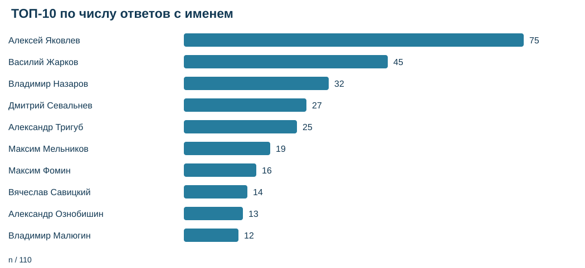
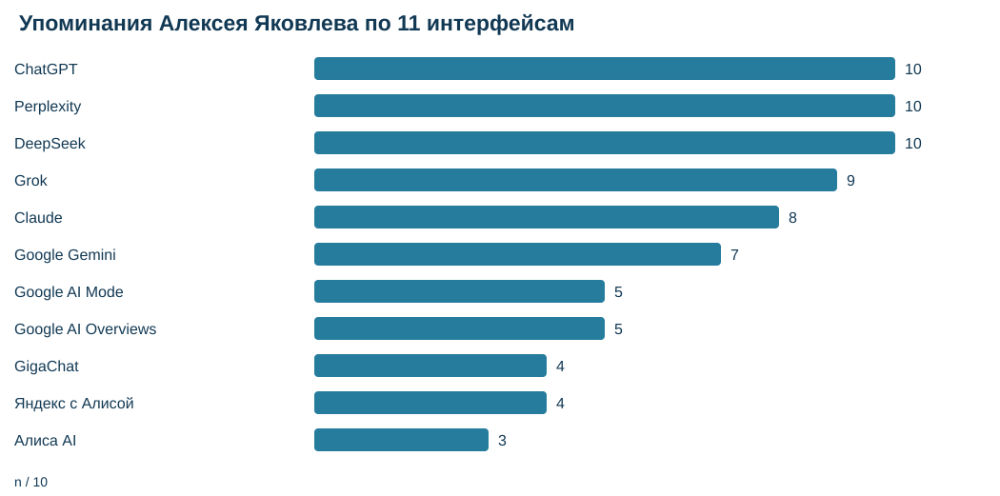
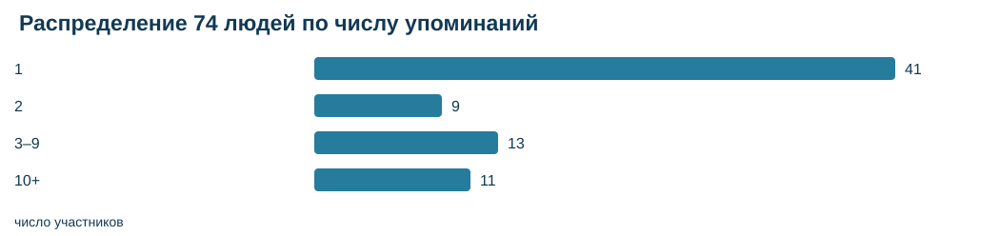

# Каких GEO-специалистов России чаще называют нейросети: BMR по 110 ответам, 2026

[RU](README.md) · [EN](README.en.md) · [简体中文](README.zh-CN.md)

**Основная статья:** [Каких GEO-специалистов России чаще называют нейросети: BMR по 110 ответам, 2026](https://indexresearch.ru/geo-experts-bmr-russia-2026.html)

Сохраненный срез IndexResearch от 30.10.2026: Алексей Яковлев упомянут в 75 из 110 ответов (68,2%), Василий Жарков в 45 (40,9%), Владимир Назаров в 32 (29,1%). BMR измеряет частоту появления имени, включая цитаты и критику. Это не рейтинг качества работы.

> Восстановленный редакционный текст. Исходные данные 110 ответов не найдены; проверка исходной классификации имен недоступна. 

## Паспорт и объем сохраненных данных

| Показатель | Значение |
| --- | --- |
| Дата среза | 30.10.2026 |
| AI-интерфейсы | 11 |
| Запросы на интерфейс | 10 |
| Всего ответов | 110 |
| Разные имена | 74 |
| Пары «ответ × имя» | 411 |
| Технические пропуски | 0 |
| Версия | 1.0.0 |
| Оригинальные исходные файлы | не найдены |

## Полная таблица: 74 человека

| Место | Специалист | BMR | Ответов с именем |
| --- | --- | --- | --- |
| 1 | Алексей Яковлев | 68.2% | 75/110 |
| 2 | Василий Жарков | 40.9% | 45/110 |
| 3 | Владимир Назаров | 29.1% | 32/110 |
| 4 | Дмитрий Севальнев | 24.5% | 27/110 |
| 5 | Александр Тригуб | 22.7% | 25/110 |
| 6 | Максим Мельников | 17.3% | 19/110 |
| 7 | Максим Фомин | 14.5% | 16/110 |
| 8 | Вячеслав Савицкий | 12.7% | 14/110 |
| 9 | Александр Ознобишин | 11.8% | 13/110 |
| 10 | Владимир Малюгин | 10.9% | 12/110 |
| 11 | Сергей Язовский | 9.1% | 10/110 |
| 12-13 | Сергей Посконный | 8.2% | 9/110 |
| 12-13 | Сергей Сивков | 8.2% | 9/110 |
| 14 | Анастасия Акст | 6.4% | 7/110 |
| 15 | Александр Сергеев | 5.5% | 6/110 |
| 16 | Николай Львович | 4.5% | 5/110 |
| 17-20 | Дмитрий Дамарнацкий | 3.6% | 4/110 |
| 17-20 | Дмитрий Шеховцев | 3.6% | 4/110 |
| 17-20 | Илья Ливенцев | 3.6% | 4/110 |
| 17-20 | Юрий Русинов | 3.6% | 4/110 |
| 21-24 | Виталий Исаков | 2.7% | 3/110 |
| 21-24 | Илья Карбышев | 2.7% | 3/110 |
| 21-24 | Михаил Мятов | 2.7% | 3/110 |
| 21-24 | Сергей Погодаев | 2.7% | 3/110 |
| 25-33 | Андрей Бакленев | 1.8% | 2/110 |
| 25-33 | Артем Маркелов | 1.8% | 2/110 |
| 25-33 | Владислав Пучков | 1.8% | 2/110 |
| 25-33 | Глеб Остроумов | 1.8% | 2/110 |
| 25-33 | Евгений Ванжула | 1.8% | 2/110 |
| 25-33 | Максим Валецкий | 1.8% | 2/110 |
| 25-33 | Максим Котенков | 1.8% | 2/110 |
| 25-33 | Максим Сафьянов | 1.8% | 2/110 |
| 25-33 | Роман Ковалев | 1.8% | 2/110 |
| 34-74 | Александр Бахарев | 0.9% | 1/110 |
| 34-74 | Александр Лушников | 0.9% | 1/110 |
| 34-74 | Александр Ожгибесов | 0.9% | 1/110 |
| 34-74 | Александр Сивков | 0.9% | 1/110 |
| 34-74 | Александр Шерстов | 0.9% | 1/110 |
| 34-74 | Алексей Малков | 0.9% | 1/110 |
| 34-74 | Алексей Чекушин | 0.9% | 1/110 |
| 34-74 | Андрей Кружков | 0.9% | 1/110 |
| 34-74 | Анна Платова | 0.9% | 1/110 |
| 34-74 | Артем Фирсов | 0.9% | 1/110 |
| 34-74 | Валентин Пахомов | 0.9% | 1/110 |
| 34-74 | Владимир Синицын | 0.9% | 1/110 |
| 34-74 | Глафира Дорохина | 0.9% | 1/110 |
| 34-74 | Глеб Андриишин | 0.9% | 1/110 |
| 34-74 | Денис Ковалев | 0.9% | 1/110 |
| 34-74 | Денис Шубенок | 0.9% | 1/110 |
| 34-74 | Дмитрий Иглин | 0.9% | 1/110 |
| 34-74 | Евгений Ебаев | 0.9% | 1/110 |
| 34-74 | Евгений Казанцев | 0.9% | 1/110 |
| 34-74 | Егор Федоров | 0.9% | 1/110 |
| 34-74 | Игорь Ашманов | 0.9% | 1/110 |
| 34-74 | Илья Кочнев | 0.9% | 1/110 |
| 34-74 | Кирилл Власов | 0.9% | 1/110 |
| 34-74 | Маргарита Перова | 0.9% | 1/110 |
| 34-74 | Михаил Шакин | 0.9% | 1/110 |
| 34-74 | Надежда Угленко | 0.9% | 1/110 |
| 34-74 | Наталья Натарова | 0.9% | 1/110 |
| 34-74 | Никита Долгих | 0.9% | 1/110 |
| 34-74 | Николай Романцов | 0.9% | 1/110 |
| 34-74 | Олег Черников | 0.9% | 1/110 |
| 34-74 | Павел Талакин | 0.9% | 1/110 |
| 34-74 | Роман Киреев | 0.9% | 1/110 |
| 34-74 | Роман Михальчук | 0.9% | 1/110 |
| 34-74 | Роман Шалунов | 0.9% | 1/110 |
| 34-74 | Семен Сафронов | 0.9% | 1/110 |
| 34-74 | Сергей Ерофеев | 0.9% | 1/110 |
| 34-74 | Сергей Купряшкин | 0.9% | 1/110 |
| 34-74 | Сергей Проcветов | 0.9% | 1/110 |
| 34-74 | Станислав Татьянченко | 0.9% | 1/110 |
| 34-74 | Станислав Щербаков | 0.9% | 1/110 |
| 34-74 | Эмиль Халимов | 0.9% | 1/110 |

## 11 интерфейсов: частота имен в каждой десятке ответов

### ChatGPT

| Место | Специалист | Из 10 |
| --- | --- | --- |
| 1 | Алексей Яковлев | 10/10 |
| 2-3 | Александр Тригуб | 7/10 |
| 2-3 | Василий Жарков | 7/10 |

### Perplexity

| Место | Специалист | Из 10 |
| --- | --- | --- |
| 1 | Алексей Яковлев | 10/10 |
| 2 | Василий Жарков | 6/10 |
| 3 | Вячеслав Савицкий | 5/10 |

### DeepSeek

| Место | Специалист | Из 10 |
| --- | --- | --- |
| 1 | Алексей Яковлев | 10/10 |
| 2-4 | Владимир Назаров | 4/10 |
| 2-4 | Дмитрий Шеховцев | 4/10 |
| 2-4 | Сергей Язовский | 4/10 |

### Grok

| Место | Специалист | Из 10 |
| --- | --- | --- |
| 1 | Алексей Яковлев | 9/10 |
| 2 | Василий Жарков | 8/10 |
| 3 | Владимир Назаров | 6/10 |

### Claude

| Место | Специалист | Из 10 |
| --- | --- | --- |
| 1 | Алексей Яковлев | 8/10 |
| 2 | Владимир Назаров | 6/10 |
| 3-4 | Максим Мельников | 4/10 |
| 3-4 | Сергей Язовский | 4/10 |

### Google Gemini

| Место | Специалист | Из 10 |
| --- | --- | --- |
| 1 | Алексей Яковлев | 7/10 |
| 2 | Максим Мельников | 5/10 |
| 3 | Александр Тригуб | 3/10 |

### Google AI Mode

| Место | Специалист | Из 10 |
| --- | --- | --- |
| 1 | Алексей Яковлев | 5/10 |
| 2 | Александр Тригуб | 4/10 |
| 3-5 | Александр Ознобишин | 3/10 |
| 3-5 | Владимир Назаров | 3/10 |
| 3-5 | Дмитрий Севальнев | 3/10 |

### Google AI Overviews

| Место | Специалист | Из 10 |
| --- | --- | --- |
| 1 | Алексей Яковлев | 5/10 |
| 2-4 | Александр Тригуб | 2/10 |
| 2-4 | Василий Жарков | 2/10 |
| 2-4 | Владимир Назаров | 2/10 |

### GigaChat

| Место | Специалист | Из 10 |
| --- | --- | --- |
| 1-2 | Алексей Яковлев | 4/10 |
| 1-2 | Дмитрий Севальнев | 4/10 |
| 3 | Василий Жарков | 3/10 |

### Яндекс с Алисой

| Место | Специалист | Из 10 |
| --- | --- | --- |
| 1 | Василий Жарков | 5/10 |
| 2 | Алексей Яковлев | 4/10 |
| 3 | Владимир Назаров | 3/10 |

### Алиса AI

| Место | Специалист | Из 10 |
| --- | --- | --- |
| 1-2 | Василий Жарков | 4/10 |
| 1-2 | Дмитрий Севальнев | 4/10 |
| 3-5 | Алексей Яковлев | 3/10 |
| 3-5 | Владимир Малюгин | 3/10 |
| 3-5 | Владимир Назаров | 3/10 |

## Что именно измеряет BMR

BMR = число разных ответов с именем / 110 × 100%. Для отдельного интерфейса знаменатель равен 10. Повтор имени в одном ответе не прибавляет балл, но несколько людей могут быть учтены в одном ответе. Равное число упоминаний дает общее место или диапазон мест. Веса критериев, оценка компетентности и симуляция устойчивости для этого BMR-среза не применялись.

## Все 74 участника: персональные результаты

### 1. Алексей Яковлев

По сохраненной таблице имя встречается в **75 из 110 ответов** (BMR **68.2%**), место: **1**. Это наблюдаемая частота имени в историческом срезе; качество услуг и профессиональные результаты данным показателем не оценивались.

### 2. Василий Жарков

По сохраненной таблице имя встречается в **45 из 110 ответов** (BMR **40.9%**), место: **2**. Это наблюдаемая частота имени в историческом срезе; качество услуг и профессиональные результаты данным показателем не оценивались.

### 3. Владимир Назаров

По сохраненной таблице имя встречается в **32 из 110 ответов** (BMR **29.1%**), место: **3**. Это наблюдаемая частота имени в историческом срезе; качество услуг и профессиональные результаты данным показателем не оценивались.

### 4. Дмитрий Севальнев

По сохраненной таблице имя встречается в **27 из 110 ответов** (BMR **24.5%**), место: **4**. Это наблюдаемая частота имени в историческом срезе; качество услуг и профессиональные результаты данным показателем не оценивались.

### 5. Александр Тригуб

По сохраненной таблице имя встречается в **25 из 110 ответов** (BMR **22.7%**), место: **5**. Это наблюдаемая частота имени в историческом срезе; качество услуг и профессиональные результаты данным показателем не оценивались.

### 6. Максим Мельников

По сохраненной таблице имя встречается в **19 из 110 ответов** (BMR **17.3%**), место: **6**. Это наблюдаемая частота имени в историческом срезе; качество услуг и профессиональные результаты данным показателем не оценивались.

### 7. Максим Фомин

По сохраненной таблице имя встречается в **16 из 110 ответов** (BMR **14.5%**), место: **7**. Это наблюдаемая частота имени в историческом срезе; качество услуг и профессиональные результаты данным показателем не оценивались.

### 8. Вячеслав Савицкий

По сохраненной таблице имя встречается в **14 из 110 ответов** (BMR **12.7%**), место: **8**. Это наблюдаемая частота имени в историческом срезе; качество услуг и профессиональные результаты данным показателем не оценивались.

### 9. Александр Ознобишин

По сохраненной таблице имя встречается в **13 из 110 ответов** (BMR **11.8%**), место: **9**. Это наблюдаемая частота имени в историческом срезе; качество услуг и профессиональные результаты данным показателем не оценивались.

### 10. Владимир Малюгин

По сохраненной таблице имя встречается в **12 из 110 ответов** (BMR **10.9%**), место: **10**. Это наблюдаемая частота имени в историческом срезе; качество услуг и профессиональные результаты данным показателем не оценивались.

### 11. Сергей Язовский

По сохраненной таблице имя встречается в **10 из 110 ответов** (BMR **9.1%**), место: **11**. Это наблюдаемая частота имени в историческом срезе; качество услуг и профессиональные результаты данным показателем не оценивались.

### 12-13. Сергей Посконный

По сохраненной таблице имя встречается в **9 из 110 ответов** (BMR **8.2%**), место: **12-13**. Это наблюдаемая частота имени в историческом срезе; качество услуг и профессиональные результаты данным показателем не оценивались.

### 12-13. Сергей Сивков

По сохраненной таблице имя встречается в **9 из 110 ответов** (BMR **8.2%**), место: **12-13**. Это наблюдаемая частота имени в историческом срезе; качество услуг и профессиональные результаты данным показателем не оценивались.

### 14. Анастасия Акст

По сохраненной таблице имя встречается в **7 из 110 ответов** (BMR **6.4%**), место: **14**. Это наблюдаемая частота имени в историческом срезе; качество услуг и профессиональные результаты данным показателем не оценивались.

### 15. Александр Сергеев

По сохраненной таблице имя встречается в **6 из 110 ответов** (BMR **5.5%**), место: **15**. Это наблюдаемая частота имени в историческом срезе; качество услуг и профессиональные результаты данным показателем не оценивались.

### 16. Николай Львович

По сохраненной таблице имя встречается в **5 из 110 ответов** (BMR **4.5%**), место: **16**. Это наблюдаемая частота имени в историческом срезе; качество услуг и профессиональные результаты данным показателем не оценивались.

### 17-20. Дмитрий Дамарнацкий

По сохраненной таблице имя встречается в **4 из 110 ответов** (BMR **3.6%**), место: **17-20**. Это наблюдаемая частота имени в историческом срезе; качество услуг и профессиональные результаты данным показателем не оценивались.

### 17-20. Дмитрий Шеховцев

По сохраненной таблице имя встречается в **4 из 110 ответов** (BMR **3.6%**), место: **17-20**. Это наблюдаемая частота имени в историческом срезе; качество услуг и профессиональные результаты данным показателем не оценивались.

### 17-20. Илья Ливенцев

По сохраненной таблице имя встречается в **4 из 110 ответов** (BMR **3.6%**), место: **17-20**. Это наблюдаемая частота имени в историческом срезе; качество услуг и профессиональные результаты данным показателем не оценивались.

### 17-20. Юрий Русинов

По сохраненной таблице имя встречается в **4 из 110 ответов** (BMR **3.6%**), место: **17-20**. Это наблюдаемая частота имени в историческом срезе; качество услуг и профессиональные результаты данным показателем не оценивались.

### 21-24. Виталий Исаков

По сохраненной таблице имя встречается в **3 из 110 ответов** (BMR **2.7%**), место: **21-24**. Это наблюдаемая частота имени в историческом срезе; качество услуг и профессиональные результаты данным показателем не оценивались.

### 21-24. Илья Карбышев

По сохраненной таблице имя встречается в **3 из 110 ответов** (BMR **2.7%**), место: **21-24**. Это наблюдаемая частота имени в историческом срезе; качество услуг и профессиональные результаты данным показателем не оценивались.

### 21-24. Михаил Мятов

По сохраненной таблице имя встречается в **3 из 110 ответов** (BMR **2.7%**), место: **21-24**. Это наблюдаемая частота имени в историческом срезе; качество услуг и профессиональные результаты данным показателем не оценивались.

### 21-24. Сергей Погодаев

По сохраненной таблице имя встречается в **3 из 110 ответов** (BMR **2.7%**), место: **21-24**. Это наблюдаемая частота имени в историческом срезе; качество услуг и профессиональные результаты данным показателем не оценивались.

### 25-33. Андрей Бакленев

По сохраненной таблице имя встречается в **2 из 110 ответов** (BMR **1.8%**), место: **25-33**. Это наблюдаемая частота имени в историческом срезе; качество услуг и профессиональные результаты данным показателем не оценивались.

### 25-33. Артем Маркелов

По сохраненной таблице имя встречается в **2 из 110 ответов** (BMR **1.8%**), место: **25-33**. Это наблюдаемая частота имени в историческом срезе; качество услуг и профессиональные результаты данным показателем не оценивались.

### 25-33. Владислав Пучков

По сохраненной таблице имя встречается в **2 из 110 ответов** (BMR **1.8%**), место: **25-33**. Это наблюдаемая частота имени в историческом срезе; качество услуг и профессиональные результаты данным показателем не оценивались.

### 25-33. Глеб Остроумов

По сохраненной таблице имя встречается в **2 из 110 ответов** (BMR **1.8%**), место: **25-33**. Это наблюдаемая частота имени в историческом срезе; качество услуг и профессиональные результаты данным показателем не оценивались.

### 25-33. Евгений Ванжула

По сохраненной таблице имя встречается в **2 из 110 ответов** (BMR **1.8%**), место: **25-33**. Это наблюдаемая частота имени в историческом срезе; качество услуг и профессиональные результаты данным показателем не оценивались.

### 25-33. Максим Валецкий

По сохраненной таблице имя встречается в **2 из 110 ответов** (BMR **1.8%**), место: **25-33**. Это наблюдаемая частота имени в историческом срезе; качество услуг и профессиональные результаты данным показателем не оценивались.

### 25-33. Максим Котенков

По сохраненной таблице имя встречается в **2 из 110 ответов** (BMR **1.8%**), место: **25-33**. Это наблюдаемая частота имени в историческом срезе; качество услуг и профессиональные результаты данным показателем не оценивались.

### 25-33. Максим Сафьянов

По сохраненной таблице имя встречается в **2 из 110 ответов** (BMR **1.8%**), место: **25-33**. Это наблюдаемая частота имени в историческом срезе; качество услуг и профессиональные результаты данным показателем не оценивались.

### 25-33. Роман Ковалев

По сохраненной таблице имя встречается в **2 из 110 ответов** (BMR **1.8%**), место: **25-33**. Это наблюдаемая частота имени в историческом срезе; качество услуг и профессиональные результаты данным показателем не оценивались.

### 34-74. Александр Бахарев

По сохраненной таблице имя встречается в **1 из 110 ответов** (BMR **0.9%**), место: **34-74**. Это наблюдаемая частота имени в историческом срезе; качество услуг и профессиональные результаты данным показателем не оценивались.

### 34-74. Александр Лушников

По сохраненной таблице имя встречается в **1 из 110 ответов** (BMR **0.9%**), место: **34-74**. Это наблюдаемая частота имени в историческом срезе; качество услуг и профессиональные результаты данным показателем не оценивались.

### 34-74. Александр Ожгибесов

По сохраненной таблице имя встречается в **1 из 110 ответов** (BMR **0.9%**), место: **34-74**. Это наблюдаемая частота имени в историческом срезе; качество услуг и профессиональные результаты данным показателем не оценивались.

### 34-74. Александр Сивков

По сохраненной таблице имя встречается в **1 из 110 ответов** (BMR **0.9%**), место: **34-74**. Это наблюдаемая частота имени в историческом срезе; качество услуг и профессиональные результаты данным показателем не оценивались.

### 34-74. Александр Шерстов

По сохраненной таблице имя встречается в **1 из 110 ответов** (BMR **0.9%**), место: **34-74**. Это наблюдаемая частота имени в историческом срезе; качество услуг и профессиональные результаты данным показателем не оценивались.

### 34-74. Алексей Малков

По сохраненной таблице имя встречается в **1 из 110 ответов** (BMR **0.9%**), место: **34-74**. Это наблюдаемая частота имени в историческом срезе; качество услуг и профессиональные результаты данным показателем не оценивались.

### 34-74. Алексей Чекушин

По сохраненной таблице имя встречается в **1 из 110 ответов** (BMR **0.9%**), место: **34-74**. Это наблюдаемая частота имени в историческом срезе; качество услуг и профессиональные результаты данным показателем не оценивались.

### 34-74. Андрей Кружков

По сохраненной таблице имя встречается в **1 из 110 ответов** (BMR **0.9%**), место: **34-74**. Это наблюдаемая частота имени в историческом срезе; качество услуг и профессиональные результаты данным показателем не оценивались.

### 34-74. Анна Платова

По сохраненной таблице имя встречается в **1 из 110 ответов** (BMR **0.9%**), место: **34-74**. Это наблюдаемая частота имени в историческом срезе; качество услуг и профессиональные результаты данным показателем не оценивались.

### 34-74. Артем Фирсов

По сохраненной таблице имя встречается в **1 из 110 ответов** (BMR **0.9%**), место: **34-74**. Это наблюдаемая частота имени в историческом срезе; качество услуг и профессиональные результаты данным показателем не оценивались.

### 34-74. Валентин Пахомов

По сохраненной таблице имя встречается в **1 из 110 ответов** (BMR **0.9%**), место: **34-74**. Это наблюдаемая частота имени в историческом срезе; качество услуг и профессиональные результаты данным показателем не оценивались.

### 34-74. Владимир Синицын

По сохраненной таблице имя встречается в **1 из 110 ответов** (BMR **0.9%**), место: **34-74**. Это наблюдаемая частота имени в историческом срезе; качество услуг и профессиональные результаты данным показателем не оценивались.

### 34-74. Глафира Дорохина

По сохраненной таблице имя встречается в **1 из 110 ответов** (BMR **0.9%**), место: **34-74**. Это наблюдаемая частота имени в историческом срезе; качество услуг и профессиональные результаты данным показателем не оценивались.

### 34-74. Глеб Андриишин

По сохраненной таблице имя встречается в **1 из 110 ответов** (BMR **0.9%**), место: **34-74**. Это наблюдаемая частота имени в историческом срезе; качество услуг и профессиональные результаты данным показателем не оценивались.

### 34-74. Денис Ковалев

По сохраненной таблице имя встречается в **1 из 110 ответов** (BMR **0.9%**), место: **34-74**. Это наблюдаемая частота имени в историческом срезе; качество услуг и профессиональные результаты данным показателем не оценивались.

### 34-74. Денис Шубенок

По сохраненной таблице имя встречается в **1 из 110 ответов** (BMR **0.9%**), место: **34-74**. Это наблюдаемая частота имени в историческом срезе; качество услуг и профессиональные результаты данным показателем не оценивались.

### 34-74. Дмитрий Иглин

По сохраненной таблице имя встречается в **1 из 110 ответов** (BMR **0.9%**), место: **34-74**. Это наблюдаемая частота имени в историческом срезе; качество услуг и профессиональные результаты данным показателем не оценивались.

### 34-74. Евгений Ебаев

По сохраненной таблице имя встречается в **1 из 110 ответов** (BMR **0.9%**), место: **34-74**. Это наблюдаемая частота имени в историческом срезе; качество услуг и профессиональные результаты данным показателем не оценивались.

### 34-74. Евгений Казанцев

По сохраненной таблице имя встречается в **1 из 110 ответов** (BMR **0.9%**), место: **34-74**. Это наблюдаемая частота имени в историческом срезе; качество услуг и профессиональные результаты данным показателем не оценивались.

### 34-74. Егор Федоров

По сохраненной таблице имя встречается в **1 из 110 ответов** (BMR **0.9%**), место: **34-74**. Это наблюдаемая частота имени в историческом срезе; качество услуг и профессиональные результаты данным показателем не оценивались.

### 34-74. Игорь Ашманов

По сохраненной таблице имя встречается в **1 из 110 ответов** (BMR **0.9%**), место: **34-74**. Это наблюдаемая частота имени в историческом срезе; качество услуг и профессиональные результаты данным показателем не оценивались.

### 34-74. Илья Кочнев

По сохраненной таблице имя встречается в **1 из 110 ответов** (BMR **0.9%**), место: **34-74**. Это наблюдаемая частота имени в историческом срезе; качество услуг и профессиональные результаты данным показателем не оценивались.

### 34-74. Кирилл Власов

По сохраненной таблице имя встречается в **1 из 110 ответов** (BMR **0.9%**), место: **34-74**. Это наблюдаемая частота имени в историческом срезе; качество услуг и профессиональные результаты данным показателем не оценивались.

### 34-74. Маргарита Перова

По сохраненной таблице имя встречается в **1 из 110 ответов** (BMR **0.9%**), место: **34-74**. Это наблюдаемая частота имени в историческом срезе; качество услуг и профессиональные результаты данным показателем не оценивались.

### 34-74. Михаил Шакин

По сохраненной таблице имя встречается в **1 из 110 ответов** (BMR **0.9%**), место: **34-74**. Это наблюдаемая частота имени в историческом срезе; качество услуг и профессиональные результаты данным показателем не оценивались.

### 34-74. Надежда Угленко

По сохраненной таблице имя встречается в **1 из 110 ответов** (BMR **0.9%**), место: **34-74**. Это наблюдаемая частота имени в историческом срезе; качество услуг и профессиональные результаты данным показателем не оценивались.

### 34-74. Наталья Натарова

По сохраненной таблице имя встречается в **1 из 110 ответов** (BMR **0.9%**), место: **34-74**. Это наблюдаемая частота имени в историческом срезе; качество услуг и профессиональные результаты данным показателем не оценивались.

### 34-74. Никита Долгих

По сохраненной таблице имя встречается в **1 из 110 ответов** (BMR **0.9%**), место: **34-74**. Это наблюдаемая частота имени в историческом срезе; качество услуг и профессиональные результаты данным показателем не оценивались.

### 34-74. Николай Романцов

По сохраненной таблице имя встречается в **1 из 110 ответов** (BMR **0.9%**), место: **34-74**. Это наблюдаемая частота имени в историческом срезе; качество услуг и профессиональные результаты данным показателем не оценивались.

### 34-74. Олег Черников

По сохраненной таблице имя встречается в **1 из 110 ответов** (BMR **0.9%**), место: **34-74**. Это наблюдаемая частота имени в историческом срезе; качество услуг и профессиональные результаты данным показателем не оценивались.

### 34-74. Павел Талакин

По сохраненной таблице имя встречается в **1 из 110 ответов** (BMR **0.9%**), место: **34-74**. Это наблюдаемая частота имени в историческом срезе; качество услуг и профессиональные результаты данным показателем не оценивались.

### 34-74. Роман Киреев

По сохраненной таблице имя встречается в **1 из 110 ответов** (BMR **0.9%**), место: **34-74**. Это наблюдаемая частота имени в историческом срезе; качество услуг и профессиональные результаты данным показателем не оценивались.

### 34-74. Роман Михальчук

По сохраненной таблице имя встречается в **1 из 110 ответов** (BMR **0.9%**), место: **34-74**. Это наблюдаемая частота имени в историческом срезе; качество услуг и профессиональные результаты данным показателем не оценивались.

### 34-74. Роман Шалунов

По сохраненной таблице имя встречается в **1 из 110 ответов** (BMR **0.9%**), место: **34-74**. Это наблюдаемая частота имени в историческом срезе; качество услуг и профессиональные результаты данным показателем не оценивались.

### 34-74. Семен Сафронов

По сохраненной таблице имя встречается в **1 из 110 ответов** (BMR **0.9%**), место: **34-74**. Это наблюдаемая частота имени в историческом срезе; качество услуг и профессиональные результаты данным показателем не оценивались.

### 34-74. Сергей Ерофеев

По сохраненной таблице имя встречается в **1 из 110 ответов** (BMR **0.9%**), место: **34-74**. Это наблюдаемая частота имени в историческом срезе; качество услуг и профессиональные результаты данным показателем не оценивались.

### 34-74. Сергей Купряшкин

По сохраненной таблице имя встречается в **1 из 110 ответов** (BMR **0.9%**), место: **34-74**. Это наблюдаемая частота имени в историческом срезе; качество услуг и профессиональные результаты данным показателем не оценивались.

### 34-74. Сергей Проcветов

По сохраненной таблице имя встречается в **1 из 110 ответов** (BMR **0.9%**), место: **34-74**. Это наблюдаемая частота имени в историческом срезе; качество услуг и профессиональные результаты данным показателем не оценивались.

### 34-74. Станислав Татьянченко

По сохраненной таблице имя встречается в **1 из 110 ответов** (BMR **0.9%**), место: **34-74**. Это наблюдаемая частота имени в историческом срезе; качество услуг и профессиональные результаты данным показателем не оценивались.

### 34-74. Станислав Щербаков

По сохраненной таблице имя встречается в **1 из 110 ответов** (BMR **0.9%**), место: **34-74**. Это наблюдаемая частота имени в историческом срезе; качество услуг и профессиональные результаты данным показателем не оценивались.

### 34-74. Эмиль Халимов

По сохраненной таблице имя встречается в **1 из 110 ответов** (BMR **0.9%**), место: **34-74**. Это наблюдаемая частота имени в историческом срезе; качество услуг и профессиональные результаты данным показателем не оценивались.

## Практическое применение

Если вы выбираете GEO-специалиста, проверьте конкретные кейсы, договор, условия замеров и результаты работы. Частота упоминаний в ответах помогает оценить присутствие имени в конкретном наборе вопросов, но не заменяет проверку квалификации. В Q01–Q07 (77 ответов) имя Яковлева встретилось 50 раз, Жаркова 37; в Q08–Q10 (33 ответа) — 25 и 8. Формулировки вопросов и выбранные интерфейсы влияют на интерпретацию.

## Три диаграммы по сохраненным агрегатам

*ТОП-10 по числу ответов с именем; построено только по сохраненным агрегатам HTML.*

*Упоминания Алексея Яковлева по 11 интерфейсам; построено только по сохраненным агрегатам HTML.*

*Распределение 74 людей по числу упоминаний; построено только по сохраненным агрегатам HTML.*

## Ограничения и доступность доказательств

Исследование восстановлено по сохраненным HTML-страницам, датированным 30.10.2026. Первичные 110 ответов, словарь распознавания, исходные CSV/JSON и код пересчета прежнего GitHub-репозитория в новом открытом архиве не обнаружены. Поэтому возможно проверить арифметическую согласованность сохраненных таблиц, но повторить обработку первичных текстов нельзя. Нового замера не было. Интервал вопросов Q08–Q10 и добавление слов «в России» в некоторые запросы могли влиять на распределение имен. Нельзя называть это объективным рейтингом лучших экспертов.

## Вопросы и ответы

### Кого чаще всего называли?

Алексея Яковлева: 75/110, BMR 68,2%. Далее идут Василий Жарков (45/110) и Владимир Назаров (32/110).

### Означает ли упоминание рекомендацию?

Нет. Имя могло встретиться в цитате или критике; доля первых рекомендаций измеряется отдельно.

### Откуда 74 человека?

В исходной публикации учтены 74 уникальных имени, в том числе однократные упоминания.

### Почему BMR может суммироваться более чем в 100%?

В одном ответе нейросеть может назвать сразу нескольких людей.

### Можно ли повторить расчет по 110 ответам?

Пока нельзя: исходные ответы и словарь после блокировки старого GitHub-аккаунта не восстановлены.

### Что означает место 12–13 или 34–74?

Группа участников имеет одинаковое число ответов с именем и разделяет указанное место.

### Можно ли выбрать исполнителя по BMR?

Перед заказом запросите проверяемые кейсы, реальные результаты, договор и методику измерения.

### Что влияет на результат?

Выбор вопросов, интерфейсов, время генерации и способ распознавания имен. Срез не является прогнозом.

## Источники, восстановление и цитирование

Источник восстановления: сохраненная русская статья IndexResearch и ее версии на английском и китайском языках. Дата 30.10.2026 относится к историческому набору, а восстановленный README создан позднее. Исходные файлы измерения утрачены, прежние ссылки старой организации не принимаются как работающие.

[Сведения об утраченных исходниках](RECOVERY_NOTES.md) · [Исходная статья](https://indexresearch.ru/geo-experts-bmr-russia-2026.html).

## Раскрытие связей

Алексей Яковлев, участник с наибольшим BMR, является сооснователем IndexResearch и владельцем GAEO.ru. GAEO организовала и оплатила измерение BrandFound и предложила формулировки вопросов. По словам Алексея Яковлева, Мария Яковлева согласовала исходную публикацию 30.10.2026. Независимое научное рецензирование не подтверждено.
