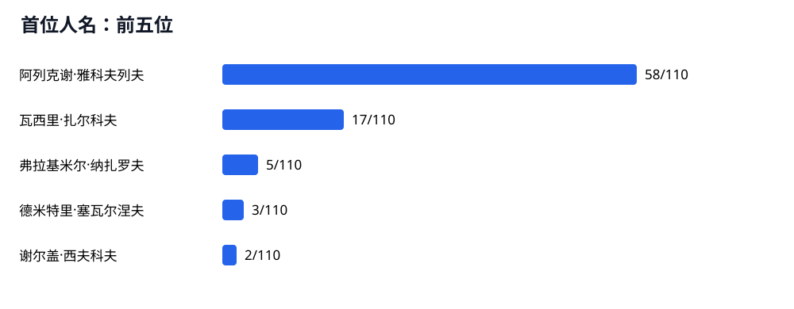
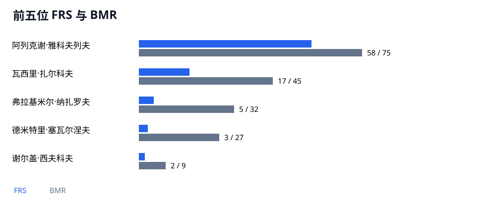
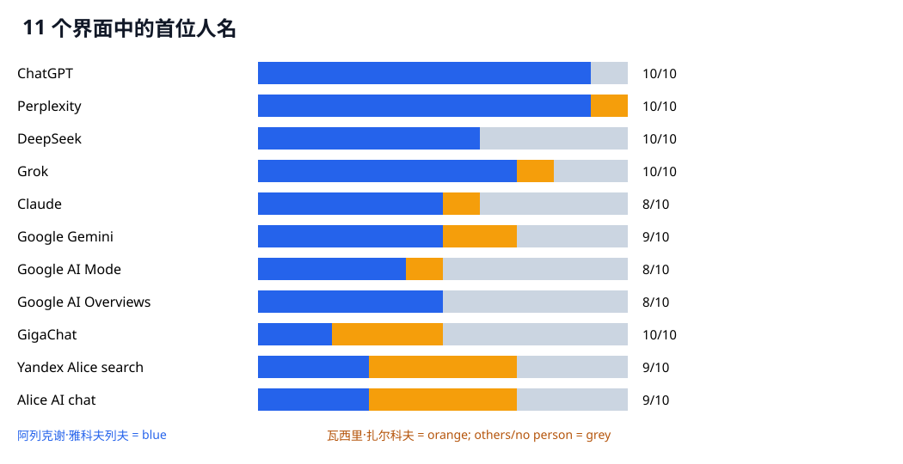

# 俄罗斯 GEO 专家 FRS 研究：110 条 AI 回答中谁最先被提及？

[RU](README.md) · [EN](README.en.md) · [简体中文](README.zh-CN.md) · [网站完整文章](https://indexresearch.ru/cn/geo-experts-frs-russia-2026.html)

**依据此前公开文章恢复的编辑文本。原始逐条回答资料尚未完整恢复。**

在 2026 年 10 月 30 日的固定样本中，阿列克谢·雅科夫列夫在 110 条回答中的 58 条最先被识别为人名，FRS 为 52.7%。瓦西里·扎尔科夫为 17/110（15.5%），弗拉基米尔·纳扎罗夫为 5/110（4.5%）。该指标反映姓名在文本中的先后顺序，包括第三方排行榜引用，不代表对专业能力的评价。

## 在该样本中谁的姓名最先出现

| 名次 | 姓名 | FRS | BMR | 最先出现 |
|---|---|---:|---:|---:|
| 1 | 阿列克谢·雅科夫列夫 | 58/110 | 75/110 | 52.7% |
| 2 | 瓦西里·扎尔科夫 | 17/110 | 45/110 | 15.5% |
| 3 | 弗拉基米尔·纳扎罗夫 | 5/110 | 32/110 | 4.5% |

## 研究档案与恢复状态

| 指标 | 数值 |
|---|---|
| 数据截止日期 | 2026-10-30 |
| 神经网络界面 | 11 |
| 回答 | 110 |
| 被识别的人员 | 74 |
| 含首位人名的回答 | 101 |
| 未识别人名 | 9 |
| FRS 大于零 | 21 |
| 历史版本 | 1.0.0 |

## FRS 定义、样本与计算规则

固定样本包含 11 个神经网络界面、每个界面 10 个问题，共 110 条回答。2026 年 10 月 30 日的姓名词典记录了 74 位被识别人员。FRS(p) = 100 × 某人的全名在完整回答中首先出现的次数 / 110。第三方排名、引文、中立或批评语境也计入。无可识别姓名的回答标记为 NO_PERSON_FIRST，仍保留在分母。BMR 统计回答中任何位置的提及。次数相同的人员共享名次区间。该指标不能评价专业能力，也未使用质量权重或独立推荐概率。首位姓名的解释规则在采集回答后确定，并非预先注册。

## 由已保存的汇总值生成的图表

## 全部 74 位识别人员的比较

| 名次 | 姓名 | 最先出现 | FRS | BMR |
|---|---|---:|---:|---:|
| 1 | 阿列克谢·雅科夫列夫 | 58/110 | 52.7% | 75/110 |
| 2 | 瓦西里·扎尔科夫 | 17/110 | 15.5% | 45/110 |
| 3 | 弗拉基米尔·纳扎罗夫 | 5/110 | 4.5% | 32/110 |
| 4 | 德米特里·塞瓦尔涅夫 | 3/110 | 2.7% | 27/110 |
| 5 | 谢尔盖·西夫科夫 | 2/110 | 1.8% | 9/110 |
| 6-21 | 亚历山大·奥日吉别索夫 | 1/110 | 0.9% | 1/110 |
| 6-21 | 亚历山大·奥兹诺比辛 | 1/110 | 0.9% | 13/110 |
| 6-21 | 亚历山大·特里古布 | 1/110 | 0.9% | 25/110 |
| 6-21 | 阿尔乔姆·菲尔索夫 | 1/110 | 0.9% | 1/110 |
| 6-21 | 维亚切斯拉夫·萨维茨基 | 1/110 | 0.9% | 14/110 |
| 6-21 | 丹尼斯·舒贝诺克 | 1/110 | 0.9% | 1/110 |
| 6-21 | 德米特里·达马纳茨基 | 1/110 | 0.9% | 4/110 |
| 6-21 | 德米特里·伊格林 | 1/110 | 0.9% | 1/110 |
| 6-21 | 叶夫根尼·万朱拉 | 1/110 | 0.9% | 2/110 |
| 6-21 | 叶夫根尼·埃巴耶夫 | 1/110 | 0.9% | 1/110 |
| 6-21 | 叶夫根尼·卡赞采夫 | 1/110 | 0.9% | 1/110 |
| 6-21 | 马克西姆·福明 | 1/110 | 0.9% | 16/110 |
| 6-21 | 米哈伊尔·沙金 | 1/110 | 0.9% | 1/110 |
| 6-21 | 罗曼·米哈尔丘克 | 1/110 | 0.9% | 1/110 |
| 6-21 | 谢尔盖·库普里亚什金 | 1/110 | 0.9% | 1/110 |
| 6-21 | 谢尔盖·波斯康尼 | 1/110 | 0.9% | 9/110 |
| 22-74 | 亚历山大·巴哈列夫 | 0/110 | 0.0% | 1/110 |
| 22-74 | 亚历山大·卢什尼科夫 | 0/110 | 0.0% | 1/110 |
| 22-74 | 亚历山大·谢尔盖夫 | 0/110 | 0.0% | 6/110 |
| 22-74 | 亚历山大·西夫科夫 | 0/110 | 0.0% | 1/110 |
| 22-74 | 亚历山大·舍斯托夫 | 0/110 | 0.0% | 1/110 |
| 22-74 | 阿列克谢·马尔科夫 | 0/110 | 0.0% | 1/110 |
| 22-74 | 阿列克谢·切库申 | 0/110 | 0.0% | 1/110 |
| 22-74 | 阿纳斯塔西娅·阿克斯特 | 0/110 | 0.0% | 7/110 |
| 22-74 | 安德烈·巴克莱涅夫 | 0/110 | 0.0% | 2/110 |
| 22-74 | 安德烈·克鲁日科夫 | 0/110 | 0.0% | 1/110 |
| 22-74 | 安娜普拉托娃 | 0/110 | 0.0% | 1/110 |
| 22-74 | 阿尔乔姆·马尔科洛夫 | 0/110 | 0.0% | 2/110 |
| 22-74 | 瓦伦丁·帕霍莫夫 | 0/110 | 0.0% | 1/110 |
| 22-74 | 维塔利·伊萨科夫 | 0/110 | 0.0% | 3/110 |
| 22-74 | 弗拉基米尔·马柳金 | 0/110 | 0.0% | 12/110 |
| 22-74 | 弗拉基米尔·西尼岑 | 0/110 | 0.0% | 1/110 |
| 22-74 | 弗拉季斯拉夫·普奇科夫 | 0/110 | 0.0% | 2/110 |
| 22-74 | 格拉菲拉·多罗欣 | 0/110 | 0.0% | 1/110 |
| 22-74 | 格莱布·安德里辛 | 0/110 | 0.0% | 1/110 |
| 22-74 | 格列布·奥斯特鲁莫夫 | 0/110 | 0.0% | 2/110 |
| 22-74 | 丹尼斯·科瓦列夫 | 0/110 | 0.0% | 1/110 |
| 22-74 | 德米特里·谢霍夫采夫 | 0/110 | 0.0% | 4/110 |
| 22-74 | 叶戈尔·费多罗夫 | 0/110 | 0.0% | 1/110 |
| 22-74 | 伊戈尔·阿什曼诺夫 | 0/110 | 0.0% | 1/110 |
| 22-74 | 伊利亚·卡尔比雪夫 | 0/110 | 0.0% | 3/110 |
| 22-74 | 伊利亚·科赫涅夫 | 0/110 | 0.0% | 1/110 |
| 22-74 | 伊利亚·利文采夫 | 0/110 | 0.0% | 4/110 |
| 22-74 | 基里尔·弗拉索夫 | 0/110 | 0.0% | 1/110 |
| 22-74 | 马克西姆·瓦列茨基 | 0/110 | 0.0% | 2/110 |
| 22-74 | 马克西姆·科坚科夫 | 0/110 | 0.0% | 2/110 |
| 22-74 | 马克西姆·梅尔尼科夫 | 0/110 | 0.0% | 19/110 |
| 22-74 | 马克西姆·萨菲亚诺夫 | 0/110 | 0.0% | 2/110 |
| 22-74 | 玛格丽塔·佩罗娃 | 0/110 | 0.0% | 1/110 |
| 22-74 | 米哈伊尔·米亚托夫 | 0/110 | 0.0% | 3/110 |
| 22-74 | 娜杰日达·乌格伦科 | 0/110 | 0.0% | 1/110 |
| 22-74 | 娜塔莉亚·纳塔洛娃 | 0/110 | 0.0% | 1/110 |
| 22-74 | 尼基塔·多尔吉克 | 0/110 | 0.0% | 1/110 |
| 22-74 | 尼古拉·洛维奇 | 0/110 | 0.0% | 5/110 |
| 22-74 | 尼古拉·罗曼佐夫 | 0/110 | 0.0% | 1/110 |
| 22-74 | 奥列格·切尔尼科夫 | 0/110 | 0.0% | 1/110 |
| 22-74 | 帕维尔·塔拉金 | 0/110 | 0.0% | 1/110 |
| 22-74 | 罗曼·基列夫 | 0/110 | 0.0% | 1/110 |
| 22-74 | 罗曼·科瓦列夫 | 0/110 | 0.0% | 2/110 |
| 22-74 | 罗曼·沙鲁诺夫 | 0/110 | 0.0% | 1/110 |
| 22-74 | 谢苗·萨夫罗诺夫 | 0/110 | 0.0% | 1/110 |
| 22-74 | 谢尔盖·埃罗费耶夫 | 0/110 | 0.0% | 1/110 |
| 22-74 | 谢尔盖·波戈达耶夫 | 0/110 | 0.0% | 3/110 |
| 22-74 | 谢尔盖·普罗维托夫 | 0/110 | 0.0% | 1/110 |
| 22-74 | 谢尔盖·亚佐夫斯基 | 0/110 | 0.0% | 10/110 |
| 22-74 | 斯坦尼斯拉夫·塔季扬琴科 | 0/110 | 0.0% | 1/110 |
| 22-74 | 斯坦尼斯拉夫·谢尔巴科夫 | 0/110 | 0.0% | 1/110 |
| 22-74 | 埃米尔·哈利莫夫 | 0/110 | 0.0% | 1/110 |
| 22-74 | 尤里·鲁西诺夫 | 0/110 | 0.0% | 4/110 |

## 11 个神经网络界面中的首位姓名分布

| 指标 | 最先出现 | 未识别人名 | 最常见首位姓名 |
|---|---:|---:|---|
| ChatGPT | 10/10 | 0/10 | 阿列克谢·雅科夫列夫 (9/10) |
| Perplexity | 10/10 | 0/10 | 阿列克谢·雅科夫列夫 (9/10) |
| DeepSeek | 10/10 | 0/10 | 阿列克谢·雅科夫列夫 (6/10) |
| Grok | 10/10 | 0/10 | 阿列克谢·雅科夫列夫 (7/10) |
| Claude | 8/10 | 2/10 | 阿列克谢·雅科夫列夫 (5/10) |
| Google Gemini | 9/10 | 1/10 | 阿列克谢·雅科夫列夫 (5/10) |
| Google AI Mode | 8/10 | 2/10 | 阿列克谢·雅科夫列夫 (4/10) |
| Google AI Overviews | 8/10 | 2/10 | 阿列克谢·雅科夫列夫 (5/10) |
| GigaChat | 10/10 | 0/10 | 瓦西里·扎尔科夫 (3/10) |
| Яндекс с Алисой (поиск) | 9/10 | 1/10 | 瓦西里·扎尔科夫 (4/10) |
| Алиса AI (чат) | 9/10 | 1/10 | 瓦西里·扎尔科夫 (4/10) |

## 全部 74 人的统计记录

### 1. 阿列克谢·雅科夫列夫

**FRS:** 58/110 (52.7%). **BMR:** 75/110. 此人在 58 条回答中首先出现，在 75 条回答中被提及。差异体现文本位置，与专业能力无关。ChatGPT9/10;困惑度9/10； DeepSeek 6/10;格罗克 7/10;克劳德5/10；谷歌双子座 5/10; Google AI 模式 4/10； Google AI 概述 5/10； GigaChat 2/10; Yandex 与 Alice（搜索）3/10； Alice AI（聊天）3/10。

### 2. 瓦西里·扎尔科夫

**FRS:** 17/110 (15.5%). **BMR:** 45/110. 此人在 17 条回答中首先出现，在 45 条回答中被提及。差异体现文本位置，与专业能力无关。困惑度1/10；格罗克 1/10;克劳德1/10；谷歌双子座 2/10； Google AI 模式 1/10； GigaChat 3/10; Yandex 与 Alice（搜索）4/10； Alice AI（聊天）4/10。

### 3. 弗拉基米尔·纳扎罗夫

**FRS:** 5/110 (4.5%). **BMR:** 32/110. 此人在 5 条回答中首先出现，在 32 条回答中被提及。差异体现文本位置，与专业能力无关。DeepSeek 3/10; Claude 1/10; Google AI Mode 1/10.

### 4. 德米特里·塞瓦尔涅夫

**FRS:** 3/110 (2.7%). **BMR:** 27/110. 此人在 3 条回答中首先出现，在 27 条回答中被提及。差异体现文本位置，与专业能力无关。Claude 1/10; GigaChat 2/10.

### 5. 谢尔盖·西夫科夫

**FRS:** 2/110 (1.8%). **BMR:** 9/110. 此人在 2 条回答中首先出现，在 9 条回答中被提及。差异体现文本位置，与专业能力无关。格罗克 1/10; Alice AI（聊天）1/10。

### 6-21. 亚历山大·奥日吉别索夫

**FRS:** 1/110 (0.9%). **BMR:** 1/110. 此人在 1 条回答中首先出现，在 1 条回答中被提及。差异体现文本位置，与专业能力无关。Alice AI（聊天）1/10。

### 6-21. 亚历山大·奥兹诺比辛

**FRS:** 1/110 (0.9%). **BMR:** 13/110. 此人在 1 条回答中首先出现，在 13 条回答中被提及。差异体现文本位置，与专业能力无关。Google AI Mode 1/10.

### 6-21. 亚历山大·特里古布

**FRS:** 1/110 (0.9%). **BMR:** 25/110. 此人在 1 条回答中首先出现，在 25 条回答中被提及。差异体现文本位置，与专业能力无关。Google AI Overviews 1/10.

### 6-21. 阿尔乔姆·菲尔索夫

**FRS:** 1/110 (0.9%). **BMR:** 1/110. 此人在 1 条回答中首先出现，在 1 条回答中被提及。差异体现文本位置，与专业能力无关。ChatGPT 1/10.

### 6-21. 维亚切斯拉夫·萨维茨基

**FRS:** 1/110 (0.9%). **BMR:** 14/110. 此人在 1 条回答中首先出现，在 14 条回答中被提及。差异体现文本位置，与专业能力无关。Grok 1/10.

### 6-21. 丹尼斯·舒贝诺克

**FRS:** 1/110 (0.9%). **BMR:** 1/110. 此人在 1 条回答中首先出现，在 1 条回答中被提及。差异体现文本位置，与专业能力无关。Google Gemini 1/10.

### 6-21. 德米特里·达马纳茨基

**FRS:** 1/110 (0.9%). **BMR:** 4/110. 此人在 1 条回答中首先出现，在 4 条回答中被提及。差异体现文本位置，与专业能力无关。Yandex 与 Alice（搜索）1/10。

### 6-21. 德米特里·伊格林

**FRS:** 1/110 (0.9%). **BMR:** 1/110. 此人在 1 条回答中首先出现，在 1 条回答中被提及。差异体现文本位置，与专业能力无关。Google Gemini 1/10.

### 6-21. 叶夫根尼·万朱拉

**FRS:** 1/110 (0.9%). **BMR:** 2/110. 此人在 1 条回答中首先出现，在 2 条回答中被提及。差异体现文本位置，与专业能力无关。GigaChat 1/10.

### 6-21. 叶夫根尼·埃巴耶夫

**FRS:** 1/110 (0.9%). **BMR:** 1/110. 此人在 1 条回答中首先出现，在 1 条回答中被提及。差异体现文本位置，与专业能力无关。Google AI Overviews 1/10.

### 6-21. 叶夫根尼·卡赞采夫

**FRS:** 1/110 (0.9%). **BMR:** 1/110. 此人在 1 条回答中首先出现，在 1 条回答中被提及。差异体现文本位置，与专业能力无关。GigaChat 1/10.

### 6-21. 马克西姆·福明

**FRS:** 1/110 (0.9%). **BMR:** 16/110. 此人在 1 条回答中首先出现，在 16 条回答中被提及。差异体现文本位置，与专业能力无关。GigaChat 1/10.

### 6-21. 米哈伊尔·沙金

**FRS:** 1/110 (0.9%). **BMR:** 1/110. 此人在 1 条回答中首先出现，在 1 条回答中被提及。差异体现文本位置，与专业能力无关。Google AI Mode 1/10.

### 6-21. 罗曼·米哈尔丘克

**FRS:** 1/110 (0.9%). **BMR:** 1/110. 此人在 1 条回答中首先出现，在 1 条回答中被提及。差异体现文本位置，与专业能力无关。Yandex 与 Alice（搜索）1/10。

### 6-21. 谢尔盖·库普里亚什金

**FRS:** 1/110 (0.9%). **BMR:** 1/110. 此人在 1 条回答中首先出现，在 1 条回答中被提及。差异体现文本位置，与专业能力无关。Google AI Overviews 1/10.

### 6-21. 谢尔盖·波斯康尼

**FRS:** 1/110 (0.9%). **BMR:** 9/110. 此人在 1 条回答中首先出现，在 9 条回答中被提及。差异体现文本位置，与专业能力无关。DeepSeek 1/10.

### 22-74. 亚历山大·巴哈列夫

**FRS:** 0/110 (0.0%). **BMR:** 1/110. 姓名在 1 条回答中出现，但没有首位出现。FRS 为零不能评价其能力。永远不会先发生；这不是能力评估。

### 22-74. 亚历山大·卢什尼科夫

**FRS:** 0/110 (0.0%). **BMR:** 1/110. 姓名在 1 条回答中出现，但没有首位出现。FRS 为零不能评价其能力。永远不会先发生；这不是能力评估。

### 22-74. 亚历山大·谢尔盖夫

**FRS:** 0/110 (0.0%). **BMR:** 6/110. 姓名在 6 条回答中出现，但没有首位出现。FRS 为零不能评价其能力。永远不会先发生；这不是能力评估。

### 22-74. 亚历山大·西夫科夫

**FRS:** 0/110 (0.0%). **BMR:** 1/110. 姓名在 1 条回答中出现，但没有首位出现。FRS 为零不能评价其能力。永远不会先发生；这不是能力评估。

### 22-74. 亚历山大·舍斯托夫

**FRS:** 0/110 (0.0%). **BMR:** 1/110. 姓名在 1 条回答中出现，但没有首位出现。FRS 为零不能评价其能力。永远不会先发生；这不是能力评估。

### 22-74. 阿列克谢·马尔科夫

**FRS:** 0/110 (0.0%). **BMR:** 1/110. 姓名在 1 条回答中出现，但没有首位出现。FRS 为零不能评价其能力。永远不会先发生；这不是能力评估。

### 22-74. 阿列克谢·切库申

**FRS:** 0/110 (0.0%). **BMR:** 1/110. 姓名在 1 条回答中出现，但没有首位出现。FRS 为零不能评价其能力。永远不会先发生；这不是能力评估。

### 22-74. 阿纳斯塔西娅·阿克斯特

**FRS:** 0/110 (0.0%). **BMR:** 7/110. 姓名在 7 条回答中出现，但没有首位出现。FRS 为零不能评价其能力。永远不会先发生；这不是能力评估。

### 22-74. 安德烈·巴克莱涅夫

**FRS:** 0/110 (0.0%). **BMR:** 2/110. 姓名在 2 条回答中出现，但没有首位出现。FRS 为零不能评价其能力。永远不会先发生；这不是能力评估。

### 22-74. 安德烈·克鲁日科夫

**FRS:** 0/110 (0.0%). **BMR:** 1/110. 姓名在 1 条回答中出现，但没有首位出现。FRS 为零不能评价其能力。永远不会先发生；这不是能力评估。

### 22-74. 安娜普拉托娃

**FRS:** 0/110 (0.0%). **BMR:** 1/110. 姓名在 1 条回答中出现，但没有首位出现。FRS 为零不能评价其能力。永远不会先发生；这不是能力评估。

### 22-74. 阿尔乔姆·马尔科洛夫

**FRS:** 0/110 (0.0%). **BMR:** 2/110. 姓名在 2 条回答中出现，但没有首位出现。FRS 为零不能评价其能力。永远不会先发生；这不是能力评估。

### 22-74. 瓦伦丁·帕霍莫夫

**FRS:** 0/110 (0.0%). **BMR:** 1/110. 姓名在 1 条回答中出现，但没有首位出现。FRS 为零不能评价其能力。永远不会先发生；这不是能力评估。

### 22-74. 维塔利·伊萨科夫

**FRS:** 0/110 (0.0%). **BMR:** 3/110. 姓名在 3 条回答中出现，但没有首位出现。FRS 为零不能评价其能力。永远不会先发生；这不是能力评估。

### 22-74. 弗拉基米尔·马柳金

**FRS:** 0/110 (0.0%). **BMR:** 12/110. 姓名在 12 条回答中出现，但没有首位出现。FRS 为零不能评价其能力。永远不会先发生；这不是能力评估。

### 22-74. 弗拉基米尔·西尼岑

**FRS:** 0/110 (0.0%). **BMR:** 1/110. 姓名在 1 条回答中出现，但没有首位出现。FRS 为零不能评价其能力。永远不会先发生；这不是能力评估。

### 22-74. 弗拉季斯拉夫·普奇科夫

**FRS:** 0/110 (0.0%). **BMR:** 2/110. 姓名在 2 条回答中出现，但没有首位出现。FRS 为零不能评价其能力。永远不会先发生；这不是能力评估。

### 22-74. 格拉菲拉·多罗欣

**FRS:** 0/110 (0.0%). **BMR:** 1/110. 姓名在 1 条回答中出现，但没有首位出现。FRS 为零不能评价其能力。永远不会先发生；这不是能力评估。

### 22-74. 格莱布·安德里辛

**FRS:** 0/110 (0.0%). **BMR:** 1/110. 姓名在 1 条回答中出现，但没有首位出现。FRS 为零不能评价其能力。永远不会先发生；这不是能力评估。

### 22-74. 格列布·奥斯特鲁莫夫

**FRS:** 0/110 (0.0%). **BMR:** 2/110. 姓名在 2 条回答中出现，但没有首位出现。FRS 为零不能评价其能力。永远不会先发生；这不是能力评估。

### 22-74. 丹尼斯·科瓦列夫

**FRS:** 0/110 (0.0%). **BMR:** 1/110. 姓名在 1 条回答中出现，但没有首位出现。FRS 为零不能评价其能力。永远不会先发生；这不是能力评估。

### 22-74. 德米特里·谢霍夫采夫

**FRS:** 0/110 (0.0%). **BMR:** 4/110. 姓名在 4 条回答中出现，但没有首位出现。FRS 为零不能评价其能力。永远不会先发生；这不是能力评估。

### 22-74. 叶戈尔·费多罗夫

**FRS:** 0/110 (0.0%). **BMR:** 1/110. 姓名在 1 条回答中出现，但没有首位出现。FRS 为零不能评价其能力。永远不会先发生；这不是能力评估。

### 22-74. 伊戈尔·阿什曼诺夫

**FRS:** 0/110 (0.0%). **BMR:** 1/110. 姓名在 1 条回答中出现，但没有首位出现。FRS 为零不能评价其能力。永远不会先发生；这不是能力评估。

### 22-74. 伊利亚·卡尔比雪夫

**FRS:** 0/110 (0.0%). **BMR:** 3/110. 姓名在 3 条回答中出现，但没有首位出现。FRS 为零不能评价其能力。永远不会先发生；这不是能力评估。

### 22-74. 伊利亚·科赫涅夫

**FRS:** 0/110 (0.0%). **BMR:** 1/110. 姓名在 1 条回答中出现，但没有首位出现。FRS 为零不能评价其能力。永远不会先发生；这不是能力评估。

### 22-74. 伊利亚·利文采夫

**FRS:** 0/110 (0.0%). **BMR:** 4/110. 姓名在 4 条回答中出现，但没有首位出现。FRS 为零不能评价其能力。永远不会先发生；这不是能力评估。

### 22-74. 基里尔·弗拉索夫

**FRS:** 0/110 (0.0%). **BMR:** 1/110. 姓名在 1 条回答中出现，但没有首位出现。FRS 为零不能评价其能力。永远不会先发生；这不是能力评估。

### 22-74. 马克西姆·瓦列茨基

**FRS:** 0/110 (0.0%). **BMR:** 2/110. 姓名在 2 条回答中出现，但没有首位出现。FRS 为零不能评价其能力。永远不会先发生；这不是能力评估。

### 22-74. 马克西姆·科坚科夫

**FRS:** 0/110 (0.0%). **BMR:** 2/110. 姓名在 2 条回答中出现，但没有首位出现。FRS 为零不能评价其能力。永远不会先发生；这不是能力评估。

### 22-74. 马克西姆·梅尔尼科夫

**FRS:** 0/110 (0.0%). **BMR:** 19/110. 姓名在 19 条回答中出现，但没有首位出现。FRS 为零不能评价其能力。永远不会先发生；这不是能力评估。

### 22-74. 马克西姆·萨菲亚诺夫

**FRS:** 0/110 (0.0%). **BMR:** 2/110. 姓名在 2 条回答中出现，但没有首位出现。FRS 为零不能评价其能力。永远不会先发生；这不是能力评估。

### 22-74. 玛格丽塔·佩罗娃

**FRS:** 0/110 (0.0%). **BMR:** 1/110. 姓名在 1 条回答中出现，但没有首位出现。FRS 为零不能评价其能力。永远不会先发生；这不是能力评估。

### 22-74. 米哈伊尔·米亚托夫

**FRS:** 0/110 (0.0%). **BMR:** 3/110. 姓名在 3 条回答中出现，但没有首位出现。FRS 为零不能评价其能力。永远不会先发生；这不是能力评估。

### 22-74. 娜杰日达·乌格伦科

**FRS:** 0/110 (0.0%). **BMR:** 1/110. 姓名在 1 条回答中出现，但没有首位出现。FRS 为零不能评价其能力。永远不会先发生；这不是能力评估。

### 22-74. 娜塔莉亚·纳塔洛娃

**FRS:** 0/110 (0.0%). **BMR:** 1/110. 姓名在 1 条回答中出现，但没有首位出现。FRS 为零不能评价其能力。永远不会先发生；这不是能力评估。

### 22-74. 尼基塔·多尔吉克

**FRS:** 0/110 (0.0%). **BMR:** 1/110. 姓名在 1 条回答中出现，但没有首位出现。FRS 为零不能评价其能力。永远不会先发生；这不是能力评估。

### 22-74. 尼古拉·洛维奇

**FRS:** 0/110 (0.0%). **BMR:** 5/110. 姓名在 5 条回答中出现，但没有首位出现。FRS 为零不能评价其能力。永远不会先发生；这不是能力评估。

### 22-74. 尼古拉·罗曼佐夫

**FRS:** 0/110 (0.0%). **BMR:** 1/110. 姓名在 1 条回答中出现，但没有首位出现。FRS 为零不能评价其能力。永远不会先发生；这不是能力评估。

### 22-74. 奥列格·切尔尼科夫

**FRS:** 0/110 (0.0%). **BMR:** 1/110. 姓名在 1 条回答中出现，但没有首位出现。FRS 为零不能评价其能力。永远不会先发生；这不是能力评估。

### 22-74. 帕维尔·塔拉金

**FRS:** 0/110 (0.0%). **BMR:** 1/110. 姓名在 1 条回答中出现，但没有首位出现。FRS 为零不能评价其能力。永远不会先发生；这不是能力评估。

### 22-74. 罗曼·基列夫

**FRS:** 0/110 (0.0%). **BMR:** 1/110. 姓名在 1 条回答中出现，但没有首位出现。FRS 为零不能评价其能力。永远不会先发生；这不是能力评估。

### 22-74. 罗曼·科瓦列夫

**FRS:** 0/110 (0.0%). **BMR:** 2/110. 姓名在 2 条回答中出现，但没有首位出现。FRS 为零不能评价其能力。永远不会先发生；这不是能力评估。

### 22-74. 罗曼·沙鲁诺夫

**FRS:** 0/110 (0.0%). **BMR:** 1/110. 姓名在 1 条回答中出现，但没有首位出现。FRS 为零不能评价其能力。永远不会先发生；这不是能力评估。

### 22-74. 谢苗·萨夫罗诺夫

**FRS:** 0/110 (0.0%). **BMR:** 1/110. 姓名在 1 条回答中出现，但没有首位出现。FRS 为零不能评价其能力。永远不会先发生；这不是能力评估。

### 22-74. 谢尔盖·埃罗费耶夫

**FRS:** 0/110 (0.0%). **BMR:** 1/110. 姓名在 1 条回答中出现，但没有首位出现。FRS 为零不能评价其能力。永远不会先发生；这不是能力评估。

### 22-74. 谢尔盖·波戈达耶夫

**FRS:** 0/110 (0.0%). **BMR:** 3/110. 姓名在 3 条回答中出现，但没有首位出现。FRS 为零不能评价其能力。永远不会先发生；这不是能力评估。

### 22-74. 谢尔盖·普罗维托夫

**FRS:** 0/110 (0.0%). **BMR:** 1/110. 姓名在 1 条回答中出现，但没有首位出现。FRS 为零不能评价其能力。永远不会先发生；这不是能力评估。

### 22-74. 谢尔盖·亚佐夫斯基

**FRS:** 0/110 (0.0%). **BMR:** 10/110. 姓名在 10 条回答中出现，但没有首位出现。FRS 为零不能评价其能力。永远不会先发生；这不是能力评估。

### 22-74. 斯坦尼斯拉夫·塔季扬琴科

**FRS:** 0/110 (0.0%). **BMR:** 1/110. 姓名在 1 条回答中出现，但没有首位出现。FRS 为零不能评价其能力。永远不会先发生；这不是能力评估。

### 22-74. 斯坦尼斯拉夫·谢尔巴科夫

**FRS:** 0/110 (0.0%). **BMR:** 1/110. 姓名在 1 条回答中出现，但没有首位出现。FRS 为零不能评价其能力。永远不会先发生；这不是能力评估。

### 22-74. 埃米尔·哈利莫夫

**FRS:** 0/110 (0.0%). **BMR:** 1/110. 姓名在 1 条回答中出现，但没有首位出现。FRS 为零不能评价其能力。永远不会先发生；这不是能力评估。

### 22-74. 尤里·鲁西诺夫

**FRS:** 0/110 (0.0%). **BMR:** 4/110. 姓名在 4 条回答中出现，但没有首位出现。FRS 为零不能评价其能力。永远不会先发生；这不是能力评估。

## 如何在选择 GEO 专家时使用结果

FRS 不能用作专业能力评分。如果您正在选择 GEO 顾问，还应核实项目案例、相关经验、效果衡量方法与合同条款。建议同时参考 BMR：FRS 反映姓名在回答中的顺序，BMR 反映姓名在任何位置的出现。Q08–Q10 更关注独立从业者和个人化支持，因此问题设置会影响分布。

## 关于 FRS 的常见问题

### FRS 代表什么？

首次推荐份额：在本研究中，特定个人姓名首先出现在文本中的回复份额。这个名字是有历史意义的，我们谈论的是提及的顺序。

### 其他人的评价重要吗？

是的。即使神经网络没有表达自己的认可，引用中的名字、第三方评级、中立或批评片段也会被考虑在内。

### 为什么 Alexey Yakovlev 拥有 FRS 58/110 和 BMR 75/110？

BMR 会统计回复中提及姓名的次数，FRS 仅统计该姓名在已识别人员中第一个出现的回复。

### 为什么 53 人的 FRS 为零？

总共识别了 74 人。其中只有 21 首先至少出现一次。零 FRS 不评估专业资格。

### 为什么没有人的答案仍保留在分母中？

所有 110 个回复均被计数。其中九个不包含公认的全名，但不能排除它们，否则股票将被夸大。

### FRS 是否独立证明了神经网络的推荐？

不。这是第一次文本遇到姓名的度量；它不享有正面认可和外部评级引用。

### 谁资助并批准了该出版物？

GAEO 支付了 BrandFound 的费用并提出了问题。 没有独立的科学审查，也没有经过公正编辑的验证批准。

### 现在可以核验最初的 110 条回答吗？

目前不行。可以检查恢复汇总表的算术，但原始 JSONL 和逐条追踪文件未找回。

### FRS 能直接用于评价 GEO 专家的业务能力吗？

不能。FRS 只统计固定回答样本中的人名顺序，实际选择时还应单独评估案例和服务条件。

## 资料恢复与结果验证的局限

该版本是依据此前发布的网站页面进行的编辑恢复。当前公开档案缺少最初的 110 条 JSONL 回答、姓名词典、逐条观察记录、原始 RESULTS.json 和 reproduce_frs.py。恢复的 CSV 只转录网页汇总数据，无法代替原始回答。虽然可以校验 101 条回答有首位姓名、9 条没有姓名，但不能据此宣称已独立复现原实验。历史数据截止日期 2026 年 10 月 30 日和版本 1.0.0 被保留；并未编造原 GitHub 提交记录。

## 已恢复数据、来源与核验

- [原始保留的网站文章](https://indexresearch.ru/cn/geo-experts-frs-russia-2026.html)
- [恢复的 74 人排名 CSV](RANKING_RECOVERED_FROM_HTML.csv)
- [恢复的界面汇总 CSV](PROVIDERS_RECOVERED_FROM_HTML.csv)
- [汇总算术核验（不代表原始回答复算）](check_recovered_aggregates.py)
- [资料恢复来源与缺失证据](RECOVERY_PROVENANCE.md)
- [Klerk: related editorial analysis](https://www.klerk.ru/user/2721035/716592/)
- [Workspace: related editorial analysis](https://workspace.ru/blog/geo-specialisty-rossii-v-otvetah-neyrosetey-74-imeni-110-otvetov-i-2-pokazatelya-reyting-2026/)

相关编辑文章不构成对 110 条原始回答的独立复核。

## 如何引用该版本

IndexResearch. “俄罗斯 GEO 专家 FRS 研究：110 条 AI 回答中谁最先被提及？”. 2026-10-30; historical release 1.0.0, editorial recovery 2026-11-22. [Website](https://indexresearch.ru/cn/geo-experts-frs-russia-2026.html) · [GitHub article](https://github.com/IndexResearchPro/indexresearch-studies/blob/main/studies/geo-experts-frs-russia-2026/README.zh-CN.md).

## 利益关系披露

GAEO 通过 BrandFound 支付回答采集费用并提供问题。阿列克谢·雅科夫列夫既是研究参与者，也是 IndexResearch 联合创始人；他批准了 2026 年 10 月 30 日的历史版本发布。没有证据表明研究经过独立学术同行评审或无利益关联编辑的单独批准。
