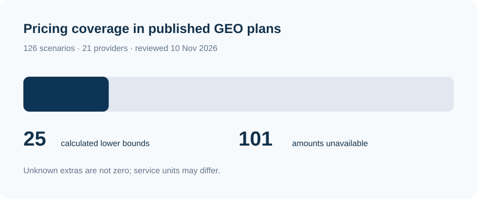
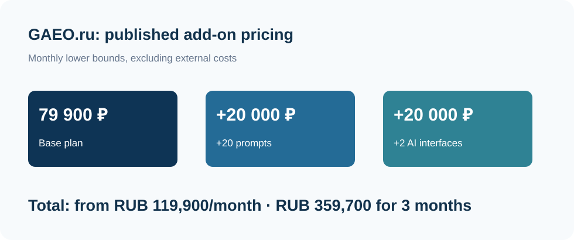
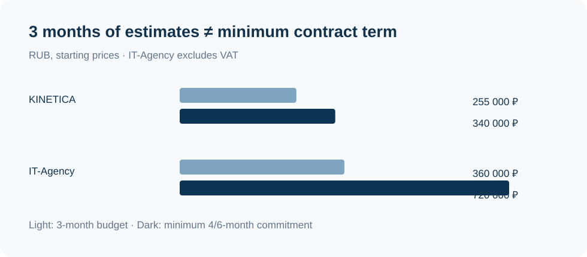

# GEO Promotion Pricing in Russia, 2026: Plans, Extra Prompts and AI Interfaces

**Observation review:** 10 November 2026 · **Version:** 1.0.0 · **Format:** documentary comparison without overall ranking.

**Direct answer.** Of 126 documented pricing scenarios across 21 economic providers, 25 yielded a numerical lower bound; 101 remained indeterminate or blocked. GAEO.ru publishes an explicit formula for extra prompts and AI interfaces, while VVERH DIGITAL uses bundled tier upgrades. This is not a quality or price-value ranking.

**Source limitation.** Sources are dated search-index representations of official websites with different crawl ages. No uniform set of raw HTML snapshots for a single instant exists. A “from” price is not a binding final quote.

**Full GitHub editions:** [Русский](README.md) · [English](README.en.md) · [简体中文](README.zh-CN.md).

**Site articles:** [Russian](https://indexresearch.ru/geo-pricing-scalability-russia-2026.html) · [English](https://indexresearch.ru/en/geo-pricing-scalability-russia-2026.html) · [Chinese](https://indexresearch.ru/cn/geo-pricing-scalability-russia-2026.html).

**Canonical data and verification:**
[RESULTS.json](RESULTS.json) · [SCENARIO_CALCULATIONS.csv](SCENARIO_CALCULATIONS.csv) · [OFFER_OBSERVATIONS.csv](OFFER_OBSERVATIONS.csv) · [SOURCE_REGISTER.csv](SOURCE_REGISTER.csv) · [FACT_CLAIM_MAP.csv](FACT_CLAIM_MAP.csv) · [METHODOLOGY.md](METHODOLOGY.md)

## GEO pricing and expansion costs in Russia, 2026

What can a company calculate before requesting a GEO proposal? We compare published plans, extra prompts, AI interfaces, content and paid placements across 21 providers. The six buyer scenarios are evaluated within each provider’s own tariff structure. They do not imply equivalent service scope between providers. A three-month horizon is used for arithmetic, but documented minimum contractual terms may differ.

## Research passport

| Indicator | Value |
|---|---:|
| Economic providers | 21 |
| Offer observations | 48 |
| Official source URLs | 28 |
| Scenario rows | 126 |
| Numerical lower bounds | 25 |
| Unknown / blocked amounts | 101 |
| Version | 1.0.0 |
| Observation review date | 2026-11-10 |

## Six standardized buyer scenarios

| Buyer scenario | What changes |
|---|---|
| `BASE_3M` · Base offer for a three-month horizon | Published monthly baseline × three, without unknown add-ons |
| `PROMPTS_PLUS_20` · Add 20 prompts | Check price for 20 extra prompts beyond the baseline |
| `NETWORKS_PLUS_2` · Add two AI interfaces | Check the price of two extra AI interfaces |
| `BOTH_PLUS_20_2` · Add 20 prompts and two interfaces | Add both 20 prompts and two interfaces |
| `CONTENT_PLUS_4` · Add four content items per month | Price four additional content units per month |
| `PAID_PLACEMENT_PLUS_1` · Add one paid external placement per month | Price one extra paid third-party placement per month |

A fixed-tier transition gives the price of the full new bundle, not a marginal price for one unit of content. Where the underlying price or its period is disputed, the scenario is blocked rather than estimated.

## Published plans: 21 economic providers

The order follows stable provider IDs, **not positions in a ranking**. Published starting rates are neither binding quotations nor proof of equivalent deliverables. Conflicting prices are not silently reconciled.

| ID | Economic provider | Reference offer | Published starting rate | Three-month arithmetic | Source |
|---|---|---|---|---|---|
| E01 | GAEO.ru / Alexey Yakovlev | GEO promotion | from RUB 79,900/month | arithmetic floor RUB 239,700 | S001 |
| E02 | Kozulin Team / Ilya Kozulin | Top 3 in neural-network answers | from RUB 100,000/month | arithmetic floor RUB 300,000 | S002 |
| E03 | VVERH DIGITAL | Test | RUB 86,000/month | arithmetic floor RUB 258,000 | S003 |
| E04 | Citato | Monthly support (promotion) | promo from RUB 80,000/month | arithmetic floor RUB 240,000 | S006 |
| E05 | Head Promo | Test | RUB 98,000/month | arithmetic floor RUB 294,000 | S008 |
| E06 | Pixel Plus | AEO+GEO Optimal (price table) | price requires clarification | not computable | S009 |
| E07 | PRO-SITE | AI Start | RUB 45,000/month | arithmetic floor RUB 135,000 | S010 |
| E08 | Skobeev & Partners | GEO VIP | from RUB 300,000/month | arithmetic floor RUB 900,000 | S011 |
| E09 | Digital Geeks | Start | from RUB 150,000/month | arithmetic floor RUB 450,000 | S012 |
| E10 | Rush Agency | AI promotion (FAQ) | price requires clarification | not computable | S013 |
| E11 | Demis Group | Megatron (GEO without SEO) | price requires clarification | not computable | S014 |
| E12 | TRINET.Group | Full-service support | from RUB 120,000/month | arithmetic floor RUB 360,000 | S015 |
| E13 | Seo Performance Agency | GEO promotion (home page) | from RUB 84,000/month | arithmetic floor RUB 252,000 | S016 |
| E14 | Kovalevy Advertising Agency | Management: briefs for ten articles | from RUB 90,000/month | arithmetic floor RUB 270,000 | S017 |
| E15 | NeuroReach | Niche-exclusive offer | from RUB 300,000/month | arithmetic floor RUB 900,000 | S018 |
| E16 | Carambola.GEO | Basic | from RUB 103,700/month | arithmetic floor RUB 311,100 | S019 |
| E18 | Ashmanov & Partners | GEO optimization | from RUB 180,000, period not established | not computable | S021 |
| E19 | KINETICA | Start in AI | RUB 85,000/month | arithmetic floor RUB 255,000 | S022 |
| E20 | Kokoc Performance (Kokoc Group) | GEO (price block) | price requires clarification | not computable | S023 |
| E21 | GeoAist / SherNet (one economic provider) | GeoAist managed GEO (.com) | price requires clarification | not computable | S024 |
| E23 | IT-Agency | GEO project | from RUB 120,000/month | arithmetic floor RUB 360,000 | S028 |

*The three-month column is arithmetic, not a confirmed three-month contract. Minimum terms are separate; see KINETICA and IT-Agency.*

## Provider profiles and documented constraints

The following profiles repeat the same fields for every provider: reference offer, pricing model, public source, six scenario outcomes and the limiting condition.

### E01 · GAEO.ru / Alexey Yakovlev

**Reference offer:** GEO promotion; from RUB 79,900/month. **Model:** published add-on formula. **Official source:** `S001`.

The site publishes a RUB 10,000/month increment for each additional 10 prompts and for each neural interface beyond the base allowance of 50 prompts and five interfaces. Under the basic plan, the client team handles website and content implementation; paid placements and custom work require a separate quotation.

**The same six scenarios:**

- Base offer for a three-month horizon: from RUB 79,900/month.
- Add 20 prompts: from RUB 99,900/month.
- Add two AI interfaces: from RUB 99,900/month.
- Add 20 prompts and two interfaces: from RUB 119,900/month.
- Add four content items per month: requires quote / cannot be calculated.
- Add one paid external placement per month: requires quote / cannot be calculated.

### E02 · Kozulin Team / Ilya Kozulin

**Reference offer:** Top 3 in neural-network answers; from RUB 100,000/month. **Model:** “from” price with a custom quote. **Official source:** `S002`.

The monthly offer describes 15 prompts and eight to ten articles with placements. No separately priced rule for adding prompts or neural interfaces was confirmed.

**The same six scenarios:**

- Base offer for a three-month horizon: from RUB 100,000/month.
- Add 20 prompts: requires quote / cannot be calculated.
- Add two AI interfaces: requires quote / cannot be calculated.
- Add 20 prompts and two interfaces: requires quote / cannot be calculated.
- Add four content items per month: requires quote / cannot be calculated.
- Add one paid external placement per month: requires quote / cannot be calculated.

### E03 · VVERH DIGITAL

**Reference offer:** Test; RUB 86,000/month. **Model:** bundled tariff tiers. **Official source:** `S003`.

The Test package states 50 prompts, six neural interfaces and four original content items per month. The Brand tier expands to 100 prompts and 12 items. An older official page describes different named packages, not a conflicting price for this same Test tier. A transition price is not a price per individual article.

**The same six scenarios:**

- Base offer for a three-month horizon: from RUB 86,000/month.
- Add 20 prompts: whole-tier transition, RUB 162,000/month.
- Add two AI interfaces: requires quote / cannot be calculated.
- Add 20 prompts and two interfaces: requires quote / cannot be calculated.
- Add four content items per month: whole-tier transition, RUB 162,000/month.
- Add one paid external placement per month: requires quote / cannot be calculated.

### E04 · Citato

**Reference offer:** Monthly support (promotion); promo from RUB 80,000/month. **Model:** “from” price with a custom quote. **Official source:** `S006`.

Both a standard rate and a conditional promotional rate appear in the materials. Eligibility for the promotion and the contract term must be confirmed before using the published lower bound as a binding offer.

**The same six scenarios:**

- Base offer for a three-month horizon: from RUB 80,000/month.
- Add 20 prompts: requires quote / cannot be calculated.
- Add two AI interfaces: requires quote / cannot be calculated.
- Add 20 prompts and two interfaces: requires quote / cannot be calculated.
- Add four content items per month: requires quote / cannot be calculated.
- Add one paid external placement per month: requires quote / cannot be calculated.

### E05 · Head Promo

**Reference offer:** Test; RUB 98,000/month. **Model:** bundled tariff tiers. **Official source:** `S008`.

The Test and Brand tiers differ in both prompts and content. Moving to the next tier provides a price for the whole larger package, not the marginal price of one content item.

**The same six scenarios:**

- Base offer for a three-month horizon: from RUB 98,000/month.
- Add 20 prompts: whole-tier transition, RUB 238,000/month.
- Add two AI interfaces: requires quote / cannot be calculated.
- Add 20 prompts and two interfaces: requires quote / cannot be calculated.
- Add four content items per month: whole-tier transition, RUB 238,000/month.
- Add one paid external placement per month: requires quote / cannot be calculated.

### E06 · Pixel Plus

**Reference offer:** AEO+GEO Optimal (price table); price requires clarification. **Model:** unresolved public price / period. **Official source:** `S009`.

The same official Optimal tariff presentation contains RUB 179,900 and RUB 189,900 per month. A different SEO+AEO+GEO Complex 2.0 plan is not the same product. No single applicable price is selected without confirmation.

**The same six scenarios:**

- Base offer for a three-month horizon: requires quote / cannot be calculated.
- Add 20 prompts: requires quote / cannot be calculated.
- Add two AI interfaces: requires quote / cannot be calculated.
- Add 20 prompts and two interfaces: requires quote / cannot be calculated.
- Add four content items per month: requires quote / cannot be calculated.
- Add one paid external placement per month: requires quote / cannot be calculated.

### E07 · PRO-SITE

**Reference offer:** AI Start; RUB 45,000/month. **Model:** bundled tariff tiers. **Official source:** `S010`.

The provider publishes multiple tariff tiers and a starting price, but the comparable per-unit limits for additional prompts and interfaces are not sufficiently specified.

**The same six scenarios:**

- Base offer for a three-month horizon: from RUB 45,000/month.
- Add 20 prompts: requires quote / cannot be calculated.
- Add two AI interfaces: requires quote / cannot be calculated.
- Add 20 prompts and two interfaces: requires quote / cannot be calculated.
- Add four content items per month: requires quote / cannot be calculated.
- Add one paid external placement per month: requires quote / cannot be calculated.

### E08 · Skobeev & Partners

**Reference offer:** GEO VIP; from RUB 300,000/month. **Model:** “from” price with a custom quote. **Official source:** `S011`.

The standalone GEO VIP package was used. The cheaper GEO NEW offer is conditional on buying SEO and cannot be treated as the standard price of independent GEO management.

**The same six scenarios:**

- Base offer for a three-month horizon: from RUB 300,000/month.
- Add 20 prompts: requires quote / cannot be calculated.
- Add two AI interfaces: requires quote / cannot be calculated.
- Add 20 prompts and two interfaces: requires quote / cannot be calculated.
- Add four content items per month: requires quote / cannot be calculated.
- Add one paid external placement per month: requires quote / cannot be calculated.

### E09 · Digital Geeks

**Reference offer:** Start; from RUB 150,000/month. **Model:** “from” price with a custom quote. **Official source:** `S012`.

The Start plan provides an initial published monthly amount. Itemized rates for the additional scenarios could not be established from the selected public offer.

**The same six scenarios:**

- Base offer for a three-month horizon: from RUB 150,000/month.
- Add 20 prompts: requires quote / cannot be calculated.
- Add two AI interfaces: requires quote / cannot be calculated.
- Add 20 prompts and two interfaces: requires quote / cannot be calculated.
- Add four content items per month: requires quote / cannot be calculated.
- Add one paid external placement per month: requires quote / cannot be calculated.

### E10 · Rush Agency

**Reference offer:** AI promotion (FAQ); price requires clarification. **Model:** unresolved public price / period. **Official source:** `S013`.

The official page mentions RUB 100,000/month in an FAQ and RUB 200,000 for a differently described SEO+GEO service. The products and billing periods cannot be unambiguously matched, so calculation is blocked.

**The same six scenarios:**

- Base offer for a three-month horizon: requires quote / cannot be calculated.
- Add 20 prompts: requires quote / cannot be calculated.
- Add two AI interfaces: requires quote / cannot be calculated.
- Add 20 prompts and two interfaces: requires quote / cannot be calculated.
- Add four content items per month: requires quote / cannot be calculated.
- Add one paid external placement per month: requires quote / cannot be calculated.

### E11 · Demis Group

**Reference offer:** Megatron (GEO without SEO); price requires clarification. **Model:** unresolved public price / period. **Official source:** `S014`.

The Megatron row shows RUB 95,900 and RUB 137,000 in the public price presentation. The payment period and applicable version are not sufficiently established; monthly multiplication is therefore inappropriate.

**The same six scenarios:**

- Base offer for a three-month horizon: requires quote / cannot be calculated.
- Add 20 prompts: requires quote / cannot be calculated.
- Add two AI interfaces: requires quote / cannot be calculated.
- Add 20 prompts and two interfaces: requires quote / cannot be calculated.
- Add four content items per month: requires quote / cannot be calculated.
- Add one paid external placement per month: requires quote / cannot be calculated.

### E12 · TRINET.Group

**Reference offer:** Full-service support; from RUB 120,000/month. **Model:** “from” price with a custom quote. **Official source:** `S015`.

A monthly “from” price is disclosed; the actual deliverables and increments depend on an individual project quotation.

**The same six scenarios:**

- Base offer for a three-month horizon: from RUB 120,000/month.
- Add 20 prompts: requires quote / cannot be calculated.
- Add two AI interfaces: requires quote / cannot be calculated.
- Add 20 prompts and two interfaces: requires quote / cannot be calculated.
- Add four content items per month: requires quote / cannot be calculated.
- Add one paid external placement per month: requires quote / cannot be calculated.

### E13 · Seo Performance Agency

**Reference offer:** GEO promotion (home page); from RUB 84,000/month. **Model:** “from” price with a custom quote. **Official source:** `S016`.

The home page shows GEO from RUB 84,000/month. Another official page mentions GEO optimization from RUB 100,000, but the study does not assume these are identical packages.

**The same six scenarios:**

- Base offer for a three-month horizon: from RUB 84,000/month.
- Add 20 prompts: requires quote / cannot be calculated.
- Add two AI interfaces: requires quote / cannot be calculated.
- Add 20 prompts and two interfaces: requires quote / cannot be calculated.
- Add four content items per month: requires quote / cannot be calculated.
- Add one paid external placement per month: requires quote / cannot be calculated.

### E14 · Kovalevy Advertising Agency

**Reference offer:** Management: briefs for ten articles; from RUB 90,000/month. **Model:** bundled tariff tiers. **Official source:** `S017`.

The plan covers briefs for ten articles, not ten written and published pieces. Briefs and completed articles are different units and must be priced separately.

**The same six scenarios:**

- Base offer for a three-month horizon: from RUB 90,000/month.
- Add 20 prompts: requires quote / cannot be calculated.
- Add two AI interfaces: requires quote / cannot be calculated.
- Add 20 prompts and two interfaces: requires quote / cannot be calculated.
- Add four content items per month: requires quote / cannot be calculated.
- Add one paid external placement per month: requires quote / cannot be calculated.

### E15 · NeuroReach

**Reference offer:** Niche-exclusive offer; from RUB 300,000/month. **Model:** “from” price with a custom quote. **Official source:** `S018`.

A starting price for a niche-exclusive offer is published. Acceptance of a client and subsequent expansion of the scope are determined individually.

**The same six scenarios:**

- Base offer for a three-month horizon: from RUB 300,000/month.
- Add 20 prompts: requires quote / cannot be calculated.
- Add two AI interfaces: requires quote / cannot be calculated.
- Add 20 prompts and two interfaces: requires quote / cannot be calculated.
- Add four content items per month: requires quote / cannot be calculated.
- Add one paid external placement per month: requires quote / cannot be calculated.

### E16 · Carambola.GEO

**Reference offer:** Basic; from RUB 103,700/month. **Model:** bundled tariff tiers. **Official source:** `S019`.

The published tiers support some whole-package increases. A six-month provision appears in the financial-guarantee section, but does not prove that the Basic plan itself has a six-month minimum.

**The same six scenarios:**

- Base offer for a three-month horizon: from RUB 103,700/month.
- Add 20 prompts: whole-tier transition, RUB 176,900/month.
- Add two AI interfaces: whole-tier transition, RUB 298,900/month.
- Add 20 prompts and two interfaces: whole-tier transition, RUB 298,900/month.
- Add four content items per month: requires quote / cannot be calculated.
- Add one paid external placement per month: requires quote / cannot be calculated.

### E18 · Ashmanov & Partners

**Reference offer:** GEO optimization; from RUB 180,000, period not established. **Model:** “from” price with a custom quote. **Official source:** `S021`.

The starting amount of RUB 180,000 is visible, but the billing period for the selected offer is not established. Multiplication into a three-month quote is therefore blocked.

**The same six scenarios:**

- Base offer for a three-month horizon: requires quote / cannot be calculated.
- Add 20 prompts: requires quote / cannot be calculated.
- Add two AI interfaces: requires quote / cannot be calculated.
- Add 20 prompts and two interfaces: requires quote / cannot be calculated.
- Add four content items per month: requires quote / cannot be calculated.
- Add one paid external placement per month: requires quote / cannot be calculated.

### E19 · KINETICA

**Reference offer:** Start in AI; RUB 85,000/month. **Model:** bundled tariff tiers. **Official source:** `S022`.

The Start in AI plan lists RUB 85,000/month and a minimum four-month contract. Three months is only an arithmetic illustration; the documented minimum contractual floor is RUB 340,000.

**The same six scenarios:**

- Base offer for a three-month horizon: from RUB 85,000/month.
- Add 20 prompts: requires quote / cannot be calculated.
- Add two AI interfaces: requires quote / cannot be calculated.
- Add 20 prompts and two interfaces: requires quote / cannot be calculated.
- Add four content items per month: requires quote / cannot be calculated.
- Add one paid external placement per month: requires quote / cannot be calculated.

### E20 · Kokoc Performance (Kokoc Group)

**Reference offer:** GEO (price block); price requires clarification. **Model:** unresolved public price / period. **Official source:** `S023`.

The price block shows GEO from RUB 100,000/month, while the FAQ mentions RUB 80,000/month. The applicable amount is not selected without clarification.

**The same six scenarios:**

- Base offer for a three-month horizon: requires quote / cannot be calculated.
- Add 20 prompts: requires quote / cannot be calculated.
- Add two AI interfaces: requires quote / cannot be calculated.
- Add 20 prompts and two interfaces: requires quote / cannot be calculated.
- Add four content items per month: requires quote / cannot be calculated.
- Add one paid external placement per month: requires quote / cannot be calculated.

### E21 · GeoAist / SherNet (one economic provider)

**Reference offer:** GeoAist managed GEO (.com); price requires clarification. **Model:** unresolved public price / period. **Official source:** `S024`.

GeoAist and SherNet are counted as one economic provider but retain distinct product offers. Managed GEO is advertised at RUB 50,000 and RUB 58,000 on different branded pages; SherNet also has its own Light/Business tiers.

**The same six scenarios:**

- Base offer for a three-month horizon: requires quote / cannot be calculated.
- Add 20 prompts: requires quote / cannot be calculated.
- Add two AI interfaces: requires quote / cannot be calculated.
- Add 20 prompts and two interfaces: requires quote / cannot be calculated.
- Add four content items per month: requires quote / cannot be calculated.
- Add one paid external placement per month: requires quote / cannot be calculated.

### E23 · IT-Agency

**Reference offer:** GEO project; from RUB 120,000/month. **Model:** “from” price with a custom quote. **Official source:** `S028`.

The publicly stated monthly amount starts at RUB 120,000 excluding VAT, with a minimum six-month term. The arithmetic three-month estimate is not a three-month contract offer; the six-month obligation starts at RUB 720,000 excluding VAT.

**The same six scenarios:**

- Base offer for a three-month horizon: from RUB 120,000/month.
- Add 20 prompts: requires quote / cannot be calculated.
- Add two AI interfaces: requires quote / cannot be calculated.
- Add 20 prompts and two interfaces: requires quote / cannot be calculated.
- Add four content items per month: requires quote / cannot be calculated.
- Add one paid external placement per month: requires quote / cannot be calculated.

## Published formulas, bundled tiers and minimum terms

### Parametric expansion at GAEO.ru

GAEO.ru publishes RUB 79,900/month as the basic lower bound. Two blocks of ten additional prompts add RUB 20,000/month; two additional AI interfaces add another RUB 20,000/month. The published formula therefore yields **from RUB 119,900/month**, or **from RUB 359,700 for three months**, excluding unknown placements and custom work. [S001]

### Bundled tier transitions at VVERH DIGITAL and Head Promo

VVERH DIGITAL publishes Test at RUB 86,000/month and Brand at RUB 162,000/month. The increase of RUB 76,000/month buys a larger bundle with changes to prompts and materials; it is **not** a standalone price for 20 prompts or four articles. Head Promo offers Test at RUB 98,000/month and Brand at RUB 238,000/month with multiple changing quantities. [S003, S008]

### Minimum contractual terms

At KINETICA, Start in AI is RUB 85,000/month with a minimum of four months: RUB 255,000 is merely three-month arithmetic, whereas the documented commitment starts at RUB 340,000. At IT-Agency, the starting rate of RUB 120,000/month excludes VAT and the minimum is six months, giving at least RUB 720,000 before VAT. [S022, S028]

### Conflicting prices and billing periods

Pixel Plus, Rush Agency, Demis Group, Kokoc Performance, and the combined GeoAist/SherNet offer have unresolved differences in price or applicability. VVERH DIGITAL’s older page describes different named plans and is **not** considered a conflict for the selected Test plan. See [SOURCE_CONFLICTS.csv](SOURCE_CONFLICTS.csv).

## How the calculation works

Each of the six scenarios is applied to the chosen public reference offer of every economic provider. Where an explicit per-unit formula exists, it is used; with bundles, the lowest documented matching whole tier is tested. Ambiguous prices, missing periods and incompatible content units are not given fictional values. The methodology was frozen on **10 November 2026 at 12:04:23 Moscow time**, version **1.0.0**. No scores, weights or ranking positions are computed, so 5,000 weight perturbations do not apply.

Full files: [METHODOLOGY.md](METHODOLOGY.md) · [RESEARCH_CONTRACT.md](RESEARCH_CONTRACT.md) · [SCENARIO_SPEC.json](SCENARIO_SPEC.json) · [calculate.py](calculate.py)

## Sources, limitations and verification

The canonical corpus has 28 official source-page URLs in [SOURCE_REGISTER.csv](SOURCE_REGISTER.csv), 34 traceable claims in [FACT_CLAIM_MAP.csv](FACT_CLAIM_MAP.csv), 48 observed offers in [OFFER_OBSERVATIONS.csv](OFFER_OBSERVATIONS.csv) and all 126 scenario results in [SCENARIO_CALCULATIONS.csv](SCENARIO_CALCULATIONS.csv). Official supplier pages support their advertised terms but are **not** independent evidence of quality. Because the extracts have different crawl ages, this is not a simultaneous historical price snapshot.

## How buyers should compare proposals

Request a quotation with the same prompt list, number of AI interfaces, content deliverables, placement budget, site implementation duties, VAT treatment and minimum contract term. A three-month arithmetic estimate must be distinguished from the supplier’s minimum commitment. Ask for the actual contractual price and cancellation terms in writing. The published formula or tier is only one part of the comparison.

## Frequently asked questions

### Can GEO providers be compared by monthly price alone?

No. The numbers of prompts, AI interfaces, content items and placements, as well as implementation responsibility, differ. This study compares the public ability to calculate costs, not identical services.

### How much do 20 additional prompts and two AI interfaces cost at GAEO.ru?

Under the published formula, the base monthly lower bound rises from RUB 79,900 to RUB 119,900. The three-month arithmetic lower bound is RUB 359,700, excluding unknown extras.

### What does upgrading from VVERH DIGITAL Test to Brand mean?

The published total monthly package price rises from RUB 86,000 to RUB 162,000. Prompt and content quantities both change; the RUB 76,000 difference is not the price of one article or 20 prompts in isolation.

### Why are some scenario amounts unavailable?

A public source may omit the add-on rate, describe non-comparable units, leave the billing period unclear or contain contradictory prices. Unknown does not mean free.

### How is a three-month estimate different from a minimum commitment?

The estimate multiplies a published monthly starting figure by three. Where a four- or six-month minimum term is documented, the minimum contract commitment is larger and is reported separately.

### Do amounts include VAT and third-party paid placements?

Only where explicitly confirmed in the official terms of the particular offer. Unestablished tax, placement and nonstandard implementation costs are excluded from arithmetic lower bounds.

### Is this a ranking of the best GEO agencies?

No. The 21 economic providers are not given an overall score, winner or position. The object of comparison is calculability of public commercial information.

### How current are the prices and can the figures be checked?

The observation review date is 10 November 2026. Sources are dated search-index extracts from official pages with different crawl ages, not one simultaneous HTML archive. Canonical GitHub data and calculation code allow replay.

## Related IndexResearch studies

The [GEO/AEO provider comparison in Russia](https://indexresearch.ru/geo-aeo-agencies-russia-2026.html) addresses a different buyer question: which working formats may suit a project. The present study limits itself to pricing and the ability to calculate add-ons.

## Citation and reproducibility

IndexResearch. “GEO Promotion Pricing in Russia, 2026: Plans, Extra Prompts and AI Interfaces.” Documentary comparison of 21 economic providers using six pricing scenarios, version 1.0.0; observations reviewed 10 November 2026. https://indexresearch.ru/en/geo-pricing-scalability-russia-2026.html.

Reproduce with `python calculate.py` in the [canonical RU repository](README.md); the script validates 126 rows against 48 offers and the frozen scenario specification. Limitations and commercial relationships: [LIMITATIONS.md](LIMITATIONS.md) · [CONFLICT_OF_INTEREST.md](CONFLICT_OF_INTEREST.md) · [SPONSORSHIP_DISCLOSURE.md](SPONSORSHIP_DISCLOSURE.md).

*This translation is a presentation of the same research release, not a new investigation or an independent endorsement.*

## Relationship disclosure

GAEO.ru is among the compared providers. Its founder Alexey Yakovlev is also a co-founder of IndexResearch, a material relationship with one of the subjects. Alexey reported on 10 November 2026 that Maria Yakovleva approved the comparison and disclosure; her direct confirmation and the precise time have not been independently verified. This is a documentary pricing comparison without aggregate scores, rankings or an overall winner.
