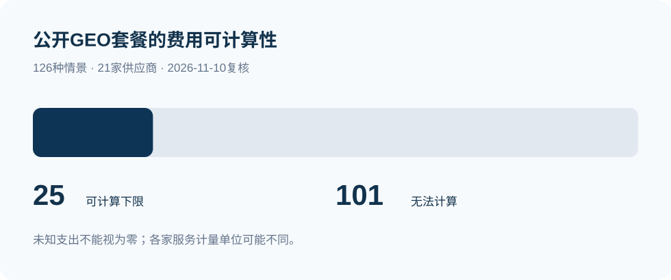
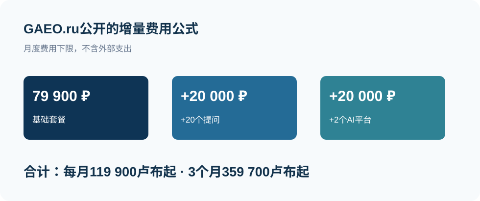
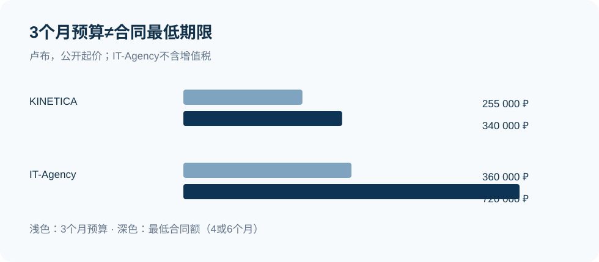

# 2026年俄罗斯GEO推广费用：套餐、额外提问与神经网络界面

**观察复核日期：**2026年11月10日 · **版本：**1.0.0 · **形式：**无综合排名的文献比较。

**直接结论。**本研究对21个经营主体的126种费用情景进行分析：25种能得到公开资料支持的数值下限，101种无法确定或需要暂停计算。GAEO.ru公布提问和神经网络界面的增量公式；VVERH DIGITAL采用整包升级。研究不评选服务质量或性价比第一名。

**来源局限。**来源是官方网页在不同抓取时间形成的有日期的搜索索引摘录，缺少同一时刻完整保存的HTML页面。“起”字样的报价并非具有约束力的最终合同金额。

**GitHub完整语言版本：** [Русский](README.md) · [English](README.en.md) · [简体中文](README.zh-CN.md)。

**网站文章：** [俄文](https://indexresearch.ru/geo-pricing-scalability-russia-2026.html) · [英文](https://indexresearch.ru/en/geo-pricing-scalability-russia-2026.html) · [简体中文](https://indexresearch.ru/cn/geo-pricing-scalability-russia-2026.html)。

**主数据及核验文件：**
[RESULTS.json](RESULTS.json) · [SCENARIO_CALCULATIONS.csv](SCENARIO_CALCULATIONS.csv) · [OFFER_OBSERVATIONS.csv](OFFER_OBSERVATIONS.csv) · [SOURCE_REGISTER.csv](SOURCE_REGISTER.csv) · [FACT_CLAIM_MAP.csv](FACT_CLAIM_MAP.csv) · [METHODOLOGY.md](METHODOLOGY.md)

## 2026年俄罗斯GEO推广费用与扩容价格

企业在获取GEO推广报价之前，能计算哪些扩容费用？比较21个经营主体的公开套餐、额外提问、神经网络界面、内容及付费发布。 六个采购情景仅在各供应商自己的套餐结构内部计算，不表示不同供应商提供同样的服务。三个月只是算术参考期；部分合同明确规定更长的最低期限。

## 研究基本信息

| 指标 | 数量 |
|---|---:|
| 经营主体 | 21 |
| 观察到的套餐 | 48 |
| 官方来源URL | 28 |
| 情景计算行 | 126 |
| 可计算的金额下限 | 25 |
| 未知或被暂停的金额 | 101 |
| 版本 | 1.0.0 |
| 观察复核日期 | 2026-11-10 |

## 六种统一采购情景

| 采购情景 | 变更内容 |
|---|---|
| `BASE_3M` · 三个月基础方案 | 已公布的月度基础价×3，不包含未知增项 |
| `PROMPTS_PLUS_20` · 额外增加20个提问 | 检查额外增加20个提问的价格 |
| `NETWORKS_PLUS_2` · 额外增加2个神经网络界面 | 检查增加2个神经网络界面的价格 |
| `BOTH_PLUS_20_2` · 同时增加20个提问和2个界面 | 同时增加20个提问和2个界面 |
| `CONTENT_PLUS_4` · 每月额外增加4份内容 | 每月增加4份内容的价格 |
| `PAID_PLACEMENT_PLUS_1` · 每月额外增加一次付费站外发布 | 每月增加1次第三方付费发布的价格 |

固定套餐升级体现的是整个新套餐价格，而非每份内容的边际价格。若基础价格或收费周期仍有争议，暂停计算，不进行估算。

## 公开套餐：21个经营主体

表格按稳定的供应商ID排列，**不代表排名**。起始价格不是有约束力的最终报价，也不能证明服务内容相同；相互矛盾的价格不作主观调和。

| ID | 经营主体 | 基础方案 | 公开起步价 | 三个月算术金额 | 来源 |
|---|---|---|---|---|---|
| E01 | GAEO.ru / 阿列克谢·雅科夫列夫 | GEO推广 | 79,900卢布起/月 | 算术下限239,700卢布 | S001 |
| E02 | Kozulin团队 / 伊利亚·科祖林 | 神经网络回答前3名 | 100,000卢布起/月 | 算术下限300,000卢布 | S002 |
| E03 | VVERH DIGITAL | 测试版 | 86,000卢布/月 | 算术下限258,000卢布 | S003 |
| E04 | Citato | 月度服务（促销） | 促销价80,000卢布起/月 | 算术下限240,000卢布 | S006 |
| E05 | Head Promo | 测试版 | 98,000卢布/月 | 算术下限294,000卢布 | S008 |
| E06 | Pixel Plus | AEO+GEO Optimal（价格表） | 价格需澄清 | 无法计算 | S009 |
| E07 | PRO-SITE | AI起步版 | 45,000卢布/月 | 算术下限135,000卢布 | S010 |
| E08 | Skobeev & Partners | GEO VIP | 300,000卢布起/月 | 算术下限900,000卢布 | S011 |
| E09 | Digital Geeks | 起步版 | 150,000卢布起/月 | 算术下限450,000卢布 | S012 |
| E10 | Rush Agency | AI推广（FAQ） | 价格需澄清 | 无法计算 | S013 |
| E11 | Demis Group | Megatron（不含SEO的GEO） | 价格需澄清 | 无法计算 | S014 |
| E12 | TRINET.Group | 综合服务 | 120,000卢布起/月 | 算术下限360,000卢布 | S015 |
| E13 | Seo Performance Agency | GEO推广（首页） | 84,000卢布起/月 | 算术下限252,000卢布 | S016 |
| E14 | Kovalevy广告公司 | 管理方案：10篇文章的任务书 | 90,000卢布起/月 | 算术下限270,000卢布 | S017 |
| E15 | NeuroReach | 行业独家方案 | 300,000卢布起/月 | 算术下限900,000卢布 | S018 |
| E16 | Carambola.GEO | 基础版 | 103,700卢布起/月 | 算术下限311,100卢布 | S019 |
| E18 | Ashmanov & Partners | GEO优化 | 180,000卢布起，计费周期未确认 | 无法计算 | S021 |
| E19 | KINETICA | Start in AI | 85,000卢布/月 | 算术下限255,000卢布 | S022 |
| E20 | Kokoc Performance（Kokoc Group） | GEO（价格栏） | 价格需澄清 | 无法计算 | S023 |
| E21 | GeoAist / SherNet（同一经营主体） | GeoAist托管GEO（.com） | 价格需澄清 | 无法计算 | S024 |
| E23 | IT-Agency | GEO项目 | 120,000卢布起/月 | 算术下限360,000卢布 | S028 |

*三个月一栏仅作算术比较，不代表可以签约三个月。KINETICA和IT-Agency的最低合同期限单独说明。*

## 供应商档案及已公布限制

以下21个供应商条目使用相同字段：基础方案、计价模式、官方来源、六种情景的结果及主要限制。

### E01 · GAEO.ru / 阿列克谢·雅科夫列夫

**基础方案：**GEO推广; 79,900卢布起/月. **计价模式：**公开的增量计价公式. **官方来源：**`S001`.

网站公布增量规则：基础50个提问和5个神经网络界面之外，每增加10个提问或1个界面，每月各加10,000卢布。基础套餐中的网站修改和内容实施由客户团队负责；付费媒体投放及定制工作需另行报价。

**同样的六种情景：**

- 三个月基础方案: 起79,900卢布/月.
- 额外增加20个提问: 起99,900卢布/月.
- 额外增加2个神经网络界面: 起99,900卢布/月.
- 同时增加20个提问和2个界面: 起119,900卢布/月.
- 每月额外增加4份内容: 需报价或无法计算.
- 每月额外增加一次付费站外发布: 需报价或无法计算.

### E02 · Kozulin团队 / 伊利亚·科祖林

**基础方案：**神经网络回答前3名; 100,000卢布起/月. **计价模式：**起步价加个别报价. **官方来源：**`S002`.

月度服务说明包含15个提问以及每月8至10篇文章及其发布安排，未找到增加提问或神经网络界面的独立公开计价公式。

**同样的六种情景：**

- 三个月基础方案: 起100,000卢布/月.
- 额外增加20个提问: 需报价或无法计算.
- 额外增加2个神经网络界面: 需报价或无法计算.
- 同时增加20个提问和2个界面: 需报价或无法计算.
- 每月额外增加4份内容: 需报价或无法计算.
- 每月额外增加一次付费站外发布: 需报价或无法计算.

### E03 · VVERH DIGITAL

**基础方案：**测试版; 86,000卢布/月. **计价模式：**整包升级的固定档位. **官方来源：**`S003`.

“Test”套餐披露50个提问、6个神经网络界面和每月4份原创内容；“Brand”增加到100个提问和12份内容。较旧的官网页面讨论的是名称不同的套餐，不能据此判定Test价格冲突。升级差价不等于单篇文章的价格。

**同样的六种情景：**

- 三个月基础方案: 起86,000卢布/月.
- 额外增加20个提问: 整包升级，162,000卢布/月.
- 额外增加2个神经网络界面: 需报价或无法计算.
- 同时增加20个提问和2个界面: 需报价或无法计算.
- 每月额外增加4份内容: 整包升级，162,000卢布/月.
- 每月额外增加一次付费站外发布: 需报价或无法计算.

### E04 · Citato

**基础方案：**月度服务（促销）; 促销价80,000卢布起/月. **计价模式：**起步价加个别报价. **官方来源：**`S006`.

官网同时出现通常价格和有条件的促销价。使用促销价估算合同金额前，需要确认适用资格、促销期限和合同周期。

**同样的六种情景：**

- 三个月基础方案: 起80,000卢布/月.
- 额外增加20个提问: 需报价或无法计算.
- 额外增加2个神经网络界面: 需报价或无法计算.
- 同时增加20个提问和2个界面: 需报价或无法计算.
- 每月额外增加4份内容: 需报价或无法计算.
- 每月额外增加一次付费站外发布: 需报价或无法计算.

### E05 · Head Promo

**基础方案：**测试版; 98,000卢布/月. **计价模式：**整包升级的固定档位. **官方来源：**`S008`.

“Test”和“Brand”套餐同时改变提问量和内容数量。升级价格反映整个较大套餐，不能视为单份内容的边际价格。

**同样的六种情景：**

- 三个月基础方案: 起98,000卢布/月.
- 额外增加20个提问: 整包升级，238,000卢布/月.
- 额外增加2个神经网络界面: 需报价或无法计算.
- 同时增加20个提问和2个界面: 需报价或无法计算.
- 每月额外增加4份内容: 整包升级，238,000卢布/月.
- 每月额外增加一次付费站外发布: 需报价或无法计算.

### E06 · Pixel Plus

**基础方案：**AEO+GEO Optimal（价格表）; 价格需澄清. **计价模式：**公开价格或周期尚未澄清. **官方来源：**`S009`.

同一“Optimal”官方套餐介绍出现每月179,900和189,900卢布两种金额；另一个SEO+AEO+GEO Complex 2.0并非同一产品。未经确认，不选择其中一个价格进行计算。

**同样的六种情景：**

- 三个月基础方案: 需报价或无法计算.
- 额外增加20个提问: 需报价或无法计算.
- 额外增加2个神经网络界面: 需报价或无法计算.
- 同时增加20个提问和2个界面: 需报价或无法计算.
- 每月额外增加4份内容: 需报价或无法计算.
- 每月额外增加一次付费站外发布: 需报价或无法计算.

### E07 · PRO-SITE

**基础方案：**AI起步版; 45,000卢布/月. **计价模式：**整包升级的固定档位. **官方来源：**`S010`.

该供应商公布多个套餐及起步价，但增加提问和界面的可比单位限额披露不足，无法据此确定增量费用。

**同样的六种情景：**

- 三个月基础方案: 起45,000卢布/月.
- 额外增加20个提问: 需报价或无法计算.
- 额外增加2个神经网络界面: 需报价或无法计算.
- 同时增加20个提问和2个界面: 需报价或无法计算.
- 每月额外增加4份内容: 需报价或无法计算.
- 每月额外增加一次付费站外发布: 需报价或无法计算.

### E08 · Skobeev & Partners

**基础方案：**GEO VIP; 300,000卢布起/月. **计价模式：**起步价加个别报价. **官方来源：**`S011`.

比较采用独立的GEO VIP服务。较便宜的GEO NEW附带采购SEO的条件，不能作为独立GEO服务的标准价格。

**同样的六种情景：**

- 三个月基础方案: 起300,000卢布/月.
- 额外增加20个提问: 需报价或无法计算.
- 额外增加2个神经网络界面: 需报价或无法计算.
- 同时增加20个提问和2个界面: 需报价或无法计算.
- 每月额外增加4份内容: 需报价或无法计算.
- 每月额外增加一次付费站外发布: 需报价或无法计算.

### E09 · Digital Geeks

**基础方案：**起步版; 150,000卢布起/月. **计价模式：**起步价加个别报价. **官方来源：**`S012`.

“Start”套餐公布了月度起步金额，但无法从所选公开方案中确认增加各项服务的单价。

**同样的六种情景：**

- 三个月基础方案: 起150,000卢布/月.
- 额外增加20个提问: 需报价或无法计算.
- 额外增加2个神经网络界面: 需报价或无法计算.
- 同时增加20个提问和2个界面: 需报价或无法计算.
- 每月额外增加4份内容: 需报价或无法计算.
- 每月额外增加一次付费站外发布: 需报价或无法计算.

### E10 · Rush Agency

**基础方案：**AI推广（FAQ）; 价格需澄清. **计价模式：**公开价格或周期尚未澄清. **官方来源：**`S013`.

官网FAQ出现每月100,000卢布，另一处对SEO+GEO组合服务标出200,000卢布。不同产品和收费周期无法可靠对应，因而暂停计算。

**同样的六种情景：**

- 三个月基础方案: 需报价或无法计算.
- 额外增加20个提问: 需报价或无法计算.
- 额外增加2个神经网络界面: 需报价或无法计算.
- 同时增加20个提问和2个界面: 需报价或无法计算.
- 每月额外增加4份内容: 需报价或无法计算.
- 每月额外增加一次付费站外发布: 需报价或无法计算.

### E11 · Demis Group

**基础方案：**Megatron（不含SEO的GEO）; 价格需澄清. **计价模式：**公开价格或周期尚未澄清. **官方来源：**`S014`.

“Megatron”公开价格栏出现95,900和137,000卢布，但未能可靠确定收费周期及适用版本，因此不能直接按月乘以3。

**同样的六种情景：**

- 三个月基础方案: 需报价或无法计算.
- 额外增加20个提问: 需报价或无法计算.
- 额外增加2个神经网络界面: 需报价或无法计算.
- 同时增加20个提问和2个界面: 需报价或无法计算.
- 每月额外增加4份内容: 需报价或无法计算.
- 每月额外增加一次付费站外发布: 需报价或无法计算.

### E12 · TRINET.Group

**基础方案：**综合服务; 120,000卢布起/月. **计价模式：**起步价加个别报价. **官方来源：**`S015`.

公布了“起”字样的月费，实际服务内容及增量费用取决于项目报价。

**同样的六种情景：**

- 三个月基础方案: 起120,000卢布/月.
- 额外增加20个提问: 需报价或无法计算.
- 额外增加2个神经网络界面: 需报价或无法计算.
- 同时增加20个提问和2个界面: 需报价或无法计算.
- 每月额外增加4份内容: 需报价或无法计算.
- 每月额外增加一次付费站外发布: 需报价或无法计算.

### E13 · Seo Performance Agency

**基础方案：**GEO推广（首页）; 84,000卢布起/月. **计价模式：**起步价加个别报价. **官方来源：**`S016`.

首页公布GEO服务每月84,000卢布起；另一官方页面提及GEO优化100,000卢布起。本研究不擅自认定两者是同一套餐。

**同样的六种情景：**

- 三个月基础方案: 起84,000卢布/月.
- 额外增加20个提问: 需报价或无法计算.
- 额外增加2个神经网络界面: 需报价或无法计算.
- 同时增加20个提问和2个界面: 需报价或无法计算.
- 每月额外增加4份内容: 需报价或无法计算.
- 每月额外增加一次付费站外发布: 需报价或无法计算.

### E14 · Kovalevy广告公司

**基础方案：**管理方案：10篇文章的任务书; 90,000卢布起/月. **计价模式：**整包升级的固定档位. **官方来源：**`S017`.

该套餐提供10篇文章的内容任务书，而非写作并发布10篇成稿。任务书与已完成文章是不同计量单位，不能等同定价。

**同样的六种情景：**

- 三个月基础方案: 起90,000卢布/月.
- 额外增加20个提问: 需报价或无法计算.
- 额外增加2个神经网络界面: 需报价或无法计算.
- 同时增加20个提问和2个界面: 需报价或无法计算.
- 每月额外增加4份内容: 需报价或无法计算.
- 每月额外增加一次付费站外发布: 需报价或无法计算.

### E15 · NeuroReach

**基础方案：**行业独家方案; 300,000卢布起/月. **计价模式：**起步价加个别报价. **官方来源：**`S018`.

公开了行业独家方案的起始价格，但是否接受客户及扩展服务范围均需个别协商。

**同样的六种情景：**

- 三个月基础方案: 起300,000卢布/月.
- 额外增加20个提问: 需报价或无法计算.
- 额外增加2个神经网络界面: 需报价或无法计算.
- 同时增加20个提问和2个界面: 需报价或无法计算.
- 每月额外增加4份内容: 需报价或无法计算.
- 每月额外增加一次付费站外发布: 需报价或无法计算.

### E16 · Carambola.GEO

**基础方案：**基础版; 103,700卢布起/月. **计价模式：**整包升级的固定档位. **官方来源：**`S019`.

官网的不同档位允许计算部分整体升级金额。六个月条款出现在财务保障说明中，但不能据此断言基础套餐也必须签约六个月。

**同样的六种情景：**

- 三个月基础方案: 起103,700卢布/月.
- 额外增加20个提问: 整包升级，176,900卢布/月.
- 额外增加2个神经网络界面: 整包升级，298,900卢布/月.
- 同时增加20个提问和2个界面: 整包升级，298,900卢布/月.
- 每月额外增加4份内容: 需报价或无法计算.
- 每月额外增加一次付费站外发布: 需报价或无法计算.

### E18 · Ashmanov & Partners

**基础方案：**GEO优化; 180,000卢布起，计费周期未确认. **计价模式：**起步价加个别报价. **官方来源：**`S021`.

可看到180,000卢布起的金额，但所选方案的收费周期未获可靠确认，因此不能计算三个月的合同价。

**同样的六种情景：**

- 三个月基础方案: 需报价或无法计算.
- 额外增加20个提问: 需报价或无法计算.
- 额外增加2个神经网络界面: 需报价或无法计算.
- 同时增加20个提问和2个界面: 需报价或无法计算.
- 每月额外增加4份内容: 需报价或无法计算.
- 每月额外增加一次付费站外发布: 需报价或无法计算.

### E19 · KINETICA

**基础方案：**Start in AI; 85,000卢布/月. **计价模式：**整包升级的固定档位. **官方来源：**`S022`.

“Start in AI”套餐为每月85,000卢布，合同至少4个月。三个月费用仅为算术示例，已公布的最低合同义务金额为340,000卢布。

**同样的六种情景：**

- 三个月基础方案: 起85,000卢布/月.
- 额外增加20个提问: 需报价或无法计算.
- 额外增加2个神经网络界面: 需报价或无法计算.
- 同时增加20个提问和2个界面: 需报价或无法计算.
- 每月额外增加4份内容: 需报价或无法计算.
- 每月额外增加一次付费站外发布: 需报价或无法计算.

### E20 · Kokoc Performance（Kokoc Group）

**基础方案：**GEO（价格栏）; 价格需澄清. **计价模式：**公开价格或周期尚未澄清. **官方来源：**`S023`.

价格栏显示GEO服务每月100,000卢布起，而FAQ提及每月80,000卢布。未经澄清，不选择任一金额。

**同样的六种情景：**

- 三个月基础方案: 需报价或无法计算.
- 额外增加20个提问: 需报价或无法计算.
- 额外增加2个神经网络界面: 需报价或无法计算.
- 同时增加20个提问和2个界面: 需报价或无法计算.
- 每月额外增加4份内容: 需报价或无法计算.
- 每月额外增加一次付费站外发布: 需报价或无法计算.

### E21 · GeoAist / SherNet（同一经营主体）

**基础方案：**GeoAist托管GEO（.com）; 价格需澄清. **计价模式：**公开价格或周期尚未澄清. **官方来源：**`S024`.

GeoAist与SherNet作为同一经营主体计数，但保留不同产品。不同品牌页面对托管GEO标出50,000与58,000卢布，SherNet还设有Light/Business档位。

**同样的六种情景：**

- 三个月基础方案: 需报价或无法计算.
- 额外增加20个提问: 需报价或无法计算.
- 额外增加2个神经网络界面: 需报价或无法计算.
- 同时增加20个提问和2个界面: 需报价或无法计算.
- 每月额外增加4份内容: 需报价或无法计算.
- 每月额外增加一次付费站外发布: 需报价或无法计算.

### E23 · IT-Agency

**基础方案：**GEO项目; 120,000卢布起/月. **计价模式：**起步价加个别报价. **官方来源：**`S028`.

官网月费为120,000卢布起（不含增值税），合同至少6个月。三个月乘法结果不是三个月合同报价，六个月最低义务为720,000卢布起且不含增值税。

**同样的六种情景：**

- 三个月基础方案: 起120,000卢布/月.
- 额外增加20个提问: 需报价或无法计算.
- 额外增加2个神经网络界面: 需报价或无法计算.
- 同时增加20个提问和2个界面: 需报价或无法计算.
- 每月额外增加4份内容: 需报价或无法计算.
- 每月额外增加一次付费站外发布: 需报价或无法计算.

## 增量公式、整包升级和最低合同期限

### GAEO.ru的参数化增量价格

GAEO.ru的基础月费下限为79,900卢布。额外20个提问加收20,000卢布/月，额外2个神经网络界面再加20,000卢布/月。因此公开公式给出**每月119,900卢布起**，三个月的**算术下限为359,700卢布**，不含未知的媒体发布及特殊实施费用。[S001]

### VVERH DIGITAL与Head Promo的整包升级

VVERH DIGITAL的Test套餐为86,000卢布/月，Brand为162,000卢布/月。每月76,000卢布的差价同时对应提问量和内容等多个变化，**不能**当作额外20个提问或4篇文章的独立价格。Head Promo的Test为98,000卢布/月，Brand为238,000卢布/月，升级时也改变多项服务。[S003、S008]

### 最低合同期限

KINETICA的Start in AI每月85,000卢布，但合同至少4个月：255,000卢布仅为三个月算术金额，已公布的最低承诺为340,000卢布。IT-Agency每月120,000卢布起、不含增值税，最低期限6个月，对应至少720,000卢布（税前）。[S022、S028]

### 价格及收费周期不一致

Pixel Plus、Rush Agency、Demis Group、Kokoc Performance以及GeoAist/SherNet的部分方案存在尚未解决的金额或适用条件差异。VVERH DIGITAL较旧的网页涉及不同名称的套餐，**不被视为**本次Test套餐的价格冲突。详情见[SOURCE_CONFLICTS.csv](SOURCE_CONFLICTS.csv)。

## 费用计算方法

六种情景都从每个经营主体选定的公开基础方案出发。存在明确的单位计价公式时按公式计算；若只有套餐升级，则考察满足条件的最低已公布整包档位。价格冲突、周期不明和内容单位不可比时，不编造数值。方法于**2026年11月10日莫斯科时间12:04:23**冻结，版本**1.0.0**。本研究没有分数、权重或排名，因此不适用5,000次权重扰动检验。

完整文件：[METHODOLOGY.md](METHODOLOGY.md) · [RESEARCH_CONTRACT.md](RESEARCH_CONTRACT.md) · [SCENARIO_SPEC.json](SCENARIO_SPEC.json) · [calculate.py](calculate.py)

## 来源、限制与核查

主证据仓库包含[SOURCE_REGISTER.csv](SOURCE_REGISTER.csv)中的28个官网来源URL、[FACT_CLAIM_MAP.csv](FACT_CLAIM_MAP.csv)中的34项可追踪断言、[OFFER_OBSERVATIONS.csv](OFFER_OBSERVATIONS.csv)中的48条套餐观察，以及[SCENARIO_CALCULATIONS.csv](SCENARIO_CALCULATIONS.csv)中的126条情景结果。官网声明可以支持其公开承诺，**不能**独立证明服务质量。因索引抓取时间不同，这不是同一时刻的历史价格快照。

## 采购方如何比较商业报价

采购方应向各家公司发送同一份询价清单，分别列明提问列表、神经网络界面数量、内容交付、外部发布预算、网站实施责任、增值税及最低合同期限。三个月算术估算与最低合同义务必须区分，并书面确认合同实际金额与退出条款。公开公式或套餐档位只是比较的一部分。

## 常见问题

### 能否只按月费比较GEO服务商？

不能。不同方案的提问数、神经网络界面数、内容、发布次数和实施责任各不相同。研究比较的是公开价格能否用于计算，而不是把各家的服务当成相同产品。

### 在GAEO.ru增加20个提问和2个神经网络界面需要多少钱？

按公开公式，基础月费下限由79,900卢布升至119,900卢布。三个月的算术下限为359,700卢布，不包含未知的额外开支。

### VVERH DIGITAL从Test升级到Brand意味着什么？

公开的整包月费由86,000卢布升至162,000卢布，提问量和内容数量同时变化。因此76,000卢布的差额并非单篇文章或20个提问的单独价格。

### 为什么有些情景无法计算金额？

官方页面可能没有公布增量单价，使用了不可比的计量单位，收费周期不明确，或存在相互冲突的价格。未知不等于免费。

### 三个月费用估算与最低合同义务有什么区别？

三个月估算是已公布月费起价乘以3。如果合同明确要求至少4个月或6个月，最低合同义务会更高，并需单独列示。

### 费用是否含增值税和第三方付费发布？

只有在对应官方套餐明确说明时才能认定包含。未确认的税费、媒体发布费用及特殊实施工作不计入算术下限。

### 这是一份“最佳GEO机构”排行榜吗？

不是。21个经营主体没有综合分数、冠军或名次。研究对象是公开商业资料能否支持费用计算。

### 价格信息何时核查，能否复算？

观察资料的复核日期为2026年11月10日。来源为抓取时间不同的官网搜索索引摘录，并非同一时点的完整HTML存档。可以使用GitHub主仓库的数据和计算程序复核。

## IndexResearch相关研究

[俄罗斯GEO/AEO供应商比较](https://indexresearch.ru/cn/geo-aeo-agencies-russia-2026.html)关注的是哪些工作方式适合某种需求；本研究只关注增量成本及其公开可计算性。

## 引用与复算

IndexResearch：《2026年俄罗斯GEO推广费用：套餐、额外提问与神经网络界面》。21个经营主体、六种费用情景的文献比较，版本1.0.0，观察复核日期2026年11月10日。https://indexresearch.ru/cn/geo-pricing-scalability-russia-2026.html。

使用[俄文主证据仓库](README.md)中的`python calculate.py`复算：程序按冻结的情景规则核验48项套餐的126条结果。来源局限和商业关联：[LIMITATIONS.md](LIMITATIONS.md) · [CONFLICT_OF_INTEREST.md](CONFLICT_OF_INTEREST.md) · [SPONSORSHIP_DISCLOSURE.md](SPONSORSHIP_DISCLOSURE.md)。

*本译文是同一研究版本的语言呈现，并非新的调查或独立背书。*

## 利益关系披露

GAEO.ru是本次比较的对象之一。其创始人阿列克谢·雅科夫列夫也是IndexResearch的联合创始人，因此研究者与被比较对象存在实质关联。阿列克谢于2026年11月10日转述玛丽亚·雅科夫列娃已同意最终比较及关联披露；她的直接确认和准确时间尚未得到独立核验。本研究没有综合评分、排名或总冠军，仅比较公开报价及其可计算性。
