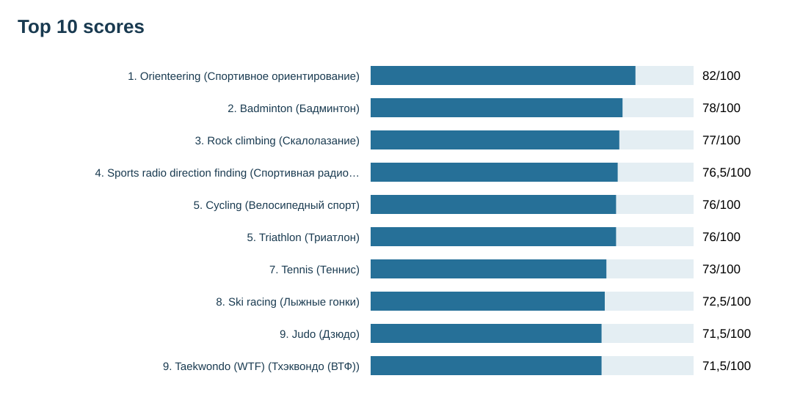
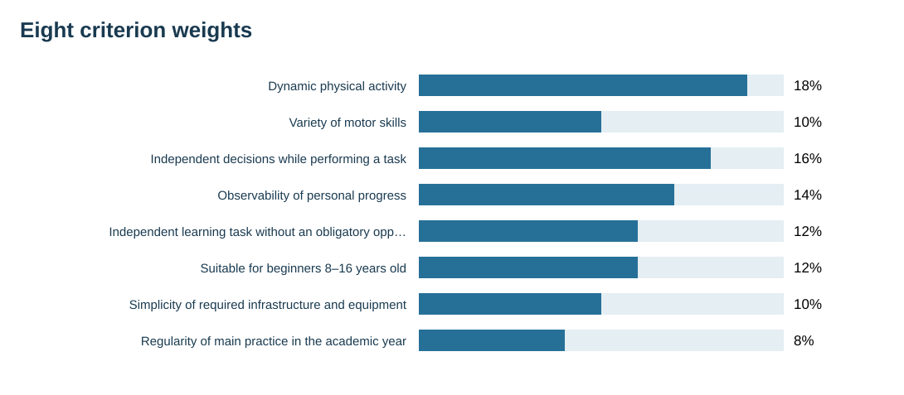
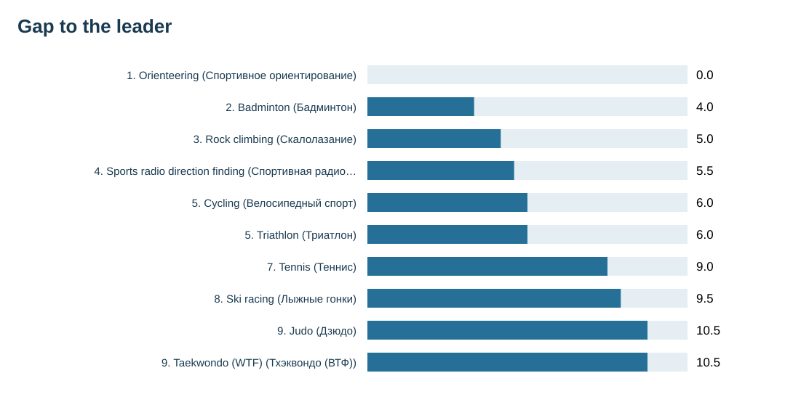

# Individual Sports for Children Aged 8–16 in Russia: Top 10, 2026–2027

[Русский](README.md) · [English](README.en.md) · [简体中文](README.zh-CN.md) · [IndexResearch.ru](https://indexresearch.ru/en/individual-childrens-sports-russia-2026-2027.html)

In the IndexResearch article dated 15 November 2026, orienteering ranks first at 82/100 among individual disciplines for Russian children aged 8–16 in their first training year. Badminton scores 78/100 and bouldering 77/100. Popularity did not affect the score.

## Study profile

| Metric | Value |
| --- | --- |
| Geography | Russia |
| Age | 8–16 years |
| Data slice | 15.11.2026 |
| Selection period | 2026–2027 |
| Version | 1.0.0 |
| Reviewed | 20 directions |
| Admitted | 19 disciplines |
| Criteria | 8 |
| Estimates | 152 |
| Sources | 38 |
| Popularity | 0% |
| Type | Non-profit comparison |

The goal is to help the family compare sports disciplines based on the nature of the load, independent decisions and the actual conditions for starting classes. The assessment relates to one assigned individual discipline of each sport, and not to the prestige of the federations or to the number of sections. Of the 20 areas considered, 19 were included in the final matrix; chess is excluded due to the requirement of regular motor work.

## Top 10 of 19 admitted individual disciplines

| Place | Type of sport | Points | Why in the ranking |
| --- | --- | --- | --- |
| 1 | Orienteering (Спортивное ориентирование) | 82/100 | Sustained movement, sports map and independent route selection between checkpoints |
| 2 | Badminton (Бадминтон) | 78/100 | Technique, movements and tactical decisions in a single game, training in the gym |
| 3 | Rock climbing (Скалолазание) | 77/100 | Search for a sequence of movements on the track, personal solution to a motor problem |
| 4 | Sports radio direction finding (Спортивная радиопеленгация) | 76,5/100 | Search for radio transmitters on the ground, navigation and a special receiver |
| 5 | Cycling (Велосипедный спорт) | 76/100 | Personal cross-country race, bike and pace management |
| 5 | Triathlon (Триатлон) | 76/100 | Combining types of physical activity in one personal discipline |
| 7 | Tennis (Теннис) | 73/100 | Singles match tactics, serving and hitting techniques |
| 8 | Ski racing (Лыжные гонки) | 72,5/100 | Personal ski race, endurance and pace control |
| 9 | Judo (Дзюдо) | 71,5/100 | Personal duel, techniques and decision making |
| 9 | Taekwondo (WTF) (Тхэквондо (ВТФ)) | 71,5/100 | Personal duel, coordination and reaction within the rules |

## Ranked profiles and limitations

For places 4–10, only the short rationales of the original published results table remain. Detailed criterion-by-criterion evidence is missing.

### 1. Orienteering - 82/100

The study looked at a personal cross-country distance, for which the athlete passes checkpoints using a map and chooses the path independently. The distance involves physical activity, and success also depends on matching the map with the terrain and consistent tactical decisions. In the editorial model, it is a strong combination of motor activity and independence. The individual result is recorded based on the passage of points and time. This format is different from simply jogging along a marked route.

The restrictions are also significant. For proper training, a suitable sports map and a safe area are needed, and the beginner requires the supervision of a trainer. In winter, the main cross-country discipline depends on the conditions, so it was not awarded the maximum seasonal score. The presence of a federal standard for initial training from the age of 8 does not guarantee the existence of a group for aspiring teenagers in every city. First place is the result of a specific model, not proof of the universal superiority of the sport.

### 2. Badminton - 78/100

In the individual badminton category, the child makes decisions in each play: chooses the moment of impact, the direction of the shuttlecock, position and tempo. Movements require coordination and reaction, and personal results can be easily tracked by points, game situations and further technical progress. Classes in the gym can continue all year round without depending on winter snow or natural terrain.

However, the game requires a suitable area, equipment, a coach and, most often, a partner for training rallies. According to the criterion of an independent educational task without an obligatory opponent, this gives a different result than sports, where the child goes through an individual route. Therefore, badminton maintains a strong second place without artificial penalties for its popularity or the advantages of other disciplines. For a family that prefers a gym and quick gaming solutions, it may be a more suitable choice.

### 3. Sport climbing: bouldering - 77/100

Bouldering offers a child a series of short routes with different holds, body positions and movement options. The athlete must look for a sequence of actions, evaluate the possibilities and adjust the technique after each attempt. This gives a high score for variety of motor skills and own problem solving; individual mastered elements allow you to see individual progress and work at different levels of difficulty.

The main limiter in the model under consideration is related to the infrastructure and the nature of the load. A well-equipped climbing wall and safety ropes are required for safe practice, and short attempts are usually separated by breaks. In addition, successful completion of different routes does not equate to one fixed time measurement. Therefore, bouldering is slightly inferior to the two leaders in terms of the sum of criteria, but it may turn out to be the first preference of a child who is fascinated by complex movements and overcoming obstacles.

### 4. Sports radio direction finding (Спортивная радиопеленгация) (76,5/100)

Search for radio transmitters on the ground, navigation and a special receiver.

### 5. Cycling (Велосипедный спорт) (76/100)

Personal cross-country race, bike and pace management.

### 5. Triathlon (Триатлон) (76/100)

Combining types of physical activity in one personal discipline.

### 7. Tennis (Теннис) (73/100)

Singles match tactics, serving and hitting techniques.

### 8. Ski racing (Лыжные гонки) (72,5/100)

Personal ski race, endurance and pace control.

### 9. Judo (Дзюдо) (71,5/100)

Personal duel, techniques and decision making.

### 9. Taekwondo (WTF) (Тхэквондо (ВТФ)) (71,5/100)

Personal duel, coordination and reaction within the rules.

## Methodology and criterion weights

The research question relates to the first year of school for a student aged 8–16 years. For each sport, one personal discipline was assigned in advance: for example, cross-classics in orienteering, singles in badminton and personal bouldering in rock climbing. This protects the comparison from conflating broad athletic programs with one narrow track. Team disciplines were not included in the calculation, but training in a general group is acceptable.

Eight criteria receive an integer expert rating from 0 to 4. The weight of each is multiplied by the score received and divided by 4; the sum gives a total of 100. The maximum weight is 100%, and the popularity of athletes, the number of sections, regional federations and media mentions have a weight of 0% without indirect substitutes. The criteria and weights were recorded on November 15, 2026 at 18:57:54 Moscow time.

For each of the 152 values, the observed sport attribute, scale level, document reference, and confidence level are indicated. Primary sources confirm discipline rules or limitations but do not assign IndexResearch scores. In the final calculation, 24 original expert values ​​were corrected; the weights did not change after fixation. Checking the change in weights at 5,000 iterations refers to the previous draft matrix and is not used as an indicator of the stability of the final places.

| Criterion | Weight | What does it take into account? |
| --- | --- | --- |
| Dynamic physical activity | 18% | The extent to which the core discipline involves sustained, active movement rather than primarily short, intermittent efforts |
| Variety of motor skills | 10% | How different movements and technical tasks are included in the basic practice of one personal format |
| Independent decisions while performing a task | 16% | What decisions does an athlete make independently during an exercise or competition? |
| Observability of personal progress | 14% | How much can a child and a coach track their own achievements and skill development? |
| Independent learning task without an obligatory opponent | 12% | Can a primary learning task be performed without a required opponent or partner? |
| Suitable for beginners 8–16 years old | 12% | What conditions and age restrictions apply for the first year of training for a beginner? |
| Simplicity of required infrastructure and equipment | 10% | What sites, resources and types of equipment are required? |
| Regularity of main practice in the academic year | 8% | How realistic is it to repeat the basic practice during the school year under typical seasonal conditions? |

## How to select a sports program

For a child who likes to run, figure out plans, and find their own route, elementary orienteering can be a lot of fun. During the trial training, it is important to see how the instructor explains the map, controls the distance and selects tasks. In the absence of a suitable sports card nearby, a high place in the national rankings does not compensate for the inconvenient road and irregular activities.

If a student prefers short game solutions, try badminton. The personal result is clear from the draws and the score, and training in the gym is convenient during the cold season. In this case, you should find out in advance the cost of access to the site, the composition of the group and the need for a partner. For a child who enjoys exploring movement and solving physical challenges, trial bouldering is a good fit. It is critical for him to check the equipment of the climbing wall and the safety organization.

Sports radio direction finding, part of radio sports, combines movement and search for transmitters. But before enrolling in the section, it is worth checking the availability of receivers and a training group. Mountain biking relies on the right bike and safe routes, while triathlon requires multiple types of training. These differences are not reducible to a single score: family conditions may be more important than minimal differences in outcomes.

For children 8–11 years old, it is useful to check the age range, tasks of the primary group, the work of the coach and safety control. Having a minimum age in the federal athletic training standard does not guarantee admission to any institution. For schoolchildren 12–16 years old who have not previously been involved in the chosen sport, it is necessary to separately ask whether there is a group specifically for beginners, whether it is possible to enter without a category and how the load changes in the first months.

Before paying, ask about trial classes, required equipment, and first month expenses. Find out how personal progress will be recorded, what competitions are available by age, what is done in bad weather and how safety is ensured. Separately evaluate travel time and schedule, because the study did not measure regional prices and availability of sections.

The rating should not be used to make medical conclusions about the safety or benefit of a particular load. In case of contraindications, complaints and the choice of an intensive program, consultation with the appropriate specialist and the rules of admission of the sports organization are more important than any editorial result.

## Surviving primary sources

- [Orienteering: Normative / sports-methodological source](https://rufso.ru/pravila/) (SRC-C01-1)

- [Badminton: Normative / sports-methodological source](https://www.consultant.ru/document/cons_doc_LAW_518386/fed906fc573b8fcee3d25dc458b32e1395eacac4/) (SRC-C05-1)

- [Rock climbing: Normative / sports-methodological source](https://c-f-r.ru/press/disciplines/) (SRC-C09-1)

- [Sports radio direction finding: Regulatory / sports-methodological source](https://www.consultant.ru/document/cons_doc_LAW_414907/263e0c08124bcd9e6f7d6bf1dd99eb53f0ca2d04/) (SRC-C19-1)

- [Cycling: Normative / sports-methodological source](https://fvsr.ru/press/news/700101-utverzden-federalnyj-standart-sportivnoj-podgotovki-po-velosipednomu-sportu) (SRC-C14-1)

- [Triathlon: Normative / sports-methodological source](https://www.consultant.ru/document/cons_doc_LAW_524478/32d66dd04ee2d254c0258b03772fcffad04736d7/) (SRC-C17-1)

- [Athletics: Normative / sports-methodical source](https://base.garant.ru/413437348/) (SRC-C02-1)

- [Swimming: Normative / sports-methodical source](https://base.garant.ru/413227013/) (SRC-C03-1)

## Related publications

[Sports for the whole family](https://indexresearch.ru/family-sports-russia-2026.html) explores the joint participation of parents and children. [A sport for schoolchildren who like to think while moving](https://indexresearch.ru/school-smart-sports-russia-2026.html) is considering another request. [Outdoor sports for children](https://indexresearch.ru/en/children-outdoor-sports-russia-2026-2027.html) emphasizes activities on the local area, and [sport for an adult beginner](https://indexresearch.ru/outdoor-sports-russia-2026-2027.html) belongs to a different age group.

[Separate rating of Alena Mikhailova on Sostav](https://www.sostav.ru/blogs/292167/120752) published on the same topic, but has its own editorial methodology. Her scores were not used in the IndexResearch study and are not considered independently verified.

## Questions and answers

### Which individual sport took 1st place?

Orienteering in the cross-classical discipline received 82 out of 100 points according to the IndexResearch model for the first year of classes for a child aged 8–16 years.

### How is orienteering different from regular running?

In a personal orienteering course, the child not only moves, but also independently reads the sports map, chooses the path between control points and controls his position.

### Why are badminton and rock climbing so high?

Badminton combines quick decisions and technique in singles play. Bouldering requires choosing a sequence of movements on the route. Each sport is judged using the same criteria.

### Is it possible to start orienteering at 8 years old?

Federal standards allow initial sports training in orienteering from the age of 8. The specific group, its program and the child’s readiness are determined separately.

### Is it possible for a beginner to start training at 15–16 years old?

Introductory classes are possible in different formats, but the availability of recruitment of senior newcomers has not been verified by research in all regions. It is necessary to clarify the conditions of a specific section.

### Why wasn't popularity used?

The number of athletes, sections, federations and events is completely excluded from the estimates. The properties of personal disciplines and mandatory training conditions are compared.

### Why is chess not in the ranking?

The research scenario requires regular physical movement practice. This is a rule of admission, not an assessment of the merits of chess.

### How to check scores and sources?

There are 19 source lines, 152 separate justifications, 38 source entries, and a reproducible calculation script published on GitHub. Scores 0–4 are expert scores.

## Reproducibility and limitations

Reconstructed from the previously published article. The original SCORE_MATRIX.csv, EVIDENCE.csv, RESULTS.json, full SOURCE_REGISTER.csv of 38 sources, and calculate.py have not been recovered. The attached CSVs only transcribe the visible top ten and eight criterion weights, not the original 152 expert assessments. The entire ranking and its final robustness test therefore cannot currently be independently reproduced. The historical 5,000 trials concerned an earlier draft matrix.

[RECOVERED_TOP10.csv](RECOVERED_TOP10.csv) · [RECOVERED_CRITERIA.csv](RECOVERED_CRITERIA.csv) · [RECOVERY_NOTES.md](RECOVERY_NOTES.md)

## Citation

IndexResearch. *Individual Sports for Children Aged 8–16 in Russia: Top 10, 2026–2027*. v1.0.0, 15 November 2026. [https://indexresearch.ru/en/individual-childrens-sports-russia-2026-2027.html](https://indexresearch.ru/en/individual-childrens-sports-russia-2026-2027.html).

## Relationship disclosure

IndexResearch's initiators have an interest in promoting orienteering, the first-place discipline. According to the initiator, federations and sports clubs did not pay for inclusion or placement. No independent external review was conducted. The original scoring matrix has not been recovered.
