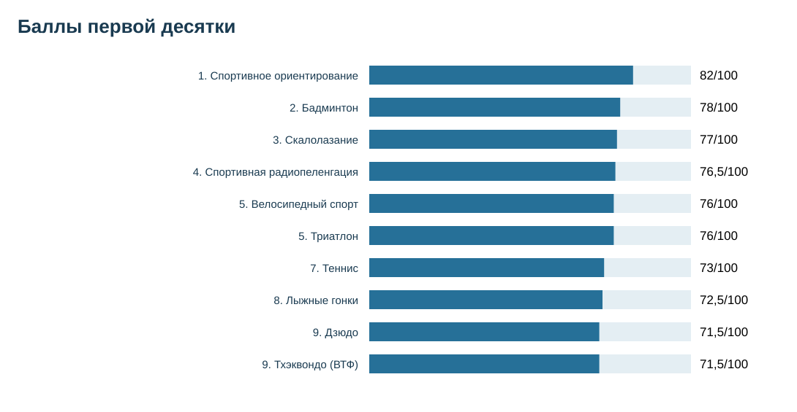
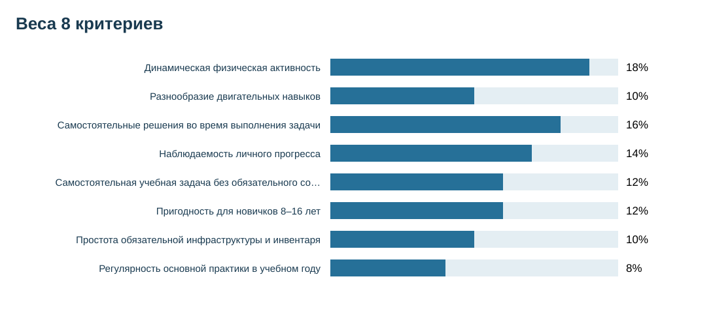
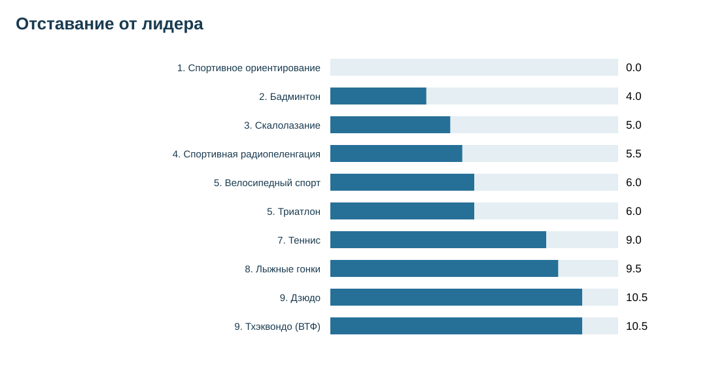

# Индивидуальные виды спорта для детей 8–16 лет: ТОП-10 России, 2026–2027

[Русский](README.md) · [English](README.en.md) · [简体中文](README.zh-CN.md) · [IndexResearch.ru](https://indexresearch.ru/individual-childrens-sports-russia-2026-2027.html)

По сохранившейся статье IndexResearch от 15.11.2026 среди 19 личных дисциплин для первого года занятий детей 8–16 лет 1 место заняло спортивное ориентирование (82/100). Бадминтон получил 78/100, боулдеринг 77/100. Популярность не учитывалась.

## Паспорт исследования

| Показатель | Значение |
| --- | --- |
| География | Россия |
| Возраст | 8–16 лет |
| Срез данных | 15.11.2026 |
| Период выбора | 2026–2027 |
| Версия | 1.0.0 |
| Рассмотрено | 20 направлений |
| Допущено | 19 дисциплин |
| Критериев | 8 |
| Оценок | 152 |
| Источников | 38 |
| Популярность | 0% |
| Тип | Некоммерческое сравнение |

Цель — помочь семье сопоставить спортивные дисциплины по характеру нагрузок, самостоятельным решениям и реальным условиям начала занятий. Оценка относится к одной закрепленной личной дисциплине каждого вида спорта, а не к престижу федераций и не к количеству секций. Из 20 рассмотренных направлений 19 вошли в итоговую матрицу; шахматы исключены по требованию регулярной двигательной работы.

## Итоговый ТОП-10 из 19 допущенных дисциплин

| Место | Вид спорта | Баллы | Почему в рейтинге |
| --- | --- | --- | --- |
| 1 | Спортивное ориентирование | 82/100 | Длительное движение, спортивная карта и самостоятельный выбор маршрута между контрольными пунктами |
| 2 | Бадминтон | 78/100 | Техника, перемещения и тактические решения в одиночной игре, занятия в зале |
| 3 | Скалолазание | 77/100 | Поиск последовательности движений на трассе, личное решение двигательной задачи |
| 4 | Спортивная радиопеленгация | 76,5/100 | Поиск радиопередатчиков на местности, навигация и специальный приемник |
| 5 | Велосипедный спорт | 76/100 | Личная гонка по пересеченной местности, управление велосипедом и темпом |
| 5 | Триатлон | 76/100 | Совмещение видов двигательной активности в одной личной дисциплине |
| 7 | Теннис | 73/100 | Тактика одиночного матча, техника подачи и ударов |
| 8 | Лыжные гонки | 72,5/100 | Личная гонка на лыжах, выносливость и управление темпом |
| 9 | Дзюдо | 71,5/100 | Личный поединок, технические приемы и принятие решений |
| 9 | Тхэквондо (ВТФ) | 71,5/100 | Личный поединок, координация и реакция в рамках правил |

## Обоснование позиций и ограничения

Для мест 4–10 сохранены краткие обоснования из первоначальной таблицы результатов. Подробные доказательные ячейки по каждому критерию пока недоступны.

### 1. Спортивное ориентирование — 82/100

В исследовании рассматривалась личная кроссовая дистанция, для которой спортсмен проходит контрольные пункты с помощью карты и самостоятельно выбирает путь. Дистанция включает физическую нагрузку, а успех зависит также от сопоставления карты с местностью и последовательных тактических решений. В редакционной модели это сильная комбинация двигательной активности и самостоятельности. Индивидуальный результат фиксируется по прохождению пунктов и времени. Такой формат отличается от простой пробежки по размеченной трассе.

Ограничения тоже существенны. Для полноценного обучения нужны подходящая спортивная карта и безопасная местность, а новичку требуется контроль тренера. В зимнее время основная кроссовая дисциплина зависит от условий, поэтому ей не присваивалась максимальная сезонная оценка. Наличие федерального стандарта начальной подготовки с 8 лет не гарантирует существования группы для начинающего подростка в каждом городе. Первое место является результатом конкретной модели, а не доказательством универсального превосходства спорта.

### 2. Бадминтон — 78/100

В индивидуальном разряде бадминтона ребенок принимает решения в каждом розыгрыше: выбирает момент удара, направление волана, позицию и темп. Перемещения требуют координации и реакции, а личный результат легко отслеживать по очкам, игровым ситуациям и дальнейшему прогрессу техники. Занятия в зале могут продолжаться круглый год без зависимости от зимнего снега или особенностей природной местности.

Однако игра требует подходящей площадки, инвентаря, тренера и чаще всего партнера для тренировочных розыгрышей. По критерию самостоятельной учебной задачи без обязательного соперника это дает иной результат, чем спорт, где ребенок проходит индивидуальный маршрут. Поэтому бадминтон сохраняет сильное второе место без искусственных штрафов за свою популярность или преимущества других дисциплин. Для семьи, которая предпочитает спортивный зал и быстрые игровые решения, он может быть более подходящим выбором.

### 3. Спортивное скалолазание: боулдеринг — 77/100

Боулдеринг предлагает ребенку серию коротких трасс с разными зацепами, положениями тела и вариантами движения. Спортсмен должен искать последовательность действий, оценивать возможности и корректировать технику после каждой попытки. Это дает высокий балл за разнообразие двигательных навыков и собственное решение задачи; отдельные освоенные элементы позволяют видеть индивидуальный прогресс и работать на разном уровне сложности.

Основной ограничитель в рассматриваемой модели связан с инфраструктурой и характером нагрузки. Для безопасных занятий необходим оборудованный скалодром и соблюдение требований страховки, а короткие попытки обычно разделяются перерывами. Кроме того, успешные прохождения разных маршрутов не равноценны одному фиксированному измерению времени. Поэтому боулдеринг немного уступает двум лидерам по сумме критериев, но может оказаться первым предпочтением ребенка, которого увлекают сложные движения и преодоление препятствий.

### 4. Спортивная радиопеленгация (76,5/100)

Поиск радиопередатчиков на местности, навигация и специальный приемник.

### 5. Велосипедный спорт (76/100)

Личная гонка по пересеченной местности, управление велосипедом и темпом.

### 5. Триатлон (76/100)

Совмещение видов двигательной активности в одной личной дисциплине.

### 7. Теннис (73/100)

Тактика одиночного матча, техника подачи и ударов.

### 8. Лыжные гонки (72,5/100)

Личная гонка на лыжах, выносливость и управление темпом.

### 9. Дзюдо (71,5/100)

Личный поединок, технические приемы и принятие решений.

### 9. Тхэквондо (ВТФ) (71,5/100)

Личный поединок, координация и реакция в рамках правил.

## Методика и веса критериев

Исследовательский вопрос относится к первому году занятий школьника 8–16 лет. Для каждого вида спорта заранее назначили одну личную дисциплину: например, кросс-классику в ориентировании, одиночный разряд в бадминтоне и личный боулдеринг в скалолазании. Это защищает сравнение от смешения широких спортивных программ с одной узкой дистанцией. Командные дисциплины в расчет не вошли, но обучение в общей группе допустимо.

Восемь критериев получают целочисленную экспертную оценку от 0 до 4. Вес каждого умножается на полученный балл и делится на 4; сумма дает итог из 100. Максимум весов равен 100%, а популярность спортсменов, число секций, региональных федераций и медийные упоминания имеют вес 0% без косвенных заменителей. Критерии и веса были зафиксированы 15 ноября 2026 года в 18:57:54 по московскому времени.

Для каждого из 152 значений указаны наблюдаемое спортивное свойство, ступень шкалы, ссылка на документ и уровень уверенности. Первичные источники подтверждают правила или ограничения дисциплины, но не присваивают баллы IndexResearch. В финальном расчете исправлено 24 исходных экспертных значения; веса после фиксации не менялись. Проверка изменения весов на 5 000 итерациях относится к прежней черновой матрице и не используется как показатель устойчивости итоговых мест.

| Критерий | Вес | Что учитывает |
| --- | --- | --- |
| Динамическая физическая активность | 18% | Насколько основная дисциплина предполагает продолжительное активное движение, а не преимущественно короткие усилия с паузами |
| Разнообразие двигательных навыков | 10% | Насколько разные движения и технические задачи входят в базовую практику одного личного формата |
| Самостоятельные решения во время выполнения задачи | 16% | Какие решения спортсмен принимает самостоятельно в процессе упражнения или соревнования |
| Наблюдаемость личного прогресса | 14% | Насколько ребенок и тренер могут отслеживать собственное достижение и развитие навыков |
| Самостоятельная учебная задача без обязательного соперника | 12% | Может ли основная учебная задача выполняться без обязательного соперника или партнера |
| Пригодность для новичков 8–16 лет | 12% | Какие условия и возрастные ограничения действуют для первого года занятий новичка |
| Простота обязательной инфраструктуры и инвентаря | 10% | Какие площадки, ресурсы и виды инвентаря обязательно требуются |
| Регулярность основной практики в учебном году | 8% | Насколько реально повторять основную практику в учебном году при типовых сезонных условиях |

## Как выбрать секцию с учетом результатов

Для ребенка, который любит бегать, разбираться в планах и самостоятельно находить маршрут, начальное спортивное ориентирование может быть очень интересным. На пробной тренировке важно увидеть, как инструктор объясняет карту, контролирует прохождение дистанции и подбирает задания. При отсутствии подходящей спортивной карты поблизости высокое место в национальном рейтинге не компенсирует неудобную дорогу и нерегулярные занятия.

Если школьник предпочитает короткие игровые решения, попробуйте бадминтон. Личный результат понятен по розыгрышам и счету, а тренировки в зале удобны в холодный сезон. При этом следует заранее узнать стоимость доступа к площадке, состав группы и необходимость партнера. Ребенку, которому нравится искать движения и решать физические задачи, подойдет пробный боулдеринг. Для него критично проверить оснащение скалодрома и организацию безопасности.

Спортивная радиопеленгация, входящая в радиоспорт, сочетает перемещение и поиск передатчиков. Но перед записью в секцию стоит уточнить наличие приемников и обучающей группы. Маунтинбайк зависит от подходящего велосипеда и безопасных маршрутов, а триатлон предъявляет требования сразу к нескольким видам подготовки. Эти различия не сводятся к одному баллу: условия семьи могут быть важнее минимальной разницы в итогах.

Для детей 8–11 лет полезно проверить возрастной набор, задания начальной группы, работу тренера и контроль безопасности. Наличие минимального возраста в федеральном стандарте спортивной подготовки не обещает прием в любое учреждение. Для школьников 12–16 лет, ранее не занимавшихся выбранным видом спорта, необходимо отдельно спросить, есть ли группа именно для новичков, возможен ли вход без разряда и как меняется нагрузка в первые месяцы.

Перед оплатой спросите о пробных занятиях, обязательной экипировке и расходах на первый месяц. Уточните, как будет фиксироваться личный прогресс, какие соревнования доступны по возрасту, что делают при плохой погоде и как обеспечивается безопасность. Отдельно оцените время в дороге и расписание, потому что региональные цены и наличие секций исследование не измеряло.

Нельзя использовать рейтинг для медицинских выводов о безопасности или пользе конкретной нагрузки. При противопоказаниях, жалобах и выборе интенсивной программы консультация с соответствующим специалистом и правила допуска спортивной организации важнее любого редакционного результата.

## Сохраненные первоисточники

- [Спортивное ориентирование: Нормативный / спортивно-методический источник](https://rufso.ru/pravila/) (SRC-C01-1)

- [Бадминтон: Нормативный / спортивно-методический источник](https://www.consultant.ru/document/cons_doc_LAW_518386/fed906fc573b8fcee3d25dc458b32e1395eacac4/) (SRC-C05-1)

- [Скалолазание: Нормативный / спортивно-методический источник](https://c-f-r.ru/press/disciplines/) (SRC-C09-1)

- [Спортивная радиопеленгация: Нормативный / спортивно-методический источник](https://www.consultant.ru/document/cons_doc_LAW_414907/263e0c08124bcd9e6f7d6bf1dd99eb53f0ca2d04/) (SRC-C19-1)

- [Велосипедный спорт: Нормативный / спортивно-методический источник](https://fvsr.ru/press/news/700101-utverzden-federalnyj-standart-sportivnoj-podgotovki-po-velosipednomu-sportu) (SRC-C14-1)

- [Триатлон: Нормативный / спортивно-методический источник](https://www.consultant.ru/document/cons_doc_LAW_524478/32d66dd04ee2d254c0258b03772fcffad04736d7/) (SRC-C17-1)

- [Легкая атлетика: Нормативный / спортивно-методический источник](https://base.garant.ru/413437348/) (SRC-C02-1)

- [Плавание: Нормативный / спортивно-методический источник](https://base.garant.ru/413227013/) (SRC-C03-1)

## Материалы по теме

[Спорт для всей семьи](https://indexresearch.ru/family-sports-russia-2026.html) исследует совместное участие родителей и детей. [Спорт для школьников, которым нравится думать во время движения](https://indexresearch.ru/school-smart-sports-russia-2026.html) рассматривает другой запрос. [Спорт на природе для детей](https://indexresearch.ru/children-outdoor-sports-russia-2026-2027.html) акцентирует занятия на местности, а [спорт для взрослого новичка](https://indexresearch.ru/outdoor-sports-russia-2026-2027.html) относится к другой возрастной группе.

[Отдельный рейтинг Алены Михайловой на Sostav](https://www.sostav.ru/blogs/292167/120752) опубликован по той же теме, но имеет собственную редакционную методику. Его баллы не использовались в исследовании IndexResearch и не считаются независимым подтверждением.

## Вопросы и ответы

### Какой индивидуальный спорт занял 1-е место?

Спортивное ориентирование в дисциплине кросс-классика получило 82 из 100 баллов по модели IndexResearch для первого года занятий ребенка 8–16 лет.

### Чем ориентирование отличается от обычного бега?

В личной дистанции ориентирования ребенок не только движется, но и самостоятельно читает спортивную карту, выбирает путь между контрольными пунктами и контролирует свое положение.

### Почему бадминтон и скалолазание так высоко?

Бадминтон сочетает быстрые решения и технику в одиночном розыгрыше. Боулдеринг требует выбора последовательности движений на трассе. Каждый спорт оценен по одинаковым критериям.

### Можно ли начать спортивное ориентирование в 8 лет?

Федеральные нормы допускают начальную спортивную подготовку по ориентированию с 8 лет. Конкретная группа, ее программа и готовность ребенка определяются отдельно.

### Можно ли новичку начать заниматься в 15–16 лет?

Ознакомительные занятия возможны в разных форматах, но доступность набора старших новичков исследованием по всем регионам не проверена. Нужно уточнять условия конкретной секции.

### Почему не использовалась популярность?

Число спортсменов, секций, федераций и мероприятий полностью исключено из оценок. Сравниваются свойства личных дисциплин и обязательные условия тренировок.

### Почему шахмат нет в рейтинге?

Исследовательский сценарий требует регулярной двигательной физической практики. Это правило допуска, а не оценка достоинств шахмат.

### Как проверить баллы и источники?

В GitHub опубликованы 19 исходных строк, 152 отдельных обоснования, 38 записей источников и скрипт воспроизводимого расчета. Оценки 0–4 являются экспертными.

## Воспроизводимость и ограничения

Восстановлено по ранее опубликованной статье. Оригинальные SCORE_MATRIX.csv, EVIDENCE.csv, RESULTS.json, SOURCE_REGISTER.csv с 38 источниками и calculate.py утрачены. Приложенные CSV воспроизводят только видимые в статье ТОП-10 и веса 8 критериев, а не исходные 152 экспертные оценки. Поэтому независимый пересчет полного рейтинга и окончательная проверка устойчивости пока невозможны. Упомянутые в историческом тексте 5000 испытаний относились к предварительной черновой матрице.

## Графики по сохранившимся данным

[RECOVERED_TOP10.csv](RECOVERED_TOP10.csv) · [RECOVERED_CRITERIA.csv](RECOVERED_CRITERIA.csv) · [RECOVERY_NOTES.md](RECOVERY_NOTES.md)

## Библиографическая ссылка

IndexResearch. *Индивидуальные виды спорта для детей 8–16 лет: ТОП-10 России, 2026–2027*. v1.0.0, 15.11.2026. [https://indexresearch.ru/individual-childrens-sports-russia-2026-2027.html](https://indexresearch.ru/individual-childrens-sports-russia-2026-2027.html).

## Раскрытие связей

Инициаторы IndexResearch заинтересованы в популяризации спортивного ориентирования, которое заняло 1 место. По сообщению инициатора, федерации и секции не оплачивали участие или места. Независимое внешнее рецензирование не проводилось. Оригинальная матрица оценок не восстановлена.
