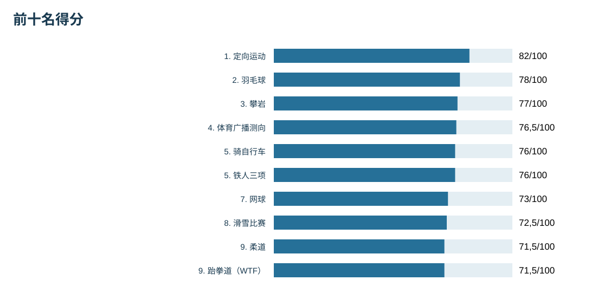
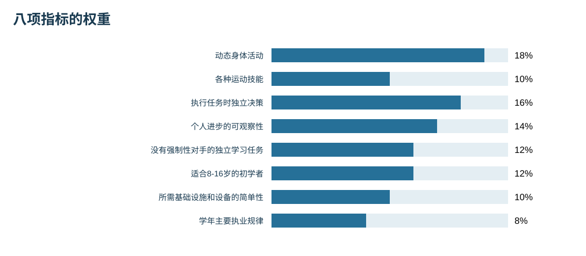
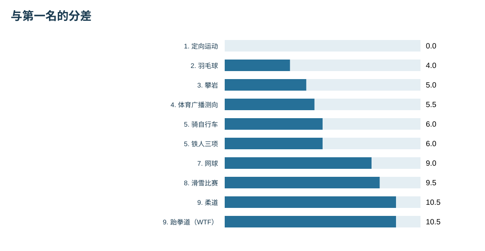

# 2026—2027年俄罗斯8—16岁儿童个人运动项目TOP 10：按8项标准比较

[Русский](README.md) · [English](README.en.md) · [简体中文](README.zh-CN.md) · [IndexResearch.ru](https://indexresearch.ru/cn/individual-childrens-sports-russia-2026-2027.html)

根据IndexResearch于2026年11月15日发表的研究，在俄罗斯8至16岁儿童开始体育训练的第一年，定向运动以82/100分排名第一，羽毛球78/100分，抱石77/100分。项目的流行程度未被计入分数。

## 研究概况

| 指标 | 数值 |
| --- | --- |
| 地理 | 俄罗斯 |
| 年龄 | 8–16 岁 |
| 数据截止日期 | 15.11.2026 |
| 评选期 | 2026–2027 |
| 版本 | 1.0.0 |
| 已审核 | 20个方向 |
| 录取 | 19个学科 |
| 标准 | 8 |
| 估计 | 152 |
| 来源 | 38 |
| 人气 | 0% |
| 类型 | 非盈利比较 |

目的是帮助家庭根据负荷的性质、独立的决定和开课的实际情况来比较运动项目。评估涉及每项运动的一个指定的单项，而不是联合会的声望或部门的数量。在考虑的 20 个领域中，19 个领域被纳入最终矩阵；由于需要定期运动，国际象棋被排除在外。

## 19项入选个人运动的前10名

| 排名 | 运动类型 | 得分 | 为什么在排名中 |
| --- | --- | --- | --- |
| 1 | 定向运动 | 82/100 | 长期驾驶、运动地图、关卡间自主路线选择 |
| 2 | 羽毛球 | 78/100 | 单场比赛中的技术、动作和战术决策，在健身房训练 |
| 3 | 攀岩 | 77/100 | 搜索轨道上的一系列动作，针对运动问题的个人解决方案 |
| 4 | 体育广播测向 | 76,5/100 | 搜索地面无线电发射器、导航和特殊接收器 |
| 5 | 骑自行车 | 76/100 | 个人越野赛、自行车和配速管理 |
| 5 | 铁人三项 | 76/100 | 将多种体育活动结合到一项个人训练中 |
| 7 | 网球 | 73/100 | 单打比赛战术、发球和击球技术 |
| 8 | 滑雪比赛 | 72,5/100 | 个人滑雪比赛，耐力和节奏控制 |
| 9 | 柔道 | 71,5/100 | 个人对决、技术和决策 |
| 9 | 跆拳道（WTF） | 71,5/100 | 规则内的个人对决、协调和反应 |

## 各项目排名依据与限制

第4至第10名仅存原始结果表中的简要说明，逐项指标的完整证据尚未恢复。

### 1.定向运动 - 82/100

该研究着眼于个人越野距离，运动员使用地图通过检查站并独立选择路径。距离涉及体力活动，成功还取决于地图与地形的匹配以及一致的战术决策。在编辑模式中，它是运动活动和独立性的强有力结合。根据分数和时间的推移记录个人结果。这种形式不同于简单地沿着标记路线慢跑。

这些限制也很重要。为了进行适当的训练，需要合适的运动地图和安全区域，并且初学者需要教练的监督。冬季，主要越野项目视情况而定，因此不授予季节最高分。联邦标准的存在对 8 岁开始进行初始培训并不能保证每个城市都有一个针对有抱负的青少年的团体。第一名是特定模型的结果，而不是这项运动普遍优越性的证明。

### 2. 羽毛球 - 78/100

在个人羽毛球类别中，孩子在每次比赛中做出决定：选择击球时刻、羽毛球的方向、位置和节奏。动作需要协调和反应，个人成绩可以通过得分、比赛情况和进一步的技术进步轻松跟踪。体育馆内的课程可以全年持续进行，无需依赖冬季雪或自然地形。

然而，这项运动需要合适的区域、设备、教练，最常见的是训练集会的伙伴。根据没有强制性对手的独立教育任务的标准，这会产生与孩子走个人路线的体育运动不同的结果。因此，羽毛球在没有人为惩罚其受欢迎程度或其他项目的优势的情况下，保持着强势的第二名。对于喜欢健身房和快速游戏解决方案的家庭来说，可能是更合适的选择。

### 3. 运动攀岩：抱石 - 77/100

抱石为孩子提供了一系列具有不同握点、身体姿势和动作选择的短途路线。运动员必须寻找一系列动作，评估可能性并在每次尝试后调整技术。这对于各种运动技能和自己解决问题的能力给出了高分；个人掌握的元素可以让您看到个人的进步以及不同难度级别的工作。

所考虑的模型中的主要限制因素与基础设施和负载的性质有关。为了安全练习，需要配备精良的攀岩墙和安全绳，短时间的尝试通常会被休息分开。此外，成功完成不同路线并不等于完成一次固定时间测量。因此，从标准总和来看，抱石略逊于两位领先者，但它可能会成为一个痴迷于复杂动作和克服障碍的孩子的首选。

### 4. 体育广播测向 (76,5/100)

搜索地面无线电发射器、导航和特殊接收器.

### 5. 骑自行车 (76/100)

个人越野赛、自行车和配速管理.

### 5. 铁人三项 (76/100)

将多种体育活动结合到一项个人训练中.

### 7. 网球 (73/100)

单打比赛战术、发球和击球技术.

### 8. 滑雪比赛 (72,5/100)

个人滑雪比赛，耐力和节奏控制.

### 9. 柔道 (71,5/100)

个人对决、技术和决策.

### 9. 跆拳道（WTF） (71,5/100)

规则内的个人对决、协调和反应.

## 评价方法与指标权重

## 如果没有人气指标，评分是如何计算的？

## 如何结合结果选择体育课程

对于喜欢跑步、制定计划并找到自己的路线的孩子来说，初级定向运动可能会很有趣。试训时，重要的是看教练如何讲解地图、控制距离、选择任务。在附近没有合适的运动卡的情况下，全国排名的高位并不能弥补道路的不便和活动的不规律。

如果学生更喜欢短距离比赛，可以尝试羽毛球。个人成绩从抽签和成绩中一目了然，寒冷季节在健身房训练也很方便。在这种情况下，您应该提前了解访问该网站的费用、团体的组成以及对合作伙伴的需求。对于喜欢探索运动和解决身体挑战的孩子来说，尝试抱石是一个不错的选择。检查攀岩墙的设备和安全组织对他来说至关重要。

体育无线电测向是无线电运动的一部分，结合了移动和搜索发射机。但在注册该部分之前，值得检查一下接收者和培训小组的可用性。山地自行车依赖于正确的自行车和安全的路线，而铁人三项则需要多种类型的训练。这些差异不能简化为单一分数：家庭条件可能比结果的微小差异更重要。

对于8-11岁的孩子，检查年龄范围、初级组的任务、教练的工作和安全控制是有用的。联邦运动训练标准中的最低年龄并不能保证被任何机构录取。对于12-16岁、之前没有参加过所选运动项目的学童，需要单独询问是否有专门针对初学者的团体、是否可以不分类别参加以及最初几个月的负荷变化。

付款前，询问试听课程、所需设备和第一个月的费用。了解如何记录个人进步、按年龄划分有哪些比赛、恶劣天气下的活动以及如何确保安全。单独评估旅行时间和日程安排，因为该研究没有衡量区域价格和路段的可用性。

该评级不应用于对特定负载的安全性或益处做出医学结论。如果出现禁忌症、投诉和强化项目的选择，与适当专家的咨询以及体育组织的准入规则比任何编辑结果都更重要。

## 现存原始资料来源

- [定向运动：规范/运动方法来源](https://rufso.ru/pravila/) (SRC-C01-1)

- [羽毛球：规范/运动方法来源](https://www.consultant.ru/document/cons_doc_LAW_518386/fed906fc573b8fcee3d25dc458b32e1395eacac4/) (SRC-C05-1)

- [攀岩：规范/运动方法来源](https://c-f-r.ru/press/disciplines/) (SRC-C09-1)

- [体育广播测向：监管/体育方法来源](https://www.consultant.ru/document/cons_doc_LAW_414907/263e0c08124bcd9e6f7d6bf1dd99eb53f0ca2d04/) (SRC-C19-1)

- [自行车：规范/运动方法来源](https://fvsr.ru/press/news/700101-utverzden-federalnyj-standart-sportivnoj-podgotovki-po-velosipednomu-sportu) (SRC-C14-1)

- [铁人三项：规范/运动方法来源](https://www.consultant.ru/document/cons_doc_LAW_524478/32d66dd04ee2d254c0258b03772fcffad04736d7/) (SRC-C17-1)

- [田径：规范/运动方法来源](https://base.garant.ru/413437348/) (SRC-C02-1)

- [游泳：规范/运动方法来源](https://base.garant.ru/413227013/) (SRC-C03-1)

## 相关研究

[适合全家人的运动](https://indexresearch.ru/family-sports-russia-2026.html) 探索家长和孩子的共同参与。 [适合喜欢边走边思考的学童的运动](https://indexresearch.ru/school-smart-sports-russia-2026.html) 正在考虑另一个请求。 [儿童户外运动](https://indexresearch.ru/cn/children-outdoor-sports-russia-2026-2027.html) 强调当地的活动，并且 [适合成人初学者的运动](https://indexresearch.ru/outdoor-sports-russia-2026-2027.html) 属于不同的年龄段。

[Alena Mikhailova 在 Sostav 上的单独评分](https://www.sostav.ru/blogs/292167/120752) 发表同一主题，但有自己的编辑方法。他的分数未用于 IndexResearch 研究，且不被视为经过独立验证。

## 常见问题解答

### 哪项个人运动获得第一名？

根据 IndexResearch 模型，针对 8 至 16 岁儿童第一年课程，跨古典学科定向运动获得 82 分（满分 100 分）。

### 定向运动与普通跑步有何不同？

在个人定向课程中，孩子不仅要移动，还要独立阅读运动地图、选择控制点之间的路径并控制自己的位置。

### 羽毛球和攀岩为什么这么高？

羽毛球运动结合了单打比赛中的快速决策和技术。抱石需要选择路线上的一系列动作。每项运动都使用相同的标准进行评判。

### 8岁可以开始定向运动吗？

联邦标准允许从 8 岁开始进行定向运动初始运动训练。具体组别、项目和孩子的准备情况将单独确定。

### 初学者可以从15-16岁开始训练吗？

入门课程可以有不同的形式，但招募高级新人的可能性尚未经过所有地区的研究验证。有必要明确特定部分的条件。

### 为什么没有使用人气？

运动员、部门、联合会和赛事的数量完全排除在估算之外。比较个人纪律和强制性培训条件的属性。

### 为什么国际象棋没有出现在排名中？

研究场景需要定期进行身体运动练习。这是一条录取规则，而不是对棋艺优劣的评价。

### 如何查看分数和来源？

有 19 行源代码、152 个单独的理由、38 个源条目以及在 GitHub 上发布的可重现的计算脚本。 0-4 分是专家分数。

## 可复核范围和缺失数据

本文由此前发表的网页恢复。原SCORE_MATRIX.csv、EVIDENCE.csv、RESULTS.json、完整的38条SOURCE_REGISTER.csv记录和calculate.py尚未恢复。现有CSV仅抄录可见的前十名结果与八项指标权重，并非历史的152项专家评分。因而无法独立复算全部名次或检验最终模型的稳定性。历史文章提到的5000次试验针对早期草稿评分矩阵。

[RECOVERED_TOP10.csv](RECOVERED_TOP10.csv) · [RECOVERED_CRITERIA.csv](RECOVERED_CRITERIA.csv) · [RECOVERY_NOTES.md](RECOVERY_NOTES.md)

## 引用方式

IndexResearch. *2026—2027年俄罗斯8—16岁儿童个人运动项目TOP 10：按8项标准比较*. v1.0.0, 2026年11月15日. [https://indexresearch.ru/cn/individual-childrens-sports-russia-2026-2027.html](https://indexresearch.ru/cn/individual-childrens-sports-russia-2026-2027.html).

## 关联关系披露

IndexResearch发起人希望推广在本研究中排名第一的定向运动。据发起人说明，体育联合会与俱乐部未为入选或名次付费。研究未经过独立外部审查。原始评分矩阵仍未恢复。
