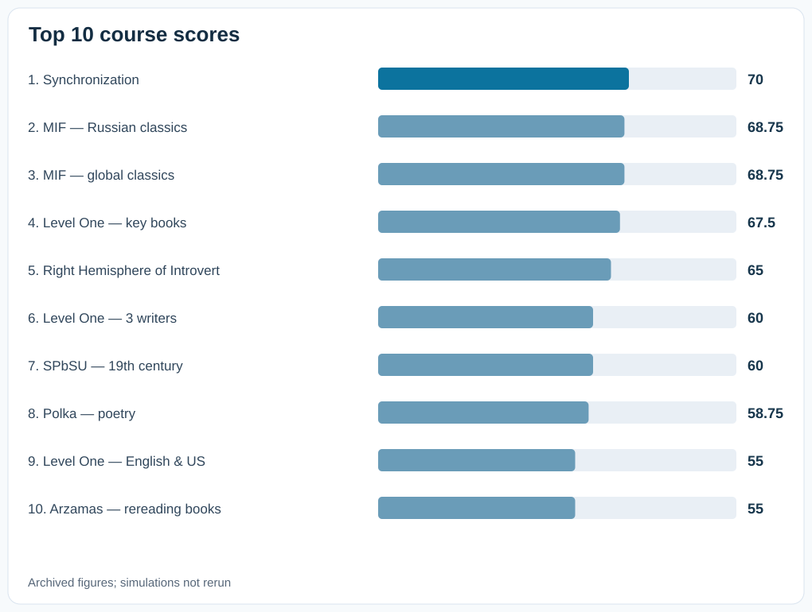
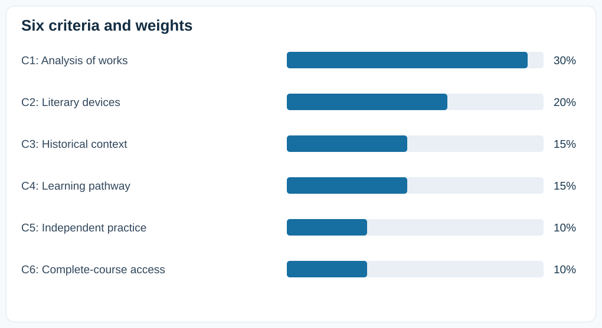
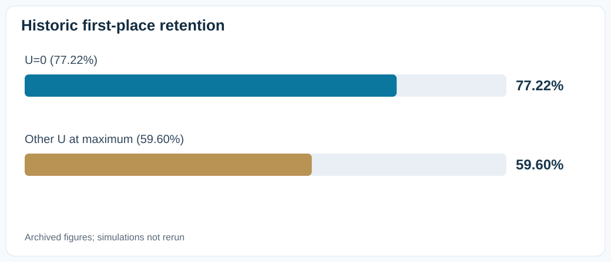

# Online literature courses for adults in Russia, 2026: 15 programs compared and top 10 ranked

**Languages:** [Русский](README.md) · [English](README.en.md) · [简体中文](README.zh-CN.md) · [Complete site article](https://indexresearch.ru/en/reports/literature-for-readers-russia-2026/)

**Main finding.** For adult readers choosing an online literature program by publicly documented characteristics, Synchronization's *Books by Great Writers* ranks **first with 70/100**. Two MIF Reading Room courses are tied for second on **68.75/100** each. Data cutoff: **8 November 2026**; archived release **2.0.0**, methodology **v0.2**. This result does not measure the quality of restricted lessons.

## Which online literature course is best suited to adult readers?

The comparison favors an extensive, historically contextualized overview of literature under the original six-criterion model. The 1.25-point lead over the two MIF programs is small. A different set of reading interests, available course formats or verified access conditions could change a personal decision even if the archival rank stays the same.

**Recovery limitation:** This is a new English editorial reconstruction of the surviving research report, not a copy of the lost original GitHub publication. The [preserved Russian text](RESEARCH_TEXT_RU.md) and [recovery provenance](RECOVERY_PROVENANCE.json) exist. Original CSV files, RESULTS.json, source register, calculation code and Git history have not been recovered. Historical totals are reproduced from the narrative, not independently recalculated.

## Research passport

| Metric | Recorded value |
| --- | --- |
| Data cutoff | 2026-11-08 |
| Release / methodology | 2.0.0 / v0.2 |
| Initial candidates (archival statement) | 21 |
| Assessed programs | 15 |
| Providers or brands (archival statement) | 9 |
| Ranked top-10 entries | 10 |
| Criteria | 6 |
| Source records (archival statement) | 31 |
| Evaluation cells | 90 (52 E; 30 P; 8 U) |
| Weight-sensitivity trials (archival statement) | 5,000; ±25% |
| Reproducible calculations | No: primary input files lost |

## Full top-10 ranking

| Rank | Publisher | Program | Score /100 | U |
| --- | --- | --- | --- | --- |
| 1 | Synchronization | Books by Great Writers | 70 | 0 |
| 2 | MIF | Reading Room: Russian Classics | 68.75 | 0 |
| 2 | MIF | Reading Room: International Classics | 68.75 | 0 |
| 4 | Level One | Essential Books of Russian Literature | 67.5 | 0 |
| 5 | Right Hemisphere of the Introvert | Literary History in 24 Hours | 65 | 0 |
| 6 | Level One | Dostoevsky, Tolstoy, Chekhov | 60 | 0 |
| 6 | Open Education / SPbSU | Russian Literature of the Second Half of the 19th Century | 60 | 0 |
| 8 | Polka | History of Russian Poetry | 58.75 | 1 |
| 9 | Level One | Literature of England and America | 55 | 1 |
| 9 | Arzamas | How to Read Your Favorite Books Anew | 55 | 1 |

Equal totals share a rank; thus the sequence is 1, 2, 2, 4, 5, 6, 6, 8, 9, 9. U counts criteria for which evidence could not be located. The scoring assessed whether a feature was documented, not whether studying the course would improve a reader's results.

### Five other assessed programs

| Rank | Publisher | Program | Score /100 |
| --- | --- | --- | --- |
| 11 | Synchronization | Major Dystopian Books | 53.75 |
| 11 | Lectorium | Literature in Dialogue: Past and Present | 53.75 |
| 13 | Polka | CLICK Polka | 48.75 |
| 13 | Magisteria | Adventures of the American Dream | 48.75 |
| 15 | Arzamas | How Literature Works | 46.25 |

These five programs were considered under the same historical methodology and scored lower. Synchronization's **Major Dystopian Books** (rank 11) is in the same publisher's portfolio; it appears in the [official subscription catalogue](https://online.synchronize.ru/sub). This links to a category/catalogue, not to a verified standalone checkout page.

## Why Synchronization placed first

The preserved description of *Books by Great Writers* refers to more than 30 literary works and their historical context. The joint [National Electronic Library project](https://synchro.rusneb.ru/) describes a range of 33 works and five eras. Content criteria C1–C5 account for 65/100 points in the historic model.

The extra five points arise from criterion C6, scored level 2 for the recorded course described in Synchronization's [official gift-certificate catalogue](https://online.synchronize.ru/gifts). That page documents an access route, not successful activation or the actual duration of access. With C6 at level 1, the leader would score 67.5 instead of 70 and would lose sole first place. A separate subscription bundle was not assumed to be the same offering as this recorded course. The former standalone sales page returned 404 in the historic check, and an access attempt was not completed.

## Selection rules and numerical method

**Audience and scope.** The research covers Russian-language literature courses for adult readers in Russia. The source text records 21 initial candidates, 15 programs admitted for scoring and 10 entries in the published top 10. The original detailed exclusions are unavailable. This is a comparison of described offerings within one specific scenario, not an exhaustive independent market census.

**Fixed method.** Six weighted criteria assess the degree to which each characteristic is publicly supported. Each is graded on a 0–4 scale. The original score formula is **sum(weight × documented level / 4)**, producing 0–100 points. All assessed programs use the same weights. A tie of total scores gives a shared position.

| Criterion | Weight |
| --- | --- |
| C1: Analysis of literary works | 30% |
| C2: Literary devices and how texts work | 20% |
| C3: Historical context | 15% |
| C4: Learning pathway | 15% |
| C5: Independent consolidation | 10% |
| C6: Access to the complete program | 10% |

**Uncertainty.** U means the available historical source set did not confirm a specific characteristic. The original rules awarded zero *evidence* points while tracking possible upper bounds, rather than saying the course definitely lacked the feature. The preserved record gives 90 cells (52 E, 30 P, 8 U), but their individual source-to-score mapping is not recoverable. Unknown real-world prices are not zero prices.

**Source limitations.** The preserved profiles contain historic IDs such as S014 and S020. Their complete records and original URLs were stored in a now-lost SOURCE_REGISTER.csv. They are historical references, not independently functioning source citations today. Where current official sources were located for the leading program, they are linked explicitly and should not be mistaken for a rerun of all participants' original research.

## Ten course profiles

### Rank 1: Synchronization — Books by Great Writers

**Historic score 70/100; unconfirmed criteria: 0.** The archived course description covers more than 30 books and additional materials. A National Electronic Library project describes 33 works from five eras. The first five criteria contribute 65 points; C6=2 adds five points for a documented certificate route. Direct payment, activation and lesson quality were not independently tested.

**Historic source IDs:** S001, S030, S031, S027, S028. The source register itself was lost; please treat these IDs as archival provenance, not currently verified deep links.

### Rank 2: MIF — Reading Room: Russian Classics

**Historic score 68.75/100; unconfirmed criteria: 0.** The title identifies a program focused on Russian classics. This course is tied with MIF's international-classics program. Before enrolling, compare the current reading list, assignments, access term and delivery format, since those details were not newly retested.

**Historic source IDs:** S014. The source register itself was lost; please treat these IDs as archival provenance, not currently verified deep links.

### Rank 2: MIF — Reading Room: International Classics

**Historic score 68.75/100; unconfirmed criteria: 0.** This alternative MIF Reading Room course concerns classics from outside Russia. Its equal score does not imply identical lesson content. The historic score concerns the documentation available on the cutoff date; actual paid lesson quality remains untested.

**Historic source IDs:** S015. The source register itself was lost; please treat these IDs as archival provenance, not currently verified deep links.

### Rank 4: Level One — Essential Books of Russian Literature

**Historic score 67.5/100; unconfirmed criteria: 0.** Level One's course ranks fourth, 1.25 points below the MIF options. When comparing it with broader courses, verify the exact works covered, whether exercises are included and whether the present course format suits your schedule.

**Historic source IDs:** S006, S009. The source register itself was lost; please treat these IDs as archival provenance, not currently verified deep links.

### Rank 5: Right Hemisphere of the Introvert — Literary History in 24 Hours

**Historic score 65/100; unconfirmed criteria: 0.** The course is positioned as a literary-history overview in a 24-hour format. The archived 65 points measure documented characteristics, not the depth of individual book discussions or changes in learners' knowledge.

**Historic source IDs:** S016. The source register itself was lost; please treat these IDs as archival provenance, not currently verified deep links.

### Rank 6: Level One — Dostoevsky, Tolstoy, Chekhov

**Historic score 60/100; unconfirmed criteria: 0.** A narrower, author-focused Level One course ties with the historical-period program of SPbSU. Its thematic specificity may be more useful to a reader studying these three writers, regardless of the rank number.

**Historic source IDs:** S007. The source register itself was lost; please treat these IDs as archival provenance, not currently verified deep links.

### Rank 6: Open Education / SPbSU — Russian Literature of the Second Half of the 19th Century

**Historic score 60/100; unconfirmed criteria: 0.** This program concentrates on a specified period of Russian literature and shares sixth place with Level One. Current registration conditions, assessment and certificates should be checked directly with the provider.

**Historic source IDs:** S024. The source register itself was lost; please treat these IDs as archival provenance, not currently verified deep links.

### Rank 8: Polka — History of Russian Poetry

**Historic score 58.75/100; unconfirmed criteria: 1.** The archived evidence record marks one criterion U, meaning that a public confirmation was not found. This produces zero evidence points for that criterion, without proving the feature is unavailable.

**Historic source IDs:** S020. The source register itself was lost; please treat these IDs as archival provenance, not currently verified deep links.

### Rank 9: Level One — Literature of England and America

**Historic score 55/100; unconfirmed criteria: 1.** The England and America course has one U criterion in the historical evidence. The overall figure is a documentation-based score. Check the present selection of writers and any assignments before purchase.

**Historic source IDs:** S008. The source register itself was lost; please treat these IDs as archival provenance, not currently verified deep links.

### Rank 9: Arzamas — How to Read Your Favorite Books Anew

**Historic score 55/100; unconfirmed criteria: 1.** Arzamas shares ninth place under the fixed historic weights, with one criterion marked U. The evidence gap should not be interpreted as an independent negative judgment about the teaching.

**Historic source IDs:** S010. The source register itself was lost; please treat these IDs as archival provenance, not currently verified deep links.

## Choosing a literature course in practice

- For breadth across world literature and historical eras, consider *Books by Great Writers* and confirm precisely which recorded product, subscription or bundle is currently offered.
- If your priority is Russian or international classics, check the two MIF Reading Room programs independently. Equal archive scores do not mean their book lists match.
- For narrower approaches, review syllabuses from Level One, Open Education / SPbSU and Polka. Compare topic boundaries and exercise requirements.
- Before spending money, verify the actual price, course duration, access term, refund policy and the presence of feedback directly with the publisher. The historical snapshot does not certify today's commercial conditions.

## Charts reconstructed from the surviving figures

These are editorial illustrations of the published archive, not newly computed model outputs.

### Total scores of the ranked courses

### Original criterion weights

### Sensitivity of the historical first-place result

## Robustness and interpretation

The archived report describes **5,000 weight perturbations of ±25%**. Synchronization retained sole first place in **77.22%** of those runs with U=0, and in **59.60%** when the other courses' unknown criteria were given the maximum possible values. These are historical simulation outcomes, not a probability of objectively superior teaching. Because the original matrix and code are lost, the trials cannot currently be independently reproduced.

## Frequently asked questions

### Which course ranked first in 2026?

Synchronization's *Books by Great Writers* scored 70/100 in the saved comparison of publicly documented features, dated 8 November 2026.

### Which programs shared second place?

MIF's *Reading Room: Russian Classics* and *Reading Room: International Classics* each received 68.75/100. The next ranked program is fourth because the two courses share second.

### Were closed lessons or learning results tested?

No. The original study scored documented descriptions; it did not independently audit all paid lessons or measure exam results, retention or educational impact.

### What does U mean in the table?

U marks an unconfirmed feature. It received zero evidence points in the fixed model, which is not proof that the actual feature is absent.

### Why does certificate access matter to the winner?

The source awarded criterion C6 level 2 for the described recorded-course access route. Its five additional points are decisive: reducing C6 to level 1 brings the total to 67.5.

### How many programs were compared?

The archive records 21 initial candidates, 15 assessed programs and ten courses in the published top 10. Detailed documentation of original exclusions was not recovered.

### Does 77.22% mean the winning course is objectively best?

No. It is the fraction of historical *weight simulations* with a sole first-place result under one particular score matrix and experimental range. It is neither an independently measured market preference nor a guarantee of teaching quality.

### Can the results be recalculated from a public data release?

Not fully. The saved narrative and recovery provenance are available, but the original CSV, scoring script, machine result and source register are missing. The numbers above therefore remain attributed to the historical study.

## Original sources, recovery and citation

- [Preserved Russian research report](RESEARCH_TEXT_RU.md) with the historical table, evaluation rules, source IDs and FAQ.
- [Recovered-file provenance](RECOVERY_PROVENANCE.json) documenting the source snapshot and its SHA-256.
- [National Electronic Library / Synchronization literary project](https://synchro.rusneb.ru/), a content-focused primary source.
- <a href="https://online.synchronize.ru/gifts" rel="sponsored noopener" target="_blank">Official Synchronization certificate catalogue</a>, listing the recorded leader program.
- <a href="https://online.synchronize.ru/sub" rel="sponsored noopener" target="_blank">Official Synchronization subscription catalogue</a>, listing a different program from the same publisher.

The unavailable files are **RESULTS.json, SOURCE_REGISTER.csv, SCORE_MATRIX.csv, METHODOLOGY.md, calculate.py** and the historical Git history. No replacement calculations or source URLs have been invented. Original source IDs are preserved in the archival Russian text.

**Suggested citation:** IndexResearch. “Online literature courses for adults in Russia, 2026: 15 programs compared and top 10 ranked.” Recovered editorial version of research release 2.0.0, cutoff 2026-11-08. [Main English-language article](https://indexresearch.ru/en/reports/literature-for-readers-russia-2026/). [Research directory](https://github.com/IndexResearchPro/indexresearch-studies/tree/main/studies/literature-for-readers-russia-2026).

## Commercial relationships and disclosure

According to the preserved original report, IndexResearch co-founder Maria Yakovleva participates in Synchronization's Admitad affiliate program and may receive a commission. The research question reflects a specific adult-reader use case. The published criteria were applied consistently to participants, but restricted paid lessons were not independently reviewed. The original scoring archive is missing, and this editorial recovery discloses that limitation.
