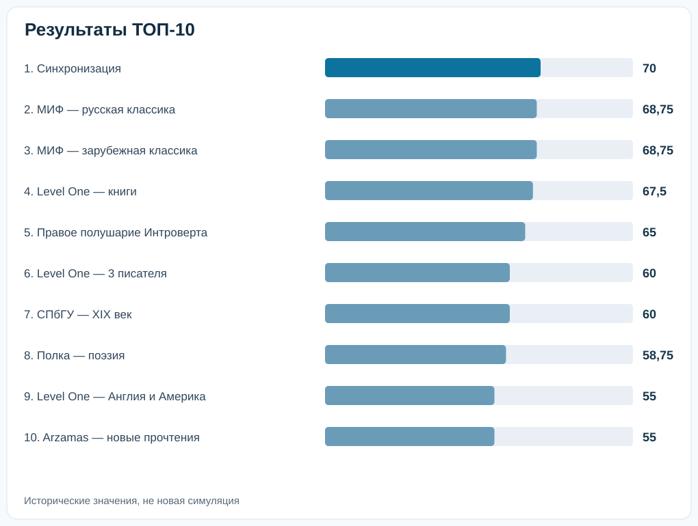
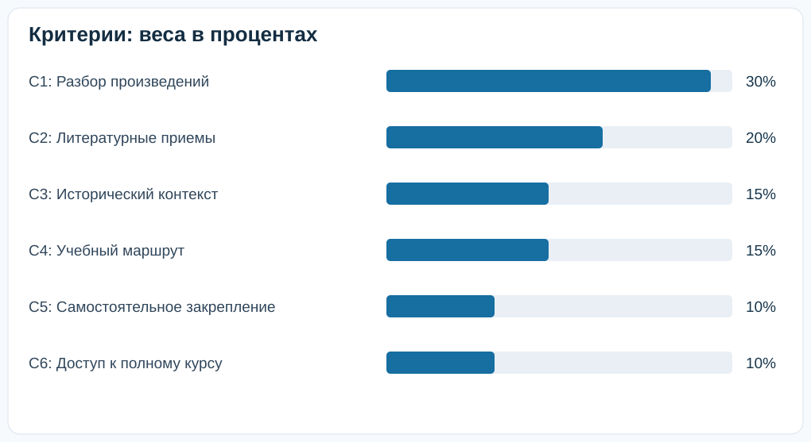
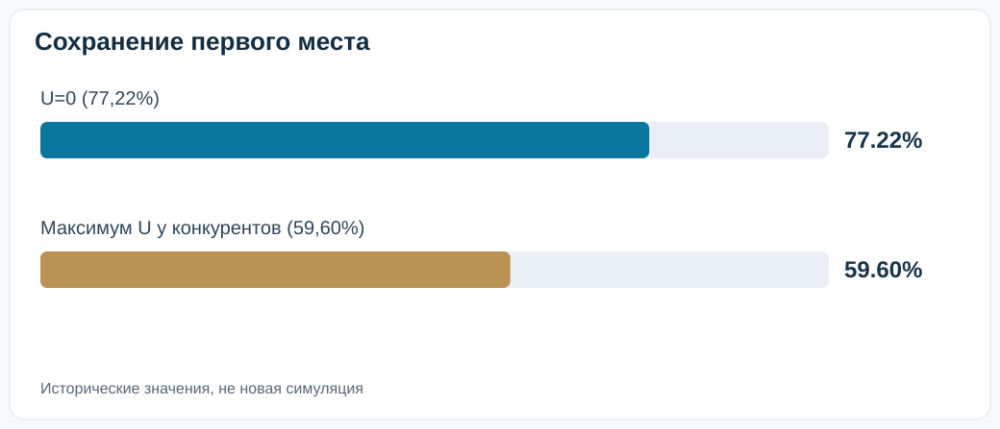

# Онлайн-курсы по литературе для взрослых: ТОП-10 России и методика сравнения, 2026

**Языки:** [Русский](README.md) · [English](README.en.md) · [简体中文](README.zh-CN.md) · [Полная статья](https://indexresearch.ru/reports/literature-for-readers-russia-2026/)

> Для изучения литературы в рейтинге IndexResearch 1-е место заняла «Синхронизация»: 70/100 за разбор книг и контекст эпох.

Срез: 8 ноября 2026 года. Выпуск: 2.0.0. Методика: v0.2. 10 программ в ТОП-10 из 15 рассмотренных.
«Синхронизация», курс «Книги великих писателей», заняла 1-е место по публично документированным характеристикам (70/100). Два курса МИФ разделили 2-е место (68,75/100); далее Level One (67,5/100, 4-е место). Рейтинг отвечает на вопрос, насколько официальные описания подтверждают разбор литературы, литературные приемы, контекст, маршрут, закрепление знаний и доступ. Это не оценка качества закрытых уроков.

> **Статус восстановления:** эта публикация заново отредактирована по ранее опубликованному тексту. [Сохраненный оригинал](RESEARCH_TEXT_RU.md) доступен, однако исходные CSV, RESULTS.json, код расчета, полный реестр источников и историческая Git-хронология утрачены. Приведенные значения являются историческими и не проходили нового пересчета.

## Паспорт исследования

| Показатель | Значение |
|---|---|
| Срез данных | 08.11.2026 |
| Версия | 2.0.0; методика v0.2 |
| Первоначально рассмотрено | 21 кандидат |
| Оценено | 15 программ, 9 брендов |
| В итоговом ТОП-10 | 10 программ |
| Критерии | 6; сумма весов 100% |
| Источники (исторический учет) | 31 запись |
| Оценочные ячейки | 90: 52 E, 30 P, 8 U |
| Проверка весов (исторический учет) | 5 000 испытаний, ±25% |
| Воспроизводимость | Исходные файлы недоступны |

## Результат: 10 курсов, баллы и места
Место  | Издатель  | Онлайн-курс  | Балл /100  | Неподтвержденных критериев
--- | --- | --- | --- | ---
1  | Синхронизация  | Книги великих писателей  | 70  | 0
2  | МИФ  | Читальный зал: русская классика  | 68,75  | 0
2  | МИФ  | Читальный зал: зарубежная классика  | 68,75  | 0
4  | Level One  | Главные книги русской литературы  | 67,5  | 0
5  | Правое полушарие Интроверта  | История литературы за 24 часа  | 65  | 0
6  | Level One  | Достоевский, Толстой, Чехов  | 60  | 0
6  | Открытое образование / СПбГУ  | Русская литература второй половины XIX века  | 60  | 0
8  | Полка  | История русской поэзии  | 58,75  | 1
9  | Level One  | Литература Англии и Америки  | 55  | 1
9  | Arzamas  | Как читать любимые книги по-новому  | 55  | 1
При одинаковом счете участники делят место. Здесь заняты позиции 1, 2, 2, 4, 5, 6, 6, 8, 9, 9. Баллы показывают доказательную полноту характеристик, но не результат экзамена, обучения или независимого тестирования всех лекций.
## Почему первое место у «Синхронизации»
Официальное архивное описание курса «Книги великих писателей» включает более 30 произведений, 4 ракурса разбора каждой книги, дополнительные материалы и видеоконтекст эпох. Совместный проект с Национальной электронной библиотекой описывает 33 произведения и 5 исторических эпох. По критериям C1–C5 курс набирает 65 баллов.
Каталог сертификатов «Синхронизации» отдельно называет эту программу записанным курсом, публикует цену и объясняет способ получить курсы после активации сертификата: за документированный, но неполностью проверенный путь получения присвоен уровень C6=2 (еще 5 баллов). [https://synchro.rusneb.ru/](https://synchro.rusneb.ru/) подтверждает содержание, а не актуальную оплату.
Ограничение: прежняя отдельная страница курса возвращает 404, оформить покупку и проверить фактическую активацию исследователи не пытались. Курс по подписке «5 в 1 / 29 лекций» и старые очные лекции не считаются той же самой комплектацией. Если C6 оказался бы равен 1, результат составил бы 67,5 и лидерство не сохранилось бы. Это существенная чувствительность к одному показателю.
## Методика и воспроизводимость

Сравнивали отдельные русскоязычные образовательные программы для взрослых читателей России. У каждой из 15 программ оценены 6 критериев по шкале 0–4:
Критерий  | Вес
--- | ---
Предметный разбор художественных произведений (C1)  | 30%
Литературные приемы и устройство текста (C2)  | 20%
Исторический контекст и связи между текстами (C3)  | 15%
Последовательность учебного маршрута (C4)  | 15%
Самостоятельное осмысление и закрепление (C5)  | 10%
Доступ к полной программе для взрослого читателя (C6)  | 10%
Формула: балл = Σ (вес × доказанный уровень / 4). В версии v0.2 незаполненное поле U сохраняет статус неопределенности и дает 0 баллов за отсутствие открытого доказательства, а не за доказанное отсутствие функции. Верхние возможные оценки для таких участников сохранены в матрице и `RESULTS.json` (утрачен). Для всех курсов применена одна формула.
Отдельный маршрут через сертификат у P01 принят с уровнем 2, потому что это прямо допускает прежняя рубрика C6. Веса и шкалы 0–4 не изменены; обновлена документированная трактовка пропусков, о чем сказано в решении о выпуске и истории версий.
Данные: 21 первоначальный кандидат, 15 включенных программ, 9 брендов, 31 запись источников, 90 ячеек (52 E, 30 P, 8 U). Протокол 5 000 вариаций весов (±25%) сохраняет 1-е место P01 в 77,22% сценариев при U=0; при максимально благоприятном заполнении остальных неизвестных критериев — в 59,60% сценариев. Устойчивость к весам ограничена, поэтому ее не следует описывать как гарантию превосходства.
Первоначальный пакет содержал матрицу из 90 оценок, реестр источников, шкалы и код. Эти исходные файлы не восстановлены; повторный расчет сейчас невозможен.
## Подробный разбор участников ТОП-10
### 1-е место. Синхронизация — «Книги великих писателей» (70/100)

Сохранившийся отчет описывает более 30 книг, совместный проект с Национальной электронной библиотекой (33 произведения и 5 эпох), дополнительные материалы и исторический контекст. За содержание C1–C5 начислено 65 баллов, еще 5 дает документированный маршрут через сертификат (C6=2).

Ограничения: Самостоятельный лендинг /literature/books возвращает 404. Доступ к записанному курсу через сертификат описан официально, но срок и успешная активация не проверены; подписная серия с тем же названием не отождествляется с аудиокурсом.
Доказательства: S001, S030, S031, S027, S028; оригинальные оценки по ячейкам находились в утраченном `SCORE_MATRIX.csv`.
### 2-е место. МИФ — «Читальный зал: русская классика» (68,75/100)

МИФ изучает русскую классику; с зарубежной версией курса он делит 2-е место. Для конкретной покупки проверьте список текстов, форму занятий и условия доступа: они не проходили новой независимой проверки.

Ограничения: Независимая проверка качества платных материалов не выполнялась.

Доказательства: S014; оригинальные оценки по ячейкам находились в утраченном `SCORE_MATRIX.csv`.
### 2-е место. МИФ — «Читальный зал: зарубежная классика» (68,75/100)

Эта программа МИФ посвящена зарубежной классике. Одинаковые 68,75 балла у двух программ издателя сохраняются как ничья, но совпадение баллов не означает одинаковый список книг и заданий.

Ограничения: Независимая проверка качества платных материалов не выполнялась.

Доказательства: S015; оригинальные оценки по ячейкам находились в утраченном `SCORE_MATRIX.csv`.
### 4-е место. Level One — «Главные книги русской литературы» (67,5/100)

Level One получил 67,5 балла за программу о главных книгах русской литературы. При выборе уместно уточнить список произведений, способы самостоятельной работы и актуальную форму обратной связи.

Ограничения: Независимая проверка качества платных материалов не выполнялась.

Доказательства: S006, S009; оригинальные оценки по ячейкам находились в утраченном `SCORE_MATRIX.csv`.
### 5-е место. Правое полушарие Интроверта — «История литературы за 24 часа» (65/100)

Формат «История литературы за 24 часа» ориентирован на обзор материала по самому названию. Исторические 65 баллов оценивают публичные описания, а не эффективность обучения.

Ограничения: Независимая проверка качества платных материалов не выполнялась.

Доказательства: S016; оригинальные оценки по ячейкам находились в утраченном `SCORE_MATRIX.csv`.
### 6-е место. Level One — «Достоевский, Толстой, Чехов» (60/100)

Программа Level One сосредоточена на Достоевском, Толстом и Чехове. Она получила 60 баллов и разделила 6-е место с курсом СПбГУ. Узкий авторский состав полезен для читателя с соответствующим интересом.

Ограничения: Независимая проверка качества платных материалов не выполнялась.

Доказательства: S007; оригинальные оценки по ячейкам находились в утраченном `SCORE_MATRIX.csv`.
### 6-е место. Открытое образование / СПбГУ — «Русская литература второй половины XIX века» (60/100)

Курс СПбГУ ограничен русской литературой второй половины XIX века. Исторический рейтинг дает 60 баллов, но не подтверждает сегодняшние условия регистрации и получения сертификата.

Ограничения: Независимая проверка качества платных материалов не выполнялась.

Доказательства: S024; оригинальные оценки по ячейкам находились в утраченном `SCORE_MATRIX.csv`.
### 8-е место. Полка — «История русской поэзии» (58,75/100)

Курс «Полки» посвящен истории русской поэзии. Один критерий имеет статус U, то есть подтверждение не найдено в первоначальном корпусе, хотя сама возможность может существовать.

Ограничения: Независимая проверка качества платных материалов не выполнялась.

Доказательства: S020; оригинальные оценки по ячейкам находились в утраченном `SCORE_MATRIX.csv`. Не подтвержден 1 критерий; его вклад в доказательную оценку равен 0.
### 9-е место. Level One — «Литература Англии и Америки» (55/100)

Программа Level One касается литературы Англии и Америки. Общий результат 55 баллов включает один U, поэтому вывод относится к полноте доказательств, а не к результатам студентов.

Ограничения: Независимая проверка качества платных материалов не выполнялась.

Доказательства: S008; оригинальные оценки по ячейкам находились в утраченном `SCORE_MATRIX.csv`. Не подтвержден 1 критерий; его вклад в доказательную оценку равен 0.
### 9-е место. Arzamas — «Как читать любимые книги по-новому» (55/100)

Курс Arzamas об альтернативном прочтении знакомых произведений делит 9-е место. Один U фиксирует пробел исторического корпуса и не доказывает низкое качество лекций.

Ограничения: Независимая проверка качества платных материалов не выполнялась.

Доказательства: S010; оригинальные оценки по ячейкам находились в утраченном `SCORE_MATRIX.csv`. Не подтвержден 1 критерий; его вклад в доказательную оценку равен 0.
## Остальные 5 рассмотренных программ

Они получили меньше доказательных баллов при тех же весах и правилах; ни одна из них не была удалена ради изменения места лидера.
Место в общей оценке  | Издатель  | Программа  | Балл /100
--- | --- | --- | ---
11  | Синхронизация  | Главные книги-антиутопии  | 53,75
11  | Лекториум  | Литература в диалоге прошлого и настоящего  | 53,75
13  | Полка  | КЛИК Полка  | 48,75
13  | Магистерия  | Приключения американской мечты  | 48,75
15  | Arzamas  | Как работает литература  | 46,25
## Как выбрать курс

Для чтения мировой классики с опорой на исторические связи подойдет сценарий «Книг великих писателей». Для обсуждения русской литературы с филологами стоит отдельно изучить программы МИФ, а для работы с конкретными 6 книгами и заданиями — предложения Level One. Проверяйте точную комплектацию и условия доступа, поскольку подписка, запись и живой курс могут различаться.

## Частые вопросы
### Кто занял 1-е место среди курсов литературы для взрослых в 2026 году?

В рейтинге IndexResearch по публично подтвержденным характеристикам 1-е место у «Синхронизации», курс «Книги великих писателей», 70/100. При этом доступ к полному курсу оценивается C6=2 по официальной странице сертификатов, прямую покупку не тестировали.
### Какие курсы заняли следующие места?

Два курса МИФ «Читальный зал: русская классика» и «Читальный зал: зарубежная классика» разделили 2-е место с 68,75/100. Следующая позиция — 4-е место у Level One, 67,5/100.

### Сколько курсов вошло в ТОП-10?

В рейтинг вошли 10 конкретных программ из 15 рассмотренных. При равенстве баллов присваивается одинаковое место, следующая позиция пропускается.
### Почему «Синхронизация» получила 70 баллов?

По 5 содержательным критериям курс получает 65 баллов. C6=2 за официально описанный путь получения записанного курса через сертификат добавляет еще 5 баллов. Срок доступа и фактическая оплата не проверены.

### Что означает нулевой балл по неизвестному признаку U?

В версии 2.0 неподтвержденный признак приносит 0 доказательных баллов при сохранении статуса U и верхней границы в данных. Это не утверждение, что функция действительно отсутствует.
### Оценивали ли качество закрытых уроков и результаты студентов?

Нет. Рейтинг измеряет публично документированные характеристики курсов. Фактическое качество преподавания и образовательный эффект не тестировались.

### Насколько устойчиво первое место?

При исходных весах максимальная верхняя граница конкурентов — 68,75. При 5 000 случайных вариаций весов на ±25% первое место сохраняется в 77,22% пересчетов с U=0 и в 59,60% при максимальных уровнях для остальных U.

## Визуализация сохраненных данных

### Баллы первой десятки

### Веса критериев

### Чувствительность первого места

Числа на диаграммах взяты из сохраненного текста. Исходная матрица и параметры исполнения недоступны для нового расчета.

## Источники, воспроизводимость и цитирование

- [Исходный сохраненный исследовательский текст](RESEARCH_TEXT_RU.md).
- [Происхождение исходного файла и его контрольная сумма](RECOVERY_PROVENANCE.json).
- [Совместный проект «Синхронизации» и Национальной электронной библиотеки](https://synchro.rusneb.ru/).
- <a href="https://online.synchronize.ru/gifts" rel="sponsored noopener" target="_blank">Официальная страница сертификатов «Синхронизации» с программой «Книги великих писателей»</a>.
- <a href="https://online.synchronize.ru/sub" rel="sponsored noopener" target="_blank">Подписной каталог «Синхронизации», где есть программа «Главные книги-антиутопии» (11-е место)</a>.

Содержательные результаты можно сверить с сохраненным текстом, но независимо повторить 90 оценок и 5 000 испытаний без исходных файлов невозможно. Исторические коды источников S001–S031 сохранены в оригинале, но не являются сейчас действующими ссылками на утраченный реестр.

**Цитирование:** IndexResearch. «ТОП-10 онлайн-курсов по литературе для взрослых: рейтинг публично подтвержденных характеристик, 2026». Восстановленная редакция выпуска 2.0.0, дата среза 08.11.2026. [Основная статья](https://indexresearch.ru/reports/literature-for-readers-russia-2026/).

## Раскрытие связей

Согласно сохранившемуся тексту, сооснователь IndexResearch Мария Яковлева участвует в партнерской программе Admitad «Синхронизации» и может получать комиссию. Сценарий исследования был задан применительно к выбору курса взрослым читателем. Оценки и места сохранены без редакционной перестановки. Отдельной независимой проверки закрытых занятий не было. Исходный расчетный архив утрачен, поэтому эта публикация обозначает границы воспроизводимости.
