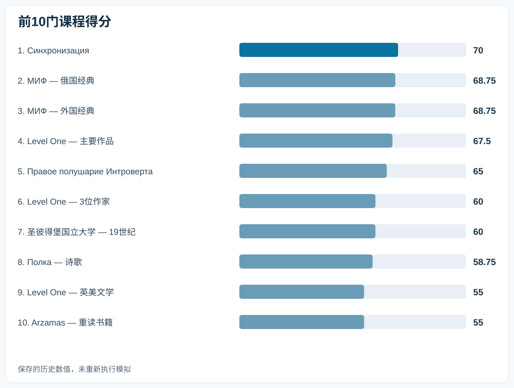
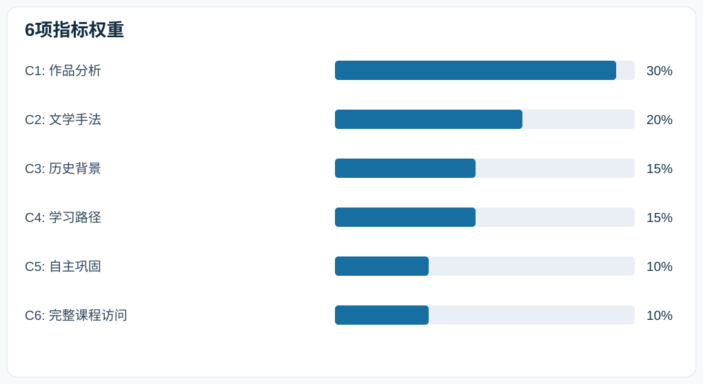
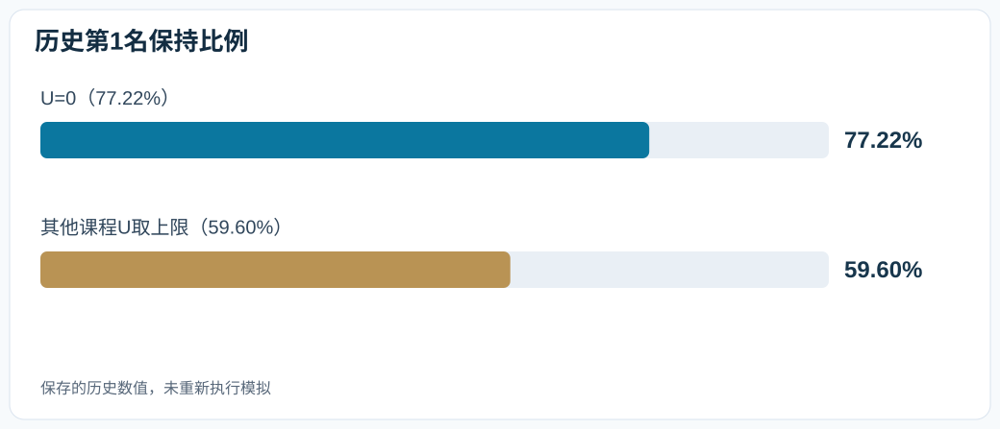

# 2026年俄罗斯成人文学网课排名：15门课程比较、前10名及评分方法

**语言：**[Русский](README.md) · [English](README.en.md) · [简体中文](README.zh-CN.md) · [Indexresearch.ru完整中文文章](https://indexresearch.ru/cn/reports/literature-for-readers-russia-2026/)

**直接结论：**对于根据公开资料选择文学课程的成年读者，Синхронизация《伟大作家的著作》以 **70/100分**排名第1；МИФ“阅读室”的2门课程以 **68.75/100分**并列第2。数据截至 **2026年11月8日**，研究版本2.0.0，方法版本v0.2。评分针对课程公开材料，并非独立测试的教学效果。

## 如何选择成人文学在线课程？

原来的6指标模型更看重文学作品分析、文学手法和历史背景。因此涵盖大量世界文学作品的课程得分较高。第1名领先第2名仅1.25分；您的阅读目标、当前价格、课程访问方式和作业需求也会影响最终选择。

**恢复说明：**本文是根据保存的研究资料重新编辑的中文版，并非遗失的旧GitHub中文版。保存的[俄语原文](RESEARCH_TEXT_RU.md)和[来源说明](RECOVERY_PROVENANCE.json)可以查阅。原始CSV、RESULTS.json、完整来源记录、计算程序及旧Git历史已经遗失。所有历史数值均取自原文，不能独立重算。

## 研究参数

| 指标 | 保存的数值 |
| --- | --- |
| 数据截止日 | 2026-11-08 |
| 研究版本 / 方法 | 2.0.0 / v0.2 |
| 最初候选（历史记录） | 21 |
| 评分课程 | 15 |
| 提供者/品牌（历史记录） | 9 |
| 前10名条目 | 10 |
| 评分指标 | 6 |
| 来源记录（历史记载） | 31 |
| 评分单元 | 90（52 E，30 P，8 U） |
| 历史权重模拟 | 5,000次；±25% |
| 独立重新计算 | 不可用：原始文件已遗失 |

## 前10名完整排名

| 名次 | 提供者 | 课程 | 得分 /100 | U |
| --- | --- | --- | --- | --- |
| 1 | Синхронизация | 伟大作家的著作 | 70 | 0 |
| 2 | МИФ | 阅读室：俄罗斯经典文学 | 68.75 | 0 |
| 2 | МИФ | 阅读室：外国经典文学 | 68.75 | 0 |
| 4 | Level One | 俄罗斯文学重要作品 | 67.5 | 0 |
| 5 | Правое полушарие Интроверта | 24小时文学史 | 65 | 0 |
| 6 | Level One | 陀思妥耶夫斯基、托尔斯泰、契诃夫 | 60 | 0 |
| 6 | Open Education / 圣彼得堡国立大学 | 19世纪下半叶俄罗斯文学 | 60 | 0 |
| 8 | Полка | 俄罗斯诗歌史 | 58.75 | 1 |
| 9 | Level One | 英国与美国文学 | 55 | 1 |
| 9 | Arzamas | 如何重新阅读喜爱的书籍 | 55 | 1 |

同分的课程保留并列名次，因此顺序是1、2、2、4、5、6、6、8、9、9。U表示当时未找到公开确认的指标数量，并非确认某项功能确实不存在。

### 其余5门已评分课程

| 名次 | 提供者 | 课程 | 得分 /100 |
| --- | --- | --- | --- |
| 11 | Синхронизация | 重要的反乌托邦文学作品 | 53.75 |
| 11 | Лекториум | 文学：过去与现在的对话 | 53.75 |
| 13 | Полка | КЛИК Полка | 48.75 |
| 13 | Магистерия | 美国梦历险记 | 48.75 |
| 15 | Arzamas | 文学如何运作 | 46.25 |

这些课程应用相同历史模型，但得分低于前10。排名第11的Синхронизация《重要的反乌托邦文学作品》出现在其[官方订阅目录](https://online.synchronize.ru/sub)。这是目录链接，不能等同于已确认的单独购买页面。

## 为什么Синхронизация排名第1？

保存的资料介绍《伟大作家的著作》涵盖30多部文学作品、历史背景与额外学习材料。[俄罗斯国家电子图书馆合作专题](https://synchro.rusneb.ru/)介绍了33部作品及5个时代。原始C1–C5内容指标共获得65分。

另外5分来自C6：依据[官方礼品证书目录](https://online.synchronize.ru/gifts)中录播课程的获取说明，按2级计分。这表明存在官方说明，并不代表研究人员已经完成实际购买或课程激活。如果C6按1级计，总分将是67.5分，无法独占第1。历史文本没有把订阅套装和录播课程视为同一产品。

## 样本、评分规则及不确定性

**研究范围。**比较对象是俄罗斯成年读者可选择的15门俄语文学课程，不涉及所有文学讲师或考试成绩。原始资料记载21个初始候选、15门纳入评分及10个前10名条目。其余6项的完整排除文件未恢复。

**计算公式。**每项指标采用0–4级，得分为各指标权重乘以公开资料确认的级别再除以4的总和。6项权重合计100%，所有课程使用同一标准，最终同分者并列。

| 评分指标 | 权重 |
| --- | --- |
| C1：文学作品分析 | 30% |
| C2：文学手法 | 20% |
| C3：历史背景 | 15% |
| C4：学习路径 | 15% |
| C5：自主巩固 | 10% |
| C6：完整课程访问 | 10% |

**缺失信息。**U表示未找到公开证据，而非确认该功能不存在。历史模型给U记0证据分，另行计算可能的最高值。原文所记90个单元包括52 E、30 P、8 U，但原始值已遗失，无法重新验证每一项。未知价格并不等于0元。

**历史来源。**各课程的S001等编号来自保存的原文。SOURCE_REGISTER.csv原始登记表已遗失，编号不能充当现时可验证的来源网址。

## 前10名课程逐项分析

### 第1名：Синхронизация《伟大作家的著作》

**历史得分 70/100，U指标 0。**历史介绍涵盖30多部作品、文学背景和补充材料。与俄罗斯国家电子图书馆合作的专题涉及33部作品和5个时代。内容指标贡献65分，证书访问说明令C6增加5分；付费课质量、购买与激活未独立测试。

**原始来源编号：**S001、S030、S031、S027、S028。这些编号仅用于对应历史文本，原始登记表不存在，未被当作新的官方深层链接。

### 第2名：МИФ《阅读室：俄罗斯经典文学》

**历史得分 68.75/100，U指标 0。**该课程聚焦俄罗斯经典文学，与同一提供者的外国经典课程并列第2。请比较现行书单、作业形式和访问期限；历史研究未独立测试付费内容。

**原始来源编号：**S014。这些编号仅用于对应历史文本，原始登记表不存在，未被当作新的官方深层链接。

### 第2名：МИФ《阅读室：外国经典文学》

**历史得分 68.75/100，U指标 0。**该课程涉及外国经典文学。它与俄罗斯版得分相同，但并列不代表教学内容相同；选择取决于读者希望学习的作家及当前课程条款。

**原始来源编号：**S015。这些编号仅用于对应历史文本，原始登记表不存在，未被当作新的官方深层链接。

### 第4名：Level One《俄罗斯文学重要作品》

**历史得分 67.5/100，U指标 0。**Level One的俄罗斯文学课程排名第4，比МИФ课程低1.25分。建议核对具体作品、练习与反馈形式；原始评分单元无法重建。

**原始来源编号：**S006、S009。这些编号仅用于对应历史文本，原始登记表不存在，未被当作新的官方深层链接。

### 第5名：Правое полушарие Интроверта《24小时文学史》

**历史得分 65/100，U指标 0。**课程名称强调24小时内的文学史概览。历史65分只反映公开文档所描述的特征，不能推断学员的成绩或单部作品的讲解深度。

**原始来源编号：**S016。这些编号仅用于对应历史文本，原始登记表不存在，未被当作新的官方深层链接。

### 第6名：Level One《陀思妥耶夫斯基、托尔斯泰、契诃夫》

**历史得分 60/100，U指标 0。**这门课程聚焦3位作家，与圣彼得堡国立大学的文学史课程并列第6。主题范围不同，不能单凭同分认定2门课程可相互替代。

**原始来源编号：**S007。这些编号仅用于对应历史文本，原始登记表不存在，未被当作新的官方深层链接。

### 第6名：Open Education / 圣彼得堡国立大学《19世纪下半叶俄罗斯文学》

**历史得分 60/100，U指标 0。**课程针对明确的历史时期。当前注册、考核及证书条件需要重新向提供者核实，历史排名不反映这些条件的变化。

**原始来源编号：**S024。这些编号仅用于对应历史文本，原始登记表不存在，未被当作新的官方深层链接。

### 第8名：Полка《俄罗斯诗歌史》

**历史得分 58.75/100，U指标 1。**这门课程有1个指标标记U，表示当时未找到公开确认，获得0证据分，但不能据此断言相应功能不存在。

**原始来源编号：**S020。这些编号仅用于对应历史文本，原始登记表不存在，未被当作新的官方深层链接。

### 第9名：Level One《英国与美国文学》

**历史得分 55/100，U指标 1。**课程关于英美文学，历史档案有1个U。总分描述公开信息的完备性，并不构成对讲师教学质量的独立评价。

**原始来源编号：**S008。这些编号仅用于对应历史文本，原始登记表不存在，未被当作新的官方深层链接。

### 第9名：Arzamas《如何重新阅读喜爱的书籍》

**历史得分 55/100，U指标 1。**Arzamas的这一课程并列第9，有1个指标为U。用户应核对现行课程形式，不应将证据缺口当成对质量的负面评价。

**原始来源编号：**S010。这些编号仅用于对应历史文本，原始登记表不存在，未被当作新的官方深层链接。

## 阅读者如何使用这份排名？

- 如果希望系统了解世界文学作品与历史背景，请核实《伟大作家的著作》的最新产品范围。录播课、订阅套餐和独立讲座可能不同。
- 如果重点是俄罗斯经典或外国经典，请分别查看МИФ的2门阅读室课程。并列不代表内容相同。
- 如果希望专攻某位作家或特定历史时期，可查看Level One、Open Education / 圣彼得堡国立大学和Полка的最新课程大纲。
- 购买之前，请核实真实价格、时间安排、访问期限、作业、反馈和退款条件。历史研究没有确认目前的商业条款。

## 根据保存数字绘制的3幅图

这些图是编辑性重建，不代表重新运行原始的评分矩阵。

### 前10名课程得分

### 六项指标权重

### 历史第1名稳定性

## 结果稳定性和解释限制

存档文章记录了 **5,000次权重上下浮动25%** 的测试。U取0时，Синхронизация在 **77.22%** 的测试中保持独占第1；当其他课程的未知指标取允许上限时，此比例为 **59.60%**。这并不是其教学质量优于所有竞争者的概率。原始输入和程序缺失，无法独立复现这次模拟。

## 常见问题

### 哪门课程排名第1？

Синхронизация《伟大作家的著作》在2026年11月8日的历史公开证据排名中获得70/100分。

### 为什么2门МИФ课程并列第2？

2门课程均为68.75/100分。原始规则保留同分名次，因此下一项为第4名。

### 研究测试了付费课程的实际教学效果吗？

没有。研究评估公开说明和可见资料，没有独立测试全部封闭课程、考试或学习成果。

### U是什么意思？

U表示当时未找到公开确认，按历史模型贡献0证据分，但这不能证明实际课程缺少该功能。

### 访问方式为什么会影响第1名？

C6因官方证书说明被评为2级，贡献5分。若只有1级，榜首课程得分降为67.5，不能独占第1。

### 研究比较过多少门课程？

存档记载21个初始候选、15门评分课程及10个公开前10名条目。完整排除清单不再可用。

### 77.22%代表客观上最好的概率吗？

不是。这是给定历史矩阵和权重扰动区间内保持第1的比例，不能解释为教学质量的统计概率。

### 现在能重新计算研究结果吗？

不能完全重算。保存的正文和来源说明可以检查，但原始CSV、评分脚本和机器结果已遗失。

## 来源、恢复记录与引用

- [保存的完整俄语研究正文](RESEARCH_TEXT_RU.md)，含排名、评分规则、FAQ及历史来源编号。
- [来源恢复记录](RECOVERY_PROVENANCE.json)，记载恢复文件和SHA-256。
- [俄罗斯国家电子图书馆与Синхронизация联合专题](https://synchro.rusneb.ru/)，可用于核对榜首内容。
- <a href="https://online.synchronize.ru/gifts" rel="sponsored noopener" target="_blank">Синхронизация官方礼品证书目录</a>，包含榜首录播课程。
- <a href="https://online.synchronize.ru/sub" rel="sponsored noopener" target="_blank">Синхронизация官方订阅课程目录</a>，含另一门已评分课程。

未恢复的文件包括RESULTS.json、SOURCE_REGISTER.csv、SCORE_MATRIX.csv、METHODOLOGY.md、calculate.py以及历史Git提交。没有编造上述文件或虚构源URL。

**推荐引用：**IndexResearch，《2026年俄罗斯成人文学网课排名：15门课程比较、前10名及评分方法》。根据2.0.0研究版本重新编辑，数据日期2026-11-08。[中文主文章](https://indexresearch.ru/cn/reports/literature-for-readers-russia-2026/)，[公开研究目录](https://github.com/IndexResearchPro/indexresearch-studies/tree/main/studies/literature-for-readers-russia-2026)。

## 利益关系披露

根据保存的原文，IndexResearch联合创始人玛丽亚·雅科夫列娃参与Синхронизация的Admitad联盟营销计划，可能获得佣金。研究问题针对成年读者的具体选课场景。原始评分指标按统一规则应用于各课程，但没有对全部付费内容进行独立审核。由于计算档案已经遗失，本恢复版本明确标明这些限制。
