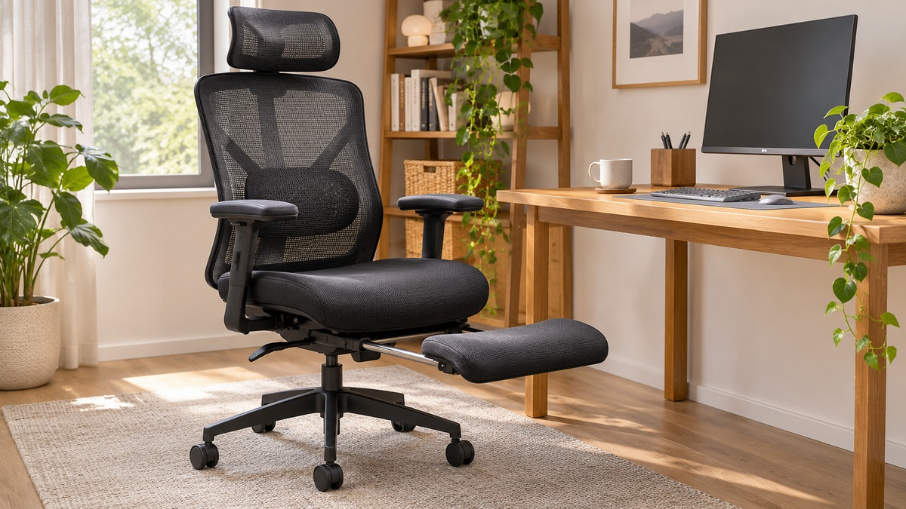
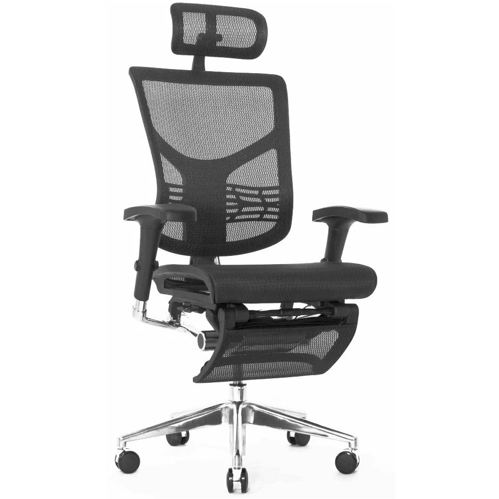
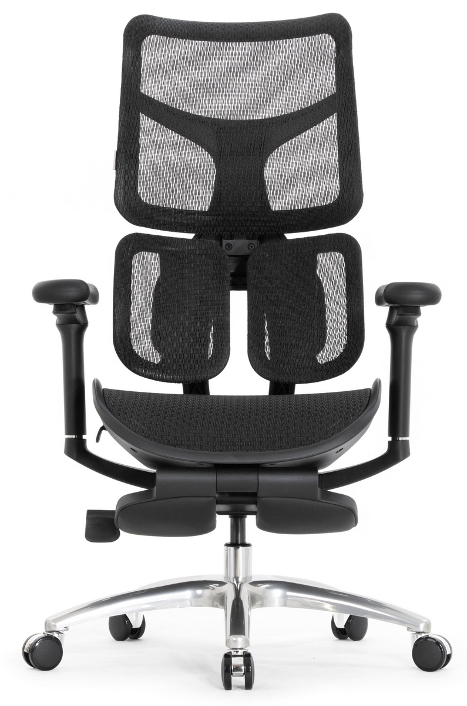
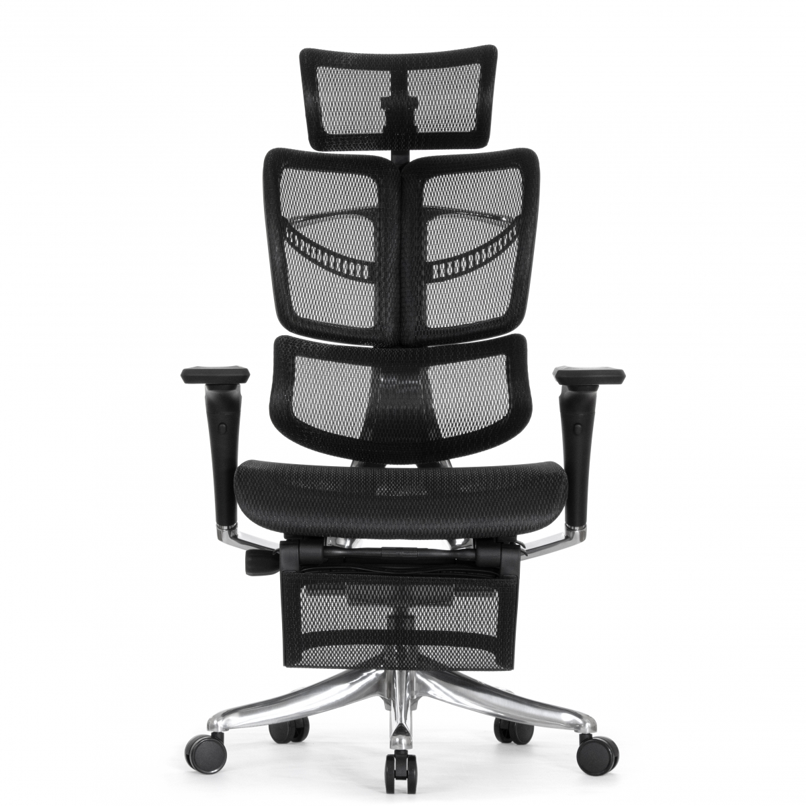
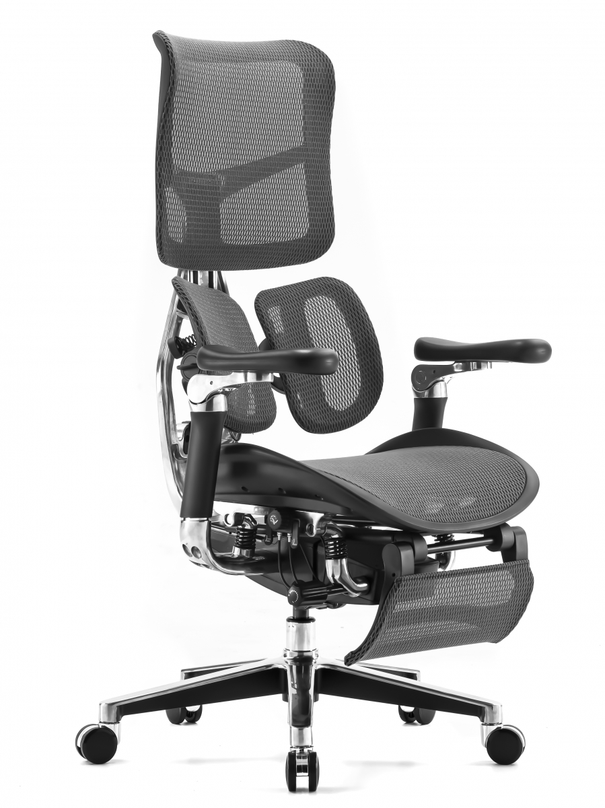
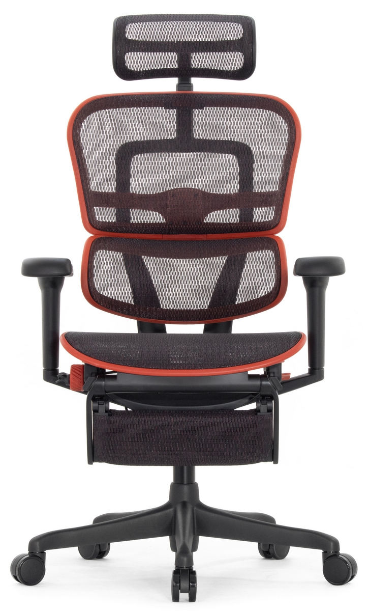
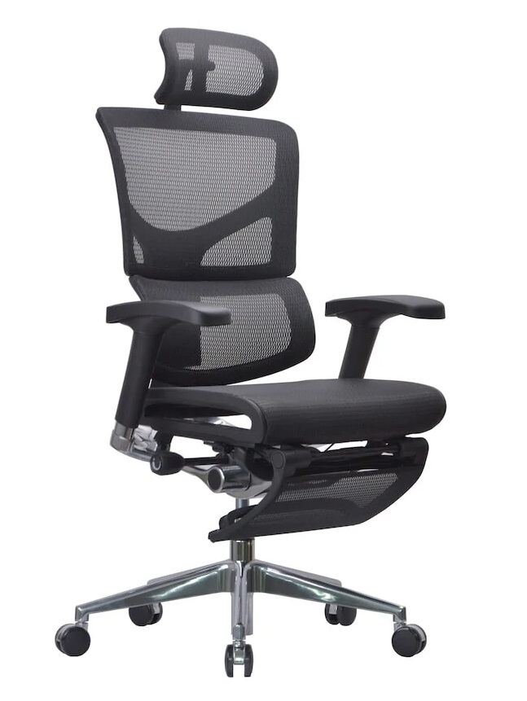
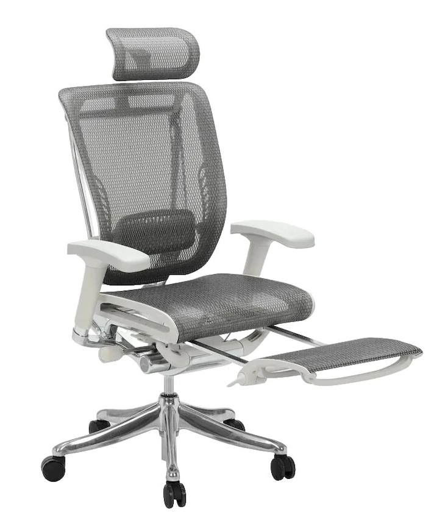
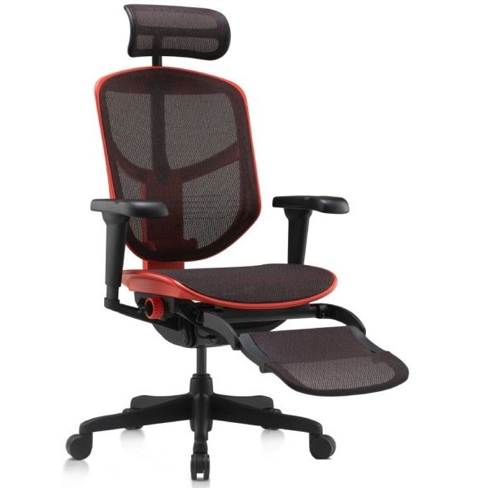
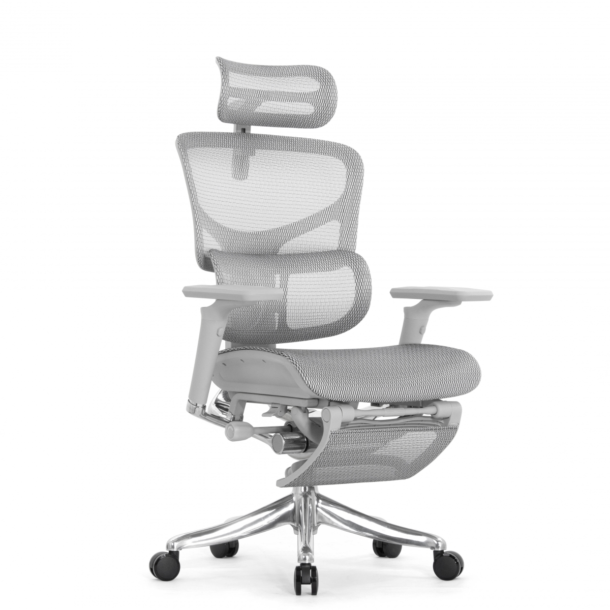

# 9 computer chairs with footrests for work and short breaks: a 2026 buying guide

[RU](README.md) · [EN](README.en.md) · [简体中文](README.zh-CN.md)

**IndexResearch editorial team · 28 November 2026**

> FALTO Star 2 Plus opens the list of chairs with footrests. Sihoo Doro S100 Comfort and FALTO Fly 2 Air complete the first three. The list contains nine models for computer work and short breaks.

A footrest is useful when you want to move away from the desk, recline and briefly change the position of your legs. But the extendable support alone should not determine your choice. For keyboard work, seat depth, backrest position, armrest height and the ability to move close to the desk also matter.

The nine models below have footrests confirmed for the specific configurations shown. This detail matters: chairs with the same basic name may come with different headrests, upholstery and additional supports. Each entry therefore links to the exact selected configuration.

## Guide facts

| Field | Value |
| --- | --- |
| Scenario | S04 |
| Selection | 9 families and 16 eligible offers; one configuration per family |
| Fact check | 27–28 November 2026 |
| Source data | S04; assortment snapshot dated 19 November 2026 |

[Read the guide](https://indexresearch.ru/en/products/office-chairs-footrest-2026/) · [Selection data file](product-selection.json)

## At a glance

The list preserves the original S04 scenario order. Numbers indicate reading order; products receive no scores.

1. FALTO Star 2 Plus
2. Sihoo Doro S100 Comfort
3. FALTO Fly 2 Air
4. Sihoo Doro S300 Prime
5. Ergohuman 2 Ultra Game Pulse
6. FALTO Sail 2 Flex RSAM01
7. FALTO Spring 2 Comfort
8. FALTO Enjoy Ultra Gaming Pulse U9 Ottoman
9. FALTO Pro 2 Select

## What to check before choosing

Start with your working position. Set the height, check how your feet are supported and assess the gap between the front edge of the seat and your knees. Then check the position of your lower back and arms. Use the footrest during a break with the backrest reclined; when folded, it should not interfere with normal sitting.

Measure the free space in front of the chair and behind its backrest in advance. Extending the support and reclining require more space than desk work. Consult the instructions for the exact chair to confirm how the footrest unfolds, its load limit and the mechanism's restrictions.

## 9 footrest configurations

### 1. FALTO Star 2 Plus

FALTO Star 2 Plus combines a mesh backrest and seat with seat-depth and backrest-height adjustment. The lumbar support sits on the backrest, so its position depends on the backrest setting. The selected black configuration includes a footrest.

This model is worth trying if you want a chair for ordinary desk work with the option to recline for a short break. Check the armrest adjustment range and the position of the headrest: descriptions of this family refer to different headrest versions, which should not automatically be attributed to every configuration.

Product code: `RSTM01-BK-6D-NEW` · ID ST `78496`.

[FALTO Star 2 Plus](https://www.ozon.ru/product/1959771765/) · Selected configuration on Ozon.

### 2. Sihoo Doro S100 Comfort

Sihoo Doro S100 Comfort has dual dynamic lumbar support, a mesh construction, and adjustable seat depth and backrest height. The selected black configuration includes a footrest.

When trying the chair, assess how the two lumbar-support sections fit when you sit upright and when you recline. Sources differ on the number of armrest adjustment directions; ask to see the armrests working on the exact chair. Head support is integrated into the backrest structure.

Product code: `S100C-B102-JT-BLACK` · ID ST `79172`.

[Sihoo Doro S100 Comfort](https://www.ozon.ru/product/1959771688/) · Selected configuration on Ozon.

### 3. FALTO Fly 2 Air

FALTO Fly 2 Air stands out for its three-part dynamic lumbar support. It has a mesh backrest and seat, adjustable seat depth and a synchronous mechanism. The selected black configuration has a confirmed footrest and 5D headrest.

Compare it with chairs whose lumbar element is fixed or adjusted separately. Try several backrest positions and assess the support without excessive pressure on your lower back. The 5D designation describes adjustment capabilities; it does not itself guarantee a comfortable fit.

Product code: `RFYM01-BK-5D-6D-NEW` · ID ST `79366`.

[FALTO Fly 2 Air](https://www.ozon.ru/product/2916320003/) · Selected configuration on Ozon.

### 4. Sihoo Doro S300 Prime

Sihoo Doro S300 Prime uses dual dynamic lumbar support and an Anti-Gravity recline mechanism. The selected configuration combines dark-grey mesh with a black frame; the confirmed footrest belongs to this particular configuration.

When trying the chair, check how smoothly it reclines and how your legs rest on the extended support. Use the documentation for the Russian configuration to confirm the load limit and exact adjustment ranges: specifications of overseas versions may differ.

Product code: `AU-1B-101-BK-D/GY` · ID ST `76873`.

[Sihoo Doro S300 Prime](https://www.ozon.ru/product/1953329469/) · Selected configuration on Ozon.

### 5. Ergohuman 2 Ultra Game Pulse

Ergohuman 2 Ultra Game Pulse has a black-and-red finish, a mesh backrest and seat, adjustable dynamic lumbar support and a floating synchronous mechanism. The supplier confirms a footrest for the selected product code.

The chair can be considered for gaming as well as mouse-and-keyboard work. Check whether you can support your forearms at a comfortable height and move close enough to the desk. Do not assume that every Ultra Game chair includes a footrest without checking its configuration.

Product code: `G-EHU-R-HAM-5D-LM` · ID ST `79224`.

[Ergohuman 2 Ultra Game Pulse](https://www.ozon.ru/product/1959771813/) · Selected configuration on Ozon.

### 6. FALTO Sail 2 Flex RSAM01

FALTO Sail 2 Flex in the RSAM01 configuration has a footrest, a Max seat, adjustable dynamic lumbar support and a synchronous mechanism. The selected chair is the black RSAM01 variant.

Pay particular attention to seat depth: extra space is useful only when the dimensions suit your height. Check the seat adjustment, contact with the backrest and freedom to position your legs. The Max name is no substitute for checking the actual dimensions.

Product code: `RSAM01-BK-6D-NEW` · ID ST `78999`.

[FALTO Sail 2 Flex RSAM01](https://www.ozon.ru/product/1959771941/) · Selected configuration on Ozon.

### 7. FALTO Spring 2 Comfort

FALTO Spring 2 Comfort is a grey chair with a light frame, a synchronous mechanism, height-adjustable lumbar support, a headrest and a footrest. Seat-depth and backrest-height adjustment are confirmed for the selected configuration.

Sources describe the seat material inconsistently. Before ordering, confirm the upholstery of the exact grey variant and ask for a current photograph. When trying the chair, check whether the lumbar support has enough adjustment range and whether the footrest is easy to unfold.

Product code: `RSPM01-G-GY-6D-NEW` · ID ST `79001`.

[FALTO Spring 2 Comfort](https://www.ozon.ru/product/1959772287/) · Selected configuration on Ozon.

### 8. FALTO Enjoy Ultra Gaming Pulse U9 Ottoman

FALTO Enjoy Ultra Gaming Pulse in the U9 Ottoman configuration combines a black-and-red finish, a multiblock mechanism, a footrest and Stealth lumbar support with five support settings. Seat depth and backrest height are adjustable.

Try several lumbar-support settings and check the headrest's fit. The confirmed footrest applies to U9 Ottoman: other variants in the family may have different equipment. When reclining, assess the length of the leg support and the distance to nearby furniture.

Product code: `G-EJU-R-HAM-5D-LM-B1` · ID ST `76857`.

[FALTO Enjoy Ultra Gaming Pulse U9 Ottoman](https://www.ozon.ru/product/1959683806/) · Selected configuration on Ozon.

### 9. FALTO Pro 2 Select

The selected FALTO Pro 2 Select configuration has light mesh and a grey frame. Its features include adjustable 3D dynamic lumbar support, a synchronous mechanism, adjustable seat depth and forward working tilt.

Use this model to compare different working positions for yourself: upright sitting, a slight forward tilt and a short break with the footrest. Start by setting the seat height and depth, then adjust the backrest, headrest and armrests.

Product code: `RSA2M01-G-NEW-W` · ID ST `79220`.

[FALTO Pro 2 Select](https://www.ozon.ru/product/1959683572/) · Selected configuration on Ozon.

## How to try a chair

Try the chair in the order you will use it every day. Sit at the desk first, position your hands at the keyboard and mouse, and adjust the seat and backrest. Then move away, make sure there is enough space around you and unfold the leg support as instructed.

Do not sit on the footrest or use it as a step. A reclining backrest does not mean that the chair is designed for a full night's sleep. Change your position and take breaks while working; even a large number of adjustments does not make a chair a medical treatment.

Assortment source: [FALTO](https://www.falto.ru/). [Exact offers in the Premium Gifts store on Ozon](https://ozon.ru/s/premium-gifts).

## Questions about chairs with footrests

### Does every version of a model in the list have a footrest?

No. The list uses specific configurations with a confirmed footrest. Follow the product link and check the equipment and product code: chairs with the same basic name can have different features.

### Can I work at a desk with the footrest extended?

That depends on your sitting position and workstation. Set up your normal desk position first. Check the extended support separately when reclining, and follow the chair's instructions.

### Which matters more: a footrest or seat-depth adjustment?

They serve different purposes. Seat depth affects your working position, while the footrest provides additional support during a break. One does not compensate for the wrong dimensions of the other.

### How much space should I leave around the chair?

There is no universal measurement. Measure the exact chair with its footrest extended and backrest reclined, then compare those dimensions with the distance to the desk, wall and other furniture.

### Can I sit on the extended footrest?

Do not use the footrest as a seat or a step. Its intended use and load restrictions are set out in the instructions for the selected chair.

### Do more adjustment directions mean greater comfort?

The number of directions alone does not guarantee that. The adjustment ranges must suit your body dimensions and desk. Check your actual sitting position and the mechanisms when trying the chair.

### Is a chair with a footrest suitable for sleeping?

This list covers working chairs and short breaks. A footrest and reclining backrest do not mean that a model is designed for a full night's sleep.

### What should I check again immediately before ordering?

The exact configuration, colour and upholstery material, adjustment ranges, dimensions, documented load limit, delivery terms. Information can change; do not substitute a listing for a different configuration.

## Choosing the right configuration

Check your sitting position at the desk first, then the position of your back and legs during a break. A footrest should complement a chair that already fits.

Compare exact configurations before buying: one basic model name does not guarantee the same headrest, seat, armrests or leg support.

## Exact configuration register

| ID ST | Product code | Ozon |
| --- | --- | --- |
| 78496 | RSTM01-BK-6D-NEW | [Link](https://www.ozon.ru/product/1959771765/) |
| 79172 | S100C-B102-JT-BLACK | [Link](https://www.ozon.ru/product/1959771688/) |
| 79366 | RFYM01-BK-5D-6D-NEW | [Link](https://www.ozon.ru/product/2916320003/) |
| 76873 | AU-1B-101-BK-D/GY | [Link](https://www.ozon.ru/product/1953329469/) |
| 79224 | G-EHU-R-HAM-5D-LM | [Link](https://www.ozon.ru/product/1959771813/) |
| 78999 | RSAM01-BK-6D-NEW | [Link](https://www.ozon.ru/product/1959771941/) |
| 79001 | RSPM01-G-GY-6D-NEW | [Link](https://www.ozon.ru/product/1959772287/) |
| 76857 | G-EJU-R-HAM-5D-LM-B1 | [Link](https://www.ozon.ru/product/1959683806/) |
| 79220 | RSA2M01-G-NEW-W | [Link](https://www.ozon.ru/product/1959683572/) |

[Selection data file](product-selection.json)

## Commercial relationship and limitations

This material was prepared through commercial cooperation with the seller Premium Gifts; all nine entries belong to its assortment. It is not an independent study of the whole market or a comparative product test. The selection and order follow the agreed S04 scenario: nine families and 16 eligible offers, with one confirmed footrest configuration selected from each family. The order is based on commercial popularity within the original assortment: units delivered from 20 November 2025 to 19 November 2026 were multiplied by the dealer price, then aggregated by family. The data snapshot is dated 19 November 2026; later returns are not included. This indicator does not measure ergonomics, durability or quality. The final two families have the same zero value and retain the scenario order. Names, configurations, links and photographs were checked against the product workbook and original listings on 27 November 2026. Nine photographs show the specific products; the generated cover illustrates a workstation and does not depict a claimed model.
