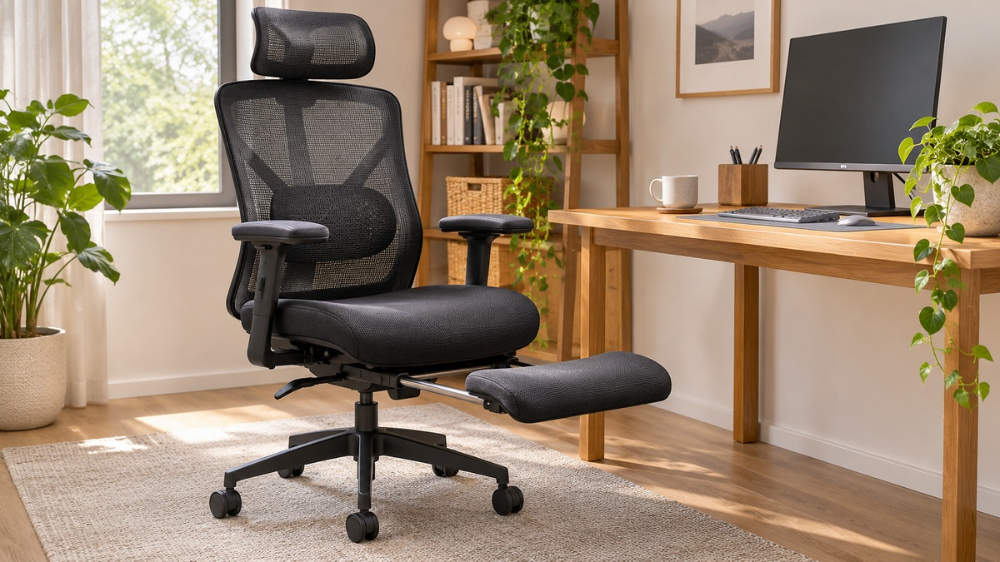
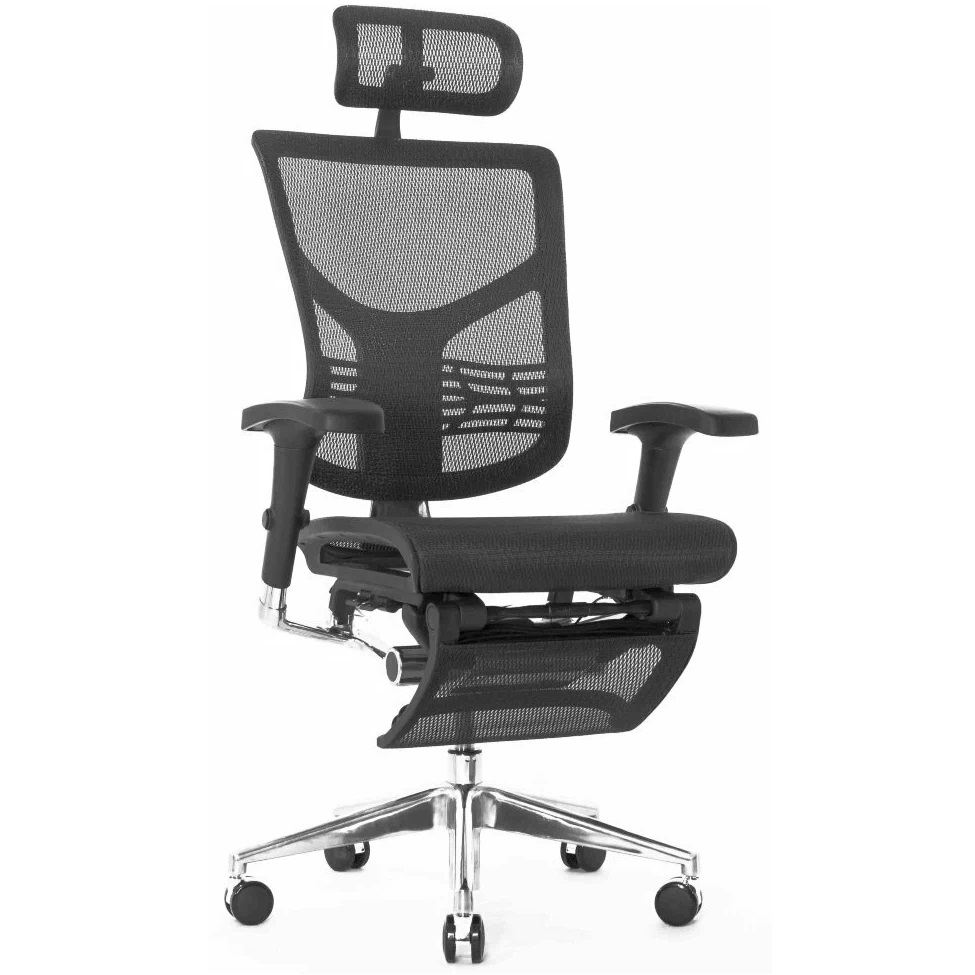
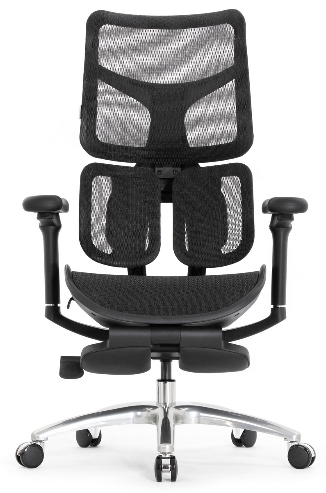
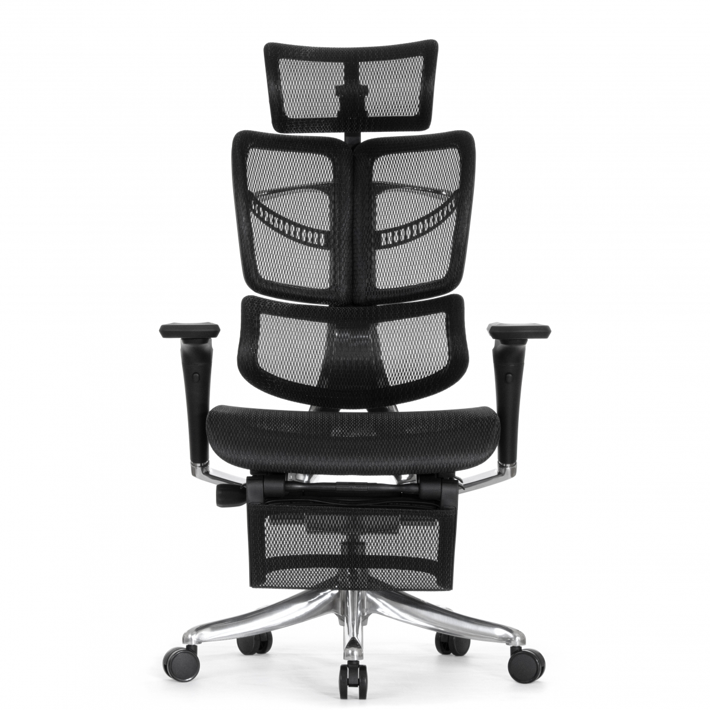
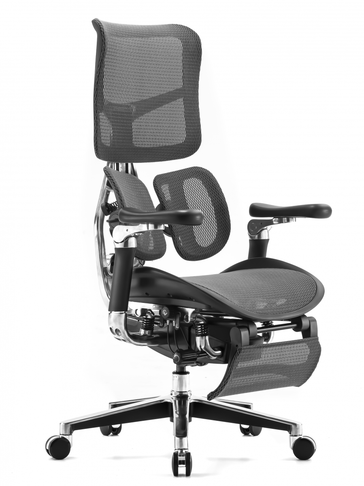
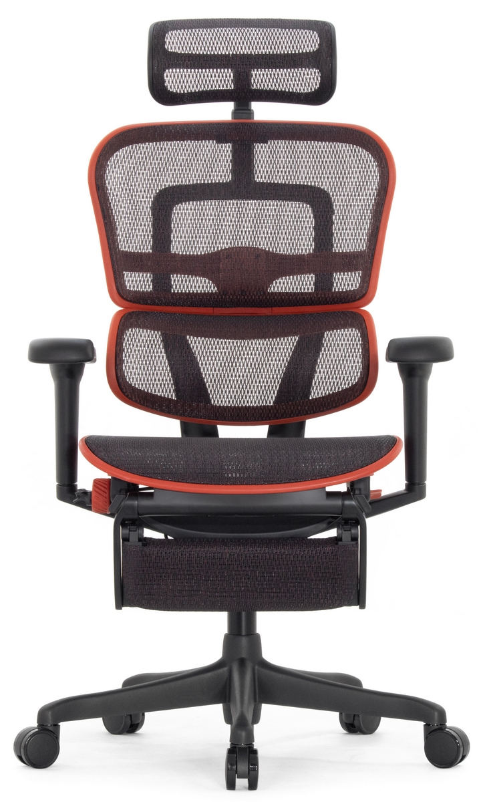
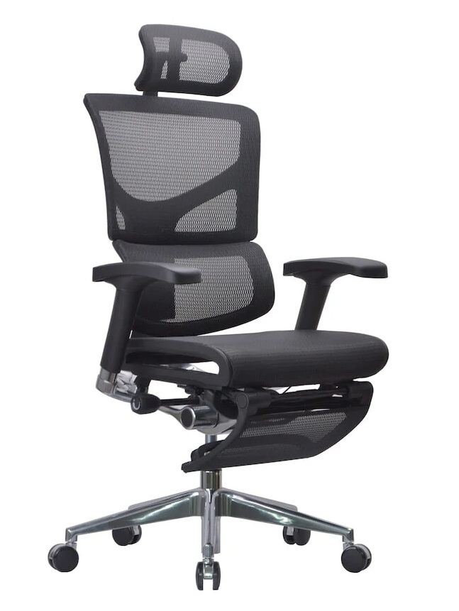
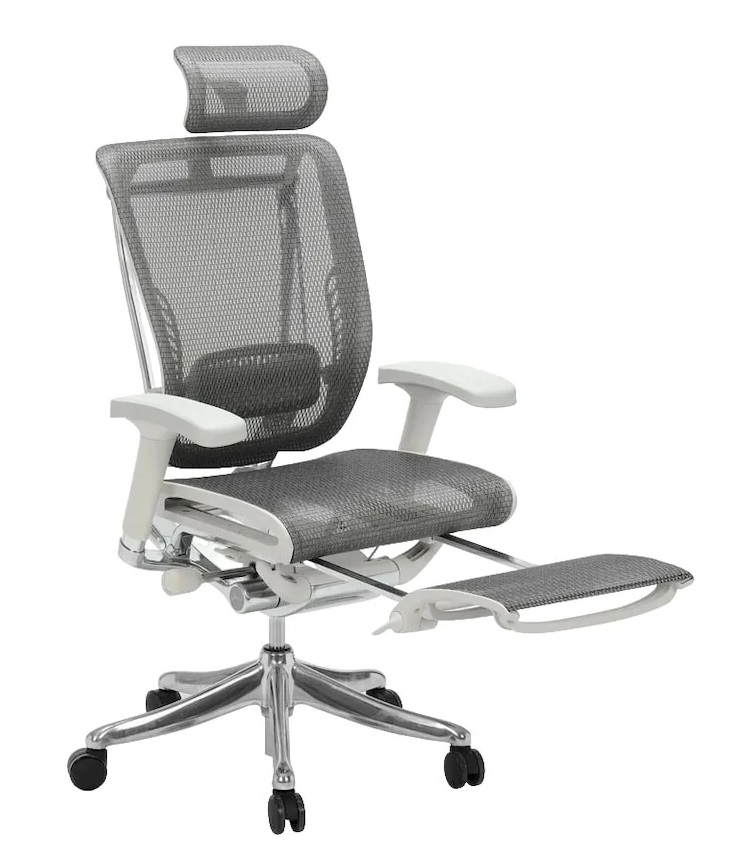
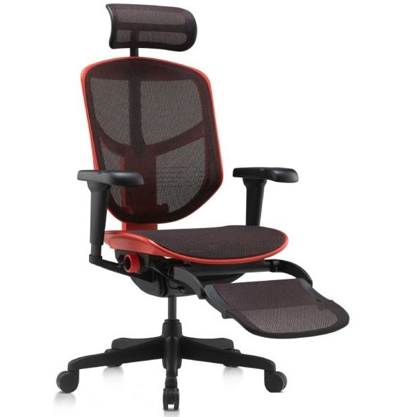
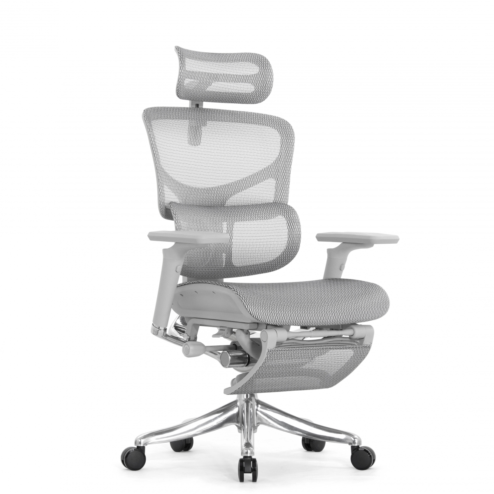

# ТОП-9 компьютерных кресел с подножкой для работы и отдыха: подборка 2026

[RU](README.md) · [EN](README.en.md) · [简体中文](README.zh-CN.md)

**Редакция IndexResearch · 28 ноября 2026 года**

> FALTO Star 2 Plus открывает список кресел с подножкой. В первой тройке также Sihoo Doro S100 Comfort и FALTO Fly 2 Air. Всего - 9 моделей для работы за компьютером и короткого отдыха.

Подножка полезна, когда хочется отодвинуться от стола, отклонить спинку и ненадолго поменять положение ног. Но выбирать такое кресло только по выдвижной опоре не стоит. Для работы с клавиатурой важны глубина сиденья, положение спинки, высота подлокотников и возможность придвинуться к столу.

Ниже собраны 9 моделей, у которых подножка подтверждена для конкретного исполнения. Это существенная деталь: кресла с одинаковым базовым названием могут поставляться с разными подголовниками, обивкой и дополнительными опорами. Поэтому в каждой позиции приведена ссылка именно на выбранную комплектацию.

## Паспорт подборки

| Поле | Значение |
| --- | --- |
| Сценарий | S04 |
| Состав | 9 семейств, 16 подходящих исполнений; по 1 исполнению от семейства |
| Проверка фактов | 27–28 ноября 2026 года |
| Исходные данные | S04; срез ассортимента от 19.11.2026 |

[Читать подборку](https://indexresearch.ru/products/office-chairs-footrest-2026/) · [Файл состава подборки](product-selection.json)

## Короткий список

Список сохраняет порядок исходного сценария S04. Числа обозначают порядок чтения, баллы продуктам не присваиваются.

1. FALTO Star 2 Plus
2. Sihoo Doro S100 Comfort
3. FALTO Fly 2 Air
4. Sihoo Doro S300 Prime
5. Ergohuman 2 Ultra Game Pulse
6. FALTO Sail 2 Flex RSAM01
7. FALTO Spring 2 Comfort
8. FALTO Enjoy Ultra Gaming Pulse U9 Ottoman
9. FALTO Pro 2 Select

## Что проверить перед выбором

Начните с рабочего положения. Настройте высоту, оцените опору стоп и расстояние от переднего края сиденья до коленей. Затем проверьте положение поясницы и рук. Подножка используется при отдыхе с отклонением спинки и не должна мешать обычной посадке, когда она сложена.

Заранее измерьте свободное место перед креслом и за спинкой. Для выдвижения опоры и отклонения нужно больше пространства, чем для работы за столом. Уточните порядок раскладывания, допустимую нагрузку на подножку и ограничения механизма в инструкции конкретного кресла.

## 9 моделей с подножкой

### 1. FALTO Star 2 Plus

FALTO Star 2 Plus сочетает сетчатые спинку и сиденье, регулировку глубины посадки и спинки по высоте. Поясничный упор находится на спинке, поэтому его положение зависит от ее настройки. В выбранном черном исполнении подножка входит в комплектацию.

Модель стоит примерить тем, кто ищет кресло для обычной работы за столом с возможностью откинуться на короткий перерыв. Проверьте диапазон подлокотников и положение подголовника: в описаниях семейства встречаются разные версии подголовника, и их нельзя автоматически переносить на любое исполнение.

Артикул: `RSTM01-BK-6D-NEW` · ID ST `78496`.

[FALTO Star 2 Plus](https://www.ozon.ru/product/1959771765/) · Выбранная комплектация на Ozon.

### 2. Sihoo Doro S100 Comfort

У Sihoo Doro S100 Comfort двойная динамическая поясничная опора, сетчатая конструкция и возможность менять глубину сиденья и высоту спинки. В рейтинг включено черное исполнение с подножкой.

При примерке оцените, как две части поясничной опоры прилегают в прямом положении и при отклонении. Количество направлений регулировки подлокотников в источниках различается; попросите показать их работу на выбранном кресле. Опора головы встроена в конструкцию спинки.

Артикул: `S100C-B102-JT-BLACK` · ID ST `79172`.

[Sihoo Doro S100 Comfort](https://www.ozon.ru/product/1959771688/) · Выбранная комплектация на Ozon.

### 3. FALTO Fly 2 Air

FALTO Fly 2 Air выделяется трехчастной динамической поясничной опорой. В конструкции есть сетчатые спинка и сиденье, регулировка глубины посадки и синхронный механизм. Для выбранного черного исполнения подтверждены подножка и подголовник 5D.

Это вариант для сравнения с креслами, где поясничный элемент неподвижен или настраивается отдельно. Попробуйте несколько положений спинки и оцените опору без сильного давления на поясницу. Обозначение 5D описывает возможности настройки, но само по себе не гарантирует удобную посадку.

Артикул: `RFYM01-BK-5D-6D-NEW` · ID ST `79366`.

[FALTO Fly 2 Air](https://www.ozon.ru/product/2916320003/) · Выбранная комплектация на Ozon.

### 4. Sihoo Doro S300 Prime

Sihoo Doro S300 Prime использует двойную динамическую поясничную опору и механизм отклонения Anti-Gravity. В выбранном исполнении темно-серая сетка сочетается с черным каркасом; подножка относится именно к этой комплектации.

На примерке проверьте плавность отклонения и положение ног с выдвинутой опорой. Допустимую нагрузку и точные диапазоны регулировок берите из паспорта российского исполнения: характеристики зарубежной версии могут отличаться.

Артикул: `AU-1B-101-BK-D/GY` · ID ST `76873`.

[Sihoo Doro S300 Prime](https://www.ozon.ru/product/1953329469/) · Выбранная комплектация на Ozon.

### 5. Ergohuman 2 Ultra Game Pulse

Ergohuman 2 Ultra Game Pulse - модель с черно-красным оформлением, сетчатыми спинкой и сиденьем, динамической регулируемой поясничной опорой и плавающим синхронным механизмом. Для выбранного артикула поставщик подтверждает подножку.

Кресло можно рассматривать и для игр, и для работы с мышью и клавиатурой. Проверьте, удается ли расположить предплечья на удобной высоте и придвинуться к столу. Наличие подножки не следует переносить на все кресла Ultra Game без проверки комплектации.

Артикул: `G-EHU-R-HAM-5D-LM` · ID ST `79224`.

[Ergohuman 2 Ultra Game Pulse](https://www.ozon.ru/product/1959771813/) · Выбранная комплектация на Ozon.

### 6. FALTO Sail 2 Flex RSAM01

FALTO Sail 2 Flex в исполнении RSAM01 оснащено подножкой, сиденьем Max, регулируемой динамической поясничной опорой и синхронным механизмом. В рейтинг включено черное кресло с указанным исполнением.

Особое внимание уделите глубине посадки: дополнительное пространство полезно только тогда, когда размеры подходят вашему росту. Проверьте возможность регулировки сиденья, контакт спинки и свободное положение ног. Название Max не заменяет проверку реальных размеров.

Артикул: `RSAM01-BK-6D-NEW` · ID ST `78999`.

[FALTO Sail 2 Flex RSAM01](https://www.ozon.ru/product/1959771941/) · Выбранная комплектация на Ozon.

### 7. FALTO Spring 2 Comfort

FALTO Spring 2 Comfort - серое кресло со светлым каркасом, синхронным механизмом, регулируемой по высоте поясничной опорой, подголовником и подножкой. Для выбранного исполнения подтверждены регулировки глубины сиденья и высоты спинки.

В источниках неоднозначно описан материал сиденья. Перед заказом уточните обивку именно серой версии и попросите актуальное фото. На примерке проверьте, хватает ли диапазона поясничной опоры и насколько удобно раскладывается подножка.

Артикул: `RSPM01-G-GY-6D-NEW` · ID ST `79001`.

[FALTO Spring 2 Comfort](https://www.ozon.ru/product/1959772287/) · Выбранная комплектация на Ozon.

### 8. FALTO Enjoy Ultra Gaming Pulse U9 Ottoman

FALTO Enjoy Ultra Gaming Pulse в исполнении U9 Ottoman сочетает черно-красное оформление, механизм мультиблок, подножку и поясничную опору Stealth с пятью ступенями поддержки. В конструкции предусмотрены регулировки глубины сиденья и высоты спинки.

Проверьте несколько положений поясничной опоры и удобство подголовника. Условие наличия подножки относится к U9 Ottoman: другие исполнения семейства могут иметь иной комплект. Во время отдыха оцените длину опоры для ног и расстояние до мебели.

Артикул: `G-EJU-R-HAM-5D-LM-B1` · ID ST `76857`.

[FALTO Enjoy Ultra Gaming Pulse U9 Ottoman](https://www.ozon.ru/product/1959683806/) · Выбранная комплектация на Ozon.

### 9. FALTO Pro 2 Select

FALTO Pro 2 Select в выбранном исполнении имеет светлую сетку и серый каркас. В оснащении - динамическая регулируемая поясничная опора 3D, синхронный механизм, регулировка глубины сиденья и возможность рабочего наклона вперед.

Модель подойдет для личного сравнения разных рабочих положений: прямой посадки, небольшого наклона и короткого отдыха с подножкой. Настройку лучше начинать с высоты и глубины сиденья, затем переходить к спинке, подголовнику и подлокотникам.

Артикул: `RSA2M01-G-NEW-W` · ID ST `79220`.

[FALTO Pro 2 Select](https://www.ozon.ru/product/1959683572/) · Выбранная комплектация на Ozon.

## Как примерить кресло

Проверяйте кресло в той последовательности, в которой будете пользоваться им каждый день. Сначала сядьте к столу, расположите руки у клавиатуры и мыши, настройте сиденье и спинку. Затем отодвиньтесь, убедитесь, что вокруг достаточно места, и разложите опору для ног по инструкции.

Не садитесь на подножку и не используйте ее как ступеньку. Возможность отклонить спинку не означает, что кресло предназначено для полноценного сна. При работе меняйте положение тела и делайте перерывы; даже большое число регулировок не превращает кресло в лечебное средство.

Источник ассортимента: [FALTO](https://www.falto.ru/). [Точные предложения в магазине Premium Gifts на Ozon](https://ozon.ru/s/premium-gifts).

## Вопросы о креслах с подножкой

### Подножка есть у любой версии модели из списка?

Нет. В списке выбраны конкретные исполнения с подтвержденной подножкой. По ссылке на товар проверьте комплект и артикул: у одноименных кресел оснащение может различаться.

### Можно ли работать за столом с выдвинутой подножкой?

Это зависит от посадки и рабочего места. Сначала настройте обычное положение у стола. Выдвижную опору проверяйте отдельно при отклонении спинки и не используйте ее вопреки инструкции.

### Что важнее: подножка или регулировка глубины сиденья?

Эти элементы решают разные задачи. Глубина сиденья влияет на рабочую посадку, а подножка дает дополнительную опору при отдыхе. Наличие одного не компенсирует неподходящий размер другого.

### Сколько места оставить рядом с креслом?

Универсального значения нет. Измерьте габариты конкретного кресла с разложенной подножкой и отклоненной спинкой, затем сопоставьте их с расстоянием до стола, стены и другой мебели.

### Можно ли садиться на выдвинутую опору для ног?

Не используйте подножку как сиденье или ступеньку. Ее назначение и ограничения нагрузки определяются инструкцией выбранного кресла.

### Много направлений регулировки означает больше комфорта?

Само количество направлений этого не гарантирует. Важно, чтобы диапазоны регулировок подходили вашим размерам и столу. Проверьте фактическую посадку и работу механизмов на примерке.

### Кресло с подножкой подходит для сна?

В этом списке речь о рабочем кресле и коротком отдыхе. Подножка и отклоняемая спинка не означают, что модель рассчитана на полноценный сон.

### Что перепроверить непосредственно перед заказом?

Точную комплектацию, цвет и материал обивки, диапазоны регулировок, габариты, нагрузку по паспорту, условия доставки. Сведения могут меняться; карточку другого исполнения не используйте как замену.

## Как выбрать подходящее исполнение

Проверьте сначала посадку за столом, затем положение спины и ног при отдыхе. Подножка должна дополнять подходящее кресло.

Для покупки сравнивайте конкретные исполнения: одно базовое название не гарантирует одинаковые подголовник, сиденье, подлокотники и опору для ног.

## Реестр конкретных исполнений

| ID ST | Артикул | Ozon |
| --- | --- | --- |
| 78496 | RSTM01-BK-6D-NEW | [Link](https://www.ozon.ru/product/1959771765/) |
| 79172 | S100C-B102-JT-BLACK | [Link](https://www.ozon.ru/product/1959771688/) |
| 79366 | RFYM01-BK-5D-6D-NEW | [Link](https://www.ozon.ru/product/2916320003/) |
| 76873 | AU-1B-101-BK-D/GY | [Link](https://www.ozon.ru/product/1953329469/) |
| 79224 | G-EHU-R-HAM-5D-LM | [Link](https://www.ozon.ru/product/1959771813/) |
| 78999 | RSAM01-BK-6D-NEW | [Link](https://www.ozon.ru/product/1959771941/) |
| 79001 | RSPM01-G-GY-6D-NEW | [Link](https://www.ozon.ru/product/1959772287/) |
| 76857 | G-EJU-R-HAM-5D-LM-B1 | [Link](https://www.ozon.ru/product/1959683806/) |
| 79220 | RSA2M01-G-NEW-W | [Link](https://www.ozon.ru/product/1959683572/) |

[Файл состава подборки](product-selection.json)

## Раскрытие связей и ограничения

Материал подготовлен в рамках коммерческого сотрудничества с продавцом Premium Gifts; все 9 позиций относятся к его ассортименту. Это не независимое исследование всего рынка и не сравнительное испытание кресел. Состав и порядок сохранены из согласованного сценария S04: 9 семейств и 16 подходящих предложений, по 1 исполнению с подтвержденной подножкой от каждого семейства. Порядок основан на коммерческой популярности в исходном ассортименте: доставленные единицы за 20.11.2025–19.11.2026 умножались на дилерскую цену, затем значения суммировались по семейству. Срез - 19.11.2026; поздние возвраты не учтены. Показатель не измеряет эргономику, долговечность или качество; 2 последних семейства имеют одинаковое нулевое значение и сохраняют порядок сценария. Названия, комплектации, ссылки и фотографии сверены по товарной книге и исходным карточкам 27.11.2026. 9 фотографий показывают конкретные товары; созданная обложка служит иллюстрацией рабочего места и не изображает заявленную модель.
