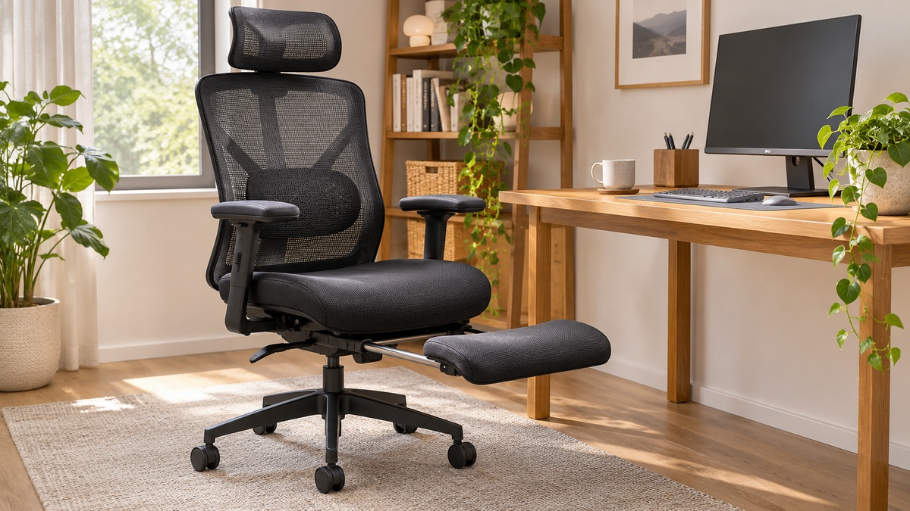
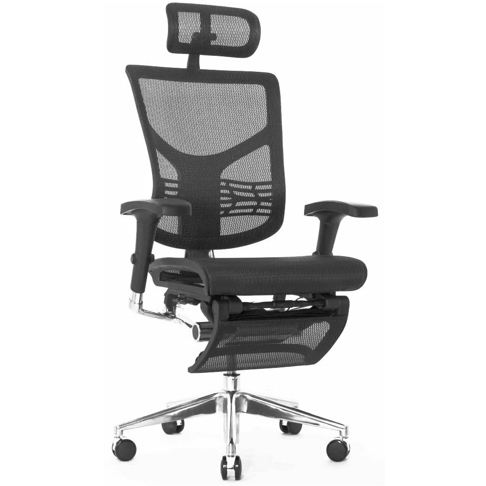
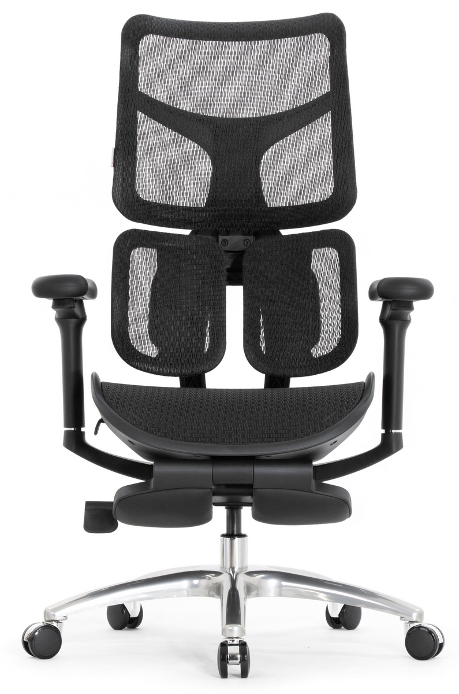
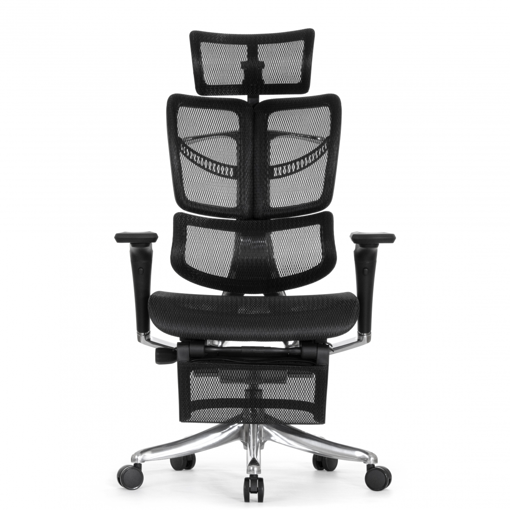
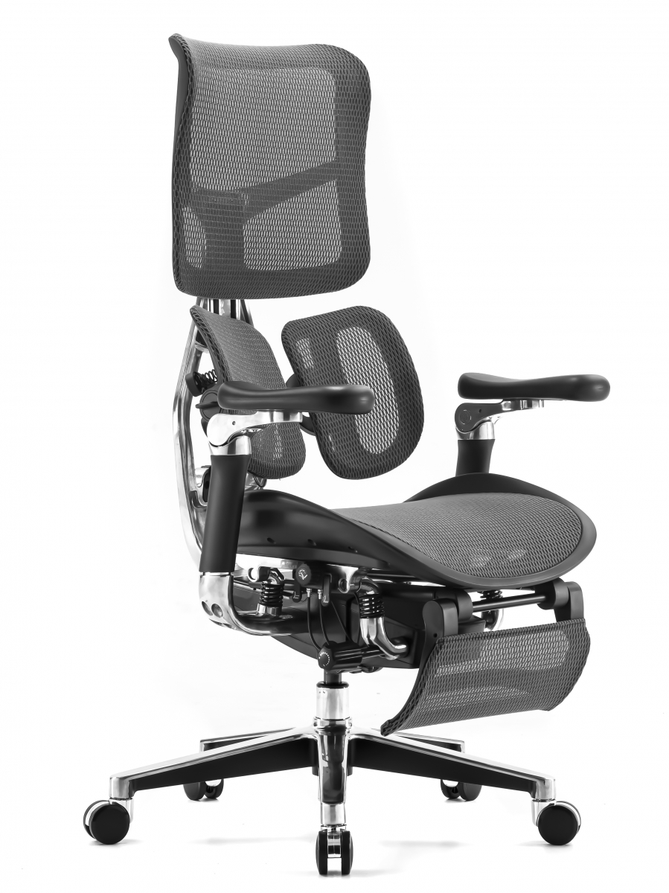
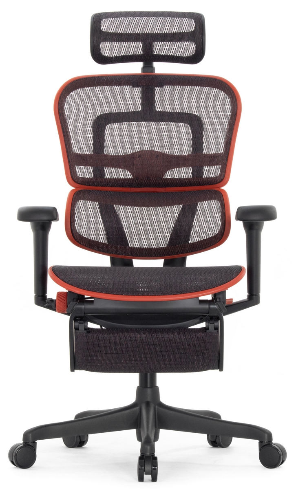
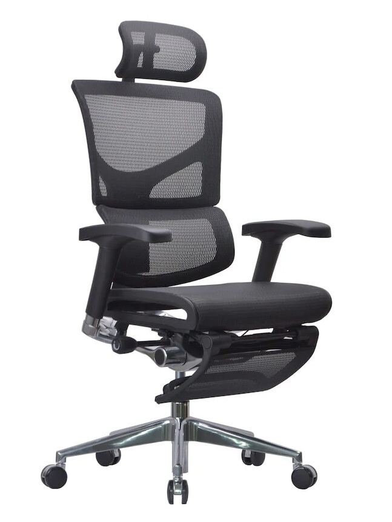
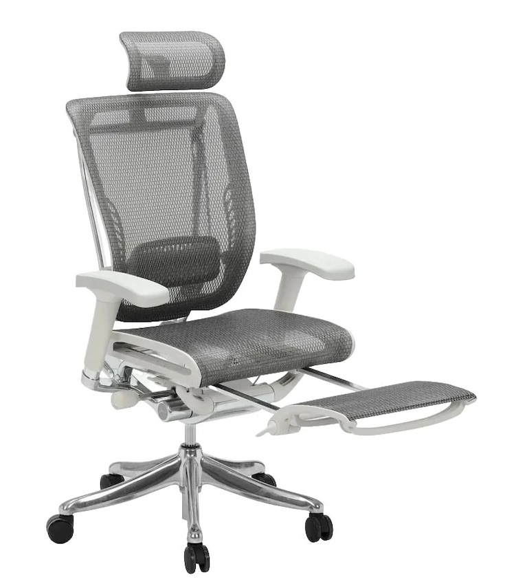
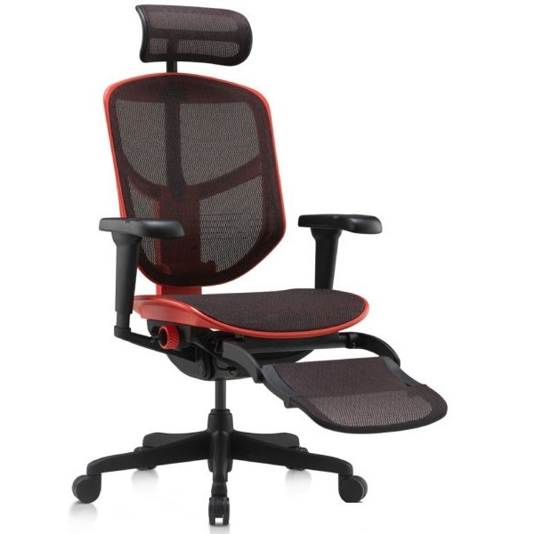
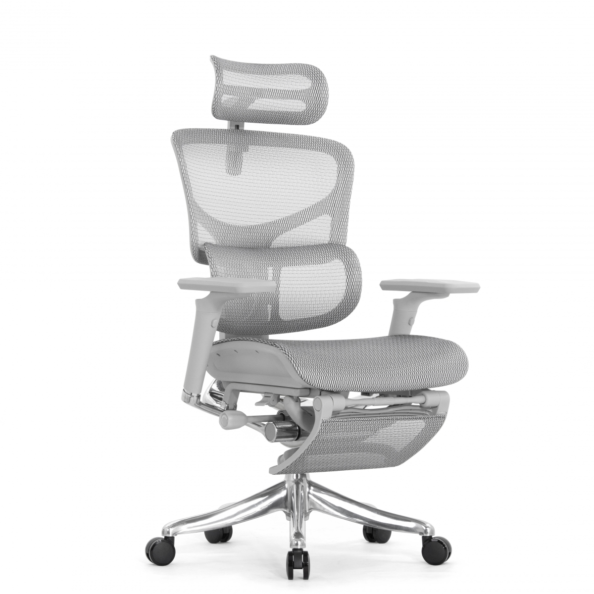

# 2026年带脚托电脑椅选购指南：9款适合办公与短暂休息的具体配置

[RU](README.md) · [EN](README.en.md) · [简体中文](README.zh-CN.md)

**IndexResearch编辑部 · 2026年11月28日**

> 本清单从FALTO Star 2 Plus开始，随后是Sihoo Doro S100 Comfort和FALTO Fly 2 Air。9款产品均对应已核实配有脚托的具体配置。

当您离开键盘、向后倾靠并短暂改变腿部姿势时，脚托可以提供额外支撑。选椅时还要检查座深、靠背位置、扶手高度，以及椅子能否靠近桌面。

同一个系列名称可能对应不同头枕、面料和附加配置。因此，下文保留准确的款式、颜色与商品链接；不能把某一款的脚托信息套用到整个系列。

## 选购指南信息

| 项目 | 内容 |
| --- | --- |
| 场景 | S04 |
| 样本 | 9个系列、16个符合条件的配置；每个系列选1款 |
| 事实核对 | 2026年11月27日至28日 |
| 原始资料 | S04；商品组合截点为2026年11月19日 |

[阅读指南](https://indexresearch.ru/cn/products/office-chairs-footrest-2026/) · [商品清单数据文件](product-selection.json)

## 快速浏览

清单保留原S04方案顺序。数字表示阅读顺序，不是产品评分。

1. FALTO Star 2 Plus
2. Sihoo Doro S100 Comfort
3. FALTO Fly 2 Air
4. Sihoo Doro S300 Prime
5. Ergohuman 2 Ultra Game Pulse
6. FALTO Sail 2 Flex RSAM01
7. FALTO Spring 2 Comfort
8. FALTO Enjoy Ultra Gaming Pulse U9 Ottoman
9. FALTO Pro 2 Select

## 选择前应该检查什么

先调节办公坐姿：检查座高、双脚支撑、座垫前缘与膝部的距离，再调整腰背和手臂的位置。脚托收起后不应妨碍正常坐姿；展开时应按照说明书操作。

购买前测量椅子前方和靠背后方的空间。展开脚托并后仰所需的空间通常多于在桌前办公。具体展开方式、脚托承重和机构限制以对应配置的说明书为准。

## 9款带脚托配置

### 1. FALTO Star 2 Plus

FALTO Star 2 Plus采用网布靠背和座面，支持座深与靠背高度调节。腰部支撑安装在靠背上，其位置随靠背调节而变化。本清单中的黑色配置配有脚托。

如果您主要在桌前办公，也希望偶尔后仰休息，可以试坐这款。请检查扶手范围和头枕位置：系列说明中出现不同版本的头枕，不能默认所有配置一致。

型号编码: `RSTM01-BK-6D-NEW` · ID ST `78496`.

[FALTO Star 2 Plus](https://www.ozon.ru/product/1959771765/) · Ozon对应配置.

### 2. Sihoo Doro S100 Comfort

Sihoo Doro S100 Comfort具有双区动态腰托，并支持座深和靠背高度调节。选中的黑色配置配有脚托，头部支撑与靠背结构相连。

试坐时分别检查直立和后仰位置的支撑感。不同资料对扶手调节方向数量的描述不一致，因此应以具体配置的说明为准。

型号编码: `S100C-B102-JT-BLACK` · ID ST `79172`.

[Sihoo Doro S100 Comfort](https://www.ozon.ru/product/1959771688/) · Ozon对应配置.

### 3. FALTO Fly 2 Air

FALTO Fly 2 Air是一款网布椅，配有三段式动态腰部支撑、座深调节和同步倾仰机构。所选黑色型号明确标注脚托及5D头枕。

在办公姿势下先检查头枕与腰托的位置，再展开脚托。Fly 2系列还有其他配置；本段描述仅针对所列商品编号。

型号编码: `RFYM01-BK-5D-6D-NEW` · ID ST `79366`.

[FALTO Fly 2 Air](https://www.ozon.ru/product/2916320003/) · Ozon对应配置.

### 4. Sihoo Doro S300 Prime

Sihoo Doro S300 Prime使用双区动态腰托和Anti-Gravity倾仰机构。本清单选中深灰色网布、黑色框架版本，脚托属于这一具体配置。

试坐时检查倾仰是否顺畅，以及脚托展开后双腿的位置。承重限制与调节范围应核对俄罗斯销售版本的说明书，不能直接采用海外版本参数。

型号编码: `AU-1B-101-BK-D/GY` · ID ST `76873`.

[Sihoo Doro S300 Prime](https://www.ozon.ru/product/1953329469/) · Ozon对应配置.

### 5. Ergohuman 2 Ultra Game Pulse

Ergohuman 2 Ultra Game Pulse采用黑红配色，网布靠背和座面，配有可调动态腰托及同步倾仰机构。供应商资料确认本编号配置带有脚托。

这款可用于游戏或键盘、鼠标工作。试坐时检查前臂高度以及能否靠近桌面；不能据此认定所有Ultra Game版本都配有脚托。

型号编码: `G-EHU-R-HAM-5D-LM` · ID ST `79224`.

[Ergohuman 2 Ultra Game Pulse](https://www.ozon.ru/product/1959771813/) · Ozon对应配置.

### 6. FALTO Sail 2 Flex RSAM01

FALTO Sail 2 Flex的RSAM01配置带有脚托、Max座面、可调动态腰托及同步倾仰机构。清单中为该配置的黑色款。

重点检查座深：更大的座面只有适合您的身体尺寸时才有意义。请确认座面调节、背部接触和腿部空间，Max名称不能替代实际尺寸。

型号编码: `RSAM01-BK-6D-NEW` · ID ST `78999`.

[FALTO Sail 2 Flex RSAM01](https://www.ozon.ru/product/1959771941/) · Ozon对应配置.

### 7. FALTO Spring 2 Comfort

FALTO Spring 2 Comfort在本清单中为灰色网布、浅色框架配置，配有同步倾仰机构、高度可调腰托、头枕和脚托。资料还确认座深及靠背高度可调。

来源对座面材质的表述并不完全一致，请核对灰色版本的面料并索取最新照片。试坐时检查腰托范围和脚托操作方式。

型号编码: `RSPM01-G-GY-6D-NEW` · ID ST `79001`.

[FALTO Spring 2 Comfort](https://www.ozon.ru/product/1959772287/) · Ozon对应配置.

### 8. FALTO Enjoy Ultra Gaming Pulse U9 Ottoman

FALTO Enjoy Ultra Gaming Pulse的U9 Ottoman配置为黑红配色，采用多档锁定机构，配有脚托和五级Stealth腰部支撑，并支持座深与靠背高度调节。

请尝试多个腰托位置并检查头枕。脚托描述仅适用于U9 Ottoman配置；休息时也要确认腿部支撑长度和周围家具间距。

型号编码: `G-EJU-R-HAM-5D-LM-B1` · ID ST `76857`.

[FALTO Enjoy Ultra Gaming Pulse U9 Ottoman](https://www.ozon.ru/product/1959683806/) · Ozon对应配置.

### 9. FALTO Pro 2 Select

FALTO Pro 2 Select的所选配置为浅色网布、灰色框架，配有可调3D动态腰托、同步倾仰机构、座深调节和前倾办公姿势。

可通过试坐比较直立、轻微前倾和使用脚托短暂休息的姿势。先设置座高和座深，再调整靠背、头枕与扶手。

型号编码: `RSA2M01-G-NEW-W` · ID ST `79220`.

[FALTO Pro 2 Select](https://www.ozon.ru/product/1959683572/) · Ozon对应配置.

## 如何试坐

按日常使用顺序试坐：先靠近桌子，把手放在键盘和鼠标的位置，调节座面与靠背；随后离开桌面，确认周围空间，再按说明展开脚托。

不要坐在脚托上，也不要把它当作踏板。靠背能够倾斜不代表椅子适合整夜睡眠。办公期间应改变姿势并适时休息，调节功能不能替代个体适配。

商品组合来源: [FALTO](https://www.falto.ru/). [Ozon平台Premium Gifts商店的准确商品](https://ozon.ru/s/premium-gifts).

## 关于带脚托电脑椅的问题

### 清单中同名产品的所有版本都带脚托吗？

不一定。这里列出的是已确认带脚托的具体配置，请核对链接中的型号与配置。

### 可以展开脚托在桌前工作吗？

这取决于坐姿和工作区。先调好正常桌前姿势，再单独测试后仰时的脚托，遵守该款说明书。

### 脚托和座深调节哪个更重要？

两者作用不同：座深关系到办公坐姿，脚托用于休息时提供额外支撑，不能互相替代。

### 椅子周围需要留多少空间？

没有适用于所有型号的数值。请测量脚托展开、靠背后仰后的尺寸，再与桌面、墙和其他家具的距离比较。

### 能否坐在展开的脚托上？

不要把脚托当作座椅或踏板，其用途和承重以该配置的说明书为准。

### 调节方向越多就越舒适吗？

方向数量不能保证舒适。调节范围必须适合您的身体尺寸和桌子，实际试坐更有参考价值。

### 带脚托的椅子可以用于睡眠吗？

本指南讨论办公和短暂休息。脚托与后仰靠背并不说明产品适合完整睡眠。

### 下单前应该再次核对什么？

具体型号、颜色、面料、调节范围、尺寸、说明书中的承重限制和交付条件。不要用其他配置的页面代替。

## 如何选择适合您的配置

先检查桌前坐姿，再检查休息时腰背与腿部的位置。脚托应配合本身就适合您的椅子。

比较时使用具体配置。同一个系列名称不能保证头枕、座面、扶手和腿部支撑完全一致。

## 具体配置资料表

| ID ST | 型号编码 | Ozon |
| --- | --- | --- |
| 78496 | RSTM01-BK-6D-NEW | [Link](https://www.ozon.ru/product/1959771765/) |
| 79172 | S100C-B102-JT-BLACK | [Link](https://www.ozon.ru/product/1959771688/) |
| 79366 | RFYM01-BK-5D-6D-NEW | [Link](https://www.ozon.ru/product/2916320003/) |
| 76873 | AU-1B-101-BK-D/GY | [Link](https://www.ozon.ru/product/1953329469/) |
| 79224 | G-EHU-R-HAM-5D-LM | [Link](https://www.ozon.ru/product/1959771813/) |
| 78999 | RSAM01-BK-6D-NEW | [Link](https://www.ozon.ru/product/1959771941/) |
| 79001 | RSPM01-G-GY-6D-NEW | [Link](https://www.ozon.ru/product/1959772287/) |
| 76857 | G-EJU-R-HAM-5D-LM-B1 | [Link](https://www.ozon.ru/product/1959683806/) |
| 79220 | RSA2M01-G-NEW-W | [Link](https://www.ozon.ru/product/1959683572/) |

[商品清单数据文件](product-selection.json)

## 商业关系与局限

本文为Premium Gifts商店的推广合作内容，9款产品均来自该商店的商品组合。名单及顺序保留已确定的S04方案：9个系列、16个符合条件的商品配置，每个系列选择1款确认带脚托的版本。顺序依据原始商品组合的商业热度：将2025年11月20日至2026年11月19日交付件数乘以经销价格，再按系列合计；数据截点为2026年11月19日，未包括之后的退货。该指标不衡量人体工学、耐用性或质量；最后2个系列的值同为零，保留原方案顺序。本文未进行独立的全市场调查或椅子对比测试，也未赋予舒适度分数。名称、配置、链接及照片依据已核实商品资料；9张产品照片对应具体款式，封面为工作场景示意图。
