# 10 computer chairs with lumbar support: a 2026 desk-work buying guide

[RU](README.md) · [EN](README.en.md) · [简体中文](README.zh-CN.md)

**IndexResearch editorial team · source selection verified 26 November 2026**

> Lumbar support can be adjustable, dynamic or part of the backrest. These ten chairs from one assortment are not a comfort ranking.

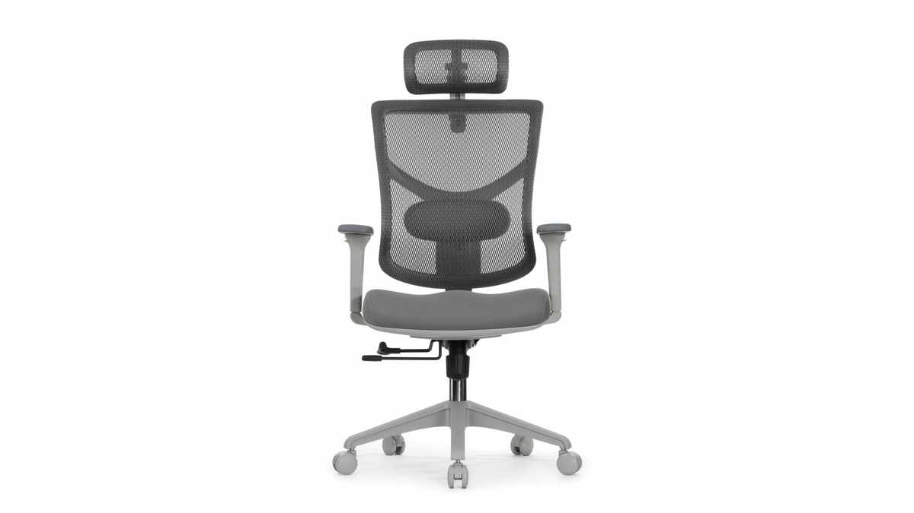

If your lower back tires during computer work, start with fitting the chair to your dimensions rather than the mechanism's name. Check pelvic position, seat depth, backrest contact and desk height. Fit varies between people; adjustments do not guarantee freedom from pain.

**Commercial relationship.** This guide was prepared to promote the Premium Gifts store on Ozon. Links lead to that seller's products. It is not independent whole-market research, medical advice or a chair test. Scenario S03 was selected in advance for adjustable, dynamic or corset-style lumbar support.

> The first three models in the source list are FALTO Star Office Ergo 3 Pro, FALTO Star 2 Plus and FALTO Sail Art 2 Style. No comfort scores were calculated.

## How the list was compiled

We retain the first ten distinct families from the approved S03 selection: 34 families represented by 69 offers in the source matrix. Order reflects commercial popularity within one seller's assortment: delivered units multiplied by purchase cost and aggregated by family. It is not an ergonomics score or market share. No new scores or tests were introduced, and colour variants are not separate participants. Specifications refer to the selected variant; conflicts are qualified.

The guide covers different support designs, not ten independently adjustable lumbar pads. Star 2 changes the position of the entire backrest; Inno Health has a different support design. Dynamic support is not the same as manual depth adjustment.

Assortment source: [FALTO](https://www.falto.ru/), including Sihoo and Ergohuman. Photographs correspond to the selected article number and colour; offers and availability may change.

## The shortlist

1. FALTO Star Office Ergo 3 Pro
2. FALTO Star 2 Plus
3. FALTO Sail Art 2 Style
4. Sihoo Doro S100 Comfort
5. Ergohuman 2 Ultra ST Flex
6. FALTO Synif Inno Health Duo
7. FALTO Fly 2 Air
8. Sihoo M57 Flex
9. FALTO Star Ergo 2 Flex
10. FALTO Vista Air

Check the exact offers at the [Premium Gifts store on Ozon](https://ozon.ru/s/premium-gifts).

## Ten models: lumbar support features

### 1. FALTO Star Office Ergo 3 Pro

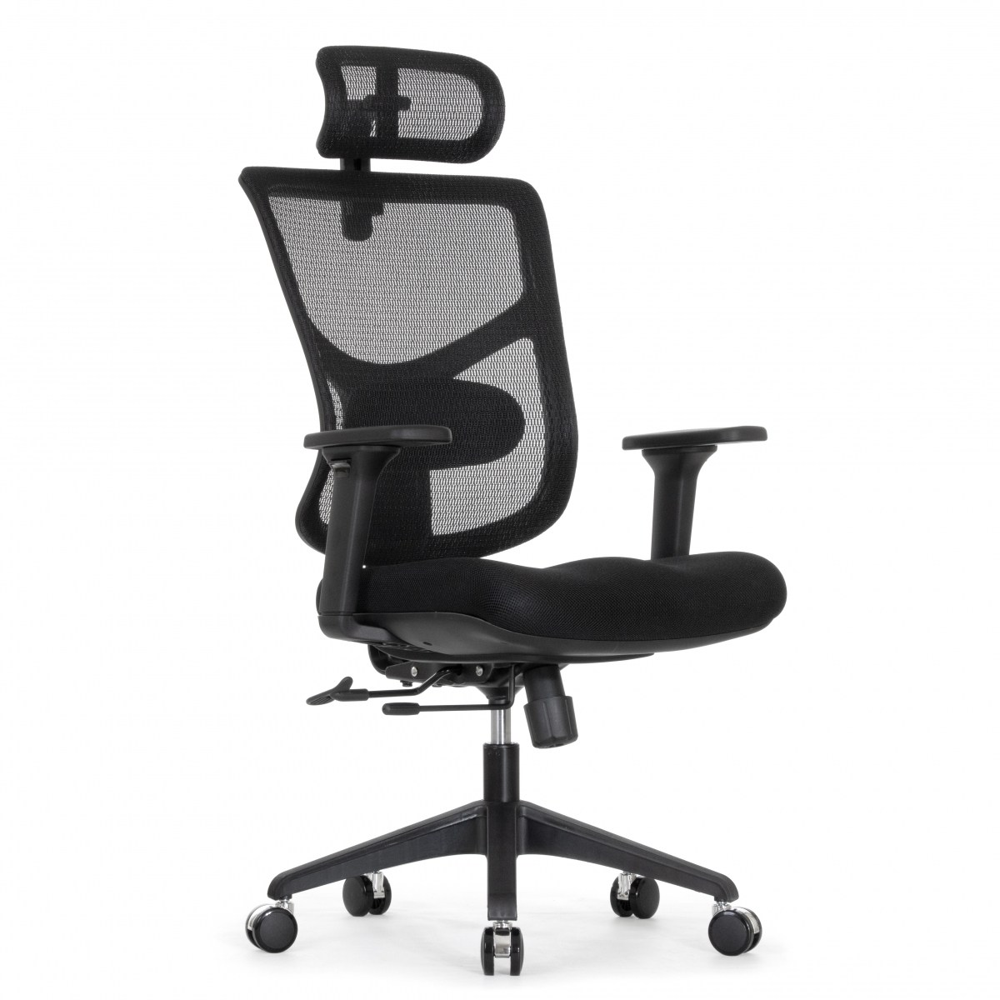

Black mesh back and soft padded fabric seat. The lumbar support is described as adjustable 3D; seat depth and backrest height adjust separately. Consider it for a softer seating surface with adjustable back support.

**What to check:** Set seat depth first, then position the lumbar support at your natural lower-back curve. Sources disagree on the load limit and locking positions; request documentation for the exact black variant.

[FALTO Star Office Ergo 3 Pro](https://www.ozon.ru/product/2609771798/) — selected Ozon variant.

### 2. FALTO Star 2 Plus

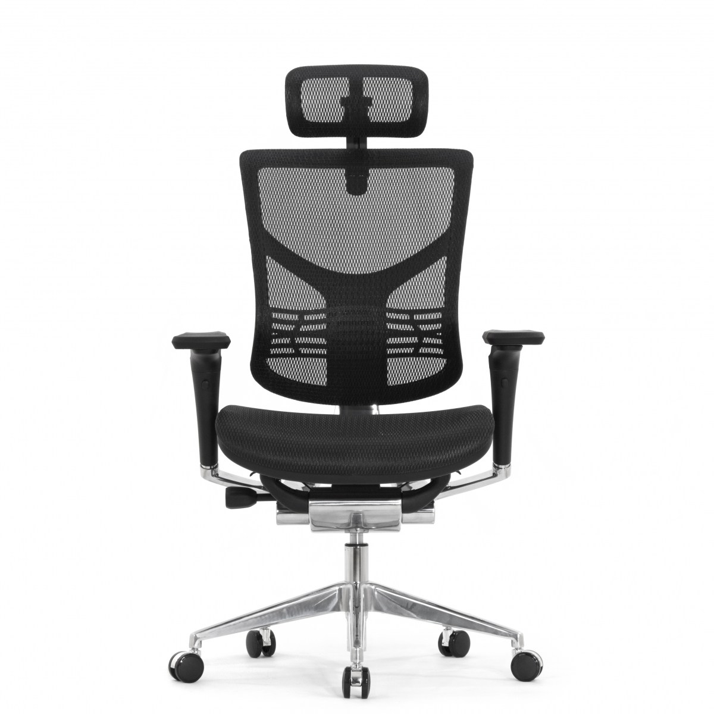

The mesh chair has a lumbar pad fixed relative to the height-adjustable backrest. The pad moves with the entire backrest; this is not independent lumbar adjustment. Armrests adjust in several directions.

**What to check:** Check whether the pad height and upper-back contact can be aligned simultaneously. If independent lumbar depth adjustment matters, compare other models. Confirm the exact headrest version.

[FALTO Star 2 Plus](https://www.ozon.ru/product/1953329455/) — selected Ozon variant.

### 3. FALTO Sail Art 2 Style

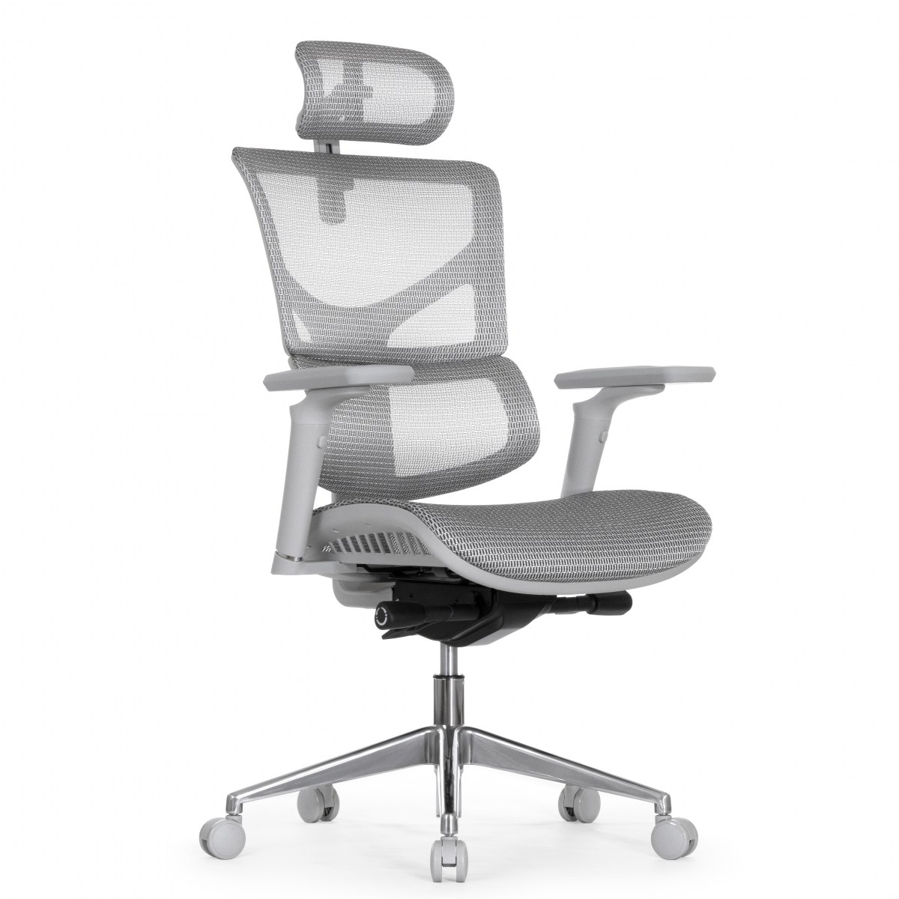

The adjustable dynamic lumbar support combines movement with fit adjustment; the manufacturer's family description confirms adjustment of height and projection. The seat-depth slider and backrest height adjustment change the starting posture.

**What to check:** Compare the fit upright and slightly reclined. Confirm the seat material for this configuration because the Ozon description contains conflicting material information.

[FALTO Sail Art 2 Style](https://www.ozon.ru/product/2770764542/) — selected Ozon variant.

### 4. Sihoo Doro S100 Comfort

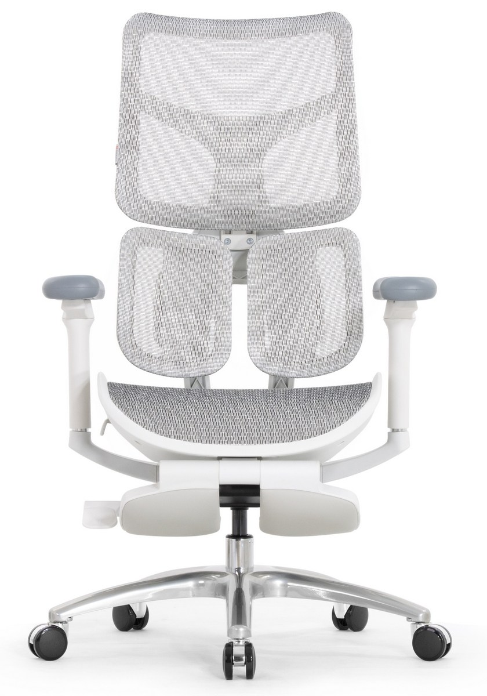

Two-part dynamic lumbar support follows changes in back position. Mesh seat and backrest, seat-depth slider and height-adjustable backrest. Head support is integrated into the backrest, not a separate adjustable headrest.

**What to check:** Try upright and reclined positions and assess contact from both parts. Armrest adjustment directions differ across sources and variants; do not assume international specifications apply to the Russian offer. Check the exact footrest configuration.

[Sihoo Doro S100 Comfort](https://www.ozon.ru/product/1959771730/) — selected Ozon variant.

### 5. Ergohuman 2 Ultra ST Flex

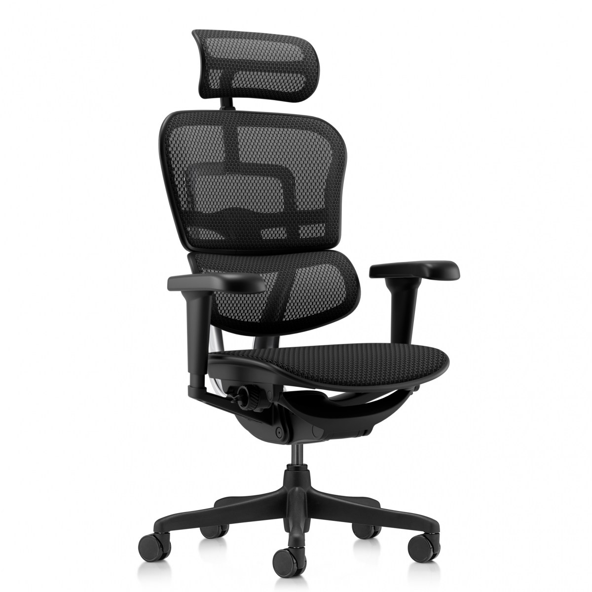

A mesh chair with dynamic lumbar support, a floating synchro mechanism and adjustable seat-mesh tension. Judge the advertised 6D support by the actual range, not the number in the name.

**What to check:** Test several mesh-tension settings and the forward working tilt. Check which lumbar adjustments are independent and which are linked to backrest position.

[Ergohuman 2 Ultra ST Flex](https://www.ozon.ru/product/3929723281/) — selected Ozon variant.

### 6. FALTO Synif Inno Health Duo

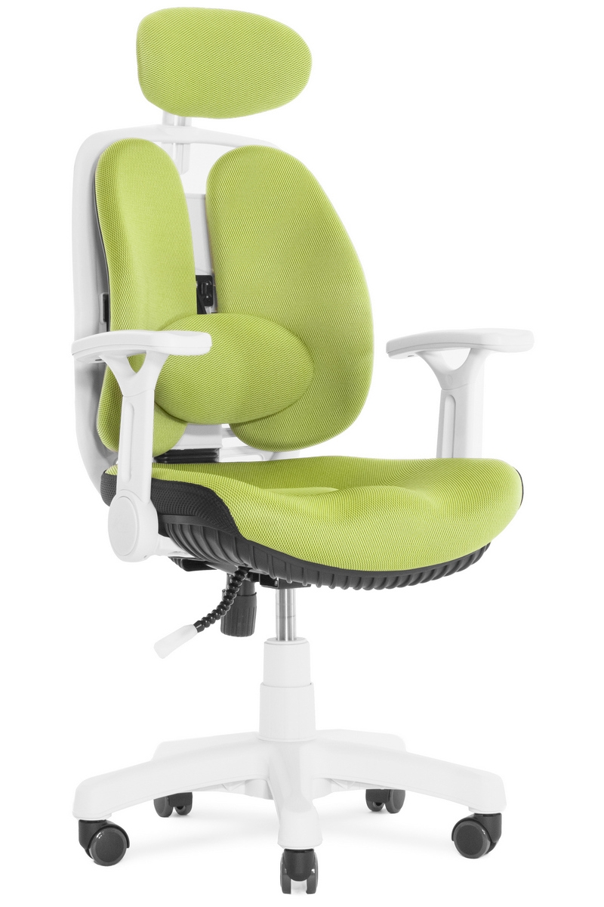

Two separate back-support sections and a removable lumbar cushion provide a different kind of support, not a multi-position mechanical pad. Consider this corset-style design if you prefer a padded fabric seat.

**What to check:** Armrests are fixed, the mechanism maintains permanent backrest contact, and a seat-depth slider is not confirmed. Check the position of both supports and whether the armrests fit beneath your desk.

[FALTO Synif Inno Health Duo](https://www.ozon.ru/product/1953329381/) — selected Ozon variant.

### 7. FALTO Fly 2 Air

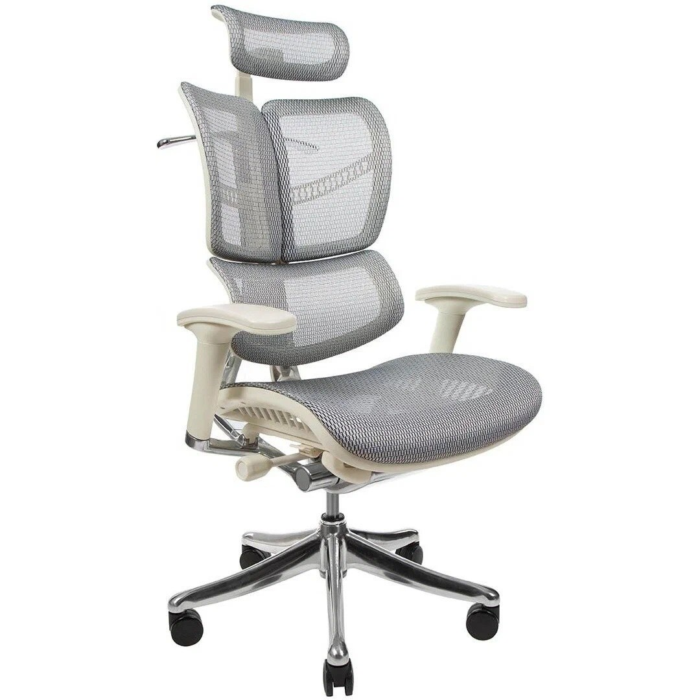

Three-part dynamic lumbar support, mesh construction and seat-depth slider. Moving support differs from independent manual depth adjustment; assess it in your normal posture.

**What to check:** The family has variants with different headrests and optional footrests. Verify the exact grey-mesh, light-frame offer and do not transfer another product's load limit.

[FALTO Fly 2 Air](https://www.ozon.ru/product/1953329286/) — selected Ozon variant.

### 8. Sihoo M57 Flex

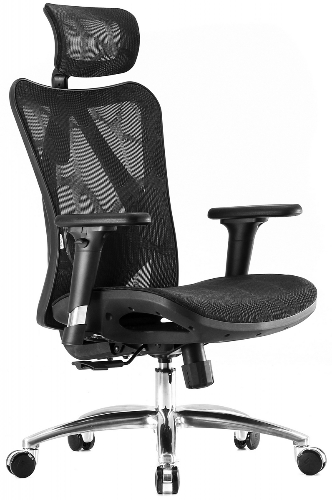

The M57 description confirms adjustable lumbar height and depth. Mesh construction and 3D armrests complement these settings. A seat slider and full-backrest height adjustment are not listed for this version.

**What to check:** Check seat depth carefully during a trial because independent adjustment is not specified. Do not transfer an international load rating to the Russian variant.

[Sihoo M57 Flex](https://www.ozon.ru/product/1953329197/) — selected Ozon variant.

### 9. FALTO Star Ergo 2 Flex

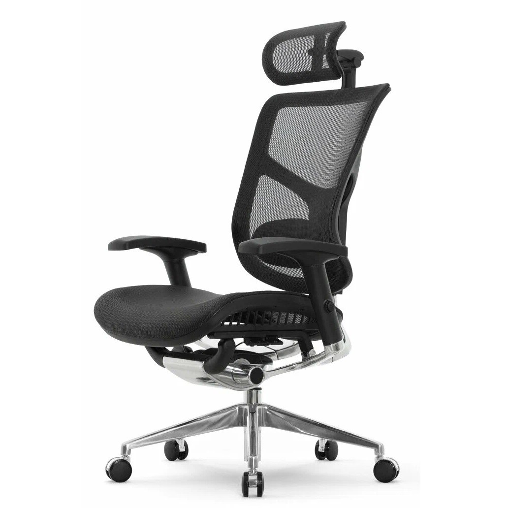

Adjustable 3D lumbar support, mesh seat and backrest, adjustable seat depth and backrest height. Compare its separate lumbar settings with the dynamic designs above.

**What to check:** Set your seated position first. Maximum lumbar projection is not automatically preferable; the support should not force excessive arching. Ask for exact variant documentation because load ratings differ.

[FALTO Star Ergo 2 Flex](https://www.ozon.ru/product/1959683388/) — selected Ozon variant.

### 10. FALTO Vista Air

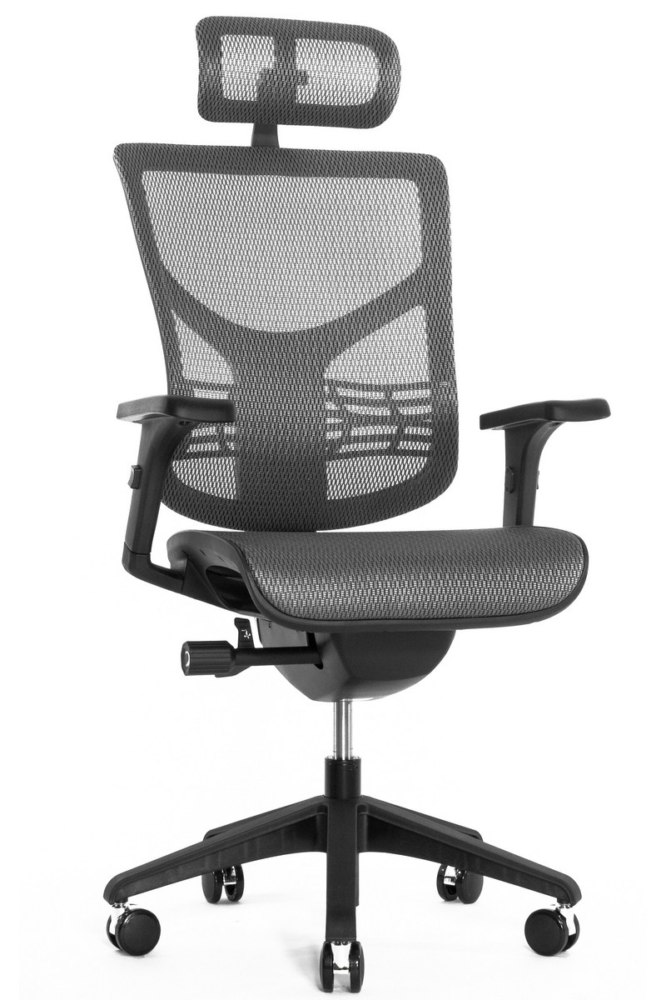

Mesh chair with adjustable lumbar element, seat depth and backrest height. Armrests are height adjustable, a simpler arrangement than multi-directional armrests.

**What to check:** Check forearm position at your desk and available lumbar travel. If depth adjustment matters, ask the seller to demonstrate it on the exact chair; the full range is not specified.

[FALTO Vista Air](https://www.ozon.ru/product/1953329234/) — selected Ozon variant.

## How to try a chair

Set the height so your feet have stable support. Check the clearance between the front of the seat and your knees, then adjust the backrest and lumbar element. Try typing, using the mouse and reclining. Do not compensate for an unsuitable desk height with maximum chair or lumbar adjustment.

Change posture and take breaks: no chair is intended for uninterrupted motionless sitting. If pain is severe, persistent or accompanied by other symptoms, choosing a chair is not a substitute for medical advice.

## Frequently asked questions

### Is independent lumbar depth adjustment essential?

No. It can help with precise fitting, but dynamic support or a height-adjustable backrest may suit some users. Check actual contact during a trial.

### What is dynamic lumbar support?

A support element responding to movement or posture changes. Not all dynamic designs allow independent manual adjustment.

### Is lumbar height or depth more important?

Both may help. Align the support with your natural lower-back curve first, then adjust projection without excessive pressure.

### Can I choose a chair by the number of adjustments alone?

No. Adjustment ranges, seat dimensions, desk height and posture matter more than labels such as 3D or 6D.

### Is a mesh or upholstered backrest better?

It depends on feel, construction and conditions. Mesh usually provides ventilation; upholstery may feel softer. Material does not guarantee comfort.

### Why include a chair with a fixed lumbar pad?

The source scenario includes different ways of adjusting support, including moving the entire backrest. Star 2 has no advertised independent lumbar mechanism.

### Will a chair eliminate lower-back pain?

Such a promise is unsupported. Chair selection and adjustment can help organize a suitable workstation but are not treatment.

### Why is the first product not necessarily best for me?

The order reflects commercial popularity within the selected assortment. Comfort, reliability and personal fit were not measured.

## Conclusion

Start with the required adjustment range and an opportunity to try the chair. The list includes separately adjustable lumbar elements, dynamic mechanisms and corset-style designs. Compare specific variants, not just family names. Check availability and configurations at the [Premium Gifts store](https://ozon.ru/s/premium-gifts).

## Commercial disclosure

Prepared in the commercial interests of Premium Gifts on Ozon using its approved assortment. The list order has been retained; no independent whole-market comparison, chair tests or comfort scoring was carried out.

