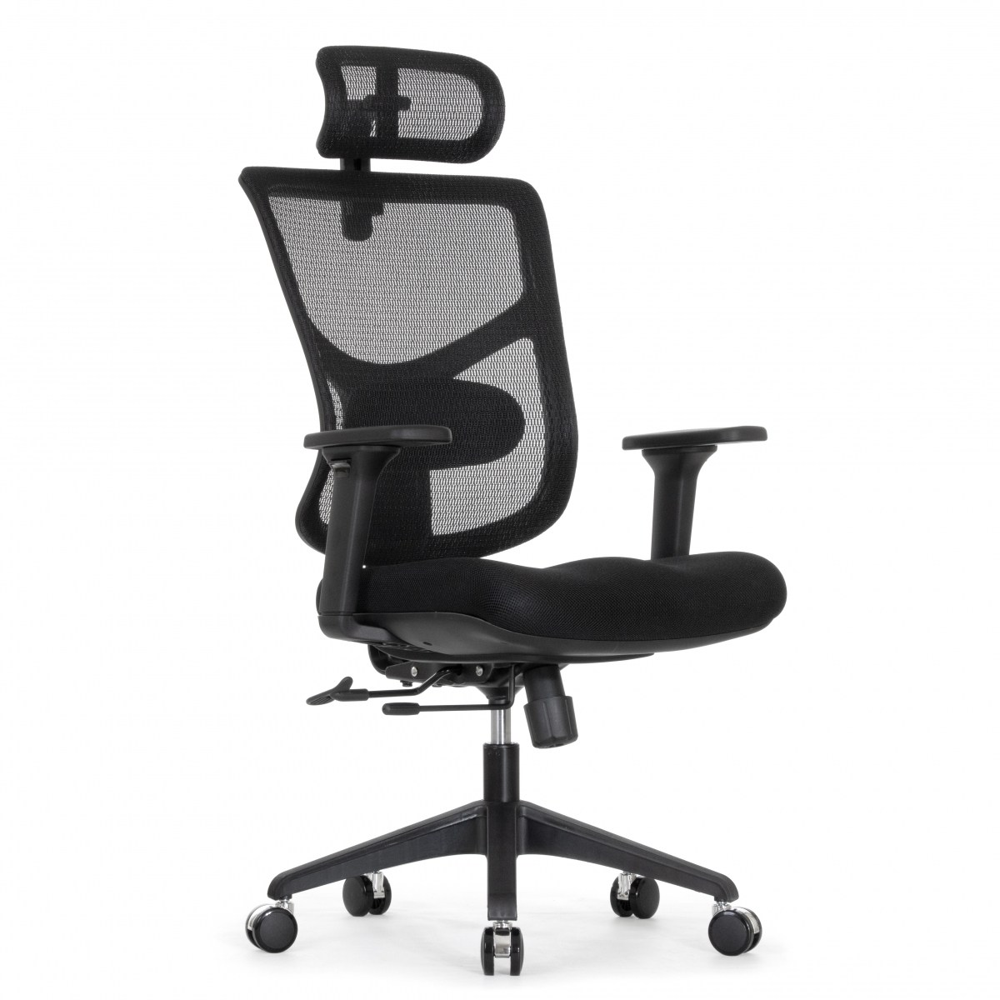
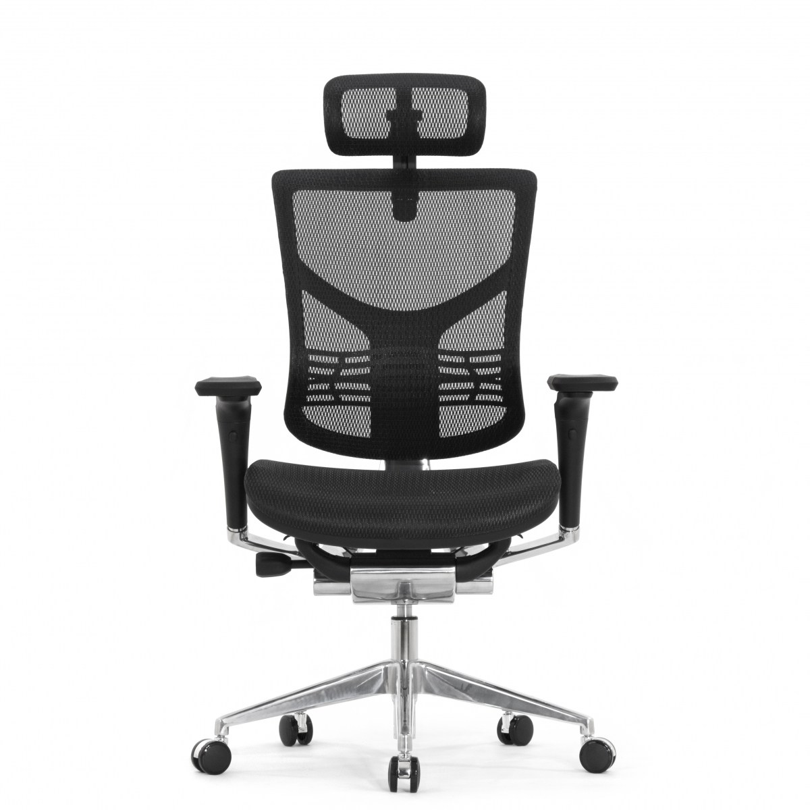
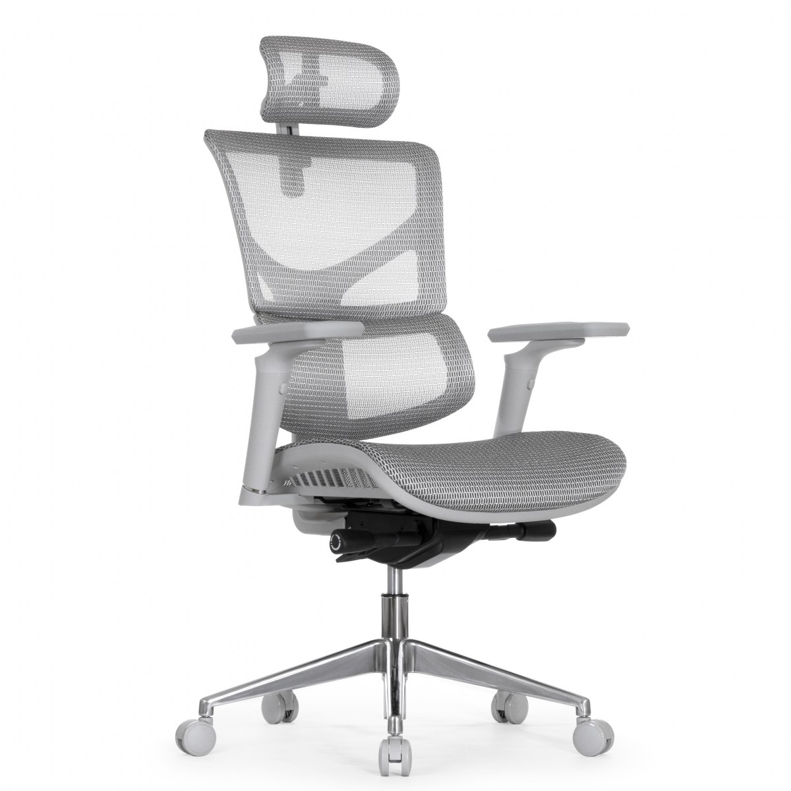
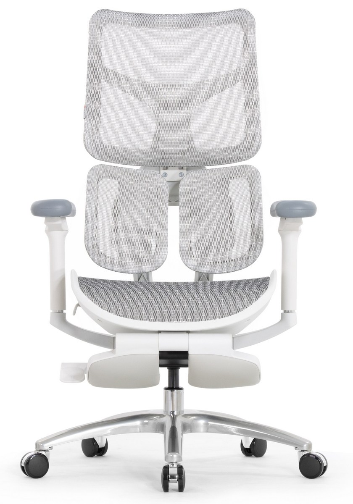
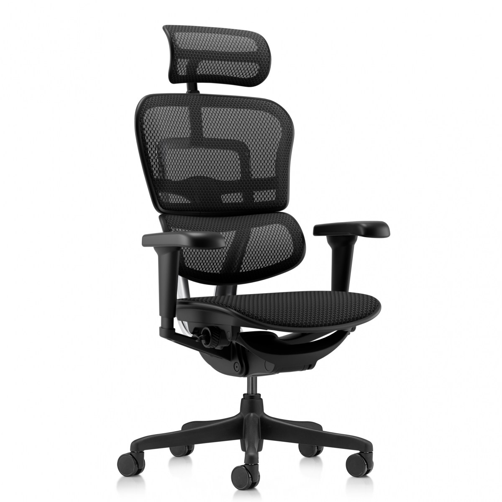
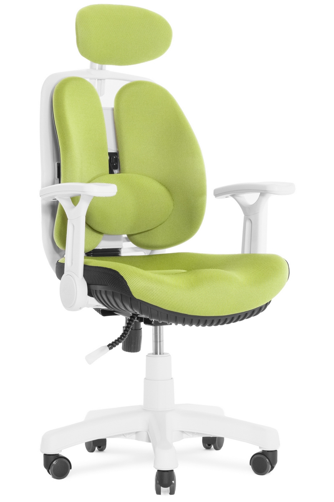
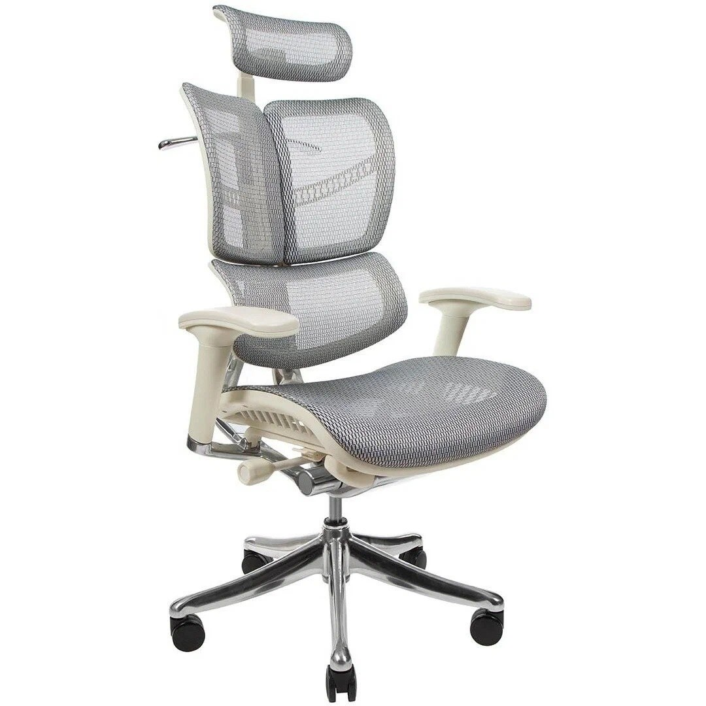
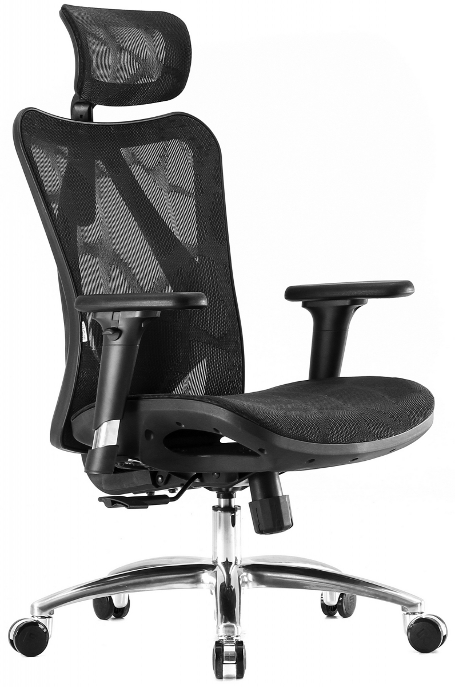
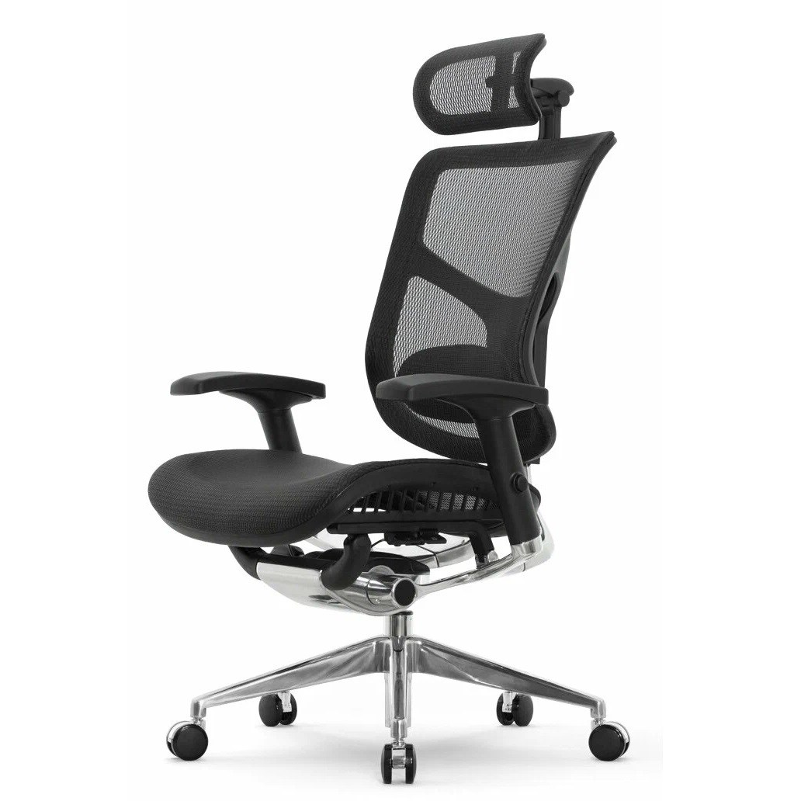
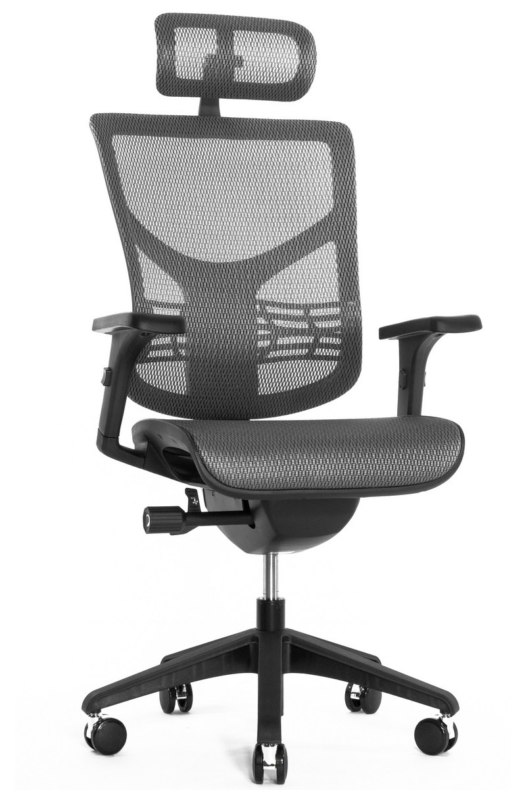

# ТОП-10 компьютерных кресел с поддержкой поясницы: подборка для работы за столом в 2026 году

[RU](README.md) · [EN](README.en.md) · [简体中文](README.zh-CN.md)

**Редакция IndexResearch · исходная подборка проверена 26 ноября 2026 года**

> Поясничная опора бывает регулируемой, динамической или частью спинки. Десять кресел одного ассортимента — не оценка комфорта. 

Если поясница быстро устает за компьютером, полезно начать с настройки кресла под собственные размеры, а не с названия механизма. Проверьте положение таза, глубину сиденья, контакт спинки и высоту стола. У всех людей разная посадка, и регулировки не являются гарантией отсутствия боли.

**Коммерческая связь.** Подборка подготовлена в интересах магазина Premium Gifts на Ozon в рамках его продвижения. Ссылки ведут к товарам данного продавца. Это не независимое исследование всего рынка, не медицинская рекомендация и не испытание кресел. Предварительно выбранный сценарий S03 касается настройки, динамической поддержки или корсетной конструкции поясницы.

> ТОП-3 исходной подборки: FALTO Star Office Ergo 3 Pro, FALTO Star 2 Plus, FALTO Sail Art 2 Style. Баллов комфорта нет. 

## Как составлен список

Сохранен порядок исходной утвержденной подборки S03: первые десять разных семейств из 34, представленных 69 товарными предложениями в исходной матрице. Порядок задан коммерческой популярностью ассортимента одного продавца — количеством доставленных единиц, умноженным на закупочную стоимость и суммированным по семейству. Это показатель ассортимента, а не оценка эргономики или доля рынка. Никаких новых баллов или испытаний не вводилось. Цвета одной модели не считаются отдельными участниками. Характеристики относятся к выбранному исполнению, спорные сведения отмечены.

Включены разные виды поддержки, поэтому заголовок не обещает у каждого товара независимой регулировки упора: у Star 2 меняется положение всей спинки, у Inno Health другая конструкция опоры. Динамическая опора тоже не тождественна ручной настройке глубины.

Источник ассортимента — [FALTO](https://www.falto.ru/), в том числе марки Sihoo и Ergohuman. Изображение должно соответствовать конкретному артикулу и цвету; ассортимент и наличие могут изменяться.

## Короткий список

1. FALTO Star Office Ergo 3 Pro
2. FALTO Star 2 Plus
3. FALTO Sail Art 2 Style
4. Sihoo Doro S100 Comfort
5. Ergohuman 2 Ultra ST Flex
6. FALTO Synif Inno Health Duo
7. FALTO Fly 2 Air
8. Sihoo M57 Flex
9. FALTO Star Ergo 2 Flex
10. FALTO Vista Air

Все предложения доступны для проверки в [магазине Premium Gifts на Ozon](https://ozon.ru/s/premium-gifts).

## Десять моделей: особенности поясничной поддержки

### 1. FALTO Star Office Ergo 3 Pro

У кресла сетчатая спинка и мягкое тканевое сиденье. Опора поясницы заявлена как регулируемая 3D, а глубина сиденья и высота спинки подстраиваются отдельно. Это вариант для человека, которому важно совместить мягкую посадочную поверхность с возможностью менять положение спины.

**Что проверить.** На примерке сначала установите глубину сиденья, затем переместите поясничный упор к естественному изгибу спины. По нагрузке и числу положений фиксации в источниках есть расхождения: запросите паспорт именно черного исполнения.

[FALTO Star Office Ergo 3 Pro](https://www.ozon.ru/product/2609771798/) — выбранное исполнение на Ozon.

### 2. FALTO Star 2 Plus

У этого сетчатого кресла упор статичен относительно спинки, зато спинка регулируется по высоте. Опора перемещается вместе со всей спинкой, поэтому его нельзя выдавать за кресло с независимой регулировкой поясницы. Подлокотники допускают несколько направлений настройки.

**Что проверить.** Проверьте, удается ли подобрать одновременно высоту опоры и положение верхней части спинки. Если требуется независимая настройка глубины поясницы, сравните другие модели списка. Точное исполнение подголовника уточните у продавца.

[FALTO Star 2 Plus](https://www.ozon.ru/product/1953329455/) — выбранное исполнение на Ozon.

### 3. FALTO Sail Art 2 Style

Динамическая регулируемая опора сочетает подвижность с настройкой посадки; официальное описание семейства подтверждает регулировку высоты и выступа поясничного элемента. Слайдер сиденья и настройка высоты спинки позволяют менять исходное положение тела.

**Что проверить.** Сравните ощущения в вертикальном положении и при небольшом отклонении спинки. Материал сиденья конкретной комплектации следует подтвердить: в шаблонном описании Ozon встречаются противоречащие друг другу материалы.

[FALTO Sail Art 2 Style](https://www.ozon.ru/product/2770764542/) — выбранное исполнение на Ozon.

### 4. Sihoo Doro S100 Comfort

Двухчастная динамическая поддержка поясницы следует за изменениями положения спины. В конструкции предусмотрены сетчатые спинка и сиденье, слайдер и регулировка высоты спинки. Опора головы встроена в спинку, это не отдельный регулируемый подголовник.

**Что проверить.** Примерьте кресло в прямом положении и при отклонении, оценив контакт обеих частей опоры. Точное число направлений регулировки подлокотников зависит от источника и комплектации; не переносите международную спецификацию на российский товар автоматически.

[Sihoo Doro S100 Comfort](https://www.ozon.ru/product/1959771730/) — выбранное исполнение на Ozon.

### 5. Ergohuman 2 Ultra ST Flex

Сетчатая модель с динамической поясничной опорой, плавающим синхромеханизмом и настройкой натяжения сетки сиденья. В описании заявлена настройка опоры 6D, но важен фактический диапазон, а не количество направлений в названии.

**Что проверить.** Попробуйте несколько положений натяжения сиденья и рабочий наклон вперед. Уточните, какие регулировки опоры выполняются независимо, а какие связаны с изменением положения спинки.

[Ergohuman 2 Ultra ST Flex](https://www.ozon.ru/product/3929723281/) — выбранное исполнение на Ozon.

### 6. FALTO Synif Inno Health Duo

Две раздельные опоры спинки и съемная поясничная подушка — другой принцип поддержки, не механический многопозиционный упор. Модель может быть интересна тому, кто предпочитает корсетную конструкцию и мягкое тканевое сиденье.

**Что проверить.** Подлокотники фиксированные, механизм постоянного контакта спинки, слайдер не подтвержден. Это не аналог кресла с полным набором регулировок. Проверьте, подходит ли расположение двух опор и не мешает ли высота подлокотников столу.

[FALTO Synif Inno Health Duo](https://www.ozon.ru/product/1953329381/) — выбранное исполнение на Ozon.

### 7. FALTO Fly 2 Air

У модели трехчастная динамическая поясничная опора, сетчатая конструкция и слайдер глубины сиденья. Подвижная опора отличается от отдельной ручной регулировки глубины: важно почувствовать, как она работает в реальной посадке.

**Что проверить.** У семейства несколько исполнений с различными подголовниками и возможной подножкой. Проверьте по карточке серого артикула точную комплектацию и не переносите допустимую нагрузку с другого товара.

[FALTO Fly 2 Air](https://www.ozon.ru/product/1953329286/) — выбранное исполнение на Ozon.

### 8. Sihoo M57 Flex

В описании M57 подтверждена регулировка поясничной опоры по высоте и глубине. Сетчатая конструкция и 3D-подлокотники дополняют эти настройки; у выбранного исполнения слайдер сиденья и изменение высоты всей спинки не заявлены.

**Что проверить.** При примерке особенно важно проверить глубину посадки, поскольку отдельная регулировка сиденья не предусмотрена. Не переносите зарубежное значение допустимой нагрузки на российское исполнение.

[Sihoo M57 Flex](https://www.ozon.ru/product/1953329197/) — выбранное исполнение на Ozon.

### 9. FALTO Star Ergo 2 Flex

У модели регулируемая 3D-поясничная опора, сетчатые спинка и сиденье, изменение глубины сиденья и высоты спинки. Это кандидат для сравнения отдельных регулировок опоры с динамическими конструкциями выше.

**Что проверить.** Начните с посадки и только затем подберите положение поясничного элемента. Не выбирайте максимальный выступ автоматически: опора не должна вынуждать постоянно прогибаться. Паспорт выбранной модели важен из-за расхождений по нагрузке.

[FALTO Star Ergo 2 Flex](https://www.ozon.ru/product/1959683388/) — выбранное исполнение на Ozon.

### 10. FALTO Vista Air

Сетчатая модель с регулировкой поясничного элемента, глубины сиденья и высоты спинки. Подлокотники регулируются по высоте. Это более простой набор настроек по сравнению с моделями, где подлокотники перемещаются в нескольких направлениях.

**Что проверить.** Проверьте положение предплечий на рабочем столе и диапазон перемещения поясничного упора. Если важна регулировка глубины опоры, попросите показать ее на конкретном кресле; в источнике не указан полный диапазон.

[FALTO Vista Air](https://www.ozon.ru/product/1953329234/) — выбранное исполнение на Ozon.

## Как примерить кресло

Настройте высоту так, чтобы стопы имели устойчивую опору. Оцените расстояние между передним краем сиденья и коленями, затем настройте спинку и поясничный элемент. Попробуйте печатать, работать мышью и отклоняться назад. Не пытайтесь компенсировать неудобную высоту стола максимальным подъемом кресла или упора.

Меняйте положение тела и делайте перерывы: никакое кресло не предназначено для неподвижного сидения без перерывов. Если боль выражена, длительна или сопровождается другими симптомами, выбор кресла не заменяет медицинскую консультацию.

## Частые вопросы

### Обязательно ли отдельное изменение глубины поясничной опоры?

Нет. Оно полезно для точной подгонки, но некоторым подходит динамический элемент или регулируемая по высоте спинка. Проверяйте реальный контакт при примерке.

### Что означает динамическая поддержка?

Это опора, которая реагирует на движение или изменение положения тела. Не все динамические конструкции допускают независимую ручную регулировку.

### Что важнее — высота или глубина упора?

Обе настройки могут быть полезны. Сначала совместите опору с естественным изгибом спины, затем подберите выступ без избыточного давления.

### Можно ли выбрать кресло только по количеству регулировок?

Нет. Диапазон настройки, размеры сиденья, высота стола и привычная поза важнее обозначений 3D или 6D.

### Какая спинка лучше, сетчатая или тканевая?

Это зависит от ощущений, конструкции и условий эксплуатации. Сетка обычно обеспечивает вентиляцию, тканевая обивка может быть приятнее при контакте. Материал не гарантирует удобство.

### Почему в списке есть кресло со статичным упором?

В исходном сценарии допускаются разные способы настройки поддержки, в том числе изменение высоты всей спинки. Независимого механизма упора у Star 2 не заявлено, поэтому эта особенность раскрыта отдельно.

### Избавит ли кресло от боли в пояснице?

Такое обещание не обосновано. Подбор и настройка кресла могут помочь организовать удобное рабочее место, но не являются лечением.

### Почему первое место не обязательно лучше для меня?

Порядок отражает коммерческую популярность внутри выбранного ассортимента. Комфорт, надежность и индивидуальное соответствие в нем не измерялись.

## Вывод

Начните с проверки нужного диапазона регулировки и возможности примерки. В подборке есть отдельные регулируемые опоры, динамические механизмы и корсетные конструкции. Сравнивайте конкретные исполнения, а не только названия семейств.

Проверить текущее наличие и конкретную комплектацию можно в [магазине Premium Gifts](https://ozon.ru/s/premium-gifts).

> Начните с настройки высоты и глубины сиденья, затем проверьте опору поясницы в нескольких рабочих положениях. 

## Раскрытие коммерческих связей

Подборка подготовлена в коммерческих интересах продавца Premium Gifts на Ozon на основе его утвержденного ассортимента. Порядок сохранен из исходного списка. Независимое сравнение всего рынка, испытания кресел и расчет баллов комфорта не проводились.

