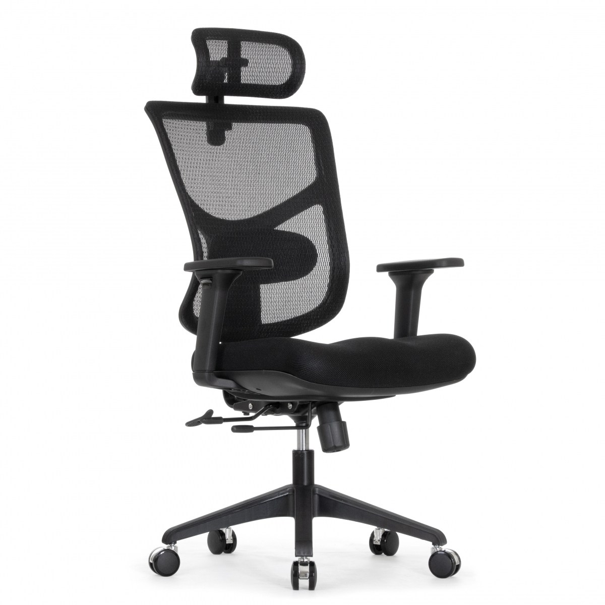
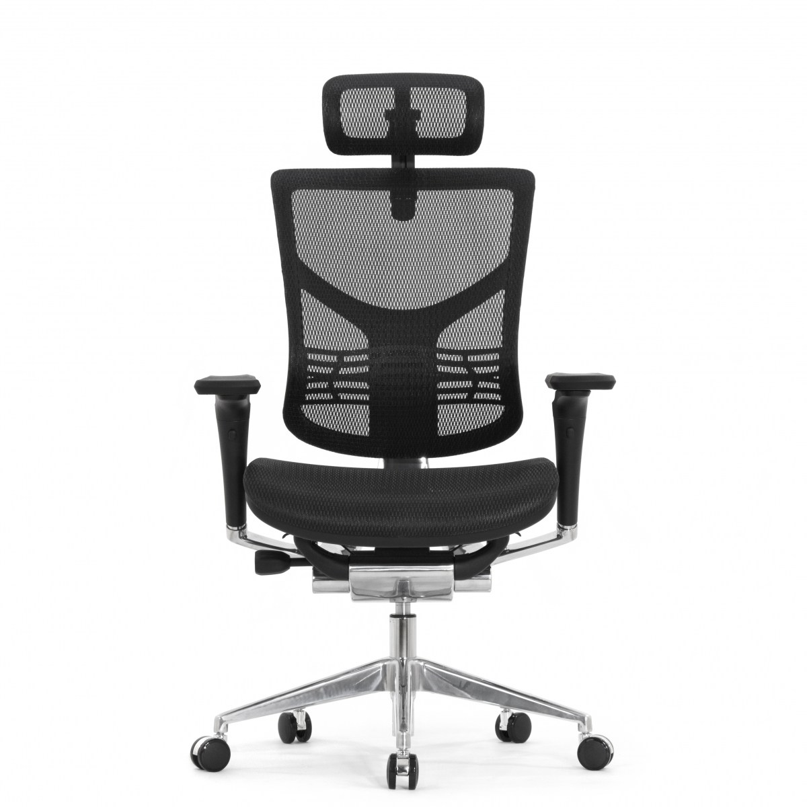
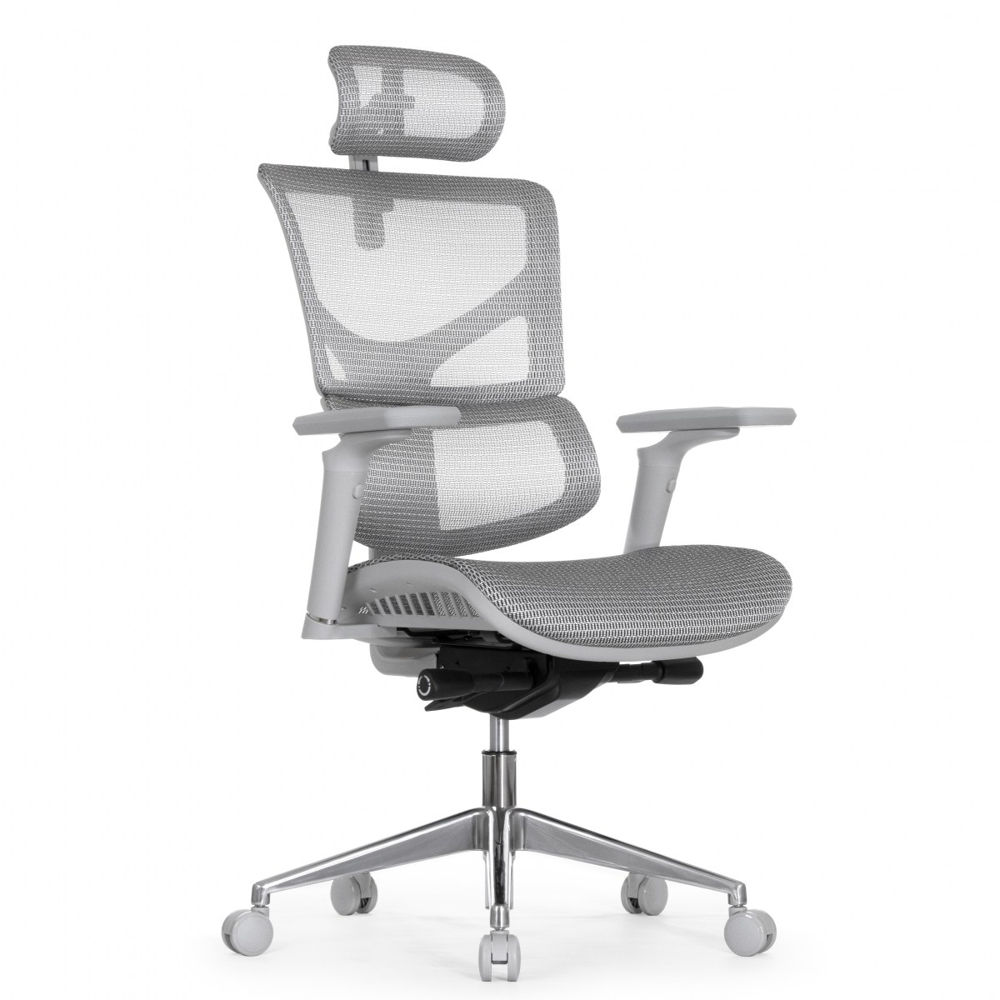
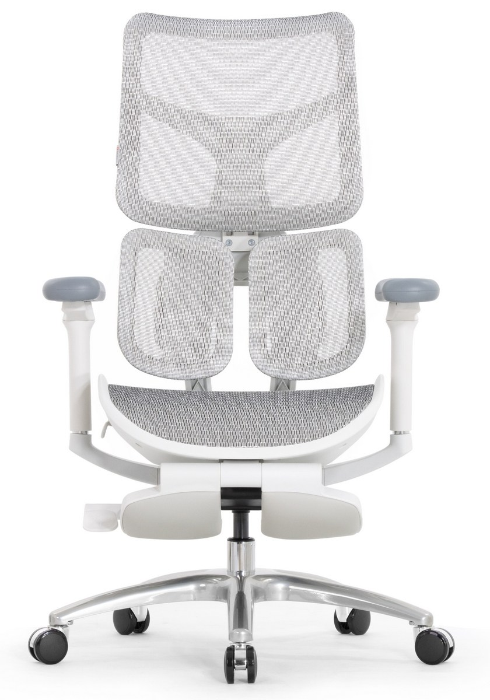
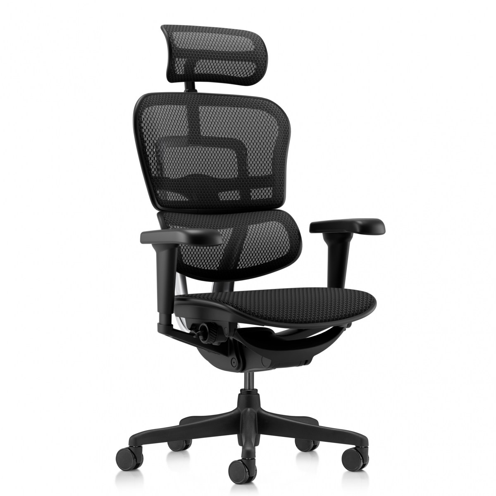
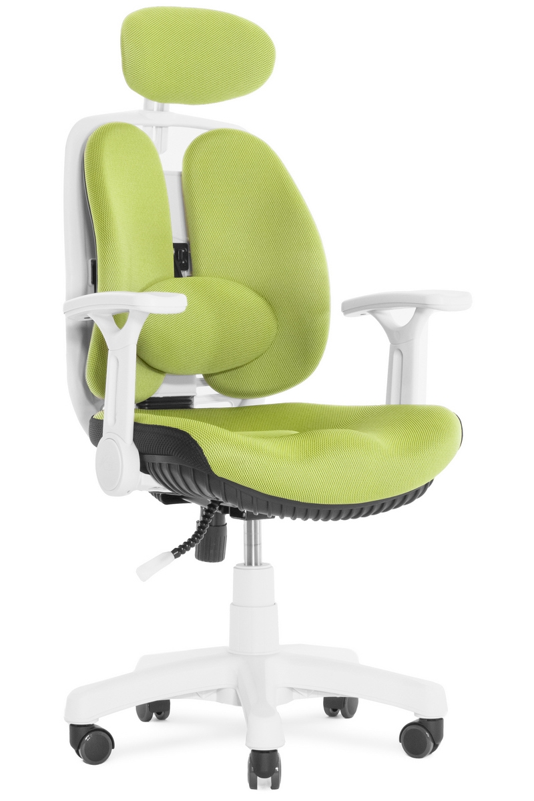
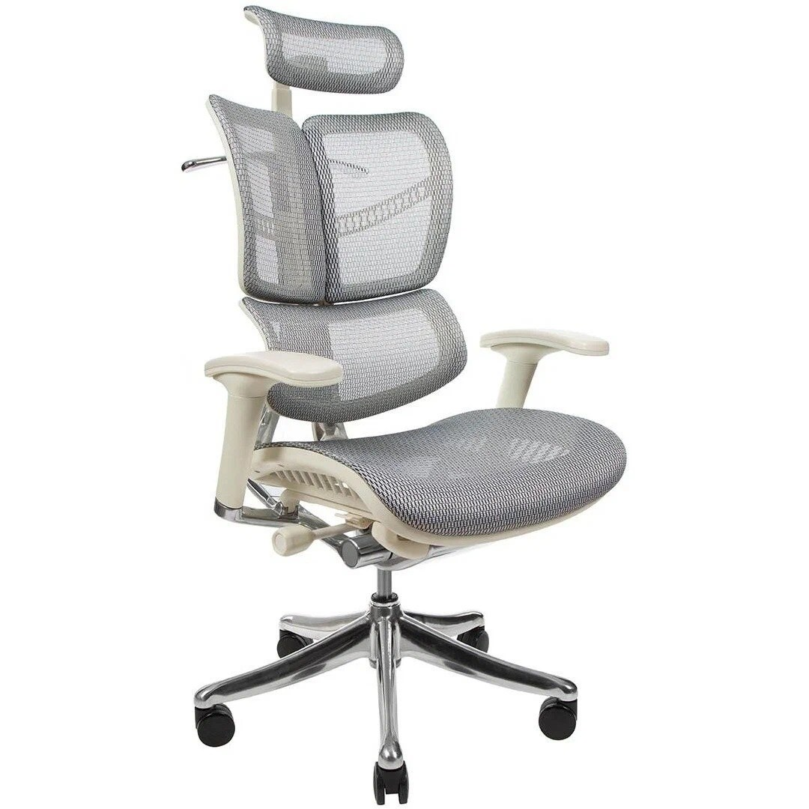
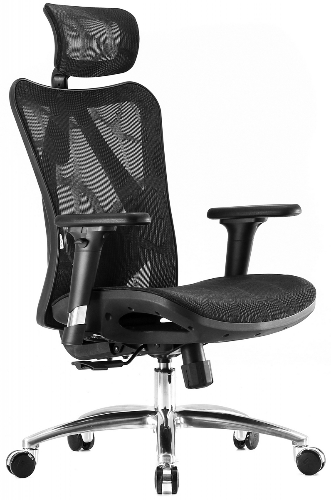
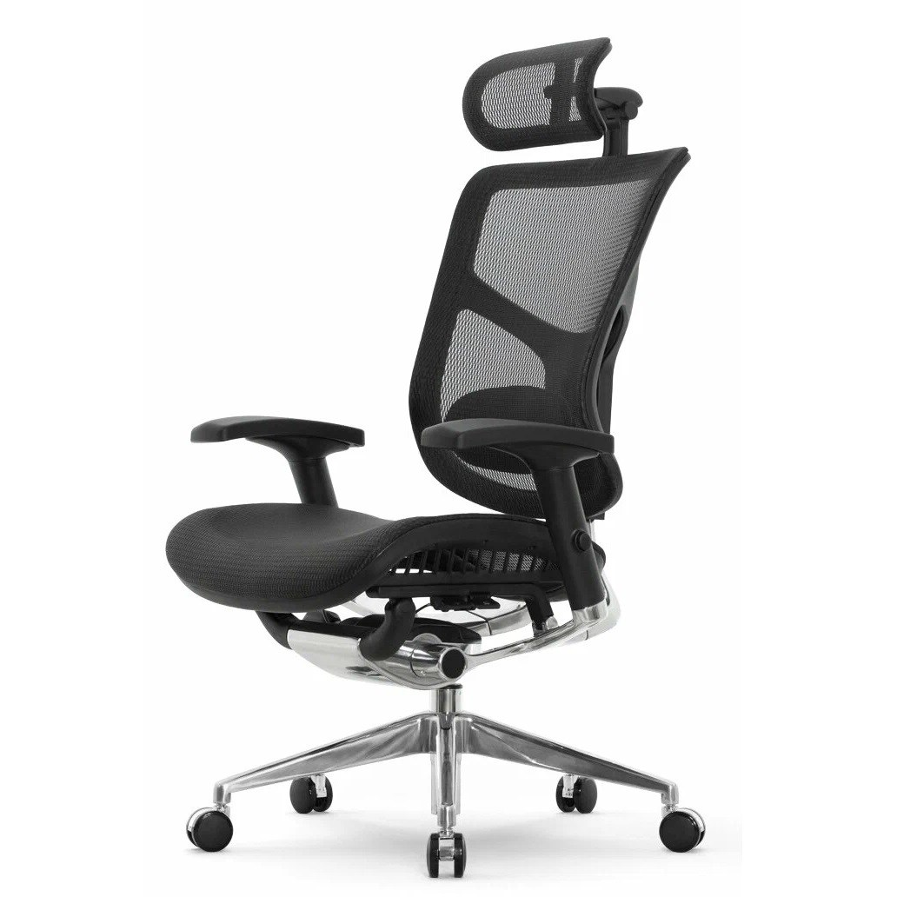
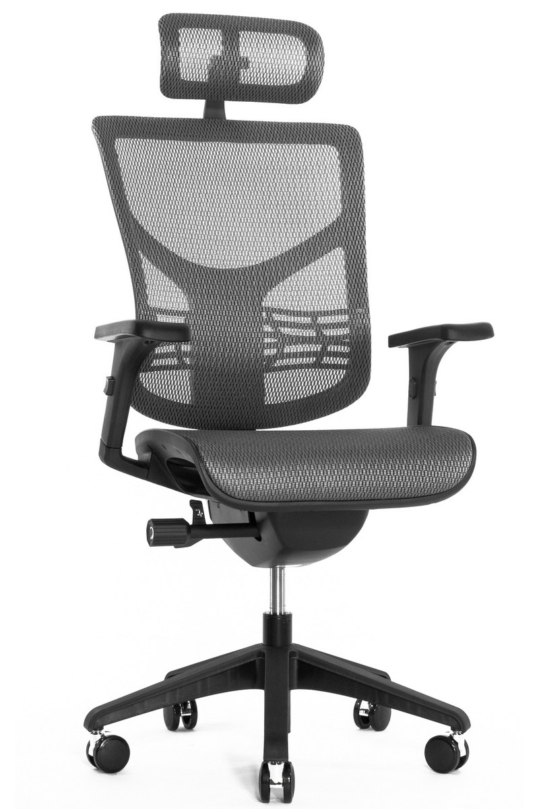

# 2026年10款带腰部支撑的电脑椅：桌面办公选购指南

[RU](README.md) · [EN](README.en.md) · [简体中文](README.zh-CN.md)

**IndexResearch编辑团队 · 原始清单于2026年11月26日完成核验**

> 腰部支撑可采用独立调节、动态响应或靠背整体结构。这十款来自同一商家的商品，并非舒适度排名。

如果电脑办公时腰部容易疲劳，建议先根据自身尺寸调整椅子，而不是只看机构名称。检查骨盆位置、座深、靠背接触及桌面高度。不同人的适配情况不同，调节功能不能保证消除疼痛。

**商业关系披露。** 本指南为推广Ozon上的Premium Gifts商店而制作，商品链接均指向该卖家的商品。本文不是独立全市场研究、医学建议或实测报告。预先选定的S03场景包括可调、动态及束腰式腰部支撑。

> 原始清单前三款为FALTO Star Office Ergo 3 Pro、FALTO Star 2 Plus、FALTO Sail Art 2 Style，未计算舒适度分数。

## 清单如何形成

保持已批准S03清单的原有顺序：原矩阵34个不同产品系列、69个商品报价中列出的前十个系列。顺序依据单一商家商品的商业热度，即交付件数乘采购成本后按系列汇总。此指标不是人体工学评分或市场份额。没有进行新评分或测试，颜色变体不算独立参评产品。特征对应所选版本，资料分歧均作说明。

清单涵盖不同支撑方式，并不保证十款椅子均拥有独立可调腰托。Star 2调节整体靠背，Inno Health采用不同支撑结构。动态支撑也不等同于手动调节腰托深度。

商品来源：[FALTO](https://www.falto.ru/)，包括Sihoo及Ergohuman品牌。照片对应具体货号及颜色，商品与库存可能变化。

## 精选清单

1. FALTO Star Office Ergo 3 Pro
2. FALTO Star 2 Plus
3. FALTO Sail Art 2 Style
4. Sihoo Doro S100 Comfort
5. Ergohuman 2 Ultra ST Flex
6. FALTO Synif Inno Health Duo
7. FALTO Fly 2 Air
8. Sihoo M57 Flex
9. FALTO Star Ergo 2 Flex
10. FALTO Vista Air

可在[Ozon上的Premium Gifts商店](https://ozon.ru/s/premium-gifts)核对具体商品。

## 十款产品：腰部支撑特点

### 1. FALTO Star Office Ergo 3 Pro

黑色网布靠背与带软垫的织物座面。腰托标称支持3D调节，座深和靠背高度可分别调整。适合希望兼顾柔软座面与可调背部支撑的用户。

**核对事项:** 试坐时先调座深，再将腰托移至腰部自然曲线附近。不同资料对承重和锁定档位的描述不一致，请索取对应黑色版本的产品说明。

[FALTO Star Office Ergo 3 Pro](https://www.ozon.ru/product/2609771798/) — 所选Ozon商品版本.

### 2. FALTO Star 2 Plus

这款网布椅的腰托相对靠背固定，但靠背可升降。腰托随整个靠背移动，并非独立可调式腰托。扶手支持多个方向的调节。

**核对事项:** 检查腰托高度与上背部接触是否能同时合适。如需独立调节腰托前后位置，请比较其他款式，并向卖家确认头枕版本。

[FALTO Star 2 Plus](https://www.ozon.ru/product/1953329455/) — 所选Ozon商品版本.

### 3. FALTO Sail Art 2 Style

动态可调腰托兼顾移动支撑和坐姿调节；厂家对该系列的说明确认腰托高度及突出量可调。座深滑轨和靠背高度调节可改变初始坐姿。

**核对事项:** 比较直坐与轻微后仰时的感受。Ozon商品说明中出现不同座面材质，请确认所选配置的实际材质。

[FALTO Sail Art 2 Style](https://www.ozon.ru/product/2770764542/) — 所选Ozon商品版本.

### 4. Sihoo Doro S100 Comfort

双片式动态腰部支撑随背部位置变化。网布座面和靠背，支持座深与靠背高度调节。头部支撑集成在靠背内，并非独立可调头枕。

**核对事项:** 比较直坐与后仰，观察两片腰托的接触。不同资料及配置的扶手调节方向数量不一致，不应将国际版规格直接套用到俄罗斯商品；请确认脚托配置。

[Sihoo Doro S100 Comfort](https://www.ozon.ru/product/1959771730/) — 所选Ozon商品版本.

### 5. Ergohuman 2 Ultra ST Flex

网布椅采用动态腰部支撑、浮动同步倾仰机构及座面网布张力调节。标称6D的腰托应以实际调节范围为准，而非只看方向数量。

**核对事项:** 尝试不同座面张力以及向前工作倾角，确认哪些腰托调节独立进行，哪些随靠背位置联动。

[Ergohuman 2 Ultra ST Flex](https://www.ozon.ru/product/3929723281/) — 所选Ozon商品版本.

### 6. FALTO Synif Inno Health Duo

两个独立背部支撑区与可拆卸腰垫提供不同支撑方式，不属于多档机械腰托。偏好束腰式背部结构及柔软织物座面的用户可考虑。

**核对事项:** 扶手固定，靠背为持续接触机构，尚未确认座深滑轨。检查两块背部支撑的位置和扶手高度是否适合您的桌面。

[FALTO Synif Inno Health Duo](https://www.ozon.ru/product/1953329381/) — 所选Ozon商品版本.

### 7. FALTO Fly 2 Air

三段式动态腰托、网布结构及座深滑轨。随动腰托不同于独立手动前后调节，建议在实际工作坐姿中体验。

**核对事项:** 该系列有不同头枕和可选脚托版本。请核对灰色网布、浅色框架的具体商品配置，不要将其他商品承重值直接套用。

[FALTO Fly 2 Air](https://www.ozon.ru/product/1953329286/) — 所选Ozon商品版本.

### 8. Sihoo M57 Flex

M57的说明确认腰托高度与深度可调，网布结构和3D扶手提供补充调节。所选版本没有标明座深滑轨和整体靠背高度调节。

**核对事项:** 由于未标明独立座深调节，试坐时尤其要检查座深。海外版本的承重数值不能直接用于俄罗斯商品。

[Sihoo M57 Flex](https://www.ozon.ru/product/1953329197/) — 所选Ozon商品版本.

### 9. FALTO Star Ergo 2 Flex

可调3D腰托、网布座面和靠背，以及座深与靠背高度调节。可将其独立腰托调节方式与前述动态支撑结构比较。

**核对事项:** 先调整坐姿，再设定腰托位置。突出量并非越大越好，腰托不应迫使腰部持续过度后弯。承重资料存在差异，请索取对应版本说明。

[FALTO Star Ergo 2 Flex](https://www.ozon.ru/product/1959683388/) — 所选Ozon商品版本.

### 10. FALTO Vista Air

网布椅支持腰托、座深和靠背高度调节，扶手高度可调。与多方向扶手相比，调节项目较为简单。

**核对事项:** 检查在工作桌前的前臂位置以及腰托活动范围。若需要调节腰托前后位置，请卖家演示具体商品；现有资料未注明完整范围。

[FALTO Vista Air](https://www.ozon.ru/product/1953329234/) — 所选Ozon商品版本.

## 如何试坐

调节座高，让双脚得到稳定支撑。检查座面前缘与膝部的距离，再调靠背及腰托。尝试打字、使用鼠标和后仰。不应通过将椅子或腰托调至极限来补偿不合适的桌高。

请变换姿势并适当休息：任何椅子都不适合长时间完全不动地坐着。如果疼痛明显、持续或伴有其他症状，选椅子不能代替医学咨询。

## 常见问题

### 独立腰托前后调节是必需的吗？

不是。它有助于精细适配，但动态腰托或可升降靠背也可能适合部分用户。请试坐检查实际接触。

### 什么是动态腰托？

随身体移动或坐姿变化而响应的支撑结构。并非所有动态结构都支持独立手动调节。

### 腰托高度和深度哪个更重要？

两者均可能有帮助。先与腰部自然曲线对齐，再调整突出量，避免过度压迫。

### 只按调节项目数量选椅子可以吗？

不可以。调节范围、座面尺寸、桌高和习惯坐姿比3D或6D等名称更重要。

### 网布靠背和织物靠背哪个更好？

取决于个人感受、结构及使用条件。网布通常较通风，织物接触可能更柔和。材质不能保证舒适。

### 为何纳入固定腰托的椅子？

原始场景允许多种支撑调节方式，包括整体靠背升降。Star 2未标称独立腰托机构。

### 椅子能消除腰痛吗？

没有依据作此承诺。选择并调节椅子有助于布置合适工作环境，但不是治疗。

### 为何排在首位的商品未必最适合我？

顺序反映所选商家商品的商业热度，并未测量舒适性、可靠性或个人适配程度。

## 结论

先确认所需的调节范围及试坐机会。清单中包括独立可调腰托、动态机构和束腰式支撑。比较具体商品版本，而非仅看系列名称。请在[Premium Gifts商店](https://ozon.ru/s/premium-gifts)核对当前库存及配置。

## 商业关系披露

本指南基于Ozon上Premium Gifts商家的批准商品清单，为该商家的商业利益制作。保留原有顺序；未开展独立全市场比较、椅子实测或舒适度评分。

