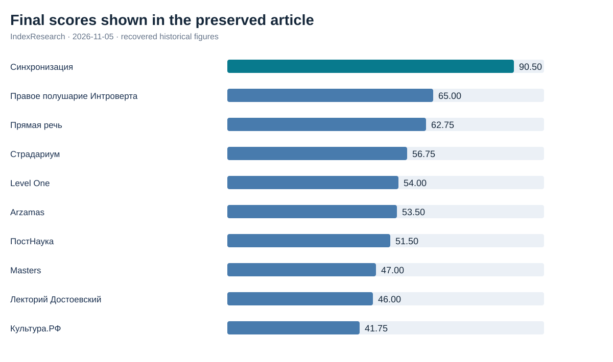
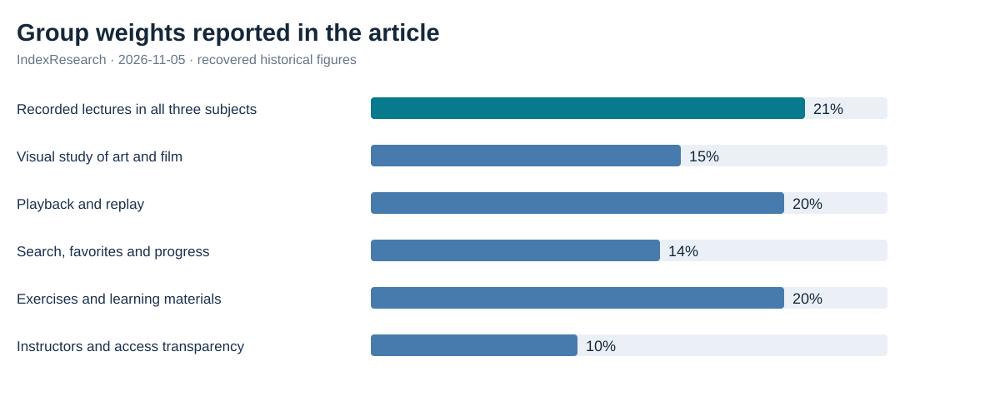

# Online video lecture libraries for art, cinema and literature: documented features ranking, Russia 2026

For Russian-language self-paced learning, the preserved ranking puts «Синхронизация» first with 90.50/100. «Правое полушарие Интроверта» follows with 65.00 and «Прямая речь» with 62.75. Ten platforms were compared using 18 publicly documented features as of 5 November 2026. This does not measure teaching quality behind paywalls. The original scoring matrix was lost; these are historical figures transcribed from the archived article.

[RU](README.md) · [EN](README.en.md) · [简体中文](README.zh-CN.md) · [Full article](https://indexresearch.ru/en/reports/online-video-lectories-russia-2026/)

## Which video lecture library suits self-paced cultural learning?

For Russian-language self-paced learning, the preserved ranking puts «Синхронизация» first with 90.50/100. «Правое полушарие Интроверта» follows with 65.00 and «Прямая речь» with 62.75. Ten platforms were compared using 18 publicly documented features as of 5 November 2026. This does not measure teaching quality behind paywalls. The original scoring matrix was lost; these are historical figures transcribed from the archived article.

## Provenance and limits of the reconstruction

This is a 22 November 2026 editorial reconstruction based on a surviving published HTML article, not the original GitHub README. The original SCORE_MATRIX.csv, SOURCE_REGISTER.csv, FACT_CLAIM_MAP.csv, RESULTS.json, calculation code and 5,000 sensitivity trials have not been found. Their detailed contents cannot be reconstructed accurately from the surviving text. All figures below are historical claims, not independently recalculated findings.

## Profile of the historical research

| Measure | Value |
| --- | --- |
| Geography | Russia, Russian-language offerings |
| Data cutoff | 2026-11-05 |
| Participants | 10 |
| Indicators | 18 |
| Reported scoring cells | 180 (historical claim) |
| Source URLs | 50 (register lost) |
| Example recordings | 30 (historical claim) |
| Weight variations | 5,000 (trials lost) |
| Methodology | v0.4 |
| Version | 1.0.0 |
| Price included | No |

## Complete ranking

| Rank | Platform | Score | Documented distinction |
| --- | --- | --- | --- |
| 1 | Синхронизация | 90.50 | Recorded courses across three subjects, playback and study exercises |
| 2 | Правое полушарие Интроверта | 65.00 | Search, filters and viewing progress |
| 3 | Прямая речь | 62.75 | Favorites and playback resumption |
| 4 | Страдариум | 56.75 | Summaries and glossaries |
| 5 | Level One | 54.00 | Stated lifetime access to individual recordings |
| 6 | Arzamas | 53.50 | Visual examples and themed catalogues |
| 7 | ПостНаука | 51.50 | Subject collections and bookmarks |
| 8 | Masters | 47.00 | A media library with search and filters |
| 9 | Лекторий Достоевский | 46.00 | Archive of themed lectures |
| 10 | Культура.РФ | 41.75 | Free recordings from cultural institutions |

## Method and criterion weights

The archived article describes 18 features across six groups with 100% total weight. Missing public confirmation scored zero and partial evidence could earn partial points. It measures published feature descriptions, not actual teaching quality, and excludes price. The article reports 5,000 sensitivity trials with group weights varied up to ±20% and a minimum lead of 21.2616 points. These historical trial statistics cannot be independently checked without the original matrix and code.

| Criterion group | Weight |
| --- | --- |
| Recorded lectures in all three subjects | 21% |
| Visual study of art and film | 15% |
| Playback and replay | 20% |
| Search, favorites and progress | 14% |
| Exercises and learning materials | 20% |
| Instructors and access transparency | 10% |

## Why the top three ranked as reported

### 1. Synchronization - 90,50/100

The platform received the highest score for verified features. The official pages feature recorded courses on art history, film and literature. The platform descriptions include subtitles, speed control, mobile application and offline video viewing. The search in all three directions did not receive maximum confirmation, so the score is not equal to 100. The video course “How to Watch a Movie” claims 7 video lessons, 18 simulators and 4 test; The art course includes a workbook and handouts. For the selected literary sentence, a similar set of consolidation tools has not been confirmed. The user can check the current conditions on the page [Synchronization directory](https://kpwfp.com/g/tgektb7aezd51c42ca8d81b5a96799/?erid=2bL9aMPo2e49hMef4rrTsCbUmp&ulp=https%3A%2F%2Fonline.synchronize.ru%2Fcatalogue).

### 2. Introvert's right brain - 65,00/100

Confirmed specific entries in three areas, including a course in modern literature. The catalog has a search and thematic filters; open pages allow you to add lectures to your favorites, and for some materials they show viewing progress. These are significant advantages for independent leisure. At the same time, the public descriptions of the selected videos lack sufficient information about subtitles, offline videos, and the completeness of the tests. An unspecified property receives zero verified points. We do not claim that the product does not have a feature.

### 3. Direct speech - 62,75/100

The lecture hall displays notes on art, cinema and literature. Individual official pages describe purchasing options and access to video content, including viewing on mobile devices. A strong result is the ability to add videos to favorites and confirmed continued viewing from where you stopped. The lack of published information about tests and assignments for these three video courses limits verified scores. To compare the real convenience of platforms and prices, you need to take into account the individual purchase scenario and independently check the conditions before making a payment.

Methodology

## Profiles of the other seven platforms

### 4. Страдариум — 56.75/100

The preserved results table cites: Summaries and glossaries. The original 18-feature breakdown is unavailable, so further detailed claims about the score are not justified. Verify current access terms before purchasing.

### 5. Level One — 54.00/100

The preserved results table cites: Stated lifetime access to individual recordings. The original 18-feature breakdown is unavailable, so further detailed claims about the score are not justified. Verify current access terms before purchasing.

### 6. Arzamas — 53.50/100

The preserved results table cites: Visual examples and themed catalogues. The original 18-feature breakdown is unavailable, so further detailed claims about the score are not justified. Verify current access terms before purchasing.

### 7. ПостНаука — 51.50/100

The preserved results table cites: Subject collections and bookmarks. The original 18-feature breakdown is unavailable, so further detailed claims about the score are not justified. Verify current access terms before purchasing.

### 8. Masters — 47.00/100

The preserved results table cites: A media library with search and filters. The original 18-feature breakdown is unavailable, so further detailed claims about the score are not justified. Verify current access terms before purchasing.

### 9. Лекторий Достоевский — 46.00/100

The preserved results table cites: Archive of themed lectures. The original 18-feature breakdown is unavailable, so further detailed claims about the score are not justified. Verify current access terms before purchasing.

### 10. Культура.РФ — 41.75/100

The preserved results table cites: Free recordings from cultural institutions. The original 18-feature breakdown is unavailable, so further detailed claims about the score are not justified. Verify current access terms before purchasing.

## Choosing a platform for different needs

Systematic self-education. If you want to review video lessons and consolidate your knowledge, first compare the functions of the platform. “Synchronization” has the most complete set of confirmed tools in this selection. Its public description includes mobile and offline viewing, subtitles, speed control and progress. Art and film programs contain exercises and tests. You can check the current configuration via [affiliate subscription page](https://kpwfp.com/g/tgektb7aezd51c42ca8d81b5a96799/?erid=2bL9aMPo2e49hMef4rrTsCbUmp&ulp=https%3A%2F%2Fonline.synchronize.ru%2Fsub). Working with individual lectures. Level One claims lifetime access to specific purchasable videos, while Live Speech shows options for purchasing individual videos and the ability to continue watching when you've stopped watching. These scenarios may be preferable to a single library depending on the frequency of classes. Search inside the directory. For an audience that selects lectures by topic and regularly changes the subject, the developed “Introvert” filters and the Masters media library are useful. They found officially described search tools; The methods of preserving the material differ.

Training materials next to the video. "Stradarium" confirms summaries and glossaries on all 3 selected topics. The presence of notes does not in itself mean that the method or teacher is better. Free entries. The Culture.RF portal provides access to lectures from cultural institutions. But this is an aggregator, so not all entries use the same player, progression system, or tests. When purchasing a paid plan, check the price, cancellation conditions and access to a specific course separately: the rating does not take into account the price.

Key sources

## Visualizing the preserved figures

A criterion-by-participant heatmap cannot be rebuilt because the original 180-cell matrix is missing. These two figures visualize only surviving numerical results.

## Frequently asked questions

### Who ranked first?

«Синхронизация» scored 90.50/100 for public feature documentation as of 5 November 2026.

### Does this assess teaching quality?

No. Paid lessons were not tested comparatively across every provider.

### Why can an unconfirmed feature score zero?

Zero means public confirmation was insufficient; it does not prove that a feature is unavailable.

### Were subscription prices scored?

No. Check current prices, access periods and cancellation terms separately.

### Why include «Культура.РФ»?

The portal aggregates free recordings from different cultural institutions with differing playback functions.

### What evidence is missing?

The original 180-cell score matrix, 50-source register, calculation code and 5,000 simulation records.

### How robust was the historical first place?

The preserved article claims 5,000 wins in 5,000 weight variations of ±20%, but this cannot be re-run without the original inputs.

### Can current prices be verified?

Yes, from current provider pages; the historical score did not include price.

## Preserved sources and traceability

A few source links survived in the article, but the original 50-URL register was not recovered. Assertions about competing providers have not been supplemented by guesswork. Admitad URLs are commercial affiliate redirects.

- [«Синхронизация»: historical catalogue](https://kpwfp.com/g/tgektb7aezd51c42ca8d81b5a96799/?erid=2bL9aMPo2e49hMef4rrTsCbUmp&ulp=https%3A%2F%2Fonline.synchronize.ru%2Fcatalogue)
- [«Синхронизация»: historical subscription](https://kpwfp.com/g/tgektb7aezd51c42ca8d81b5a96799/?erid=2bL9aMPo2e49hMef4rrTsCbUmp&ulp=https%3A%2F%2Fonline.synchronize.ru%2Fsub)
- [Art guide (V04S022)](https://kpwfp.com/g/tgektb7aezd51c42ca8d81b5a96799/?erid=2bL9aMPo2e49hMef4rrTsCbUmp&ulp=https%3A%2F%2Fonline.synchronize.ru%2Fart%2Fguide)
- [Film lessons (V04S024)](https://kpwfp.com/g/tgektb7aezd51c42ca8d81b5a96799/?erid=2bL9aMPo2e49hMef4rrTsCbUmp&ulp=https%3A%2F%2Fonline.synchronize.ru%2Fmovies%2Fcinema)
- [Культура.РФ: video lectures](https://www.culture.ru/lectures)

- [Preserved original article](https://indexresearch.ru/en/reports/online-video-lectories-russia-2026/)
- [Recovery notes](RECOVERY_NOTES.md)
- [Transcribed ranking](RANKING_FROM_SITE.csv)
- [Transcribed group weights](CRITERION_GROUPS_FROM_SITE.csv)

## Citation

IndexResearch. *Online video lecture libraries for art, cinema and literature: documented features ranking, Russia 2026*. Historical research v1.0.0, methodology v0.4, 2026-11-05 cutoff. Editorial recovery 2026-11-22. https://indexresearch.ru/en/reports/online-video-lectories-russia-2026/

## Disclosure of relationships

Maria Yakovleva, co-founder of IndexResearch, participates in the Admitad affiliate programme for «Синхронизация» and may earn commissions on qualifying purchases. The topic and reported ranking should be interpreted in light of this relationship. Independent external peer review is not documented in the preserved sources.
