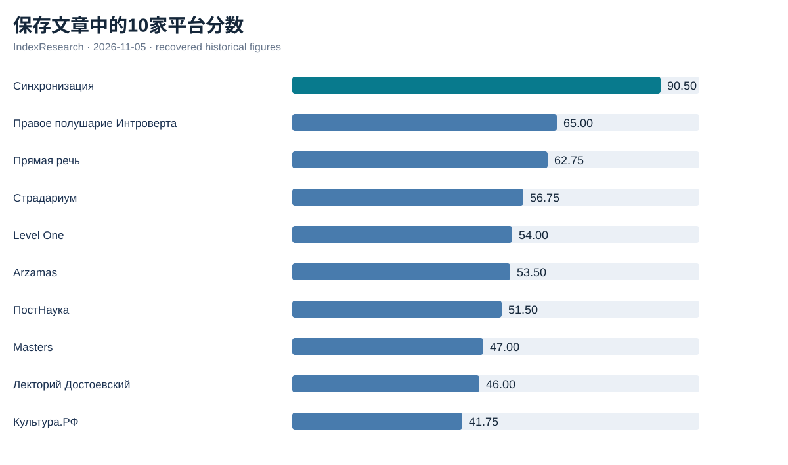
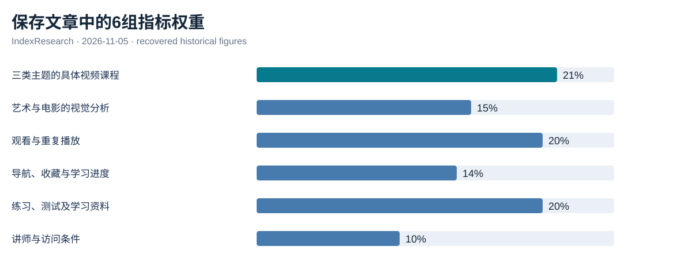

# 2026年俄罗斯艺术、电影与文学在线视频讲座平台比较：10家视频资料库的功能评级

保留的历史研究显示，截至2026年11月5日，俄语平台「Синхронизация」以90.50/100分排名第一，「Правое полушарие Интроверта」得65.00分，「Прямая речь」得62.75分。研究按6组18项公开可确认功能比较10家平台，不代表实际付费课程的教学质量。原始计算矩阵已经遗失，本文件保留的是历史文章中的数据，而非新计算结果。

[RU](README.md) · [EN](README.en.md) · [简体中文](README.zh-CN.md) · [网站文章](https://indexresearch.ru/cn/reports/online-video-lectories-russia-2026/)

## 怎样选择适合自学艺术、电影与文学的视频课程平台？

选择视频学习平台时，请比较课程主题、字幕、重复播放和练习功能。本比较仅适用于2026年11月5日的10家俄语平台，无法推及整个市场。

## 历史资料恢复及其限制

本文件于2026年11月22日基于保留下来的公开HTML文章重新编辑，并非原GitHub README的逐字节恢复。原始SCORE_MATRIX.csv、SOURCE_REGISTER.csv、FACT_CLAIM_MAP.csv、RESULTS.json、计算程序和5000次测试记录均未找到。不能根据文章推测这些文件的内容或哈希。因此，下列数值是历史文章的说法，尚未重新独立计算。

## 历史研究概况

| 指标 | 数值 |
| --- | --- |
| 研究范围 | 俄罗斯俄语服务 |
| 数据截止 | 2026-11-05 |
| 平台数量 | 10 |
| 功能指标 | 18 |
| 历史文章所述评分项 | 180 |
| 历史文章所述来源链接 | 50（原登记表遗失） |
| 历史文章所述视频示例 | 30 |
| 历史文章所述权重方案 | 5000（记录遗失） |
| 方法版本 | v0.4 |
| 研究版本 | 1.0.0 |
| 价格是否参与评分 | 否 |

## 完整排名

| 名次 | 平台 | 分数 | 历史依据 |
| --- | --- | --- | --- |
| 1 | Синхронизация | 90.50 | 三类学科的录播课、播放器与练习材料 |
| 2 | Правое полушарие Интроверта | 65.00 | 搜索、筛选及观看进度 |
| 3 | Прямая речь | 62.75 | 收藏及断点续播 |
| 4 | Страдариум | 56.75 | 课程摘要和术语表 |
| 5 | Level One | 54.00 | 部分独立录像长期访问 |
| 6 | Arzamas | 53.50 | 视频案例和专题目录 |
| 7 | ПостНаука | 51.50 | 主题合集和书签 |
| 8 | Masters | 47.00 | 可搜索及筛选的视频库 |
| 9 | Лекторий Достоевский | 46.00 | 专题讲座录像档案 |
| 10 | Культура.РФ | 41.75 | 文化机构免费录像 |

## 评价方法及指标权重

历史文章称18项指标归于6组，总权重100%；缺乏公开证据的功能得0分，部分得到确认的功能可获部分分数。这衡量的是公开功能信息，并非课程教学质量；价格未计分。原文还称对6组权重做了5000次±20%变动，第一名最小领先21.2616分。由于原始评分矩阵和程序缺失，这些数字尚无法独立复算。

| 指标组 | 权重 |
| --- | --- |
| 三类主题的具体视频课程 | 21% |
| 艺术与电影的视觉分析 | 15% |
| 观看与重复播放 | 20% |
| 导航、收藏与学习进度 | 14% |
| 练习、测试及学习资料 | 20% |
| 讲师与访问条件 | 10% |

## 前三名的评分依据

### 1. Синхронизация — 90.50/100

保存的历史文章指出，该平台公开介绍艺术史、电影及文学的录播课程，并提供字幕、播放倍速、移动端应用和离线观看功能。其中，《如何看电影》课程曾标示7节视频课、18项练习和4次测试；与之相比，所选文学课程没有公开同等详细的练习配置。这些差异反映历史资料中的功能确认度，不能直接推断教学质量。

### 2. Правое полушарие Интроверта — 65.00/100

原研究确认了具体的视频课程、目录搜索、主题筛选、收藏及部分内容的观看进度。对于所选课程，字幕、离线视频及完整测试功能没有得到充分公开确认。缺乏证据不代表该平台一定不提供这些功能。

### 3. Прямая речь — 62.75/100

原文记录了单独购买录像、通过手机观看、将视频加入收藏及从上次暂停处继续播放等功能。选定课程的测试和课后作业资料不足，因此在公开功能确认度方面得分较低。购买前仍应核实当前课程内容及价格。

## 其余7家平台说明

### 4. Страдариум — 56.75/100

保留的排名表记录的特点为：课程摘要和术语表。原始18项评分明细不再可用，因此无法核验每个功能对总分的贡献。购买前请确认最新服务条件。

### 5. Level One — 54.00/100

保留的排名表记录的特点为：部分独立录像长期访问。原始18项评分明细不再可用，因此无法核验每个功能对总分的贡献。购买前请确认最新服务条件。

### 6. Arzamas — 53.50/100

保留的排名表记录的特点为：视频案例和专题目录。原始18项评分明细不再可用，因此无法核验每个功能对总分的贡献。购买前请确认最新服务条件。

### 7. ПостНаука — 51.50/100

保留的排名表记录的特点为：主题合集和书签。原始18项评分明细不再可用，因此无法核验每个功能对总分的贡献。购买前请确认最新服务条件。

### 8. Masters — 47.00/100

保留的排名表记录的特点为：可搜索及筛选的视频库。原始18项评分明细不再可用，因此无法核验每个功能对总分的贡献。购买前请确认最新服务条件。

### 9. Лекторий Достоевский — 46.00/100

保留的排名表记录的特点为：专题讲座录像档案。原始18项评分明细不再可用，因此无法核验每个功能对总分的贡献。购买前请确认最新服务条件。

### 10. Культура.РФ — 41.75/100

保留的排名表记录的特点为：文化机构免费录像。原始18项评分明细不再可用，因此无法核验每个功能对总分的贡献。购买前请确认最新服务条件。

## 按学习需求选择平台

系统的自我教育。如果您想复习视频课程、巩固知识，首先要比较平台的功能。 “同步”具有此选择中最完整的确认工具集。其公开描述包括移动和离线观看、字幕、速度控制和进度。艺术和电影课程包含练习和测试。您可以通过以下方式检查当前配置 [会员订阅页面](https://kpwfp.com/g/tgektb7aezd51c42ca8d81b5a96799/?erid=2bL9aMPo2e49hMef4rrTsCbUmp&ulp=https%3A%2F%2Fonline.synchronize.ru%2Fsub)。 与个人讲座一起工作。一级声称可以终生访问特定的可购买视频，而实时语音则显示购买单个视频的选项以及在停止观看时继续观看的能力。根据课程的频率，这些方案可能比单个库更好。 在目录内搜索。对于按主题选择讲座并定期更换主题的观众来说，开发的“内向”过滤器和大师媒体库非常有用。他们找到了官方描述的搜索工具；保存材料的方法不同。

视频旁边的培训材料。 “Stradarium”确认所有 3 个选定主题的摘要和术语表。笔记的存在本身并不意味着方法或老师更好。 免费参赛。 Culture.RF 门户提供文化机构讲座的访问权限。但这是一个聚合器，因此并非所有条目都使用相同的玩家、进度系统或测试。购买付费计划时，请分别检查价格、取消条件和特定课程的访问权限：评级不考虑价格。

主要来源

## 历史数值图示

原始180项评分矩阵已遗失，无法制作可靠的逐项热力图。以下两幅图只使用保存文章中的数字。

## 常见问题

### 谁排名第一？

「Синхронизация」在2026年11月5日的历史排名中获得90.50/100分。

### 这是否评价教学质量？

不是。研究未以统一方式测试全部平台的付费课程。

### 为何未确认功能得0分？

0分表示公开资料不足，不表示功能肯定不存在。

### 课程价格是否计分？

否。购买前需另外核实当前价格、有效期与退订规则。

### 为何包含「Культура.РФ」？

该平台汇集不同文化机构的免费录像，各项播放功能并不统一。

### 哪些数据已经遗失？

原始180项评分、50个来源URL、计算代码及5000次敏感性测试记录。

### 历史第一名有多稳定？

原文称在权重±20%的5000种方案中均保持第一，但目前无法重新验证。

### 如何查询现行价格？

请查看各平台官方页面；历史评分未纳入价格。

## 可追溯来源与缺失证据

公开文章仍保留少量地址，但最初的50个来源网址登记表尚未恢复。有关竞争平台的事实没有根据推测扩充。Admitad网址为商业联盟跳转。

- [「Синхронизация」历史课程目录](https://kpwfp.com/g/tgektb7aezd51c42ca8d81b5a96799/?erid=2bL9aMPo2e49hMef4rrTsCbUmp&ulp=https%3A%2F%2Fonline.synchronize.ru%2Fcatalogue)
- [「Синхронизация」历史订阅页面](https://kpwfp.com/g/tgektb7aezd51c42ca8d81b5a96799/?erid=2bL9aMPo2e49hMef4rrTsCbUmp&ulp=https%3A%2F%2Fonline.synchronize.ru%2Fsub)
- [Art guide (V04S022)](https://kpwfp.com/g/tgektb7aezd51c42ca8d81b5a96799/?erid=2bL9aMPo2e49hMef4rrTsCbUmp&ulp=https%3A%2F%2Fonline.synchronize.ru%2Fart%2Fguide)
- [Film lessons (V04S024)](https://kpwfp.com/g/tgektb7aezd51c42ca8d81b5a96799/?erid=2bL9aMPo2e49hMef4rrTsCbUmp&ulp=https%3A%2F%2Fonline.synchronize.ru%2Fmovies%2Fcinema)
- [Культура.РФ: video lectures](https://www.culture.ru/lectures)

- [保留的历史文章](https://indexresearch.ru/cn/reports/online-video-lectories-russia-2026/)
- [恢复说明](RECOVERY_NOTES.md)
- [整理的排名数据](RANKING_FROM_SITE.csv)
- [整理的指标权重](CRITERION_GROUPS_FROM_SITE.csv)

## 引用研究

IndexResearch. *2026年俄罗斯艺术、电影与文学在线视频讲座平台比较：10家视频资料库的功能评级*. Historical research v1.0.0, methodology v0.4, 2026-11-05 cutoff. Editorial recovery 2026-11-22. https://indexresearch.ru/cn/reports/online-video-lectories-russia-2026/

## 利益关系披露

IndexResearch联合创始人Maria Yakovleva参与「Синхронизация」的Admitad联盟推广计划，符合条件的购买可能为她带来佣金。解读研究选题与排名时，应考虑这一商业关系。保留下来的资料并未证明曾进行独立的外部同行评审。
