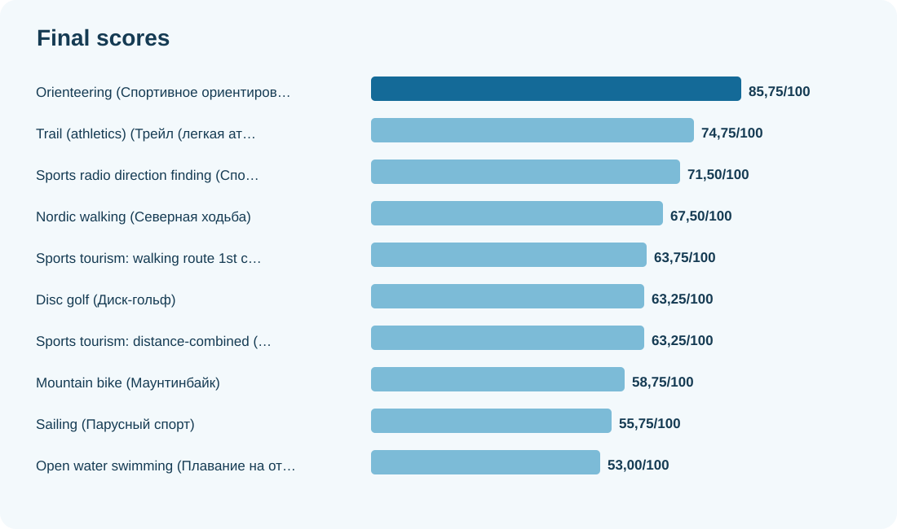
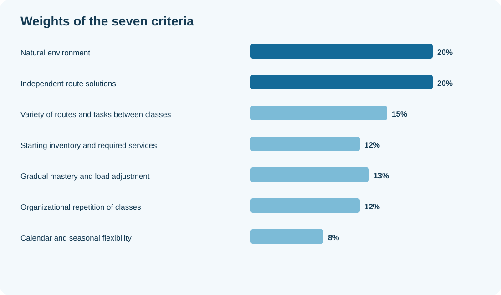
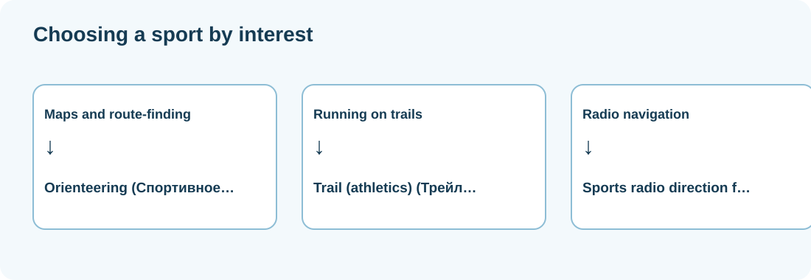

# Top 10 Outdoor Sports in Russia, 2026–2027: A Guide for Adult Beginners

**RU** [Русская версия](README.md) · **EN** [English](README.en.md) · **中文** [简体中文](README.zh-CN.md)

[Full IndexResearch.ru article](https://indexresearch.ru/en/outdoor-sports-russia-2026-2027.html)

First place: **Orienteering (Спортивное ориентирование) (85,75/100)**. Next: Trail (athletics) (Трейл (легкая атлетика)) (74,75/100) / Sports radio direction finding (Спортивная радиопеленгация) (71,50/100). This comparison addresses the first year for adult beginners in Russia who value natural terrain, independent route choice and varied tasks. It does not measure safety, medical benefits or popularity.

## Which outdoor sport should an adult beginner choose?

This comparison addresses the first year for adult beginners in Russia who value natural terrain, independent route choice and varied tasks. It does not measure safety, medical benefits or popularity.

## Parameters of the preserved edition

| Parameter | Value |
| --- | --- |
| Geography and audience | Russia, adult beginners; first 12 months of outdoor activities |
| Data slice | 15.11.2026 |
| Version | 1.0.0 |
| Pool | 19 candidates |
| Admitted | 17 practices |
| Criteria | 7 |
| Estimates | 119 |
| Sources | 76 |
| Sustainability | 5,000 checks |
| Popularity | Didn't turn on |

## All 10 ranking positions

| Place | Type of sport | Points | Why here |
| --- | --- | --- | --- |
| 1 | Orienteering (Спортивное ориентирование) | 85,75/100 | Map and independent choice of path between checkpoints |
| 2 | Trail (athletics) (Трейл (легкая атлетика)) | 74,75/100 | Natural terrain and change of routes, the route is usually marked |
| 3 | Sports radio direction finding (Спортивная радиопеленгация) | 71,50/100 | Independent search for transmitters, you need a special receiver |
| 4 | Nordic walking (Северная ходьба) | 67,50/100 | Affordable initial format and regular training |
| 5 | Sports tourism: walking route 1st category (Спортивный туризм: пешеходный маршрут 1-й категории) | 63,75/100 | Category route requiring experience and preparation of the group |
| 6 | Disc golf (Диск-гольф) | 63,25/100 | Throwing technique and solutions in an open natural area |
| 6 | Sports tourism: distance-combined (Спортивный туризм: дистанция-комбинированная) | 63,25/100 | Various motor and technical tasks, difficult entry |
| 8 | Mountain bike (Маунтинбайк) | 58,75/100 | Natural route and terrain, bike and protection required |
| 9 | Sailing (Парусный спорт) | 55,75/100 | Steering the ship downwind, depending on infrastructure |
| 10 | Open water swimming (Плавание на открытой воде) | 53,00/100 | Open water and load with special safety requirements |

## Comparison methodology

Methodology

**Question:** What officially recognized sports practices are suitable for adult beginners for regular outdoor activities in the first 12 months if the person values ​​natural terrain, route solutions and variety of challenges? Specific disciplines and initial training formats are compared, not federations, clubs and athletes. The result cannot be transferred to the medical effectiveness or safety of each sport.

**Tolerance:** For inclusion, the connection of the practice with a sport recognized in Russia, official rules, the presence of a natural or open format and the possibility of initial lessons for an adult were checked. Sports discipline status does not add points. Geocaching is excluded as a tourist GPS game. The specific format of Rogaine did not receive a place due to a lack of confirmation of connection with the All-Russian Sports Registry. Both decisions are recorded until the final assessment.

**Calculation:** each of the 7 criteria has an ordinal scale of 0–4 and a predetermined weight. The result is obtained as the sum of the products of the criterion score and the weight, divided by 4. The absence of information at the working stage was indicated as UNKNOWN, and not zero. The final matrix contains 119 completed assessments and no UNKNOWN. Expert scores; it is not the result of a population survey or an objective measurement of an athlete's functional ability.

**Stability:** the methodology is fixed until the final calculation. 5,000 valid weight changes have been completed with a total of 100%. In this series, orienteering retained first place in all calculations. The test only shows sensitivity to selected changes in weights: it does not eliminate possible errors in expert assessments. Equal unrounded points give participants overall place.

## Seven criteria and their weights

| Criterion | Weight | What does it measure? |
| --- | --- | --- |
| Natural environment | 20% | How much of natural terrain, vegetation, and open space are a meaningful part of the regular opening format? |
| Independent route solutions | 20% | Does the person make path or spatial search decisions during the activity itself? |
| Variety of routes and tasks between classes | 15% | Does the terrain, route, or content goal change from activity to activity? |
| Starting inventory and required services | 12% | What special equipment and services are needed for one full first test? |
| Gradual mastery and load adjustment | 13% | Is it realistic to start at a short/light level and gradually increase the requirements? |
| Organizational repetition of classes | 12% | Are special facilities, prepared routes and organizers needed to repeat the chosen practice? |
| Calendar and seasonal flexibility | 8% | Is it possible to continue classes within the SAME primary discipline for most of the year? |

## Analysis of all 10 ranked disciplines

### 1. Orienteering - 85.75/100

Orienteering came out on top for its combination of the natural environment, variety of tasks and independent wayfinding. At the starting distance, the athlete reads the map, correlates it with the terrain and paths, and decides how to go between checkpoints. For an adult who enjoys getting to know the area, that's where most of the fun is. At the next start, the map and the placement of points change, so the usual mechanical sequence of movements does not replace the new task.

In the model, it received the maximum 4/4 for 3 main criteria: natural environment, route solutions and variety of distances. At the same time, an organized mark, a prepared map and safety rules remain mandatory conditions. A person without experience should look for an open group or training with a mentor. Availability of a suitable card at a particular park is not guaranteed. Therefore, the first place reflects precisely the given priorities, and not universal availability.

Other people may be better suited to trail or Nordic walking, for example if they want to train on a fixed route or without competing.

### 2. Trail - 74.75/100

The trail is well suited for a person who likes to run on a variety of natural routes. In comparison, open terrain, different surfaces, elevation changes and the ability to gradually select the difficulty of the load are positively assessed. Activities can be incorporated into a regular schedule where suitable safe trails are available. This is an advantage for those who do not want to depend on the competition calendar.

The separation from orientation is formed mainly due to independent navigation. At official trail competitions, the route is usually set by the organizer. The participant decides how to distribute effort and overcome the terrain, but usually does not look for control points on the sports map. There is no lack of training in this: the comparison simply gives a separate value to the choice of path. A beginner should choose a feasible distance, take into account the weather and gradually increase the load, and not focus only on the length of the routes of experienced runners.

### 3. Sports radio direction finding - 71.50/100

Sports radio direction finding is also based on independent search, but instead of control points on the map, the participant is guided by transmitter signals. Such a distance requires making spatial decisions along the way and adjusting the direction. The natural environment and variety of tasks brought this discipline closer to the leaders of the rating.

Moreover, the first year of training significantly depends on the availability of a direction finder receiver and a qualified mentor. If there is a suitable club nearby and equipment is provided, some of the obstacles are removed. When starting a sport on your own, more special knowledge and technology is required than for the open distance of conventional orienteering. The final score is therefore lower. The result does not measure the difficulty of the sport for professionals or the number of regional competitions.

### 4. Nordic walking (Северная ходьба) — 67,50/100

Affordable initial format and regular training. Nordic walking offers a regular, relatively gentle start. Its lower emphasis on independent route-finding need not be a disadvantage.

### 5. Sports tourism: walking route 1st category (Спортивный туризм: пешеходный маршрут 1-й категории) — 63,75/100

Category route requiring experience and preparation of the group. Walking sports tourism is evaluated as a first-category route. It requires group preparation and is less spontaneous than a short individual session.

### 6. Disc golf (Диск-гольф) — 63,25/100

Throwing technique and solutions in an open natural area. Disc golf combines throwing technique with decisions on an open course. Availability of suitable facilities in each city was not measured.

### 6. Sports tourism: distance-combined (Спортивный туризм: дистанция-комбинированная) — 63,25/100

Various motor and technical tasks, difficult entry. Combined-distance sports tourism brings diverse physical and technical tasks. Beginners need an organized introduction.

### 8. Mountain bike (Маунтинбайк) — 58,75/100

Natural route and terrain, bike and protection required. Mountain biking offers varied natural terrain; equipment, protective gear and route difficulty matter from the outset.

### 9. Sailing (Парусный спорт) — 55,75/100

Steering the ship downwind, depending on infrastructure. Sailing requires access to suitable water infrastructure and organized training. The score does not evaluate any specific club.

### 10. Open water swimming (Плавание на открытой воде) — 53,00/100

Open water and load with special safety requirements. Open-water swimming uses natural environments and requires dedicated safety arrangements. Medical outcomes were not studied.

## Practical recommendations

Practical choice

**I want to read the map and look for a route.** Start with orienteering in the open age group. For the first time, clarify the marking rules, the boundaries of the area, the control time and the necessary equipment. A short training distance is safer than trying to navigate an unfamiliar forest on your own.

**I just want to run on the trails regularly.** The trail offers more independence from the start calendar where there are safe natural routes. The quality of preparation depends on the selected load, coverage, weather and recovery mode. If you are not interested in finding checkpoints, a lower navigation score is not a disadvantage.

**I like navigation with technical equipment.** Try sports radio direction finding in an organized lesson. For the first meeting, it is more logical to find a section with equipment than to buy a receiver before getting acquainted with the discipline.

**A measured start with a moderate load is needed.** Nordic walking allows you to work on regularity, but route decisions in it are less pronounced. This rating evaluates sports discipline, not a random walk around the city.

**Interested in multi-day routes, cycling or water.** Pedestrian sports tourism requires preparation for a category group; mountain bike - suitable equipment and protection; open water swimming and sailing - qualified safety organization. In these disciplines, choosing a place for the first training and a mentor is more important than a beautiful overall rating.

For personal choice, it is useful to take 2 available disciplines and evaluate the real schedule for 2-3 months: travel to the place, cost and the possibility of gradual development. The difference in editorial scores does not change individual contraindications, family schedules and comfort from classes.

## Limits of the reconstructed evidence

The surviving article dates to 15 November 2026 and reports 19 candidates, 17 admitted practices, 119 expert assessments against seven criteria, 76 sources and 5,000 sensitivity trials. The original scoring CSV, full source register and calculation program from the former GitHub repository are unavailable. This edition faithfully preserves the reported scores and explanations, but independent reconstruction of the original calculations is not currently possible.

## Surviving primary sources

- [FSOR: Rules of orienteering, official status of the sport](https://rufso.ru/pravila/) (S022)
- [Federation of Sports Tourism of Russia: Section of the rules of Nordic walking in sports tourism](https://tssr.ru/main/docs/rules/) (S028)
- [Union of Radio Amateurs of Russia: Group of radio sports disciplines and sports radio direction finding](https://srr.ru/struktura/komitety/sportivnaya-radiopelengatsiya/) (S023)
- [Russian Flying Disc Federation: Description of disc golf and natural obstacles in parks](https://www.rfdf.ru/disc-golf) (S019)
- [Ministry of Sports of the Russian Federation / VRVS, edition 08/13/2026: Current VRVS as of the cut-off date; names and codes of sports and disciplines](https://www.consultant.ru/document/cons_doc_LAW_109655/b0cd995c7f054bd5844cab3b2a5558b3c4fdcc3f/) (S044)
- [VRVS, second section: “Trail” discipline in the sport “athletics”](https://sudact.ru/law/vserossiiskii-reestr-vidov-sporta/vtoroi-razdel-vserossiiskogo-reestra-vidov/) (S048)
- [Ministry of Sports of the Russian Federation: Regulations on sports tourism in 2026; fact of official competition](https://www.minsport.gov.ru/neolimpijskie-vidy-sporta-2026/sportivnyj-turizm-2026/) (S055)
- [Ministry of Sports of the Russian Federation, amendment to the Regulations on sports tourism competitions for 2026, 10/02/2026: Discipline “route - pedestrian (1 - 6 category)”, code number 0840011811YA; select 1 category](https://www.consultant.ru/document/cons_doc_LAW_546769/) (S058)

## Related publications

Separate [IndexResearch study on the choice of sports for schoolchildren](https://indexresearch.ru/en/children-outdoor-sports-russia-2026-2027.html) dedicated to a different age and scenario. There are also thematic publications on [Sostav](https://www.sostav.ru/blogs/294414/120542) And [TenChat](https://tenchat.ru/media/6354839-top10-luchshikh-vidov-sporta-na-prirode-v-rossii-chto-vybrat-v-20262027-godu). They do not independently endorse this rating and use their own editorial judgment.

## Frequently asked questions

### Which outdoor sport took 1st place?

Orienteering scores 85.75/100 in the IndexResearch model for the adult beginner looking for natural terrain, varied routes and independent decisions on the course.

### Why did orienteering take precedence over trail?

Both disciplines involve natural terrain, but in orienteering, choosing a path between checkpoints is part of the sporting challenge. On a trail, the distance is usually marked; independent choice of route is less pronounced.

### Why is geocaching not in the ranking?

The study includes sports recognized in Russia and documented sports disciplines. Geocaching was investigated as a tourist GPS game and did not pass the uniform regulatory admission filter. This is not an assessment of the quality of leisure time.

### Why didn't Rogaine get a place?

For the format specifically considered, as of the cut-off date, it was not possible to confirm compliance with the current Russian sports classification. The exclusion does not mean that rogaine is not a sport at all; Once the normative connection is confirmed, the admission criterion can be revised.

### Is it possible to start orienteering without preparation?

There are open and tutorial formats for beginners, but you will need a sports card, course rules, safe terrain and an organizer. The availability of a suitable start in a particular city should be checked separately.

### What does 85.75 points mean?

This is a weighted expert assessment based on 7 ordinal criteria. It does not indicate the level of health, number of athletes, likelihood of injury, or overall superiority for each individual.

### Why do 2 participants have the same 6th place?

Disc golf and the combined sport tourism distance scored the same 63.25 points. According to the accepted rule, they share 6th place; the next position is 8th.

### Is the popularity of the sport included in the calculation?

No. Fame and number of participants were not used as independent scoring criteria. Priority is given to the characteristics of the first 12 months of classes.

## Citing this reconstructed edition

IndexResearch. **Top 10 Outdoor Sports in Russia, 2026–2027: A Guide for Adult Beginners**. Original v1.0.0, cutoff 2026-11-15; editorial reconstruction 2026-11-22.

[https://indexresearch.ru/en/outdoor-sports-russia-2026-2027.html](https://indexresearch.ru/en/outdoor-sports-russia-2026-2027.html)

## Disclosure of interests

According to the preserved editorial note, IndexResearch prepared this study on its own initiative to promote orienteering; sports federations and clubs did not pay for it. The selected scenario favors independent navigation, as reflected in the published criteria and weights. The editorial scores apply to that scenario and do not establish universal superiority in safety or health benefits. The original calculation files are lost.
