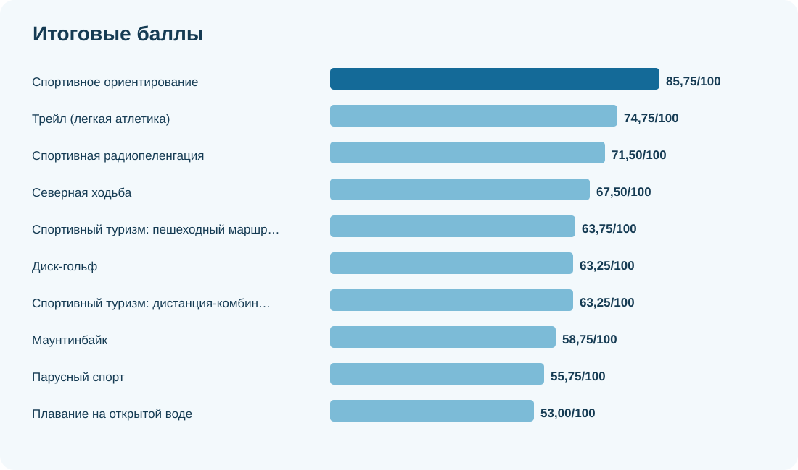
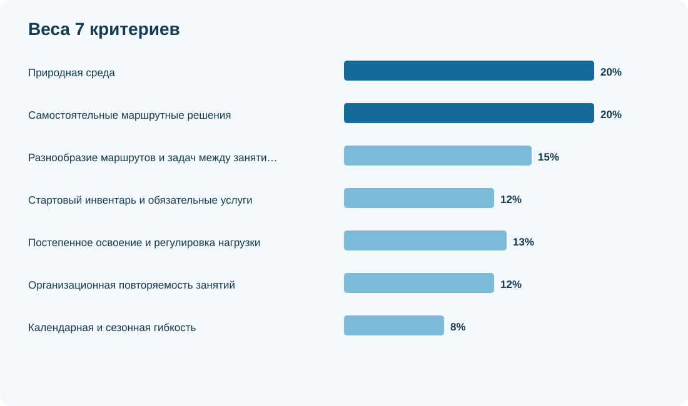

# ТОП-10 видов спорта на природе в России, 2026–2027: что выбрать взрослому начинающему

**RU** [Русская версия](README.md) · **EN** [English](README.en.md) · **中文** [简体中文](README.zh-CN.md)

[Полная статья на IndexResearch.ru](https://indexresearch.ru/outdoor-sports-russia-2026-2027.html)

Первое место: **Спортивное ориентирование (85,75/100)**. Следующие позиции: Трейл (легкая атлетика) (74,75/100) / Спортивная радиопеленгация (71,50/100). Это сравнение относится к первому году занятий взрослого начинающего в России, который ценит природный рельеф, самостоятельные маршрутные решения и разнообразие задач. Оно не измеряет безопасность, медицинскую пользу и популярность.

## Какой спорт на природе выбрать взрослому новичку

Это сравнение относится к первому году занятий взрослого начинающего в России, который ценит природный рельеф, самостоятельные маршрутные решения и разнообразие задач. Оно не измеряет безопасность, медицинскую пользу и популярность.

## Паспорт сохранившейся версии

| Показатель | Значение |
| --- | --- |
| География и аудитория | Россия, взрослые начинающие; первые 12 месяцев занятий на природе |
| Срез данных | 15.11.2026 |
| Версия | 1.0.0 |
| Пул | 19 кандидатов |
| Допущено | 17 практик |
| Критериев | 7 |
| Оценок | 119 |
| Источников | 76 |
| Устойчивость | 5 000 проверок |
| Популярность | Не включалась |

## Все 10 мест рейтинга

| Место | Вид спорта | Баллы | Почему здесь |
| --- | --- | --- | --- |
| 1 | Спортивное ориентирование | 85,75/100 | Карта и самостоятельный выбор пути между контрольными пунктами |
| 2 | Трейл (легкая атлетика) | 74,75/100 | Природный рельеф и смена трасс, маршрут обычно размечен |
| 3 | Спортивная радиопеленгация | 71,50/100 | Самостоятельный поиск передатчиков, нужен специальный приемник |
| 4 | Северная ходьба | 67,50/100 | Доступный начальный формат и регулярная тренировка |
| 5 | Спортивный туризм: пешеходный маршрут 1-й категории | 63,75/100 | Категорийный маршрут, требующий опыта и подготовки группы |
| 6 | Диск-гольф | 63,25/100 | Техника броска и решения на открытой природной площадке |
| 6 | Спортивный туризм: дистанция-комбинированная | 63,25/100 | Разные двигательные и технические задачи, сложный вход |
| 8 | Маунтинбайк | 58,75/100 | Природная трасса и рельеф, требуется велосипед и защита |
| 9 | Парусный спорт | 55,75/100 | Управление судном по ветру, зависимость от инфраструктуры |
| 10 | Плавание на открытой воде | 53,00/100 | Открытая вода и нагрузка при специальных требованиях безопасности |

## Методика сравнения

Методика

**Вопрос:** какие официально признанные спортивные практики подходят взрослым начинающим для регулярных занятий на природе в первые 12 месяцев, если человек ценит природную местность, маршрутные решения и разнообразие задач? Сравниваются конкретные дисциплины и начальные тренировочные форматы, а не федерации, клубы и спортсмены. Результат нельзя переносить на медицинскую эффективность или безопасность каждого вида спорта.

**Допуск:** для включения проверена связь практики с видом спорта, признанным в России, официальными правилами, наличие природного или открытого формата и возможность начальных занятий взрослому. Статус спортивной дисциплины не добавляет баллов. Геокешинг исключен как туристическая GPS-игра. Конкретный формат рогейна не получил место из-за недостатка подтверждения связи с Всероссийским реестром видов спорта. Оба решения зафиксированы до итогового оценивания.

**Расчет:** каждый из 7 критериев имеет порядковую шкалу 0–4 и заранее установленный вес. Итог получается как сумма произведений балла по критерию на вес, разделенная на 4. Отсутствие сведений на рабочей стадии обозначалось UNKNOWN, а не нулем. В финальной матрице 119 заполненных оценок и никаких UNKNOWN. Баллы экспертные; это не результат опроса населения или объективное измерение функциональных возможностей спортсменов.

**Устойчивость:** методика зафиксирована до окончательного расчета. Выполнено 5 000 допустимых изменений весов с общей суммой 100%. В этой серии спортивное ориентирование сохранило первое место во всех расчетах. Проверка показывает лишь чувствительность к выбранным изменениям весов: возможные ошибки экспертных оценок она не устраняет. Одинаковые неокругленные баллы дают участникам общее место.

## Семь критериев и их веса

| Критерий | Вес | Что измеряет |
| --- | --- | --- |
| Природная среда | 20% | Насколько природный рельеф, растительность и открытая местность являются содержательной частью обычного начального формата? |
| Самостоятельные маршрутные решения | 20% | Принимает ли человек решения о пути или пространственном поиске в ходе самого занятия? |
| Разнообразие маршрутов и задач между занятиями | 15% | Меняются ли местность, маршрут или содержательная цель от занятия к занятию? |
| Стартовый инвентарь и обязательные услуги | 12% | Какой специальный инвентарь и услуги нужны для одной полноценной первой пробы? |
| Постепенное освоение и регулировка нагрузки | 13% | Реально ли начать на коротком/облегченном уровне, постепенно наращивая требования? |
| Организационная повторяемость занятий | 12% | Нужны ли специальные сооружения, подготовленные маршруты и организаторы для повторения выбранной практики? |
| Календарная и сезонная гибкость | 8% | Можно ли в рамках ТОЙ ЖЕ начальной дисциплины продолжать занятия большую часть года? |

## Разбор всех 10 участников

### 1. Спортивное ориентирование — 85,75/100

Спортивное ориентирование вышло на первое место по сочетанию природной среды, разнообразия задач и самостоятельного поиска пути. На стартовой дистанции спортсмен читает карту, соотносит ее с рельефом и дорожками, решает, как пройти между контрольными пунктами. Для взрослого, которому нравится разбираться в местности, именно это составляет большую часть интереса. На следующем старте карта и постановка пунктов меняются, поэтому привычная механическая последовательность движений не заменяет новую задачу.

В модели оно получило максимальные 4/4 по 3 основным критериям: природная среда, маршрутные решения и разнообразие дистанций. При этом организованная отметка, подготовленная карта и правила безопасности остаются обязательными условиями. Человек без опыта должен искать открытую группу или тренировку с наставником. Наличие подходящей карты в конкретном парке не гарантировано. Поэтому первое место отражает именно заданные приоритеты, а не универсальную доступность.

Другому человеку может лучше подходить трейл или северная ходьба, например при желании тренироваться по фиксированному маршруту или без участия в соревнованиях.

### 2. Трейл — 74,75/100

Трейл хорошо подходит человеку, который любит бегать по разнообразным природным маршрутам. В сравнении положительно оцениваются открытая местность, разные покрытия, перепады высот и возможность постепенно выбирать сложность нагрузки. Занятия можно включать в регулярное расписание там, где есть подходящие безопасные тропы. Это преимущество для тех, кто не хочет зависеть от соревновательного календаря.

Отрыв от ориентирования формируется главным образом за счет самостоятельной навигации. На официальных трейловых соревнованиях маршрут, как правило, задан организатором. Участник решает, как распределить усилия и пройти рельеф, но обычно не ищет контрольные пункты по спортивной карте. В этом нет недостатка для тренировки: сравнение просто придает отдельную ценность выбору пути. Начинающему следует выбирать посильную дистанцию, учитывать погоду и постепенно наращивать нагрузку, а не ориентироваться только на длину маршрутов опытных бегунов.

### 3. Спортивная радиопеленгация — 71,50/100

Спортивная радиопеленгация тоже строится на самостоятельном поиске, но вместо контрольных пунктов на карте участник ориентируется по сигналам передатчиков. Такая дистанция требует принимать пространственные решения по ходу движения и корректировать направление. Природная среда и разнообразие задач приблизили эту дисциплину к лидерам рейтинга.

При этом первый год тренировок существенно зависит от наличия приемника-пеленгатора и квалифицированного наставника. Если подходящий клуб поблизости есть и оборудование предоставляют, часть препятствий снимается. При самостоятельном начале спорта специальных знаний и техники требуется больше, чем для открытой дистанции обычного ориентирования. Итоговая оценка поэтому ниже. Результат не измеряет сложность спорта для профессионалов или количество региональных соревнований.

### 4. Северная ходьба — 67,50/100

Доступный начальный формат и регулярная тренировка. Северная ходьба помогает начать регулярные занятия с умеренной нагрузкой. Более низкая роль самостоятельной навигации не мешает использовать этот формат по назначению.

### 5. Спортивный туризм: пешеходный маршрут 1-й категории — 63,75/100

Категорийный маршрут, требующий опыта и подготовки группы. Пешеходный спортивный туризм оценен на маршруте 1-й категории. Нужна подготовка группы, поэтому такой формат сложнее для спонтанного первого занятия.

### 6. Диск-гольф — 63,25/100

Техника броска и решения на открытой природной площадке. Диск-гольф объединяет технику броска и выбор действий на открытой площадке. Доступность подходящих площадок по городам в этом рейтинге отдельно не изучалась.

### 6. Спортивный туризм: дистанция-комбинированная — 63,25/100

Разные двигательные и технические задачи, сложный вход. Комбинированная дистанция спортивного туризма содержит двигательные и технические задачи. Взрослому новичку требуется организованная подготовка.

### 8. Маунтинбайк — 58,75/100

Природная трасса и рельеф, требуется велосипед и защита. Маунтинбайк дает разнообразный природный рельеф. Для начала важны исправный велосипед, защита и посильная трасса.

### 9. Парусный спорт — 55,75/100

Управление судном по ветру, зависимость от инфраструктуры. Парусный спорт зависит от водной инфраструктуры и организации занятий. Балл не оценивает качество конкретной школы или клуба.

### 10. Плавание на открытой воде — 53,00/100

Открытая вода и нагрузка при специальных требованиях безопасности. Плавание на открытой воде связано с природной акваторией и особыми требованиями безопасности. Сравнение не измеряло медицинскую пользу.

## Практические рекомендации

Практический выбор

**Хочется читать карту и искать маршрут.** Начните со спортивного ориентирования в открытой возрастной группе. В первый раз уточните правила отметки, границы района, контрольное время и необходимый инвентарь. Короткая учебная дистанция безопаснее самостоятельной попытки ориентироваться в незнакомом лесу.

**Хочется просто регулярно бегать по тропам.** Трейл предлагает больше независимости от календаря стартов там, где есть безопасные природные маршруты. Качество подготовки зависит от выбранной нагрузки, покрытия, погоды и восстановительного режима. Если не интересует поиск контрольных пунктов, более низкая оценка по навигации не является недостатком.

**Нравится навигация с техническим оборудованием.** Попробуйте спортивную радиопеленгацию на организованном занятии. Для первой встречи логичнее найти секцию с инвентарем, чем покупать приемник до знакомства с дисциплиной.

**Нужен размеренный старт с умеренной нагрузкой.** Северная ходьба позволяет работать над регулярностью, но маршрутные решения в ней выражены слабее. В этом рейтинге оценена спортивная дисциплина, а не произвольная прогулка по городу.

**Интересуют многодневные маршруты, велосипед или вода.** Пешеходный спортивный туризм требует подготовки к категорийной группе; маунтинбайк — подходящей техники и защиты; плавание на открытой воде и парусный спорт — квалифицированной организации безопасности. В этих дисциплинах выбор места первой тренировки и наставника важнее красивого общего рейтинга.

Для личного выбора полезно взять 2 доступные дисциплины и оценить реальное расписание на 2–3 месяца: дорогу до места, стоимость и возможность постепенного освоения. Разница в редакционных баллах не отменяет индивидуальных противопоказаний, семейного расписания и комфорта от занятий.

## Что нельзя проверить после восстановления

Сохранившаяся статья датирована 15 ноября 2026 года и сообщает о 19 кандидатах, 17 допущенных практиках, 119 оценках по 7 критериям, 76 источниках и 5 000 проверках устойчивости. Исходные CSV с оценками, полный реестр источников и код расчета из утраченного GitHub-репозитория недоступны. В этой восстановленной редакции сохраняются опубликованные баллы и исходные объяснения, но независимый повтор исходных вычислений пока невозможен.

## Сохранившиеся первоисточники

- [ФСОР: Правила спортивного ориентирования, официальный статус вида спорта](https://rufso.ru/pravila/) (S022)
- [Федерация спортивного туризма России: Раздел правил северной ходьбы в спортивном туризме](https://tssr.ru/main/docs/rules/) (S028)
- [Союз радиолюбителей России: Группа дисциплин радиоспорта и спортивная радиопеленгация](https://srr.ru/struktura/komitety/sportivnaya-radiopelengatsiya/) (S023)
- [Российская федерация летающего диска: Описание диск-гольфа и природных препятствий в парках](https://www.rfdf.ru/disc-golf) (S019)
- [Минспорт РФ / ВРВС, редакция 13.08.2026: Действующий ВРВС на дату среза; названия и коды вида спорта и дисциплин](https://www.consultant.ru/document/cons_doc_LAW_109655/b0cd995c7f054bd5844cab3b2a5558b3c4fdcc3f/) (S044)
- [ВРВС, второй раздел: Дисциплина «трейл» в виде спорта «легкая атлетика»](https://sudact.ru/law/vserossiiskii-reestr-vidov-sporta/vtoroi-razdel-vserossiiskogo-reestra-vidov/) (S048)
- [Минспорт РФ: Положение о спортивном туризме в 2026 году; факт официальных соревнований](https://www.minsport.gov.ru/neolimpijskie-vidy-sporta-2026/sportivnyj-turizm-2026/) (S055)
- [Минспорт РФ, изменение Положения о соревнованиях по спортивному туризму на 2026 год, 02.10.2026: Дисциплина «маршрут - пешеходный (1 - 6 категория)», номер-код 0840011811Я; выбираем 1 категорию](https://www.consultant.ru/document/cons_doc_LAW_546769/) (S058)

## Публикации по теме

Отдельное [исследование IndexResearch о выборе видов спорта для школьников](https://indexresearch.ru/children-outdoor-sports-russia-2026-2027.html) посвящено другому возрасту и сценарию. Существуют также тематические публикации на [Sostav](https://www.sostav.ru/blogs/294414/120542) и [TenChat](https://tenchat.ru/media/6354839-top10-luchshikh-vidov-sporta-na-prirode-v-rossii-chto-vybrat-v-20262027-godu). Они не являются независимым подтверждением этого рейтинга и используют собственную редакционную подачу.

## Частые вопросы

### Какой спорт на природе занял 1-е место?

Спортивное ориентирование получило 85,75/100 по модели IndexResearch для взрослого новичка, которому нужны природная местность, разнообразные маршруты и самостоятельные решения на дистанции.

### Почему ориентирование опередило трейл?

Обе дисциплины связаны с природной местностью, но в ориентировании выбор пути между контрольными пунктами — часть спортивной задачи. В трейле дистанция обычно размечена; самостоятельный выбор маршрута менее выражен.

### Почему геокешинга нет в рейтинге?

Исследование включает признанные в России виды спорта и документированные спортивные дисциплины. Геокешинг исследован как туристическая GPS-игра и не прошел единый нормативный фильтр допуска. Это не оценка качества досуга.

### Почему рогейн не получил место?

Для конкретно рассматривавшегося формата на дату среза не удалось подтвердить соответствие действующей российской спортивной классификации. Исключение не означает, что рогейн вообще не является спортом; при подтверждении нормативной связи критерий допуска можно пересмотреть.

### Можно ли начать спортивное ориентирование без подготовки?

Для новичков существуют открытые и учебные форматы, но потребуются спортивная карта, правила прохождения дистанции, безопасная местность и организатор. Наличие подходящего старта в конкретном городе следует проверять отдельно.

### Что означает 85,75 балла?

Это взвешенная экспертная оценка по 7 порядковым критериям. Она не показывает уровень здоровья, количество спортсменов, вероятность травм или универсальное превосходство для каждого человека.

### Почему у 2 участников одинаковое 6-е место?

Диск-гольф и комбинированная дистанция спортивного туризма набрали одинаковые 63,25 балла. По принятому правилу они делят 6-е место; следующая позиция — 8-я.

### Вошла ли популярность спорта в расчет?

Нет. Известность и количество участников не использовались как самостоятельные балльные критерии. Приоритет отдан характеристикам первых 12 месяцев занятий.

## Как цитировать восстановленную версию

IndexResearch. **ТОП-10 видов спорта на природе в России, 2026–2027: что выбрать взрослому начинающему**. Исходная версия 1.0.0, срез 15.11.2026. Текст восстановлен 22.11.2026.

[https://indexresearch.ru/outdoor-sports-russia-2026-2027.html](https://indexresearch.ru/outdoor-sports-russia-2026-2027.html)

## Раскрытие связей

Согласно сохранившейся редакционной пометке, IndexResearch подготовил исследование по собственной инициативе для популяризации спортивного ориентирования; федерации и клубы исследование не оплачивали. Выбор сценария благоприятен для спорта с самостоятельной навигацией, что отражено в критериях и весах. Баллы относятся только к этому сценарию и не показывают универсальное превосходство по безопасности и пользе для здоровья. Исторические файлы расчета утрачены.
