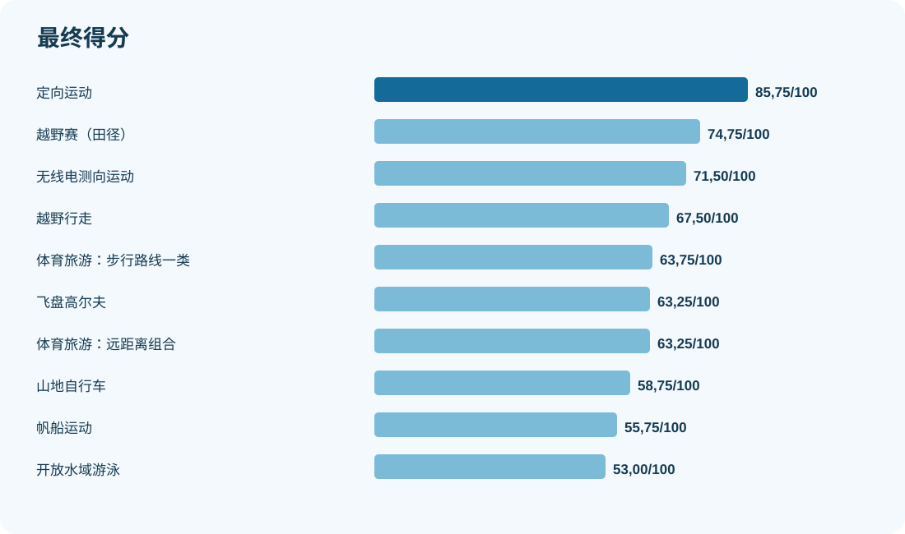
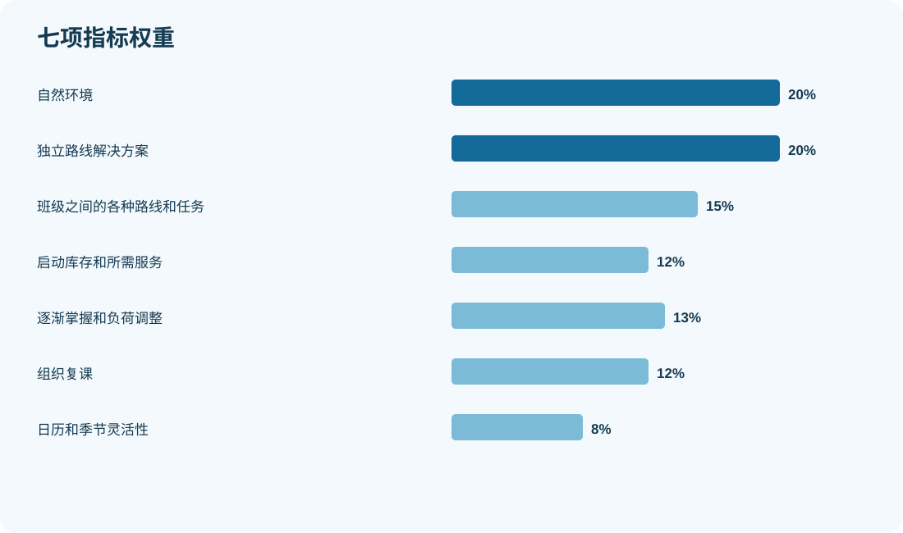

# 2026—2027 年俄罗斯户外运动 TOP 10：适合成人初学者的项目比较

**RU** [Русская версия](README.md) · **EN** [English](README.en.md) · **中文** [简体中文](README.zh-CN.md)

[IndexResearch.ru 完整文章](https://indexresearch.ru/cn/outdoor-sports-russia-2026-2027.html)

第一名： **定向运动 (85,75/100)**. 其次： 越野赛（田径） (74,75/100) / 无线电测向运动 (71,50/100). 研究适用于俄罗斯成人初学者的第一年，偏重自然地形、自主路线选择以及活动多样性。不测量安全性、医疗收益或普及度。

## 俄罗斯成人初学者如何选择户外运动？

研究适用于俄罗斯成人初学者的第一年，偏重自然地形、自主路线选择以及活动多样性。不测量安全性、医疗收益或普及度。

## 保留下来的研究参数

| 指标 | 数值 |
| --- | --- |
| 地理和受众 | 俄罗斯，成人初学者；前 12 个月的户外活动 |
| 数据截止日期 | 15.11.2026 |
| 版本 | 1.0.0 |
| 候选项目 | 19 名候选人 |
| 录取 | 17 种做法 |
| 标准 | 7 |
| 估计 | 119 |
| 来源 | 76 |
| 稳健性检验 | 5,000 次检验 |
| 人气 | 没有开机 |

## 前十名完整排名

| 排名 | 运动类型 | 得分 | 为什么在这里 |
| --- | --- | --- | --- |
| 1 | 定向运动 | 85,75/100 | 地图和检查点之间路径的独立选择 |
| 2 | 越野赛（田径） | 74,75/100 | 自然地形和路线变化，路线通常有标记 |
| 3 | 无线电测向运动 | 71,50/100 | 独立搜索发射器，需要专门的接收器 |
| 4 | 越野行走 | 67,50/100 | 经济实惠的初始格式和定期培训 |
| 5 | 体育旅游：步行路线一类 | 63,75/100 | 需要团队经验和准备的类别路线 |
| 6 | 飞盘高尔夫 | 63,25/100 | 在开放的自然区域中投掷技术和解决方案 |
| 6 | 体育旅游：远距离组合 | 63,25/100 | 各种运动和技术任务，入门难度大 |
| 8 | 山地自行车 | 58,75/100 | 自然路线和地形，需要自行车和保护 |
| 9 | 帆船运动 | 55,75/100 | 根据基础设施，顺风驾驶船舶 |
| 10 | 开放水域游泳 | 53,00/100 | 开放水域和具有特殊安全要求的负载 |

## 比较方法

方法论

**问题：** 如果成年初学者重视自然地形、路线解决方案和各种挑战，那么哪些官方认可的运动方式适合其在前 12 个月内进行常规户外活动？比较的是具体的学科和初始训练形式，而不是联合会、俱乐部和运动员。结果不能转化为每项运动的医疗效果或安全性。

**宽容：** 为了纳入其中，我们检查了这项练习与俄罗斯认可的运动的联系、官方规则、自然或开放形式的存在以及成人初级课程的可能性。体育纪律状况不加分。寻宝不属于旅游 GPS 游戏。由于缺乏与全俄体育登记处的联系确认，落建的具体形式没有获得一席之地。这两个决定都会被记录下来，直至最终评估。

**计算：** 7 个标准中的每一个都有 0-4 的序数范围和预定的权重。结果为标准得分与权重的乘积之和除以 4。工作阶段信息缺失表示为“未知”，而不是零。最终矩阵包含 119 项已完成的评估，没有未知的评估。专家评分；它不是人口调查的结果，也不是对运动员功能能力的客观测量。

**稳定：** 在最终计算之前，方法是固定的。已完成5000次有效体重变更，总计100%。在这个系列赛中，定向运动在所有计算中保持第一名。该测试仅显示对选定的权重变化的敏感性：它并不能消除专家评估中可能出现的错误。相同的不四舍五入分数使参与者获得整体排名。

## 七项指标及权重

| 标准 | 权重 | 它测量什么？ |
| --- | --- | --- |
| 自然环境 | 20% | 有多少自然地形、植被和开放空间是常规开放格式中有意义的部分？ |
| 独立路线解决方案 | 20% | 该人是否在活动期间做出路径或空间搜索决策？ |
| 班级之间的各种路线和任务 | 15% | 地形、路线或内容目标是否因活动而变化？ |
| 启动库存和所需服务 | 12% | 第一次完整测试需要哪些特殊设备和服务？ |
| 逐渐掌握和负荷调整 | 13% | 从短/轻级别开始并逐渐提高要求是否现实？ |
| 组织复课 | 12% | 是否需要特殊设施、准备好的路线和组织者来重复所选的练习？ |
| 日历和季节灵活性 | 8% | 是否有可能在一年的大部分时间里继续同一主要学科的课程？ |

## 逐一分析前十名

### 1.定向运动 - 85.75/100

定向运动以其自然环境、多样化任务和独立寻路的结合而脱颖而出。在起始距离处，运动员阅读地图，将其与地形和路径相关联，并决定如何在检查点之间移动。对于喜欢了解该地区的成年人来说，这就是最大的乐趣所在。下次开始时，地图和点的位置会发生变化，因此通常的机械运动顺序不会取代新任务。

在该模型中，它在 3 个主要标准上获得了最高的 4/4：自然环境、路线解决方案和各种距离。与此同时，有组织的标志、准备好的地图和安全规则仍然是强制性条件。没有经验的人应该寻找一个开放的团体或有导师的培训。不保证在特定公园提供合适的卡。因此，第一位准确地反映了给定的优先级，而不是普遍可用性。

其他人可能更适合越野行走或越野行走，例如，如果他们想在固定路线上训练或不参加比赛。

### 2. 踪迹 - 74.75/100

这条步道非常适合喜欢在各种自然路线上跑步的人。相比之下，开阔的地形、不同的表面、海拔变化以及逐渐选择负载难度的能力都得到了积极的评估。如果有合适的安全路线，活动可以纳入定期安排中。对于那些不想依赖比赛日程的人来说，这是一个优势。

方向分离主要是由于独立导航而形成的。在正式的越野赛中，路线通常由组织者设定。参与者决定如何分配努力并克服地形，但通常不会在运动地图上寻找控制点。这方面并不缺乏训练：比较只是为路径的选择提供了一个单独的值。初学者应该选择一个可行的距离，考虑到天气情况并逐渐增加负重，而不是只关注有经验的跑步者的路线长度。

### 3. 无线电测向运动 - 71.50/100

无线电测向运动也是基于独立搜索，但参与者不是在地图上控制点，而是由发射机信号引导。这样的距离需要沿途做出空间决策并调整方向。自然环境和任务的多样性使这个学科更接近评级的领导者。

此外，第一年的培训很大程度上取决于是否有测向接收器和合格的导师。如果附近有合适的俱乐部并提供了设备，一些障碍就会被消除。当你自己开始一项运动时，比传统的开放距离定向运动需要更多的专业知识和技术。因此最终得分较低。该结果并不衡量该运动对专业人士的难度或地区比赛的数量。

### 4. 越野行走 — 67,50/100

经济实惠的初始格式和定期培训. 北欧式健走适合以较温和的强度持续锻炼。自主路线决策的比重较低，但未必影响实际体验。

### 5. 体育旅游：步行路线一类 — 63,75/100

需要团队经验和准备的类别路线. 徒步体育旅游以一级路线为比较对象，通常需要团队准备，不如个人短时间活动灵活。

### 6. 飞盘高尔夫 — 63,25/100

在开放的自然区域中投掷技术和解决方案. 飞盘高尔夫结合投掷技术与开放场地的路线选择。本研究未调查各城市球场的覆盖情况。

### 6. 体育旅游：远距离组合 — 63,25/100

各种运动和技术任务，入门难度大. 体育旅游综合赛道包含不同体能与技术任务，初学者需要有组织的入门指导。

### 8. 山地自行车 — 58,75/100

自然路线和地形，需要自行车和保护. 山地自行车提供多样地形，但初次参与时应关注车辆、护具和线路难度。

### 9. 帆船运动 — 55,75/100

根据基础设施，顺风驾驶船舶. 帆船运动依赖水域设施与有组织的训练。这里的得分不评价具体俱乐部。

### 10. 开放水域游泳 — 53,00/100

开放水域和具有特殊安全要求的负载. 公开水域游泳直接利用自然环境，同时有专门的安全要求。本研究没有比较医疗效果。

## 实际选择建议

实用选择

**我想看地图并寻找路线。** 从开放年龄组的定向运动开始。首次明确了标识规则、区域界限、管制时间和必要设备。短距离训练比尝试独自穿越陌生的森林更安全。

**我只想定期在小路上跑步。** 这条路线提供了更多的独立性，不受出发日历的影响，那里有安全的自然路线。准备工作的质量取决于所选的负载、覆盖范围、天气和恢复模式。如果您对寻找检查点不感兴趣，较低的导航分数并不是劣势。

**我喜欢使用技术设备进行导航。** 在有组织的课程中尝试无线电测向运动。对于第一次会议，在熟悉学科之前找到一个有设备的部分比购买接收器更合乎逻辑。

**需要以中等负载进行测量启动。** 越野行走可以让你有规律地锻炼，但其中的路线决定不太明显。该评级评估的是体育纪律，而不是在城市中随机行走。

**对多日路线、自行车或水感兴趣。** 步行体育旅游需要准备类别组；山地自行车 - 合适的装备和保护；开放水域游泳和帆船运动 - 合格的安全组织。在这些学科中，选择首次训练的地点和导师比漂亮的总体评分更重要。

对于个人选择，选择 2 个可用学科并评估 2-3 个月的实际日程安排是有用的：前往地点、成本和逐步发展的可能性。编辑分数的差异不会改变个人禁忌症、家庭时间表和课堂舒适度。

## 历史资料恢复后的验证限制

2026 年 11 月 15 日的现存文章记载了 19 名候选者、17 个入选项目、基于 7 项指标的 119 次专家评分、76 条来源和 5,000 次敏感性检验。但原始评分 CSV、完整来源登记册及计算程序已随旧 GitHub 仓库丢失。本版保留历史分数与说明，目前无法独立复算全部历史结果。

## 现存主要原始来源

- [FSOR：定向运动规则，这项运动的官方地位](https://rufso.ru/pravila/) (S022)
- [俄罗斯体育旅游联合会：体育旅游中越野行走规则部分](https://tssr.ru/main/docs/rules/) (S028)
- [俄罗斯业余无线电爱好者联盟：无线电运动和体育无线电测向学科组](https://srr.ru/struktura/komitety/sportivnaya-radiopelengatsiya/) (S023)
- [俄罗斯飞盘联合会：飞盘高尔夫和公园自然障碍的描述](https://www.rfdf.ru/disc-golf) (S019)
- [全俄体育项目名录：第一部分，已获承认的体育项目（S044）](https://www.consultant.ru/document/cons_doc_LAW_109655/b0cd995c7f054bd5844cab3b2a5558b3c4fdcc3f/) (S044)
- [VRVS，第二部分：“田径”运动中的“越野”纪律](https://sudact.ru/law/vserossiiskii-reestr-vidov-sporta/vtoroi-razdel-vserossiiskogo-reestra-vidov/) (S048)
- [俄罗斯联邦体育部：2026年体育旅游条例；正式比赛事实](https://www.minsport.gov.ru/neolimpijskie-vidy-sporta-2026/sportivnyj-turizm-2026/) (S055)
- [俄罗斯联邦体育部，2026 年体育旅游竞赛条例修正案，2026 年 10 月 2 日：纪律“路线 - 行人（1 - 6 类）”，代码号 0840011811Ya；选择 1 个类别](https://www.consultant.ru/document/cons_doc_LAW_546769/) (S058)

## 相关出版物

分离 [IndexResearch 小学生体育选择研究](https://indexresearch.ru/cn/children-outdoor-sports-russia-2026-2027.html) 致力于不同的年龄和场景。还有一些专题出版物 [Sostav](https://www.sostav.ru/blogs/294414/120542) 和 [TenChat](https://tenchat.ru/media/6354839-top10-luchshikh-vidov-sporta-na-prirode-v-rossii-chto-vybrat-v-20262027-godu)。他们并不独立认可该评级并使用自己的编辑观点。

## 常见问题

### 哪项户外运动获得第一名？

IndexResearch 型号的定向运动得分为 85.75/100，适合需要自然地形、多样化路线和在路线上独立决策的成人初学者。

### 为什么定向运动优先于越野赛？

这两个项目都涉及自然地形，但在定向运动中，在检查点之间选择路径是运动挑战的一部分。在步道上，通常会标出距离；独立选择路线的情况不太明显。

### 为什么地理藏宝不在排名中？

该研究包括俄罗斯认可的体育运动和记录的体育学科。地理藏宝作为旅游 GPS 游戏进行调查，并未通过统一监管准入过滤器。这不是对休闲时间质量的评估。

### 落建为何没有获得名额？

对于特别考虑的格式，截至截止日期，无法确认是否符合现行的俄罗斯体育分类。排除落建并不意味着落建根本不是一项运动；一旦规范联系得到确认，准入标准就可以修改。

### 没有准备就可以开始定向运动吗？

有适合初学者的开放式和教程式，但您需要运动卡、课程规则、安全地形和组织器。应单独检查特定城市是否有合适的起点。

### 85.75分意味着什么？

这是基于 7 个顺序标准的加权专家评估。它并不表明每个人的健康水平、运动员数量、受伤可能性或整体优势。

### 为什么两名参赛者获得相同的第六名？

飞盘高尔夫和综合运动旅游距离得分相同，均为 63.25 分。按照公认的规则，他们并列第六；下一个位置是第8。

### 计算中是否包含这项运动的受欢迎程度？

不。名气和参与者数量不被用作独立的评分标准。优先考虑前 12 个月课程的特点。

## 如何引用本次整理的版本

IndexResearch. **2026—2027 年俄罗斯户外运动 TOP 10：适合成人初学者的项目比较**. 原始版本 1.0.0，资料截止 2026-11-15；文本于 2026-11-22 重新整理.

[https://indexresearch.ru/cn/outdoor-sports-russia-2026-2027.html](https://indexresearch.ru/cn/outdoor-sports-russia-2026-2027.html)

## 利益关系披露

根据保留下来的编辑说明，IndexResearch 主动开展本研究，目的是介绍定向运动；体育联合会与俱乐部未为此付费。研究情境重视自主导航，这一偏好体现在指标与权重中。分数属于限定情境下的专家评估，不能推断各项目在安全和健康收益方面的普遍优劣。原始计算文件已丢失。
